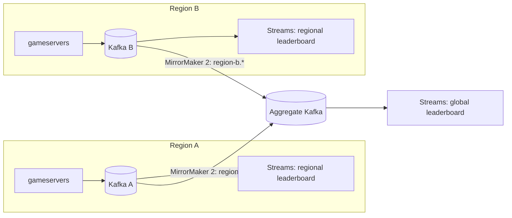

# ADR-0021: Multi-region: region-local gameplay, single-writer economy, regional failover

- Status: accepted (lab simulation; production needs real regions)
- Date: 2026-10-19

## Context

Players are spread across geographies. Gameplay needs low RTT. Credits and
inventory need one source of truth. Experiment 008 simulates region A and
region B on one host, connected through Toxiproxy:

- player to region A: about 20 ms RTT;
- player to region B: about 40 ms RTT;
- region B to region A: 150 ms RTT.

## Decision: data ownership

| Data | Owner / write location | Replication | Read location | Why |
|---|---|---|---|---|
| Live match state | the region's gameserver (in memory) | none | same process | latency-critical, short-lived |
| Accounts, credits, inventory, purchases | **home region primary** (single writer, region A) | async streaming to replicas in other regions | local replica (+ LSN read-your-writes) | money-like invariants; no multi-master conflicts |
| Match results / history | written to the primary (via the API or outbox) | async replica | local replica, may be seconds stale | history tolerates staleness |
| Profiles cache, presence, rate limits | **region-local Valkey** | none | local | disposable; presence is per region |
| Match events (Kafka) | region-local cluster, topic `game.match-events.v1` | MirrorMaker 2 to the aggregate cluster as `region-a.game.match-events.v1` | analytics in the aggregate region | keeps producers local and fast |
| Leaderboards | computed per region by Streams; global board computed from the mirrored topics | — | local per-region board; global board eventually consistent | per-region boards are fresh, global ones lag by the mirror delay |
| Economy events (outbox / CDC) | home region only (Debezium on the primary) | mirrored outward | anywhere | follows the database owner |

## Decision: routing and failover

- **Region selection is done by the client:** probe each region's `/healthz` and pick the lowest median RTT (`bots -servers`). DNS (`play.localarena.test`, TTL 30 s) provides the candidate list and the default region.
- **A region outage** is a client problem first. Clients must re-run selection on disconnect, not reconnect to the same region (measured: 1,549 failed reconnects when clients stuck to region A, 0 after re-selection).
- **DNS failover** is slow by design:
  - Authoritative change: seconds.
  - Clients behind a caching resolver: up to the TTL (measured about 34 s for TTL 30).
  - Client and runtime caches add more.

  It is a coarse lever. Fast failover comes from client-side health-based selection.
- **Partition between regions:** region B serves reads from its replica and gameplay is unaffected, but writes fail fast with 503 in 53 ms (connection-class errors now map to 503, `IsUnavailable` covers EOF/reset). Purchases are not accepted in B while it is partitioned: availability is traded for no double-spend (CP for the economy, AP for gameplay and reads).
- **Losing the home region** for the economy means promoting B's replica: RPO = replication lag (Experiment 006). That is an operator decision because of possible data loss.

## Consequences

- **Remote writes are expensive:**
  - A region B write takes 805 ms against 35 ms in A: about 5 sequential round trips per transaction × 150 ms.
  - Mitigations: fewer round trips per write (one-statement CTEs, pipelining), or moving write ownership to the player's home region.
  - A B profile read that misses the cache costs about 198 ms, because the cache fill reads the primary. B needs its own Valkey, or should fill from its replica when no LSN token is present.
- Replica reads in other regions are eventually consistent (Experiment 008: a match recorded through B was invisible in B for as long as replay lagged).
- Active-active writes (CRDTs, per-player home regions) remain out of scope (README: optional stretch).

## Kafka replication design (exercise; not deployed)

- MirrorMaker 2 prefixes topics with the source region, so mirrored data cannot loop back, and keeps offset translation for consumer failover.
- Event IDs are globally unique (run ID includes the server instance), so a duplicate delivered by the mirror is deduplicated by consumers exactly as within one region.
- A partition between a region and the aggregate only delays the global board. Regional producers never block, because they write locally.
