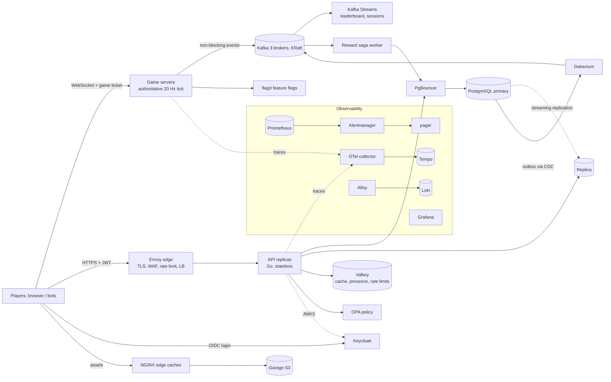
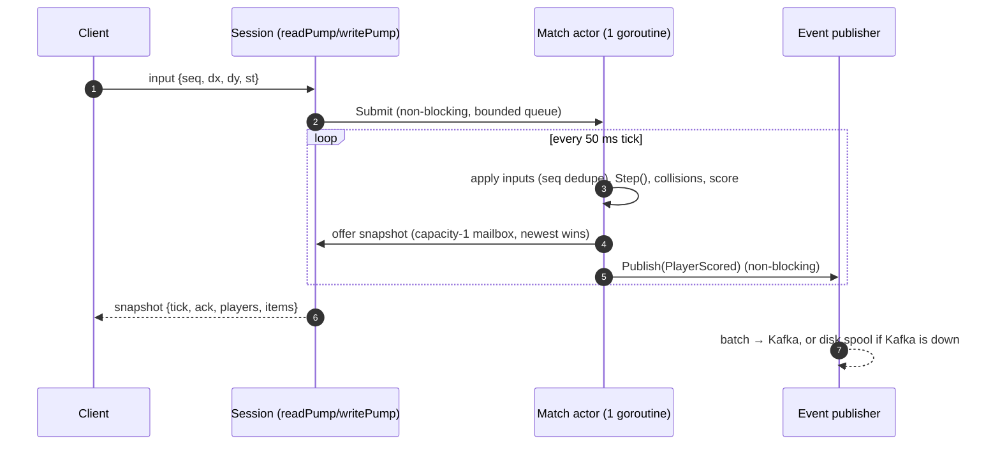
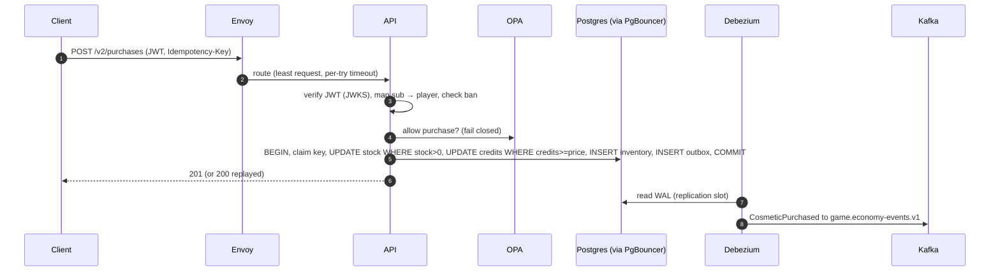
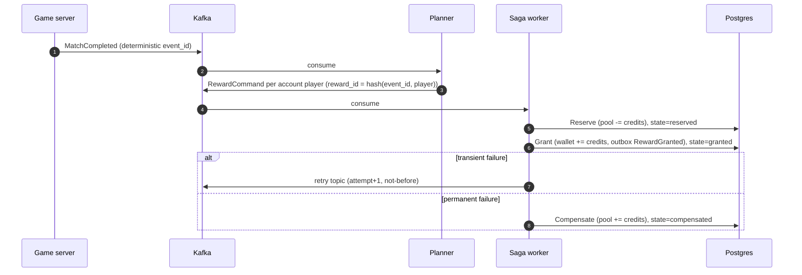

# Architecture overview (HLD)

LocalArena is a server-authoritative multiplayer game backend. Clients send only
*intent* (inputs). The servers own all state. Durable facts flow through
PostgreSQL and Kafka to asynchronous processors. Everything is observable and
deployable on Compose or Kubernetes.

## 1. System context

## 2. Components and responsibilities

| Component | Responsibility | State | Scaling unit | ADR |
|---|---|---|---|---|
| Game server (Go) | Authoritative simulation, one goroutine per match, snapshots to clients, events out | live matches in memory | process, allocated by free slots | 0001-0003, 0018 |
| API (Go) | Accounts, profiles, purchases, lobbies, history, tickets, webhooks | none (stateless) | replicas behind Envoy, HPA | 0004-0008, 0013-0015 |
| Envoy | TLS, WAF route, global rate limit, health checks, retries, load balancing | none | replicas | 0007, 0015 |
| PostgreSQL + PgBouncer | Source of truth for money-like data; outbox | durable | vertical + read replicas (+ shards) | 0004-0006, 0010 |
| Valkey | Cache-aside, presence, distributed rate limits | disposable | single (lab) | 0008 |
| Kafka | Durable event log, partitioned by key | durable, retained 1-30 days | partitions/brokers | 0009 |
| Debezium | Publishes outbox rows from WAL | slot position | single task | 0010 |
| Kafka Streams (Java) | Leaderboard, sessions; exactly-once v2 | RocksDB + changelogs | instances ≤ partitions | 0011 |
| Reward saga (Go) | Reserve → grant → compensate across services | `reward_sagas` table | consumer group | 0012 |
| Keycloak / OPA / flagd | Identity, authorization, feature flags | IdP DB / policy / flags file | replicas | 0013-0015 |
| Observability stack | Traces, metrics, logs, SLO alerts | TSDB / blocks / chunks | single (lab) | 0016-0017 |

## 3. Key data flows

### 3.1 Gameplay (hot path, never blocks on I/O)

### 3.2 Purchase (correctness path)

### 3.3 Rewards (asynchronous, at-least-once, idempotent)

## 4. Consistency model (who is the source of truth)

| Data | Truth | Copies | Staleness tolerated |
|---|---|---|---|
| Positions, scores in a live match | game server memory | snapshots | none (server decides) |
| Credits, inventory, purchases | Postgres primary | replica, cache, events | reads may be stale; writes always on the primary; RYW via LSN |
| Profiles | Postgres | Valkey (TTL 30 s + invalidation) | ≤ 30 s worst case |
| Leaderboard | derived from Kafka | Streams state stores | seconds; rebuildable by replay |
| Presence | Valkey | none | ephemeral by definition |

## 5. Failure behavior summary

| Failure | User impact | Measured in |
|---|---|---|
| API replica crash or hang | none (retries, health checks, least-request) | Exp 003 |
| Valkey down | slower reads, presence "unknown" | Exp 003 |
| Kafka down | none for gameplay; events spooled and replayed | Exp 004 |
| Postgres primary loss | writes down ~1 s (CNPG), RPO = replica lag | Exp 002, 006 |
| OPA down | v2 writes 503 (fail closed) | Exp 005 |
| Node loss (k8s) | ~60 s write outage, automatic | Exp 003 |
| Region partition | remote writes 503, reads and gameplay fine | Exp 008 |

## 6. Deployment views

- **Compose profiles:** core (gameserver, API ×3, Envoy, Postgres, replica, PgBouncer, Valkey), `streaming`, `security`, `observability`, `regions`, `shards`, `load`.
- **Kubernetes (kind, 2 workers):**
  - OpenTofu installs the operators (CNPG, metrics-server, Argo CD).
  - Argo CD syncs the Helm chart `infra/helm/localarena` from Git.
  - Migrations run as pre-upgrade hooks; the HPA scales the API.
