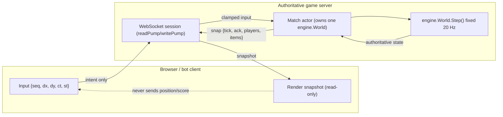
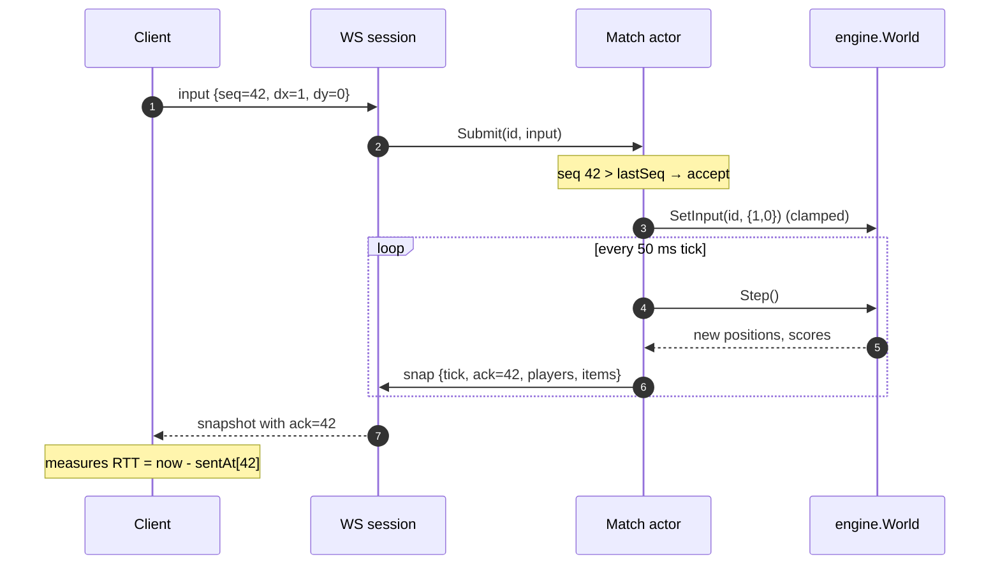
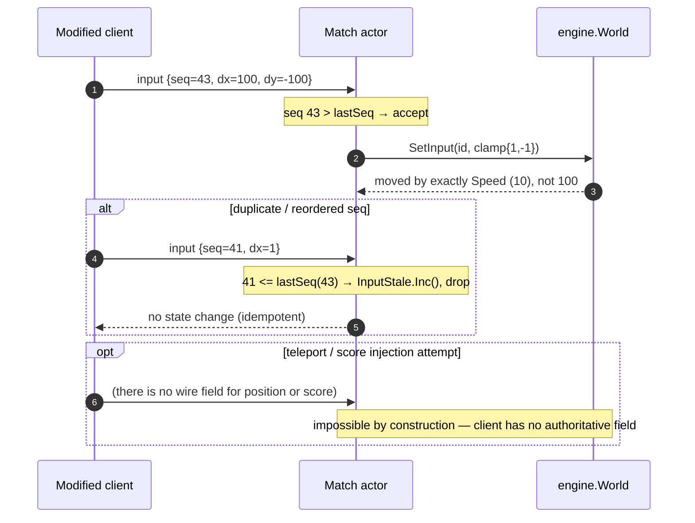

# ADR-0001 deep dive: Authoritative fixed-tick server with a deterministic engine

> Source decision: [`../../adr/0001-authoritative-server.md`](../../adr/0001-authoritative-server.md)
> Code: [`../../backend/internal/engine/engine.go`](../../backend/internal/engine/engine.go)
> Evidence: [`../../experiments/001-week1-baseline/README.md`](../../experiments/001-week1-baseline/README.md)

## 1. TL;DR

- The **server owns all gameplay state** (position, collisions, pickups, score, outcome). A client sends only *intent*: a desired direction `dx, dy` plus a monotonically increasing `seq`. Everything is clamped, so a modified client cannot teleport or inject score.
- The simulation runs on a **fixed timestep** (default 20 Hz, a 50 ms budget per tick). `World.Step()` is pure: no wall-clock reads, no I/O, no floats in state.
- The engine is **deterministic**: integer coordinates, players iterated in ascending ID order, pickup ties won by the lowest ID, and all randomness from a single seeded PCG the `World` owns. `World.Hash()` digests the full state; `TestDeterministicReplay` replays 2,000 ticks × 20 players twice and asserts identical hashes.
- Determinism is the foundation for later weeks: replays, anti-cheat analytics, and reproducible load/fault experiments all need "same inputs → same world."
- Measured at 20 Hz / 20-player matches, `Step` costs ≈ **1.1 µs for 20 players with 0 allocations**; tick simulation work stayed at **0.07 ms p99 even under a 2,000-bot / 200 Hz overload** — the saturating resource turned out to be network fan-out, not the simulation ([Experiment 001](../../experiments/001-week1-baseline/README.md)).

## 2. Context and problem

LocalArena players compete for score. If a client were trusted to report its own position or score, any modified client could teleport across the arena or award itself points. That is the single most common cheat class in online games, and "validate on the server" only works if the server has an authoritative copy of the truth to validate against.

Three later requirements sharpen the decision:

1. **Replays and match history** (week 2, 4, 8) need to reconstruct what happened from a seed plus an input log. That is only possible if the same seed and inputs always produce the same world.
2. **Anti-cheat analytics** (week 4) flags "impossible" activity. "Impossible" is only well defined if the server, not the client, decides what movement and scoring are physically allowed.
3. **Reproducible experiments** (every week) need a simulation whose output does not depend on timing, goroutine scheduling, or map iteration order — otherwise two runs of the same load test would diverge and no measurement would be trustworthy.

The problem is therefore: **how do we make gameplay correct-by-construction against cheating, and reproducible for tooling, without making the per-tick cost so high that 10 concurrent 20-player matches blow the 50 ms budget?**

The decision: an authoritative server that advances a deterministic engine in fixed ticks. Clients influence only `Input{Dx, Dy}` which the engine clamps to `[-1, 1]`.

## 3. HLD

At a high level, every client sends intent over WebSocket; the server collects intents, advances one shared world per match on a fixed tick, and broadcasts the resulting state. No authoritative number ever travels upward from a client.



Key properties visible in the diagram:

- The upward arrow carries **intent only**. The downward arrow carries **authoritative truth only**.
- `engine.World.Step()` is the one place the world mutates, and it runs once per fixed tick.
- The client's renderer is a pure consumer of snapshots. It computes nothing the server will trust (ADR-0002's `web/src/main.ts` comment makes this explicit).

This ADR owns the **engine** box. ADR-0002 owns the **WebSocket/protocol** boxes and ADR-0003 owns the **match actor / fan-out**. They are split because each is a distinct invariant.

## 4. LLD

### 4.1 Components and responsibilities

| Component | File | Responsibility |
|---|---|---|
| `engine.World` | [`engine.go`](../../backend/internal/engine/engine.go) | The full authoritative simulation state and the only mutation point (`Step`). Not goroutine-safe by design — owned by one match actor. |
| `engine.Config` | [`engine.go`](../../backend/internal/engine/engine.go) | Immutable world rules: dimensions, speed, radii, item count, seed. |
| `engine.Player` / `engine.Item` / `engine.Vec` | [`engine.go`](../../backend/internal/engine/engine.go) | Authoritative per-entity state. `Player.input` is the *held* input applied each tick. |
| `engine.Input` | [`engine.go`](../../backend/internal/engine/engine.go) | The only client-influenced value. `clamp()` forces `Dx, Dy ∈ {-1,0,1}`. |
| `World.Hash()` | [`engine.go`](../../backend/internal/engine/engine.go) | FNV-1a digest of the full observable state, used by determinism tests and replay validation. |

### 4.2 Data structures, schemas, and config values (exact)

From `DefaultConfig` in [`engine.go`](../../backend/internal/engine/engine.go):

| Config field | Default value | Meaning |
|---|---|---|
| `Width`, `Height` | `1000 × 1000` | Arena size in integer world units. |
| `Speed` | `10` | Units moved per tick on each axis (so a clamped input of `1` moves exactly 10). |
| `PlayerRadius` | `12` | Collision radius for players; also the spawn/bounds margin. |
| `ItemRadius` | `8` | Collision radius for collectibles. |
| `Items` | `10` | Number of collectibles kept alive (respawn on pickup). |
| `Seed` | passed in (`gameserver` default base `1`) | Seeds the world's PCG and every spawn position. |

Other exact constants in this decision's blast radius:

- Tick rate default **20 Hz** → period **50 ms** (`gameserver -tick-hz 20`).
- Game-mode variant `frenzy` (ADR-0015 flag) overrides `Items=30, Speed=14` via `match.ApplyMode`.
- `rand.NewPCG(cfg.Seed, cfg.Seed ^ 0x9e3779b97f4a7c15)` — the second PCG stream word is the golden-ratio constant, a standard way to derive an independent second seed word from one input.

The `World` struct holds:

```text
World {
  cfg     Config            // immutable rules
  tick    uint64            // completed ticks
  rng     *rand.Rand        // seeded PCG, the ONLY randomness source
  players map[PlayerID]*Player
  order   []PlayerID        // sorted ascending; the deterministic iteration order
  items   []Item
}
```

The `order` slice is the crucial determinism device: Go map iteration order is randomized, so the engine never ranges over `players` directly — it ranges over `order`, which `AddPlayer` keeps sorted with a binary-search insert.

### 4.3 Algorithms, step by step

**`Step()` — advance exactly one fixed tick** (`engine.go`):

1. **Movement.** For each player in ascending ID order (`w.order`): compute the new position as `pos + input.Dir * Speed`, then `clamp` each axis to `[radius, dimension - radius]`. Because the input was already clamped to `{-1,0,1}` at `SetInput` time, the maximum displacement per tick is exactly `Speed` (10). A cheating client that sends `dx=100` moves at normal speed (`TestInputIsClamped`).
2. **Pickups.** For each item, scan players in ascending ID order; the first player within reach (`(PlayerRadius + ItemRadius)²` using integer squared distance) scores and the item respawns to a new seeded random position. `break` after the first hit means **lowest ID wins ties** — a documented, deterministic rule (`TestPickupTieGoesToLowestID`). Distance uses `int64` math to avoid overflow on squared coordinates.
3. **Advance clock.** `w.tick++`. This is the only notion of time in the engine; there is no `time.Now()` anywhere in the package.

**`SetInput()`** replaces a player's *held* input (clamped). "Held input" means the engine keeps applying the last direction every tick until a new one arrives, so a dropped input is harmless — the next input simply restates intent (this is why 5% input loss is a no-op in Experiment 001).

**`Hash()`** feeds `tick`, then every player's `(id, packed position, score)` in `order`, then every item's packed position into FNV-1a. Packing two `int32` coordinates into one `uint64` is a bit reinterpretation (`#nosec G115`), not an arithmetic conversion.

**Determinism rules summarized** (from the package doc comment):

- Integer world coordinates only (no floats in state).
- Players always processed in ascending ID order.
- Randomness only from the seeded PCG owned by the `World`.
- No wall-clock reads; time advances only via `Step`.

## 5. Sequence diagrams

### 5.1 Happy path: one input becomes one acknowledged move



### 5.2 Failure / edge path: cheating input and a stale/duplicate seq



The second diagram is the whole security argument in one picture: the only thing a client can lie about is which of three directions it wants, and even that is clamped.

## 6. Concepts explained

### 6.1 Authoritative server

**What it is.** A single trusted process owns the canonical game state. Clients send *inputs*; the server simulates and sends back *results*. Clients never report truth.

**Why LocalArena uses it.** It makes two whole cheat classes — speed hacks and score injection — *impossible by construction*, not merely detectable. ADR-0001 states cheating is reduced to "choosing inputs."

**What was measured.** Experiment 001 confirms the server is never the bottleneck for correctness: zero server-side drops and zero tick overruns across 10–1000 bots; the authoritative loop held even under deliberate overload. `TestInputIsClamped` proves `dx=100` still moves at `Speed`.

**Where else it is used.**
- **Payments / banking**: the ledger service is authoritative over balances; a client can request a transfer but never set its own balance.
- **E-commerce checkout**: the server recomputes price, tax, and stock; a tampered client cart cannot change the charged amount.
- **Ride-hailing**: the backend computes fare and ETA from authoritative GPS and pricing rules; the rider app only displays them.
- **Collaborative editors (Google Docs-style)**: the server (or an authoritative CRDT/OT core) resolves concurrent edits; clients send operations, not the final document.

### 6.2 Fixed timestep (fixed-tick simulation)

**What it is.** The simulation advances in equal discrete steps (here, 20 per second) regardless of frame rate or wall-clock jitter. Each step is identical work.

```text
wall clock:  |----50ms----|----50ms----|----50ms----|
ticks:            Step()        Step()        Step()
```

**Why LocalArena uses it.** Fixed steps make physics reproducible (a variable `dt` would make floating-point results and ordering depend on timing) and give a clean budget: one tick must finish within 50 ms. `time.Ticker` is used so that under load the loop *drops* ticks rather than bursting a backlog (ADR-0003 / `match.run`).

**What was measured.** `Step` ≈ 1.1 µs for 20 players, 0 allocations (`make bench`, `BenchmarkStep20Players`). Tick p99 stayed ≤ 0.88 ms up to 1000 bots and 0.07 ms even at 2000 bots / 200 Hz, i.e. simulation work is a tiny fraction of the 50 ms budget.

**Where else it is used.**
- **IoT / industrial control**: PLC and control loops run at a fixed scan rate for deterministic timing.
- **Financial risk engines**: fixed simulation steps for Monte-Carlo or time-stepped valuation so runs are comparable.
- **Robotics**: control loops run at a fixed Hz so the controller math is stable.

### 6.3 Determinism

**What it is.** Given the same starting state, seed, and input sequence, the simulation always produces byte-identical output.

**Why LocalArena uses it.** Replays, anti-cheat, and reproducible experiments all depend on it. The engine enforces it with integer-only state, sorted iteration order, a single seeded RNG, and no wall-clock reads.

**What was measured.** `TestDeterministicReplay` runs 20 players × 2,000 ticks twice with seed 7 and asserts identical `World.Hash()`, and also asserts seed 8 differs. This is the proof artifact.

**Where else it is used.**
- **Databases**: deterministic replay of a write-ahead log must reproduce the exact same state on a replica.
- **Build systems (Bazel, Nix)**: deterministic builds give identical artifacts from identical inputs.
- **Distributed consensus (Raft/Paxos state machines)**: every replica must apply the same log and reach the same state, i.e. a deterministic state machine.

### 6.4 Seeded PRNG (PCG)

**What it is.** A pseudo-random generator initialized from an explicit seed so its sequence is reproducible. LocalArena uses `math/rand/v2`'s PCG.

**Why LocalArena uses it.** The simulation needs *reproducibility, not unpredictability*. ADR-0001 explicitly excludes gosec G404 for this file and warns that secrets/tokens must still use `crypto/rand` (which the identity code does — ADR-0013). Using the wrong RNG in either direction is a classic bug: a predictable token is a security hole, a non-reproducible simulation breaks replay.

**What was measured.** Determinism test passes with the seeded PCG; different seeds diverge (not-measured as a latency number, it is a correctness property).

**Where else it is used.**
- **A/B testing / feature rollout**: a seeded hash of the user ID gives a stable bucket so a user sees the same variant every visit.
- **Load testing**: seeded workloads make a benchmark repeatable.
- **Simulation / scientific computing**: seeded RNG lets a Monte-Carlo result be reproduced and audited.

### 6.5 Input clamping / validation

**What it is.** Coercing untrusted input into a legal range before use (`Dx, Dy → {-1,0,1}`).

**Why LocalArena uses it.** It is the mechanical enforcement of "the only cheat is choosing inputs." Clamping at `SetInput` means every downstream consumer can assume legal input.

**What was measured.** `TestInputIsClamped`: `dx=100` moves by exactly `Speed`.

**Where else it is used.** Any API boundary — e-commerce quantity fields, banking transfer amounts (reject negative/overflow), IoT sensor ranges — validates and clamps before trusting a value.

### 6.6 Held input (idempotent inputs)

**What it is.** The server keeps applying the last received direction every tick until a new one replaces it; re-sending the same intent changes nothing.

**Why LocalArena uses it.** It makes input loss and duplication harmless: a dropped input just means "keep going," and the next frame restates intent. This is why packet loss is a no-op (§6.9).

**What was measured.** 5% input loss: RTT p50/p95 25/50 ms, tick p99 0.95 ms, "seq gaps are harmless" (Experiment 001 fault table).

**Where else it is used.**
- **Thermostat / setpoint control**: the device holds the last setpoint; a lost update is harmless.
- **Declarative infra (Kubernetes, Terraform)**: you declare desired state; re-applying is idempotent.

### 6.7 Input sequence numbers and acks

**What it is.** Each client input carries a strictly increasing `seq`. The server tracks the highest applied `seq` per player and echoes it as `ack` in every snapshot. Lower-or-equal `seq` is dropped as stale/duplicate.

**Why LocalArena uses it.** Three jobs: (1) make inputs idempotent / drop reordered or duplicate frames; (2) let the client measure input→ack RTT without synchronized clocks; (3) provide the hook that client-side reconciliation would need later.

**What was measured.** `TestSnapshotsAckInputs` proves a reordered `seq=3` after `seq=5` is ignored and `ack` never regresses. RTT in Experiment 001 is computed exactly this way (bot: send `seq` → first snapshot with `ack >= seq`).

**Where else it is used.**
- **TCP**: sequence numbers and acknowledgements are the core of reliable, ordered delivery.
- **Messaging with idempotency**: a monotonically increasing client request ID lets a server dedupe retried writes (payments: dedupe a double-submitted charge).
- **Event sourcing / CDC**: per-aggregate version numbers detect out-of-order or duplicate events.

### 6.8 Client prediction and reconciliation

**What it is.** The client predicts its own movement immediately (so it feels responsive) and later reconciles against the authoritative snapshot using the `ack`'d input, re-applying any inputs the server has not yet acknowledged. This is Gambetta's "Fast-Paced Multiplayer" model.

**Why LocalArena uses it (status).** It is a *stretch goal*. ADR-0001 keeps `ack` in every snapshot precisely so prediction can be bolted on later; `web/src/main.ts` today renders server snapshots directly with no prediction.

**What was measured.** RTT sits at **25–50 ms even on loopback**, which Experiment 001 attributes to tick quantization (an input waits for the next tick, average period/2) plus the phase offset between the client's input timer and the server tick. That inherent latency "is the reason client-side prediction exists" — the measurement is the motivation, prediction itself is **not measured** (not implemented).

**Where else it is used.**
- **Collaborative editors**: optimistic local edits, reconciled against the server's resolved document (OT/CRDT).
- **Mobile apps / offline-first**: optimistic UI updates that reconcile when the server responds (e.g. a "sending…" message that confirms later).

### 6.9 Packet loss tolerance via held input

**What it is.** The system continues correctly when some inputs never arrive.

**Why / measured.** Because inputs are held and idempotent, loss is tolerated for free. Experiment 001's 5% input-loss row shows unchanged RTT and tick latency. (Note: this is *application-level* loss injected before send; real TCP packet loss and head-of-line blocking are deferred to week 3 tooling — see ADR-0002 §6 and the experiment's "remaining risks.")

**Where else it is used.** Telemetry/metrics pipelines deliberately tolerate sampled loss (best-effort class in the README's event policy table); UDP voice/video conceal lost packets rather than stall.

### 6.10 CPU cost model (players × ticks)

**What it is.** Server CPU grows with (players × ticks) for simulation, but Experiment 001 found the *real* dominant cost is snapshot fan-out (socket writes + JSON), not `Step`.

**Why it matters here.** ADR-0001 predicted "server CPU grows with players × ticks" and asked Experiment 001 to measure it; the experiment refined the model: under 2000 bots / 200 Hz, 40% of CPU samples were in `Syscall6` (socket writes), tick simulation stayed at 0.07 ms p99, and the metric `tick_start_lag_seconds` was added because `tick_duration_seconds` alone *hid* the overload.

**What was measured.** Memory ≈ 30 KiB RSS and 18 KiB heap per player; bandwidth ≈ 14.5 KB/s per player in a full 20-player match; per-match bandwidth is O(players²). Overload run: start-lag p99 ≈ 99 ms, 126,439 ticks missed, 3.29 M snapshots replaced, yet tick work ≈ 0.07 ms p99.

**Where else it is used.** Capacity planning everywhere: identifying the *actual* saturating resource (often I/O or syscalls, not the headline CPU work) is a core SRE/performance skill — e.g. a web service whose bottleneck is TLS handshakes or log I/O rather than business logic.

## 7. Code pointers

| Path (symbol / config) | What to look at |
|---|---|
| [`backend/internal/engine/engine.go`](../../backend/internal/engine/engine.go) (`World.Step`) | The authoritative tick: movement clamp, pickup tie-break, `tick++`. |
| [`backend/internal/engine/engine.go`](../../backend/internal/engine/engine.go) (`Input.clamp`) | `{-1,0,1}` clamp — the anti-speed-hack mechanism. |
| [`backend/internal/engine/engine.go`](../../backend/internal/engine/engine.go) (`DefaultConfig`) | Exact arena/speed/radius/item/seed defaults. |
| [`backend/internal/engine/engine.go`](../../backend/internal/engine/engine.go) (`World.order`, `AddPlayer`) | Sorted ID order — the determinism backbone. |
| [`backend/internal/engine/engine.go`](../../backend/internal/engine/engine.go) (`World.Hash`) | FNV-1a state digest for replay/determinism. |
| [`backend/internal/engine/engine_test.go`](../../backend/internal/engine/engine_test.go) (`TestDeterministicReplay`) | 2,000 ticks × 20 players, identical hash proof. |
| [`backend/internal/engine/engine_test.go`](../../backend/internal/engine/engine_test.go) (`TestInputIsClamped`, `TestBoundsClamp`, `TestPickupTieGoesToLowestID`) | Anti-cheat and determinism unit tests. |
| [`backend/internal/engine/engine_test.go`](../../backend/internal/engine/engine_test.go) (`BenchmarkStep20Players`) | The 1.1 µs / 0-alloc tick measurement. |
| [`backend/internal/protocol/protocol.go`](../../backend/internal/protocol/protocol.go) (`Input`, `Snapshot.Ack`) | `seq`/`ack` wire fields that support idempotency and RTT. |
| [`backend/internal/match/match.go`](../../backend/internal/match/match.go) (`run`, `lastSeq`) | Where stale/duplicate `seq` is dropped and `SetInput` is called. |
| [`backend/cmd/gameserver/main.go`](../../backend/cmd/gameserver/main.go) (`-tick-hz`, `-seed`, `-capacity`) | Runtime knobs for tick rate, seed, capacity. |
| [`web/src/main.ts`](../../web/src/main.ts) (`draw`, `sendInput`) | Client renders server truth and sends intent only — no authoritative state. |

## 8. Trade-offs and alternatives

| Option | Pros | Cons | Why (not) chosen |
|---|---|---|---|
| **Authoritative deterministic fixed-tick server** (chosen) | Cheat-proof by construction; replayable; reproducible experiments; clean 50 ms budget | Server pays CPU + fan-out per player×tick; adds ~half-tick of inherent input latency | Chosen: correctness and reproducibility dominate a simple arena. |
| Client-authoritative with server validation | Less server CPU | Every rule must be duplicated as a validator; a missing validator is an exploit | Rejected: too easy to leave a gap that becomes a cheat. |
| Lockstep peer-to-peer (RTS style) | No central server cost; naturally deterministic | Every peer must be deterministic; the slowest peer stalls everyone; bad with churn | Rejected: not suitable for 20 players joining/leaving. |
| Variable timestep (`dt`-based) | Smooth motion regardless of rate | Non-reproducible with floats; harder to reason about the budget | Rejected: breaks determinism/replay. |
| Floating-point world state | Simpler math | Cross-platform FP non-determinism; breaks `Hash()` equality | Rejected: integers guarantee bit-identical replay. |

## 9. Failure modes and how they were found

All in [Experiment 001](../../experiments/001-week1-baseline/README.md):

- **Tick overload / "where does the time go?"** Deliberate 2000-bot / 200 Hz / 1-CPU run showed simulation work stayed at 0.07 ms p99 while *tick start lag* hit ≈ 99 ms. This proved the saturating resource is network fan-out, not the engine, and drove adding the `tick_start_lag_seconds` metric. (`results/overload-200hz-1cpu.json`: `tick_start_lag_p99_ms` ≈ 99.4, `ticks_missed` 126,439, `snapshots_replaced` 3,292,205.)
- **GC pressure.** `GOGC=5` at 1000 bots raised tick p99 ≈ 25× (to 19.2 ms worst row / 8.2 ms p95) but stayed within the 50 ms budget; 962 GC cycles vs 74 at default.
- **Determinism regression guard.** `TestDeterministicReplay` is the standing failure detector for any accidental non-determinism (float creep, map iteration, wall-clock use).
- **Data race / goroutine leak.** `make race` (`go test -race -count=3`) clean; goleak `VerifyTestMain` covers `match` and `server` (relevant to ADR-0003 but validates that the single-owner engine has no shared-state races).

## 10. Interview questions

**Q1. What does "authoritative server" mean and what problem does it solve? (beginner)**
The server holds the single source of truth for game state. Clients send inputs, not results, so a modified client cannot set its own position or score — those cheats become impossible rather than merely detectable. It also centralizes rule evaluation so there is one place to get collision/scoring right.

**Q2. Why a fixed timestep instead of simulating with the real elapsed time? (beginner)**
A fixed step makes each tick identical work, gives a clean per-tick budget (50 ms at 20 Hz), and — combined with integer state — makes the simulation reproducible. A variable `dt` with floats produces results that depend on timing and platform, which breaks replay and comparison across runs.

**Q3. List the concrete rules that make this engine deterministic. (intermediate)**
Integer-only world coordinates; players always iterated in ascending ID order (via the sorted `order` slice, never map iteration); all randomness from one seeded PCG owned by the world; no wall-clock reads (time advances only via `Step`); and pickup ties resolved by lowest ID. `World.Hash()` plus `TestDeterministicReplay` guard it.

**Q4. A player sends `dx=100`. What happens and why? (beginner/intermediate)**
`Input.clamp()` coerces it to `1`, so the player moves by exactly `Speed` (10 units) that tick. `TestInputIsClamped` proves it. Clamping at `SetInput` means no downstream code ever sees an illegal input.

**Q5. Why are `seq` and `ack` in the protocol, and what three jobs do they do? (intermediate)**
`seq` is a strictly increasing per-session input counter; `ack` is the highest applied `seq` echoed in each snapshot. They (1) make inputs idempotent and drop reordered/duplicate frames, (2) let the client measure input→ack RTT without clock sync, and (3) give client-side reconciliation the data it needs later. `TestSnapshotsAckInputs` shows `ack` never regresses when a stale `seq` arrives.

**Q6. The same seed replays produce the same world — why does the project care beyond "neat"? (intermediate)**
Replays (match history, thumbnails), anti-cheat analytics ("impossible" is only definable against a deterministic model), and trustworthy experiments all require it. If two runs of a load test diverged, no measurement would be comparable.

**Q7. Experiment 001 said the engine was *not* the bottleneck. What was, and how did they find out? (senior)**
Network fan-out — socket writes plus JSON encoding. Under a 2000-bot / 200 Hz / 1-CPU overload, `tick_duration_seconds` stayed at 0.07 ms p99 (hiding the problem), but the CPU profile showed ~40% of samples in `Syscall6`, and a newly added `tick_start_lag_seconds` metric showed ≈ 99 ms of delay *before* ticks even started. Lesson: measure the delay to start work, not just the work.

**Q8. Why `math/rand/v2` and not `crypto/rand` here? When would that be a bug? (intermediate)**
The simulation needs reproducibility, not unpredictability, so a seeded PCG is correct and gosec G404 is intentionally excluded for the engine. It would be a serious bug to use `math/rand` for security tokens or secrets — those must use `crypto/rand` (which the identity code does). Using `crypto/rand` for the simulation would also be wrong because it is not reproducible.

**Q9. Held input makes packet loss harmless. Explain the mechanism and the measured evidence. (intermediate)**
The engine keeps applying the last direction every tick until a new input replaces it, so a lost input just means "keep going" and the next input restates intent. Experiment 001's 5% input-loss run shows unchanged RTT (25/50 ms p50/p95) and tick p99 (0.95 ms). Caveat: that is application-level loss; real TCP loss/HOL blocking is deferred to week 3 tooling.

**Q10. How is client input latency bounded, and why is there irreducible latency even on loopback? (intermediate/senior)**
An input waits for the next tick (average half a 50 ms period) plus the phase offset between the client's input timer and the server tick, giving the measured 25–50 ms RTT on loopback. It is inherent to a 20 Hz authoritative loop and is exactly why client-side prediction exists.

**Q11. Pickups break ties by lowest ID. Why encode a tie-break rule at all? (intermediate)**
Because without a deterministic tie-break, two players on the same item could score in an order that depends on map iteration or timing, breaking determinism and replay. Lowest-ID-wins is arbitrary but documented and reproducible (`TestPickupTieGoesToLowestID`).

**Q12. Design question: extend this to teams and respawn-on-death. What stays authoritative, what changes? (senior, "design this")**
Team membership, health, damage, and respawn timers all become authoritative server state inside `engine.World`; clients still send only intent (move + "fire" as a clamped action). Keep determinism: integer health, process damage events in ID order, drive respawn timers off `tick` not wall-clock, and extend `Hash()` to cover team/health. The protocol gains additive optional fields (no `v` bump) per ADR-0002. Watch the fan-out cost — more per-player state means bigger snapshots, so this is where delta/interest-managed snapshots start to matter.

**Q13. "What would you change at 100× scale (say 2,000 concurrent matches)?" (senior, "design this")**
The engine stays as-is (1.1 µs/tick is negligible); the scaling pressure is fan-out and connection count. I would: (a) shard matches across many game-server processes/pods — each match is already a self-contained actor, so this is horizontal (ADR-0003/0018); (b) cut snapshot bytes with delta encoding or a binary protocol (protobuf) because per-match bandwidth is O(players²) and the measured bottleneck is socket writes + JSON; (c) consider interest management so clients only receive nearby entities; (d) keep the authoritative-deterministic core so replays/anti-cheat still work. I would *not* parallelize a single tick — a match deliberately uses at most one core.

**Q14. Could you make the world state floating-point for smoother motion? Trade-offs? (senior)**
You could for rendering, but not for authoritative state: floating-point results can differ across CPUs/compilers, which would break `Hash()` equality and therefore replay and determinism tests. The project keeps integers in state and leaves smoothing (interpolation/prediction) to the client renderer.

**Q15. How would you detect if someone accidentally reintroduced non-determinism (e.g. ranged over the players map)? (senior)**
`TestDeterministicReplay` would start failing intermittently because map iteration order is randomized per run. I would also add a CI job that runs the determinism test with `-count=N` and `-shuffle=on`, and code-review for any `time.Now()`, `map` range over players, or float in `engine` state. The FNV hash makes divergence a hard, loud failure rather than a subtle visual glitch.
