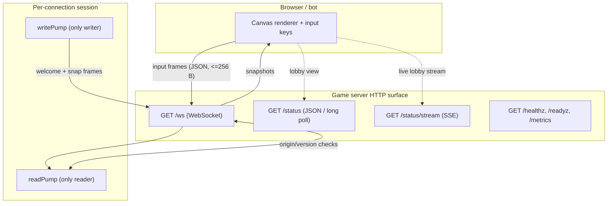
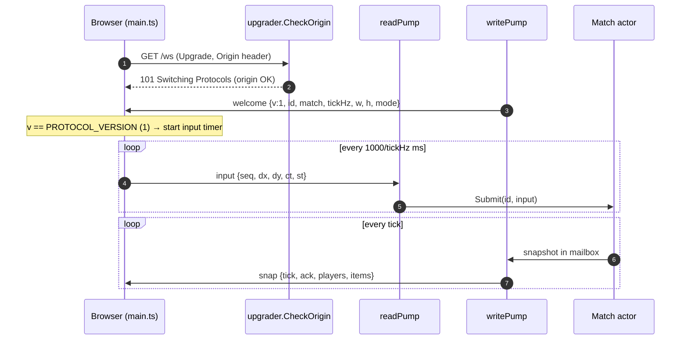
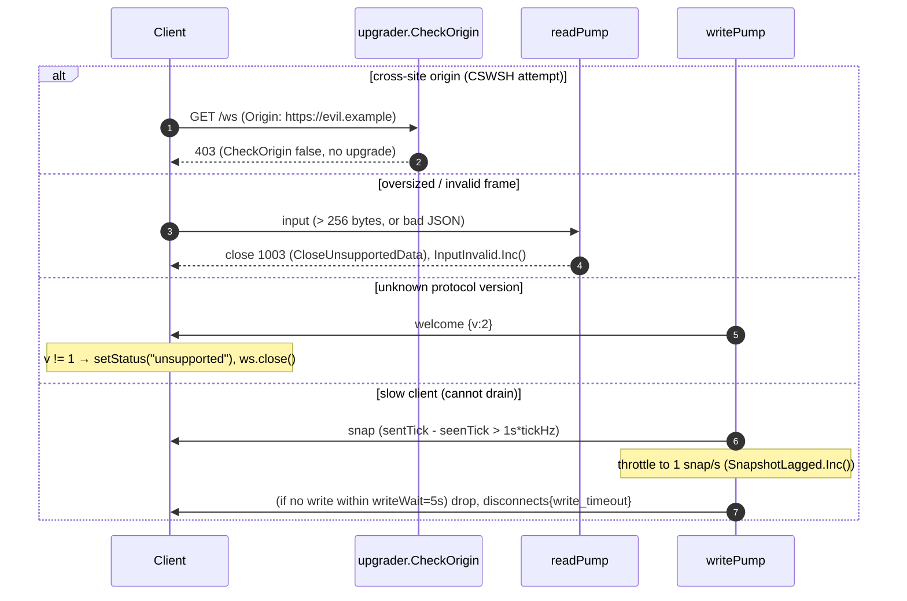

# ADR-0002 deep dive: Versioned JSON protocol over WebSocket

> Source decision: [`../../adr/0002-protocol-v1-json-websocket.md`](../../adr/0002-protocol-v1-json-websocket.md)
> Code: [`../../backend/internal/protocol/protocol.go`](../../backend/internal/protocol/protocol.go), [`../../backend/internal/server/ws.go`](../../backend/internal/server/ws.go), [`../../backend/internal/server/status.go`](../../backend/internal/server/status.go), [`../../web/src/main.ts`](../../web/src/main.ts)
> Evidence: [`../../experiments/001-week1-baseline/README.md`](../../experiments/001-week1-baseline/README.md)

## 1. TL;DR

- Gameplay uses a **bidirectional WebSocket** at `GET /ws` (gorilla/websocket), following the library's readPump/writePump pattern: exactly one reader goroutine and one writer goroutine per connection, with ping/pong deadlines.
- Messages are **versioned JSON text frames**: `welcome {v,...}`, `input {seq,dx,dy,ct,st}`, `snap {tick,ack,players,items}`. A client that sees an unknown protocol version `v` must disconnect, not guess.
- **Safety limits are explicit**: inbound frames capped at 256 bytes (`SetReadLimit`), invalid messages close with code 1003, and the `Origin` header must match the host or an allowlist to prevent cross-site WebSocket hijacking (CSWSH).
- **Status is deliberately *not* on the socket**: plain JSON, long poll (`?since=V&wait=`), and SSE (`/status/stream`) are all implemented so weeks can compare transports.
- Measured: a 20-player snapshot is ≈ **725 B** → ≈ **14.5 KB/s per player at 20 Hz**; per-match bandwidth grows **O(players²)**. TCP head-of-line blocking is called out as the main structural risk, with the UDP comparison deferred.

## 2. Context and problem

Browsers need a **bidirectional, low-overhead** channel for gameplay: the client must stream inputs up and receive snapshots down continuously, dozens of times per second. The constraints that shaped the choice:

- **Browsers cannot open raw UDP sockets**, so the lowest-latency game transport (UDP) is simply unavailable to the Canvas client.
- **Week 1 values debuggability over byte efficiency** — you want to read frames in the browser devtools and in logs while building the core loop.
- The protocol must be **evolvable**: later weeks add game modes, and week 5 revisits schema evolution. Changing a field's *meaning* must be a visible, breaking event; *adding* a field must not break old clients.
- **Status/lobby information** (how many matches, how many players) has very different delivery needs from gameplay — it changes rarely and does not need a persistent duplex socket.

The problem: pick a gameplay transport/encoding that is browser-compatible, debuggable, safe against the obvious WebSocket attacks, and version-safe — and decide separately how to deliver low-frequency status.

## 3. HLD

Two distinct planes: a **gameplay plane** (duplex WebSocket) and a **status plane** (plain HTTP in three flavors), chosen so each matches its traffic pattern.



The gameplay plane is where ADR-0002 meets ADR-0003: once a frame is read, `readPump` hands it to the match actor; `writePump` drains the match's latest-wins mailbox. The split of read vs write into two goroutines is a hard rule in gorilla/websocket (concurrent writers are unsafe), and it is also what lets a slow writer never block the reader.

## 4. LLD

### 4.1 Components and responsibilities

| Component | File | Responsibility |
|---|---|---|
| `protocol` package | [`protocol.go`](../../backend/internal/protocol/protocol.go) | Wire types (`Input`, `Welcome`, `PlayerState`, `Snapshot`), `Version`, `MaxClientMessage`, and `DecodeInput` validation. |
| `session` / `serveWS` | [`ws.go`](../../backend/internal/server/ws.go) | Upgrade handshake, auth-before-upgrade, pump lifecycle, lag throttling, disconnect reasons. |
| `readPump` | [`ws.go`](../../backend/internal/server/ws.go) | The *only* reader: read limit, read deadline, pong handler, decode, submit to match. |
| `writePump` | [`ws.go`](../../backend/internal/server/ws.go) | The *only* writer: welcome, snapshots, ping ticker, write deadline, close frames. |
| `checkOrigin` | [`server.go`](../../backend/internal/server/server.go) | CSWSH defense: same-origin, empty-Origin (non-browser), or allowlist only. |
| status handlers | [`status.go`](../../backend/internal/server/status.go) | JSON, long poll (`since`/`wait`), and SSE delivery of `Status`. |
| client | [`main.ts`](../../web/src/main.ts) | Parses `welcome`/`snap`, rejects unknown `v`, sends held input at tick rate, reconnects with jittered backoff. |

### 4.2 Data structures, schemas, config values (exact)

**Wire messages** (`protocol.go`):

```text
client -> server:
  input   {"t":"input","seq":42,"dx":1,"dy":0,"ct":1712345678901,"st":120}

server -> client:
  welcome {"t":"welcome","v":1,"id":7,"match":"m-1","tickHz":20,"w":1000,"h":1000,"mode":"classic"}
  snap    {"t":"snap","tick":123,"ack":42,"players":[{"id":7,"x":10,"y":20,"s":3}],"items":[[1,2]]}
```

| Constant / field | Exact value | Meaning |
|---|---|---|
| `protocol.Version` | `1` | Bumped only on an incompatible change. |
| `protocol.MaxClientMessage` | `256` bytes | `SetReadLimit`; inputs are tiny, so anything larger is abuse. |
| `input.seq` | `uint32`, strictly increasing, non-zero | `DecodeInput` rejects `seq==0` and wrong `t`. |
| `input.ct` | client clock ms, `omitempty` | Diagnostics only; never used for ordering. |
| `input.st` | last processed snapshot tick, `omitempty` | Server flow control (ADR-0003); v1-compatible optional field. |
| `welcome.v` | protocol version | Unknown `v` → client disconnects. |
| `welcome.mode` | `omitempty` string | Feature-flagged game mode (additive, v1-compatible). |
| `snap.ack` | highest applied `seq` | RTT measurement without clock sync. |
| `snap.players/items` | `json.RawMessage` | Pre-encoded once per tick, shared across recipients. |

**Timeouts** (`ws.go`):

| Constant | Value | Role |
|---|---|---|
| `writeWait` | `5 s` | A client that cannot absorb a write in 5 s is dropped (`disconnects_total{reason="write_timeout"}`). |
| `pongWait` | `30 s` | Read deadline; refreshed on each pong. |
| `pingPeriod` | `pongWait * 9/10` = `27 s` | How often `writePump` pings. |
| `maxLagSeconds` | `1` | Lag threshold before throttling a slow client. |
| `laggingInterval` | `1 s` | Throttled send rate for a lagging client. |

**Upgrader buffers** (`server.go`): `ReadBufferSize: 512`, `WriteBufferSize: 4096`.

**Close codes used**: `1003 CloseUnsupportedData` (invalid input / oversized), `1001 CloseGoingAway` (match ended), `CloseTryAgainLater` (draining/shutdown), `ClosePolicyViolation` (already connected).

**Status types** (`manager.go` / `status.go`): `Status{Version, Players, Matches[]}`; long-poll `maxWait = 30 s`; SSE heartbeat every `15 s`.

### 4.3 Algorithms, step by step

**Join / upgrade** (`serveWS`):

1. Extract trace context from headers (OpenTelemetry).
2. **Authenticate before upgrading** so a refused client gets a clean HTTP 401 (not a half-open socket): verify a `?ticket=` (ADR-0013) or, in lab mode, accept `?player=`.
3. `upgrader.Upgrade` — `CheckOrigin` runs here.
4. `mgr.Join(account)`; on `ErrDraining`/`ErrAlreadyPlaying`/shutdown, send the matching close code and return.
5. Start `writePump` and `readPump` goroutines.

**readPump** (the only reader):

1. `SetReadLimit(256)`, `SetReadDeadline(now+pongWait)`, install a pong handler that extends the deadline.
2. Loop `ReadMessage`; on error, map to a disconnect reason (`client_close`, `read_timeout`, `oversized`, `conn_error`) — but if `writePump` already recorded a write error, report that real cause instead.
3. `DecodeInput`: size check, JSON unmarshal, `t=="input"` and `seq!=0`. On failure, `InputInvalid.Inc()`, send close 1003, return.
4. If `in.ST > seenTick`, store it (only readPump writes `seenTick`; monotonic).
5. `Submit` to the match (non-blocking; ADR-0003).

**writePump** (the only writer):

1. Marshal and send `welcome` (includes `v`, dimensions, current `mode`).
2. Loop on three channels:
   - `c.Out` (new snapshot): compute `lagging = seenTick>0 && sentTick > seenTick + maxLagSeconds*tickHz`; if lagging and the last write was < 1 s ago, skip (`SnapshotLagged.Inc()`); else write and record `lastWrite, sentTick`.
   - `c.Done`: send close 1001 and return.
   - ping ticker: send a ping with a write deadline.
3. Any write failure records the reason into `writeErr` (so readPump reports it) and returns, which closes the conn and unblocks readPump.

**Status long poll** (`handleStatus`): if `?since=V` equals the current version, block on the `changed` channel up to `wait` (≤ 30 s); on timeout return `304 Not Modified`; on change return the new JSON.

**Status SSE** (`handleStatusStream`): write one `event: status` per membership change, with a `: ping` comment every 15 s to keep proxies from idling the stream out; ends when the request context is cancelled (which happens on server shutdown because the server's `BaseContext` derives from the signal context).

## 5. Sequence diagrams

### 5.1 Happy path: handshake, version check, gameplay loop



### 5.2 Failure / edge paths: bad origin, oversized frame, unknown version, slow client



## 6. Concepts explained

### 6.1 WebSocket

**What it is.** A protocol that upgrades a single HTTP connection to a persistent, full-duplex, message-framed channel over TCP (RFC 6455). After the `101 Switching Protocols` handshake, either side can send message frames anytime.

**Why LocalArena uses it.** It is the only browser-native bidirectional channel; it is low-overhead per message and easy to debug as JSON text. gorilla/websocket's readPump/writePump pattern is adopted directly.

**What was measured.** Full Week 1 scale ran over WebSocket: ≈ 14.5 KB/s per player, 2 goroutines per connection, clean reconnect behavior across 4,443 reconnects (Experiment 001).

**Where else it is used.** Chat/messaging apps, live trading dashboards, collaborative editors, and live sports/score feeds — anywhere a browser needs server-pushed updates with a return channel.

### 6.2 readPump / writePump (one reader, one writer per connection)

**What it is.** A concurrency pattern where exactly one goroutine reads the socket and exactly one writes it, communicating with the rest of the program via channels.

**Why LocalArena uses it.** gorilla/websocket forbids concurrent writers; the pattern also isolates a slow *writer* from the *reader* so reading inputs never blocks on a stuck write. Write failures are funneled through `writeErr` so the reader can report the true disconnect cause.

**What was measured.** "2 goroutines per connection plus 1 per match," and every scenario (including a 4,443-reconnect storm) returned to the 9–10 idle goroutine baseline — i.e. no pump leaked (Experiment 001; goleak in `match`/`server`).

**Where else it is used.** Any duplex protocol library (gRPC streams, raw TCP services) separates read and write loops; message brokers use dedicated I/O threads per connection.

### 6.3 Protocol versioning (and additive vs breaking changes)

**What it is.** A `v` field that identifies the wire contract. Adding an *optional* field is backward-compatible (old clients ignore it); changing a field's *meaning* requires bumping `v`.

**Why LocalArena uses it.** It turns incompatibility into a loud, handled event: an unknown `v` makes the client disconnect instead of silently misinterpreting state. `st` and `welcome.mode` were both added as `omitempty` optional fields *without* a version bump, demonstrating the additive path.

**What was measured.** Not a latency metric — it is a correctness/evolution property. The client enforces `msg.v !== PROTOCOL_VERSION → ws.close()` in `main.ts`.

**Where else it is used.** Public REST/gRPC APIs (`/v1`, `/v2`), event schemas with compatibility checks (ADR-0009/0015 use Apicurio), and binary protocols that carry a version byte.

### 6.4 JSON text encoding (vs binary)

**What it is.** Human-readable text frames encoded as JSON.

**Why LocalArena uses it.** Week 1 prioritizes debuggability; JSON is trivially inspectable in devtools and logs. The ADR explicitly notes delta compression or protobuf is the obvious optimization *if* bandwidth per player becomes the bottleneck.

**What was measured.** ≈ 725 B per 20-player snapshot → ≈ 14.5 KB/s per player at 20 Hz; 8 KB/s with 10 players. Per-match bandwidth is O(players²) because each of n players receives state about all n.

**Where else it is used.** Most public web APIs default to JSON for debuggability; high-throughput internal systems switch to protobuf/Avro/FlatBuffers when bytes or CPU matter (e.g. the Kafka event bus in ADR-0009 uses protobuf).

### 6.5 Read limit and frame-size caps

**What it is.** `SetReadLimit(256)` closes a connection that sends a frame larger than the cap.

**Why LocalArena uses it.** Inputs are tiny; a large frame is either a bug or an abuse/DoS attempt. Bounding frame size bounds per-connection memory and parse cost.

**What was measured.** Not separately benchmarked; enforced by `DecodeInput`'s size check and `conn.SetReadLimit`, with `oversized` as a distinct disconnect reason.

**Where else it is used.** HTTP servers set max body/header sizes; message brokers cap message size; API gateways reject oversized payloads to resist resource-exhaustion DoS.

### 6.6 Origin checks / cross-site WebSocket hijacking (CSWSH)

**What it is.** WebSocket handshakes are *not* subject to the browser's same-origin policy the way `fetch` is; a malicious site can open a socket to your server and ride along with the victim's cookies unless the server validates the `Origin` header. That attack is CSWSH.

**Why LocalArena uses it.** `checkOrigin` allows only same-origin, empty-Origin (non-browser clients like bots have no Origin), or an explicit allowlist. The comment is explicit: "Never allow all origins: that enables cross-site WebSocket hijacking once auth exists (week 5)."

**What was measured.** Not a load metric; it is a security control validated by code and revisited in the week 5 threat model ([`../../experiments/005-week5-security/threat-model.md`](../../experiments/005-week5-security/threat-model.md)).

**Where else it is used.** Any cookie-authenticated WebSocket endpoint (banking dashboards, SaaS apps) must validate Origin; the analogous defenses are CSRF tokens and `SameSite` cookies for regular HTTP.

### 6.7 Ping/pong keepalive and deadlines

**What it is.** The server periodically sends WebSocket ping control frames; the client's pong resets the read deadline. A missed pong eventually trips `pongWait` and the connection is reaped.

**Why LocalArena uses it.** It detects dead peers and half-open connections (NAT timeouts, crashed clients) so goroutines and sockets do not leak. `pingPeriod = pongWait*9/10` ensures a ping is sent well before the deadline.

**What was measured.** Idle goroutines always returned to baseline; `read_timeout` is a tracked disconnect reason (0 in the healthy runs).

**Where else it is used.** TCP keepalives, gRPC keepalive pings, MQTT keepalive for IoT devices — all detect silently dead connections.

### 6.8 TCP head-of-line (HOL) blocking

**What it is.** TCP delivers bytes strictly in order. If one segment is lost, every later segment waits in the kernel until the lost one is retransmitted — even if those later bytes are a fresher snapshot the client would prefer.

```text
sent:   snap#1 | snap#2(lost) | snap#3 | snap#4
app gets: snap#1 .......... (stall until #2 retransmits) ... snap#2,#3,#4
```

**Why it matters here.** For a real-time game, a *newer* snapshot is more valuable than an old one, but TCP will not skip ahead. ADR-0002 names HOL blocking as the structural downside of WebSocket-over-TCP and schedules a UDP comparison as a separate experiment.

**What was measured.** **Not measured in Week 1** — the experiment's loss injection was application-level (inputs dropped before send), not link-level TCP loss; real HOL blocking needs `tc netem` (root) or Toxiproxy and is deferred to week 3 (Experiment 001 "remaining risks").

**Where else it is used.** This is exactly why HTTP/2 streams over one TCP connection still suffer HOL blocking and why HTTP/3 moved to QUIC (UDP); media streaming often uses UDP/WebRTC for the same reason.

### 6.9 Status transports: JSON polling vs long polling vs SSE

**What it is.**
- **Plain JSON poll**: client asks, server answers immediately with the current status.
- **Long poll**: client sends `?since=V`; the server *holds* the request until the version changes or `wait` elapses (then `304`), reducing empty round-trips.
- **SSE** (`/status/stream`): a one-way, long-lived `text/event-stream`; the server pushes one event per change plus periodic heartbeats.

**Why LocalArena uses them.** Status changes rarely and does not need a duplex socket, so the gameplay WebSocket is kept separate. All three are implemented specifically so the project can compare transports (ADR-0002; Experiment 001).

**What was measured.** **Correctness only, not a quantitative comparison yet** — Experiment 001 lists "WebSocket vs SSE vs long-poll ... implemented and tested for correctness but not yet compared quantitatively (connections/s, bytes/update)" as a remaining risk.

**Where else it is used.** Long polling powered early chat/notification systems before WebSocket; SSE drives live news tickers, build/CI log streaming, and dashboard updates; plain polling suits low-frequency status checks.

### 6.10 UDP / WebTransport (the road not taken)

**What it is.** UDP is connectionless and unordered (no HOL blocking); WebTransport/QUIC gives browsers UDP-like streams with multiplexing.

**Why LocalArena did *not* use it (yet).** Browsers cannot open raw UDP; WebTransport/QUIC browser and Go library maturity was lower and the scope too large for Week 1. Native **UDP bots** are planned only as a comparison experiment.

**What was measured.** Not measured — the UDP comparison is explicitly deferred (Experiment 001 remaining risks; README toolchain).

**Where else it is used.** Fast-paced shooters use UDP; HTTP/3 uses QUIC; real-time media (WebRTC) uses UDP to avoid HOL blocking.

### 6.11 Exponential backoff with full jitter (client reconnect)

**What it is.** On disconnect, wait a randomized delay that grows with the attempt count, capped at a maximum, before reconnecting.

**Why LocalArena uses it.** It prevents a synchronized "reconnect storm" when many clients drop at once (e.g. a server restart). `main.ts`: `delay = random() * min(10000, 250 * 2**attempt)`.

**What was measured.** The reconnect-storm fault (mean session 1 s, 4,443 connects in ~22 s) caused **no failures** and gauges returned to 0 players / 10 goroutines (Experiment 001). The bots use the same jittered backoff on failure.

**Where else it is used.** Client SDKs for cloud services (AWS SDK), database drivers, and message consumers all use jittered exponential backoff on retry to avoid thundering-herd retries.

## 7. Code pointers

| Path (symbol / config) | What to look at |
|---|---|
| [`backend/internal/protocol/protocol.go`](../../backend/internal/protocol/protocol.go) (`Version`, `MaxClientMessage`) | Protocol version `1` and the 256-byte cap. |
| [`backend/internal/protocol/protocol.go`](../../backend/internal/protocol/protocol.go) (`DecodeInput`) | Size/JSON/type/seq validation on every inbound frame. |
| [`backend/internal/protocol/protocol.go`](../../backend/internal/protocol/protocol.go) (`Welcome`, `Snapshot`) | The additive `mode`/`st` fields and `RawMessage` reuse. |
| [`backend/internal/server/ws.go`](../../backend/internal/server/ws.go) (`serveWS`) | Auth-before-upgrade and close-code handling. |
| [`backend/internal/server/ws.go`](../../backend/internal/server/ws.go) (`readPump`, `writePump`) | The one-reader/one-writer split, deadlines, lag throttling. |
| [`backend/internal/server/ws.go`](../../backend/internal/server/ws.go) (`writeWait`, `pongWait`, `pingPeriod`, `maxLagSeconds`) | Exact timeout constants. |
| [`backend/internal/server/server.go`](../../backend/internal/server/server.go) (`checkOrigin`) | CSWSH defense. |
| [`backend/internal/server/status.go`](../../backend/internal/server/status.go) (`handleStatus`, `handleStatusStream`) | Long-poll (`since`/`wait`) and SSE implementations. |
| [`web/src/main.ts`](../../web/src/main.ts) (`connect`, ` onmessage`) | Version check, RTT from `ack`, jittered reconnect. |
| [`backend/cmd/wscheck/main.go`](../../backend/cmd/wscheck/main.go) | A tiny WebSocket smoke-check client. |

## 8. Trade-offs and alternatives

| Option | Pros | Cons | Why (not) chosen |
|---|---|---|---|
| **Versioned JSON over WebSocket** (chosen) | Browser-native duplex; debuggable; easy to evolve additively | Verbose bytes; TCP HOL blocking; O(players²) per-match bandwidth | Chosen for Week 1: correctness + debuggability first. |
| Binary encoding (protobuf/FlatBuffers) over WebSocket | Smaller frames, less CPU | Harder to debug; needs schema tooling | Deferred: the named optimization if bytes/player bottleneck appears. |
| gRPC streaming | Typed, codegen, HTTP/2 | Browsers need grpc-web + a proxy | Rejected for the client; reserved for internal RPC. |
| WebTransport/QUIC (UDP) | No HOL blocking, multiplexed | Immature browser/Go support; large scope | Deferred to a comparison experiment. |
| Raw UDP | Lowest latency, unordered | Not available to browsers | Only for native bots as a comparison. |
| Status over the gameplay socket | One connection | Couples two very different traffic patterns; harder to compare transports | Rejected: status kept on plain HTTP in three flavors. |

## 9. Failure modes and how they were found

All in [Experiment 001](../../experiments/001-week1-baseline/README.md):

- **Latency-injection harness bug (run 1).** Bots slept on the read path, throttling throughput to one frame per `latency` instead of adding delay, so RTT p50 was 6.4 s at +100 ms. Fixed by timestamping frames in a reader goroutine and releasing each at `arrival + delay`. Raw run-1 data kept in `results-run1-before-lagfix/`.
- **Slow-client staleness vs kernel buffers.** The capacity-1 mailbox never tripped because Linux socket buffers absorbed hundreds of snapshots (see ADR-0003). This is a protocol-adjacent finding: the fix was the application-level `st` flow-control field, added v1-compatibly.
- **Reconnect storm.** 4,443 connects in ~22 s, zero failures; validates the jittered backoff on both client and bots.
- **HOL blocking & transport comparison: not yet done.** Explicitly carried forward to week 3 tooling / UDP comparison.

## 10. Interview questions

**Q1. Why WebSocket for gameplay and not plain HTTP requests? (beginner)**
Gameplay is continuous and bidirectional — dozens of inputs and snapshots per second each way. WebSocket upgrades one connection to a persistent full-duplex channel, avoiding a new HTTP request per message and letting the server push snapshots without the client asking.

**Q2. What is the readPump/writePump pattern and why is it required? (beginner/intermediate)**
One goroutine reads the socket and one writes it. gorilla/websocket does not allow concurrent writers, and separating the loops means a slow write cannot block reading inputs. They coordinate through channels and a shared `writeErr` so the reader can report the true disconnect cause.

**Q3. How does the protocol stay evolvable, and what is the difference between an additive and a breaking change? (intermediate)**
A `v` version field identifies the contract. Adding an optional (`omitempty`) field — like `st` or `welcome.mode` — is additive and needs no bump because old clients ignore it. Changing a field's meaning is breaking and must bump `v`; an unknown `v` makes the client disconnect instead of misreading state.

**Q4. Why cap inbound frames at 256 bytes? (beginner)**
Inputs are tiny, so a larger frame is a bug or abuse. The cap bounds per-connection memory and parse work and gives a clean DoS defense; oversized frames are closed with code 1003 and counted as `oversized` disconnects.

**Q5. Explain CSWSH and how `checkOrigin` prevents it. (intermediate/senior)**
Cross-site WebSocket hijacking: because WebSocket handshakes aren't blocked by the same-origin policy, a malicious page could open a socket to your server using the victim's cookies. `checkOrigin` allows only same-origin, empty-Origin (non-browser), or an allowlisted host, and never `*`. It is the WebSocket analogue of CSRF protection.

**Q6. The snapshot is ~725 B and bandwidth is O(players²) per match. Why squared, and what would you do about it? (intermediate/senior)**
Each of n players receives state about all n players, so total per-match bytes scale with n×n. Levers: delta encoding (send only what changed), a binary protocol (protobuf) to shrink each field, or interest management (send only nearby entities). The ADR names delta/binary as the optimization if bytes/player becomes the bottleneck.

**Q7. What is TCP head-of-line blocking and why is it bad for this game? Was it measured? (senior)**
TCP delivers bytes in order, so a single lost segment stalls every later byte until it is retransmitted — even a fresher snapshot the client would rather have. It adds latency spikes to real-time state. It was *not* measured in Week 1 (loss injection was application-level); the real test needs `tc netem`/Toxiproxy and a UDP comparison, deferred to week 3.

**Q8. Why implement status three ways (JSON, long poll, SSE) instead of just pushing it over the game socket? (intermediate)**
Status changes rarely and is one-directional, so it doesn't need a duplex socket; keeping it on plain HTTP decouples two very different traffic patterns and lets the project compare transport efficiency. Long poll avoids empty round-trips; SSE pushes a stream with heartbeats.

**Q9. How does the server keep a slow writer from leaking goroutines or memory? (senior)**
`writeWait` (5 s) bounds any single write; a client that can't drain is dropped with `write_timeout`. Ping/pong with `pongWait` reaps dead peers. A write error is stored and closes the connection, which unblocks `readPump`, which leaves the match and returns — goleak confirms no residual goroutines.

**Q10. Why does the client use exponential backoff with full jitter on reconnect? (intermediate)**
To avoid a synchronized reconnect storm (thundering herd) after a server blip, which could knock the server over right as it recovers. Full jitter randomizes each client's delay. The reconnect-storm experiment (4,443 connects in ~22 s) had zero failures.

**Q11. The client rejects an unknown `welcome.v`. Why disconnect instead of best-effort parsing? (intermediate)**
Guessing at an unknown contract risks silently misrendering authoritative state (wrong positions/scores), which is worse than a clean failure. Disconnecting surfaces the incompatibility immediately and forces a client/version fix.

**Q12. Design question: you must add voice-chat-grade position updates at 60 Hz for a competitive mode. What transport changes would you consider? (senior, "design this")**
At 60 Hz, HOL blocking and JSON overhead hurt. I'd evaluate: (a) a binary snapshot encoding with delta compression to cut bytes/CPU; (b) WebTransport/QUIC or WebRTC data channels to escape TCP HOL blocking for the browser; (c) native UDP for non-browser/competitive clients with sequence numbers and the same held-input semantics; (d) interest management to bound snapshot size. I'd keep the authoritative-deterministic core and the `v` versioning so the new transport is an additive capability, measured against the existing WebSocket baseline.

**Q13. "At 100× scale, how do you keep status delivery cheap?" (senior, "design this")**
Status is cheap per change but every subscriber costs a held connection. At scale I'd push status through an edge/CDN-cacheable snapshot plus SSE/long-poll fan-out behind a reverse proxy (Envoy, ADR-0007), coalesce updates (the `version` + `changed` channel already debounces to one event per membership change), and avoid putting high-churn lobby data on the hot path. For truly large fan-out I'd move to a pub/sub broker feeding edge nodes rather than every client long-polling the game server directly.

**Q14. How is RTT measured without synchronized clocks, and why is that design choice important? (intermediate)**
The client times from sending input `seq` to receiving the first snapshot whose `ack >= seq`; both numbers come from the same client clock, so no cross-machine clock sync is needed. `ct` (client clock) is sent but used only for diagnostics, never for ordering, because client clocks are skewed and untrusted — the same reason the engine uses server ticks, not wall-clock, for ordering.

**Q15. Walk through exactly what happens, wire-level, when a client sends a malformed input frame. (intermediate)**
`readPump` reads the frame; `DecodeInput` fails the size/JSON/type/seq check and returns `ErrBadMessage`; the server increments `inputs_total{result="invalid"}`, sends a WebSocket close with code 1003 (`CloseUnsupportedData`, reason "invalid input") using a 5 s write deadline, sets the disconnect reason to `protocol_error`, and returns — which closes the connection and triggers the match `Leave` and `Connections.Dec()` in the deferred cleanup.
