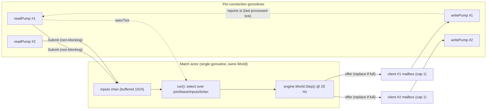
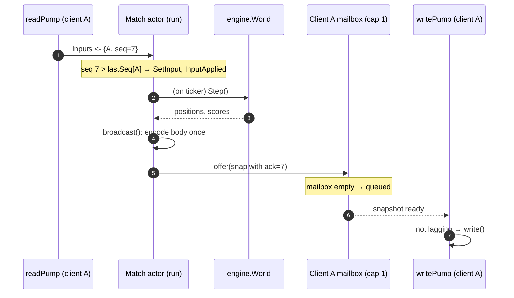
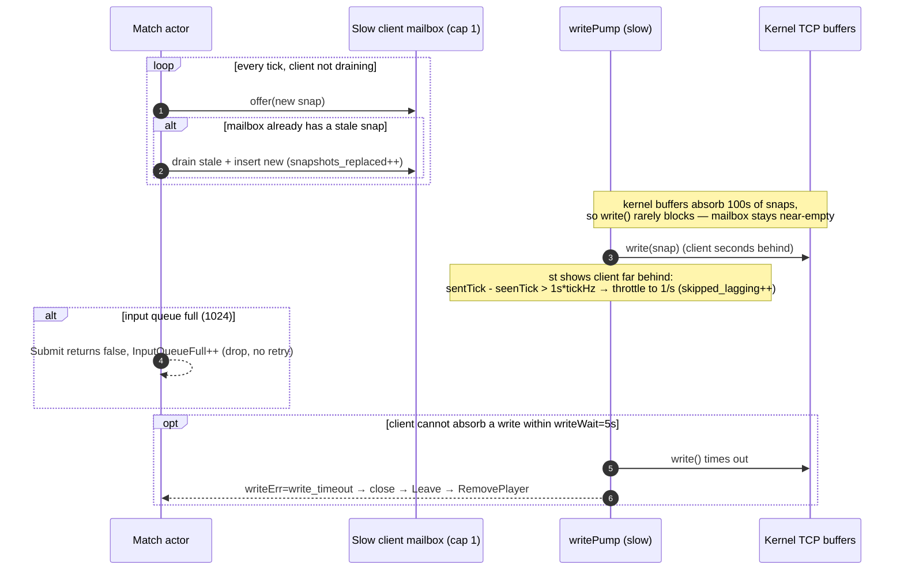

# ADR-0003 deep dive: Match actor, bounded queues, latest-wins snapshots, backpressure

> Source decision: [`../../adr/0003-match-actor-backpressure.md`](../../adr/0003-match-actor-backpressure.md)
> Code: [`../../backend/internal/match/match.go`](../../backend/internal/match/match.go), [`../../backend/internal/match/manager.go`](../../backend/internal/match/manager.go), [`../../backend/internal/server/ws.go`](../../backend/internal/server/ws.go)
> Evidence: [`../../experiments/001-week1-baseline/README.md`](../../experiments/001-week1-baseline/README.md)

## 1. TL;DR

- **One goroutine per match** (`match.run`) exclusively owns its `engine.World`. Join, leave, and input requests arrive over channels, so the world needs **no locks** and a slow client can never stall the tick loop.
- **Bounded input queue**: one buffered channel of **1,024** entries per match; `Submit` never blocks and drops-and-counts when full (`inputs_total{result="queue_full"}`). Held-input semantics make dropping safe.
- **Latest-wins snapshot mailbox**: each client has a **capacity-1** channel; a new snapshot *replaces* an unread one (`snapshots_total{result="replaced"}`). A slow client costs at most one buffered snapshot and always gets the newest state.
- **The mailbox alone is not enough.** Kernel socket buffers (MiBs) absorb hundreds of snapshots before a write blocks, so a client can be *seconds* stale while the mailbox never fills. Clients report `st` (last processed tick); when the last tick sent is **> 1 s** ahead of `st`, the session throttles to **1 snapshot/s** until it catches up — it throttles rather than stops, because a client receiving nothing could never catch up.
- Measured: with 10% slow clients at 200 bots, **fast clients were unaffected** (RTT p50/p95 25/50 ms, tick p99 unchanged), **9,201 snapshots skipped** for lagging clients, and tx/player fell from 14.8 to 13.3 KB/s ([Experiment 001](../../experiments/001-week1-baseline/README.md)).

## 2. Context and problem

With ADR-0002, each connection has two goroutines (readPump, writePump). A 20-player match therefore has ~40 goroutines all wanting to touch one shared world: readers want to apply inputs, and the fan-out wants to read positions for every client. Two naive designs both fail:

1. **Locks around the world.** If readers (fan-out) and the writer (`Step`) contend on a `sync.RWMutex`, tick duration starts to depend on lock contention, which is exactly the thing a fixed 50 ms budget cannot tolerate. Worse, if a snapshot is sent *under* the lock to a slow client, that slow client blocks the whole tick.
2. **Blocking sends to clients.** If the tick loop does a blocking `channel <- snapshot` (or a blocking socket write) to each client, the slowest client sets the pace for everyone. One player on a bad connection would freeze the match.

A second, subtler problem surfaced only under measurement: even a *bounded* application queue does not bound end-to-end staleness, because the **kernel's TCP send/receive buffers** sit underneath the application and can hold megabytes — hundreds of stale snapshots — before a write ever blocks.

The problem: **isolate each match so one slow or misbehaving client cannot affect the tick loop or other players, and bound not just the application queue but the actual end-to-end staleness, without locks on the hot path.**

## 3. HLD

The answer is the **actor model**: a match is a single goroutine that owns its state and communicates only by message passing over bounded channels. Inputs flow in through one shared bounded channel; snapshots flow out through per-client capacity-1 mailboxes; a separate application-level flow-control signal (`st`) bounds real staleness.



The Manager (not shown as a box above) sits in front: it assigns a joining player to the first match with free capacity under a mutex, creates matches on demand, and stops empty ones. It is the only locked component, and its lock protects *slot accounting*, never the world.

## 4. LLD

### 4.1 Components and responsibilities

| Component | File | Responsibility |
|---|---|---|
| `Match` / `Match.run` | [`match.go`](../../backend/internal/match/match.go) | The actor: owns `engine.World`, the tick loop, the input channel, and fan-out. |
| `Client` + `offer` | [`match.go`](../../backend/internal/match/match.go) | A player's capacity-1 mailbox (`Out`) and `Done` channel; `offer` replaces an unread snapshot. |
| `Match.broadcast` | [`match.go`](../../backend/internal/match/match.go) | Encodes the shared world body once, splices per-client `ack`, offers to each mailbox. |
| `Manager` | [`manager.go`](../../backend/internal/match/manager.go) | Slot accounting under `mu`, match creation/teardown, drain, status versioning. |
| `session.writePump` lag logic | [`ws.go`](../../backend/internal/server/ws.go) | Application-level flow control: throttle a lagging client to 1 snap/s. |

### 4.2 Data structures and config values (exact)

| Name | Value | Meaning |
|---|---|---|
| `InputQueue` | `1024` | Buffered capacity of `Match.inputs`; excess inputs dropped. |
| `Client.Out` capacity | `1` | Latest-wins mailbox depth. |
| `Options.TickHz` default | `20` | Fixed tick rate. |
| `Options.Capacity` default | `20` | Players per match. |
| `GuestIDBase` | `1_000_000_000` | First guest ID; account IDs sit below it so consumers can tell guests apart. |
| `writeWait` | `5 s` | Max time to absorb one write before drop (`write_timeout`). |
| `maxLagSeconds` | `1` | Lag threshold (ticks = `maxLagSeconds * tickHz`). |
| `laggingInterval` | `1 s` | Throttled send period for a lagging client. |
| Drain poll | `200 ms` | `Manager.Drain` status poll interval. |

**Channels inside a `Match`:** `join chan *Client` (unbuffered), `leave chan PlayerID` (unbuffered), `inputs chan input` (buffered 1024), `done chan struct{}`.

**Per-match state owned by `run` (never touched elsewhere):** `clients map[PlayerID]*Client`, `lastSeq map[PlayerID]uint32`, scratch `players`/`items` slices reused each tick, and the `engine.World`.

**Manager slot accounting (under `mu`):** `active map[PlayerID]bool`, `matches []*slot` where `slot{m, n, cancel}`, a `version uint64`, and a `changed chan struct{}` that is closed and replaced on every membership change (the long-poll/SSE notifier).

### 4.3 Algorithms, step by step

**`Client.offer(b)` — non-blocking latest-wins** (`match.go`):

1. Try `Out <- b`. If it succeeds (mailbox was empty), count `queued` and return.
2. Otherwise drain the one stale entry (`<-Out`) and count `replaced`.
3. Try `Out <- b` again. Because only the match goroutine calls `offer`, no one else can refill the mailbox between steps 2 and 3, so the second send cannot fail.

**`Submit(id, in)` — non-blocking input** (`match.go`):

1. Try `inputs <- {id, in}`. On success return `true`.
2. On a full channel, `InputQueueFull.Inc()` and return `false`; the caller does **not** retry (a newer input will follow).

**`run(ctx)` — the actor loop** (`match.go`): `select` over:
- `ctx.Done()` → return (defer closes every client's `Done`).
- `join` → add client, `world.AddPlayer`, emit `joined`.
- `leave` → close `Done`, delete client/seq, `world.RemovePlayer`, emit `left`.
- `inputs` → **idempotency gate**: if the client is unknown or `in.Seq <= lastSeq[id]`, count `stale` and skip; else record `lastSeq`, `world.SetInput`, count `applied`.
- `ticker.C` (every 50 ms at 20 Hz):
  1. If the gap since the last tick exceeds `period*3/2`, add the missed ticks to `ticks_missed_total` (`time.Ticker` drops ticks rather than bursting).
  2. Observe `tick_start_lag_seconds` = `start - scheduledTime` (scheduler starvation).
  3. `world.Step()`, publish `tick`.
  4. `broadcast` to all clients (reusing scratch slices).
  5. Emit per-tick event; if `roundTicks` reached, emit `completed` and start a fresh round with the same players.
  6. Observe `tick_duration_seconds`; if it exceeded the period, `tick_overruns_total`.

**`broadcast`** encodes the shared `players`/`items` arrays **once** per tick, builds a `head`/`tail` byte template, and for each client appends only that client's `ack` before calling `offer`. This is the "encode once, splice ack per client" optimization that keeps fan-out O(players) with minimal per-client work.

**`Manager.Join(account...)`** (`manager.go`): under `mu`, reject if closed/draining, assign a guest ID if none, reject if the player is already active, then pick the first match with `n < Capacity` or create one; `s.n++`, bump the status version, unlock, then send the new `Client` onto the match's `join` channel. Because slot accounting happens under `mu`, two concurrent joins can never overfill a match (`TestConcurrentJoinNeverOverfills`: 200 concurrent joins → exactly 10 full matches of 20).

**writePump lag throttle** (`ws.go`): on each snapshot, `lagging = seenTick>0 && sentTick > seenTick + maxLagSeconds*tickHz`. If lagging and the last write was < `laggingInterval` ago, skip the snapshot (`skipped_lagging`); otherwise write and record `lastWrite, sentTick`. Lag is compared against the tick last *sent*, not the current tick, so a throttled client is not throttled forever (a documented bug from run 1).

## 5. Sequence diagrams

### 5.1 Happy path: input → tick → fan-out to mailboxes



### 5.2 Failure / edge paths: slow client, full input queue, kernel-buffer staleness



## 6. Concepts explained

### 6.1 Actor model (one goroutine owns the state)

**What it is.** A unit of computation (an "actor") owns private state and processes messages one at a time from a mailbox; no other code touches that state directly. Here, `match.run` is the actor and the `join/leave/inputs/ticker` select is its mailbox.

**Why LocalArena uses it.** It removes locks from the hot path entirely: because only `run` touches the `World`, there is no data race and tick duration never depends on lock contention. Scaling is "more actors," not "parallelize one tick."

**What was measured.** A match uses at most one CPU core; across 10–1000 bots tick p99 stayed ≤ 0.88 ms and the `-race` suite is clean. 50 matches (1000 bots) ran with simulation work still ~0.07–0.07 ms p99 (Experiment 001).

**Where else it is used.**
- **Telecom/messaging (Erlang/Elixir, Akka)**: per-session or per-connection actors isolate failures.
- **Order-matching engines (exchanges)**: a single-threaded matching core per symbol avoids locks and gives deterministic ordering.
- **Stateful stream processing**: a Kafka Streams task owns its state partition and processes records serially (ADR-0011).
- **IoT device twins**: one actor per device serializes commands and telemetry.

### 6.2 Bounded queue (and drop-on-full)

**What it is.** A fixed-capacity buffer; when full, the producer either blocks, drops, or errors. LocalArena's input channel holds 1,024 and *drops* on full.

**Why LocalArena uses it.** An unbounded input queue would let a flood of inputs grow memory without limit and add latency (stale inputs) before any pushback. Because inputs are held and idempotent, *dropping* the newest-overflow is safe — the next input restates intent — and it is cheaper than buffering.

**What was measured.** `queue_full` is counted; in the healthy Week 1 runs the input path was never the saturating resource (fan-out was). Not separately isolated as a number, but the 1,024 bound held under the overload (no unbounded growth; RSS peaked at 89 MiB at 2000 players).

**Where else it is used.**
- **Load shedding at gateways**: a bounded request queue sheds excess rather than collapsing under overload.
- **Logging/telemetry**: bounded ring buffers drop samples under pressure (the README's "best-effort telemetry" class).
- **Producer/consumer pipelines**: bounded channels are the standard backpressure primitive.

### 6.3 Latest-wins mailbox (capacity-1, replace-on-full)

**What it is.** A queue of depth 1 where a newer item *replaces* an unread older item instead of queuing behind it.

**Why LocalArena uses it.** For world snapshots, only the newest matters — an old snapshot delivered late is worse than useless. Capacity 1 means a slow client costs at most one buffered snapshot and always receives the freshest state, unlike the chat example's 256-deep buffer (appropriate when every message matters, wrong when only the newest does).

**What was measured.** `TestSlowClientMailboxIsBounded` shows the mailbox length stays at 1 after many ticks with no reader, and the snapshot returned is recent. Under 2000-bot overload, `snapshots_replaced` reached 3.29 M — the replacement path doing exactly its job.

**Where else it is used.**
- **Dashboards/telemetry UIs**: keep only the latest metric value, not a backlog.
- **Sensor fusion/IoT**: a control loop reads the most recent sensor sample; stale samples are discarded.
- **Config/feature-flag propagation**: only the current config matters.

### 6.4 Backpressure

**What it is.** A mechanism by which a slow consumer signals a fast producer to slow down (or by which the system bounds work in flight) so queues do not grow without limit.

**Why LocalArena uses it.** The whole ADR is a study in *where* to apply backpressure for different data: inputs → drop; snapshots → replace; truly-lagging client → throttle then disconnect. The deliberate choice is that "dropping data is a policy," because ordinary bounded queues add latency (stale state) before they ever drop.

**What was measured.** With 10% slow clients, fast clients were unaffected and 9,201 snapshots were skipped — backpressure applied to the slow client only, not the match. No write timeouts occurred in that run.

**Where else it is used.**
- **Reactive streams (Reactor, RxJava, gRPC flow control)**: consumers request N items; producers respect it.
- **Kafka consumer lag / pause-resume**: a slow sink pauses partitions (ADR-0011 experiments).
- **TCP itself**: the receive window is link-level backpressure.

### 6.5 Lock-free hot path via single ownership

**What it is.** Avoiding mutexes on the critical path by giving exactly one goroutine ownership of the mutable state.

**Why LocalArena uses it.** A `sync.RWMutex` around the world would make readers (fan-out) and the writer (`Step`) contend, and a send under the lock would let a slow client block the tick. Single ownership removes the contention entirely.

**What was measured.** `-race` clean; tick latency independent of client count up to 1000 bots (Experiment 001). The `RWMutex` alternative is explicitly rejected in the ADR.

**Where else it is used.** Single-writer designs appear in LMAX Disruptor (finance), per-core sharded counters, and per-partition stream processors — all trade shared-memory concurrency for message passing or partitioning.

### 6.6 Kernel socket buffers vs application queues

**What it is.** Below the application, the OS keeps a per-socket send buffer (`tcp_wmem`) and the peer keeps a receive buffer (`tcp_rmem`). A `WriteMessage` only blocks once the *send* buffer is full; until then, bytes are accepted even if the peer is reading slowly.

```text
app mailbox (cap 1) -> writePump.write() -> [kernel send buffer up to MiBs] -> network -> [peer recv buffer]
```

**Why it matters here.** This is the key Week 1 surprise: the capacity-1 mailbox never tripped for slow clients because the kernel absorbed hundreds of snapshots, so the client was seconds stale while the server thought it was healthy. The lesson in the ADR and experiment: *bounded application queues do not bound end-to-end staleness when the kernel buffers underneath them.*

**What was measured.** Run 1: `snapshots_replaced` was 0 even with 10% slow bots; `tcp_wmem` max 4 MiB (sender), `tcp_rmem` 32 MiB (receiver) were the absorbing buffers (Experiment 001, "Root explanation" #2).

**Where else it is used.** Any streaming system must account for OS/driver buffering when reasoning about end-to-end latency — e.g. video streaming buffers, Nagle's algorithm effects, and why application-level flow control (HTTP/2 window updates) exists on top of TCP.

### 6.7 Application-level flow control (`st`-based lag throttle)

**What it is.** Because the kernel hides staleness, the *application* must measure it. Clients report `st` (last processed snapshot tick); the server compares it to the tick it last *sent* and throttles a client that is more than 1 s behind to 1 snapshot/s until it catches up — never cutting it off, because a client getting nothing can never catch up.

**Why LocalArena uses it.** It is the fix for §6.6. It is protocol-v1-compatible (an optional field). Two bugs were found building it: cutting off lagging clients livelocked them (5 bots dropped), and comparing against the *current* tick kept a throttled client throttled forever — both covered by `TestLaggingClientIsThrottled`.

**What was measured.** 9,201 snapshots skipped for lagging clients; tx/player fell from 14.8 to 13.3 KB/s; fast clients' RTT unchanged (Experiment 001; `results/slow-10pct.json`: `snapshots_skipped_lagging` 9201, `tx_bytes_per_s_per_player` 13334.6).

**Where else it is used.** HTTP/2 and QUIC stream flow control (WINDOW_UPDATE), video adaptive bitrate (drop quality when a client lags), and consumer-driven pacing in message systems.

### 6.8 Idempotent inputs via sequence gate

**What it is.** The actor drops any input whose `seq <= lastSeq[id]`, so duplicates and reordered frames never change state.

**Why LocalArena uses it.** It makes the input path safe against retransmits/reordering without extra coordination, complementing held-input semantics (ADR-0001).

**What was measured.** `inputs_stale` counted; `TestSnapshotsAckInputs` proves a reordered seq is ignored and `ack` never regresses.

**Where else it is used.** Idempotency keys in payments (ADR-0006 purchases), dedup in at-least-once messaging (ADR-0011/0012), and TCP sequence handling.

### 6.9 Graceful shutdown and goroutine-leak avoidance

**What it is.** On shutdown, `Manager.Close` cancels every match; each match closes its clients' `Done` channels; `writePump` sends close 1001 and `readPump` exits; `wg.Wait()` ensures every goroutine returns.

**Why LocalArena uses it.** Unbounded goroutine lifetime is a leak; leaked goroutines also pin memory and sockets. The design makes every goroutine's exit reachable from a single cancel.

**What was measured.** goleak `VerifyTestMain` covers `match` and `server`; load runs return to 9–10 idle goroutines after every scenario including 4,443 reconnects and 2000-bot overload (`goroutines_after` 9–10 in the result JSON).

**Where else it is used.** Context-cancellation shutdown is standard in Go services; thread-pool drain in the JVM; connection-draining in load balancers (ADR-0018 drain reuses this).

### 6.10 Match allocation under a mutex (no overfill)

**What it is.** The Manager serializes slot accounting so capacity decisions are atomic across concurrent joins.

**Why LocalArena uses it.** Two simultaneous joins must not both see "one free slot" and both take it. The mutex guards only the counters, not the world, so it is off the tick hot path.

**What was measured.** `TestConcurrentJoinNeverOverfills`: 200 concurrent joins produce exactly 10 matches of 20 players each.

**Where else it is used.** Any capacity/quota gate — connection-pool checkout (ADR-0004 PgBouncer), seat/inventory reservation (e-commerce), rate-limit token accounting (ADR-0008).

### 6.11 Tick start lag (scheduler starvation metric)

**What it is.** The delay between a tick's *scheduled* time and when the match goroutine actually *started* it — distinct from how long the tick's work took.

**Why LocalArena uses it.** Under overload, `tick_duration_seconds` stayed tiny and hid the problem; the real pain was the delay before a tick could even begin, caused by the goroutine waiting for a CPU while syscalls (socket writes) dominated. The metric was added after the overload experiment.

**What was measured.** Baseline start-lag p99 ≈ 2–5 ms; under 2000-bot / 200 Hz / 1-CPU overload, ≈ 99 ms with 126,439 ticks missed (Experiment 001; `results/overload-200hz-1cpu.json`).

**Where else it is used.** Scheduler-latency and run-queue-delay metrics in any latency-sensitive service (e.g. GC pause + scheduling delay in JVM/Go services, `sched_latency` in the kernel) distinguish "work is slow" from "work can't get scheduled."

## 7. Code pointers

| Path (symbol / config) | What to look at |
|---|---|
| [`backend/internal/match/match.go`](../../backend/internal/match/match.go) (`Match.run`) | The actor select loop: join/leave/input gate/ticker, missed-tick accounting. |
| [`backend/internal/match/match.go`](../../backend/internal/match/match.go) (`Client.offer`) | Capacity-1 latest-wins replace algorithm. |
| [`backend/internal/match/match.go`](../../backend/internal/match/match.go) (`Match.Submit`, `InputQueue`) | Non-blocking input with the 1,024 bound and drop-on-full. |
| [`backend/internal/match/match.go`](../../backend/internal/match/match.go) (`Match.broadcast`) | Encode-once / splice-ack fan-out. |
| [`backend/internal/match/manager.go`](../../backend/internal/match/manager.go) (`Manager.Join`, `release`, `mu`) | Slot accounting under mutex; create/teardown. |
| [`backend/internal/match/manager.go`](../../backend/internal/match/manager.go) (`bumpLocked`, `Status`) | Version + `changed` channel feeding long-poll/SSE. |
| [`backend/internal/match/manager.go`](../../backend/internal/match/manager.go) (`Drain`, `Close`) | Graceful drain and shutdown (used by ADR-0018). |
| [`backend/internal/server/ws.go`](../../backend/internal/server/ws.go) (`writePump` lag block, `maxLagSeconds`, `laggingInterval`) | `st`-based throttle; compare-to-sentTick fix. |
| [`backend/internal/server/ws.go`](../../backend/internal/server/ws.go) (`writeWait`, `writeErrReason`) | 5 s write bound; `write_timeout` vs `write_error`. |
| [`backend/internal/telemetry/metrics.go`](../../backend/internal/telemetry/metrics.go) (`Snapshots`, `Inputs`, `TickLag`, `TicksMissed`) | The counters/histograms that prove the behavior. |
| [`backend/internal/match/match_test.go`](../../backend/internal/match/match_test.go) (`TestConcurrentJoinNeverOverfills`, `TestSlowClientMailboxIsBounded`, `TestSnapshotsAckInputs`) | The correctness proofs cited above. |

## 8. Trade-offs and alternatives

| Option | Pros | Cons | Why (not) chosen |
|---|---|---|---|
| **Actor per match + bounded channels + cap-1 mailbox** (chosen) | No locks on hot path; slow clients isolated; bounded memory and staleness | One match = one core; dropping data is a deliberate policy you must explain | Chosen: isolation and a predictable tick budget. |
| `sync.RWMutex` around the world | Simpler to write | Readers (fan-out) and writer (`Step`) contend; a send under lock blocks the tick | Rejected: tick latency would depend on contention. |
| Large per-client buffers (256, like the chat example) | Every message delivered | Queues stale snapshots; grows memory; delivers useless old state | Rejected: for snapshots only the newest matters. |
| Unbounded input queue | Never drops an input | Unbounded memory; adds latency before pushback | Rejected: held-input makes drop-on-full safe and cheaper. |
| Mailbox-only (no `st` throttle) | Simplest flow control | Kernel buffers hide seconds of staleness; wasted bandwidth | Rejected after measurement: insufficient (the key Week 1 finding). |
| Cut off lagging clients entirely | Stops all waste immediately | Livelock: a client getting nothing can never catch up | Rejected: throttle-not-stop is the fix. |

## 9. Failure modes and how they were found

All in [Experiment 001](../../experiments/001-week1-baseline/README.md):

- **Mailbox never tripped for slow clients (run 1).** `snapshots_replaced` was 0 with 10% slow bots because kernel buffers absorbed the backlog; the server thought a seconds-stale client was healthy. Fix: `st`-based application flow control. Root cause #2 in the experiment; raw data in `results-run1-before-lagfix/`.
- **Livelock when cutting off lagging clients.** First fix attempt dropped 5 bots permanently; replaced by throttle-to-1/s.
- **Throttled-forever bug.** Comparing `st` against the *current* tick kept a throttled client throttled forever; fixed by comparing against the last tick *sent*. Both covered by `TestLaggingClientIsThrottled`.
- **Tick overload reveals fan-out, not the actor, as the limit.** 2000-bot / 200 Hz run: `ticks_missed` 126,439, `snapshots_replaced` 3.29 M, start-lag p99 ≈ 99 ms, yet no unbounded growth (RSS 89 MiB). The bounded design "held"; `time.Ticker` dropped ticks instead of bursting.
- **Goroutine-leak guard.** goleak + idle-goroutine gauges returning to 9–10 after every scenario.

## 10. Interview questions

**Q1. What is the actor model and how is a match an actor here? (beginner)**
An actor owns private state and processes messages one at a time; no other code touches its state directly. `match.run` is a single goroutine that owns the `engine.World` and receives join/leave/input/tick messages over channels, so the world needs no locks.

**Q2. Why not just put a mutex around the world? (beginner/intermediate)**
Fan-out (reading all players) and `Step` (writing) would contend on the lock, making tick duration depend on contention, and a snapshot sent under the lock to a slow client would block the whole tick. Single ownership removes both problems.

**Q3. Explain the capacity-1 latest-wins mailbox and why depth 1. (intermediate)**
Each client's outbound channel holds one snapshot; a new one replaces an unread old one. Depth 1 because only the newest world state matters — an old snapshot delivered late is useless, so buffering more just adds staleness and memory. A slow client costs at most one buffered snapshot.

**Q4. Inputs are dropped when the queue is full. Isn't dropping input dangerous? (intermediate)**
Not here: inputs are *held* and idempotent, so a dropped overflow input is immediately superseded by the next input restating intent. Dropping is cheaper than buffering and avoids adding latency. The drop is counted as `inputs_total{result="queue_full"}`.

**Q5. What is backpressure, and where does this system apply it differently for inputs vs snapshots vs lagging clients? (intermediate/senior)**
Backpressure bounds work in flight so queues don't grow unbounded. Inputs: drop on full (1,024). Snapshots: replace (keep newest). A truly lagging client: throttle to 1 snap/s, then disconnect after 5 s of unabsorbed write. Each policy matches the value of the data.

**Q6. The capacity-1 mailbox didn't bound staleness in run 1. Why, and how was it fixed? (senior)**
Linux socket buffers (`tcp_wmem` 4 MiB sender, `tcp_rmem` 32 MiB receiver) absorbed hundreds of snapshots, so `WriteMessage` rarely blocked and the mailbox was always drained — the client was seconds behind while the server saw it as healthy. Fix: clients report `st` (last processed tick); the server throttles a client more than 1 s behind to 1 snap/s. Bounded application queues don't bound end-to-end staleness when the kernel buffers underneath them.

**Q7. Why throttle a lagging client instead of cutting it off? (intermediate/senior)**
Cutting it off livelocks it: a client receiving nothing can never report catching up, so it would be dropped permanently (5 bots were dropped in the first attempt). Throttling to 1 snap/s keeps feeding it the newest state so it can recover.

**Q8. There was a bug where a throttled client stayed throttled forever. What was it? (senior)**
The lag check compared `st` to the *current* tick. A throttled client only ever reports old ticks, so it always looked lagging. The fix compares `st` to the tick last *sent*, so once the client catches up to what it was actually sent, throttling releases. Covered by `TestLaggingClientIsThrottled`.

**Q9. How does the Manager guarantee a match is never overfilled under concurrent joins? (intermediate)**
Slot accounting (`s.n++` against `Capacity`) happens under a single mutex, so two concurrent joins can't both claim the last slot. `TestConcurrentJoinNeverOverfills` fires 200 concurrent joins and gets exactly 10 full matches of 20. The mutex guards counters only, never the world.

**Q10. Distinguish `tick_duration_seconds` from `tick_start_lag_seconds`. Why did the project need both? (senior)**
`tick_duration` is how long the tick's work took; `tick_start_lag` is how late the tick *started* versus its scheduled time. Under overload, duration stayed at 0.07 ms (hiding the problem) while start lag hit ~99 ms because the goroutine couldn't get a CPU — socket-write syscalls dominated. You need the start-lag metric to see scheduler starvation.

**Q11. How does the fan-out stay cheap per client? (intermediate)**
`broadcast` encodes the shared `players`/`items` body once per tick into a byte template, then per client appends only that client's `ack` before offering. So the expensive JSON marshal happens once, not once per client; per-client work is a small append.

**Q12. How are goroutine leaks prevented, and how is that verified? (intermediate)**
Every goroutine's exit is reachable from one cancel: `Manager.Close` cancels matches, matches close clients' `Done`, writePump sends close 1001, readPump returns, and `wg.Wait()` blocks until all exit. goleak's `VerifyTestMain` covers `match`/`server`, and load runs show idle goroutines return to 9–10 after every scenario.

**Q13. Design question: a match grows to 100 players and fan-out dominates CPU. What do you change? (senior, "design this")**
Fan-out is O(players²) in bytes per match, so I'd attack bytes and work: delta encoding (send only changes), a binary snapshot format (protobuf), and interest management (each client only receives nearby entities). I'd keep encode-once/splice-ack but potentially pre-encode per interest-region. If one core can't fan out 100 clients, I'd move fan-out to a pool of writer goroutines reading an immutable per-tick snapshot (the world stays single-writer), or split very large lobbies. I would not add locks to the world.

**Q14. "At 100× matches on one box, what limits you and how do you scale?" (senior, "design this")**
Each match is one goroutine/one core-slice, so thousands of matches are fine CPU-wise for `Step`; the limits are connection count, socket-write syscalls, and memory (~30 KiB RSS/player measured). I'd scale horizontally: many game-server processes/pods, each running a Manager, with a matchmaker/allocator placing players (ADR-0018). The actor-per-match design makes this a clean shard boundary because a match shares no mutable state with other matches.

**Q15. Why are empty matches stopped, and what breaks if you forget? (intermediate)**
`Manager.release` cancels a match's context when its player count hits 0, which ends the goroutine and decrements the `matches` gauge. Forgetting it leaks one goroutine and one `engine.World` per abandoned match forever — a slow memory/goroutine leak that goleak and the idle-goroutine gauge would catch.
