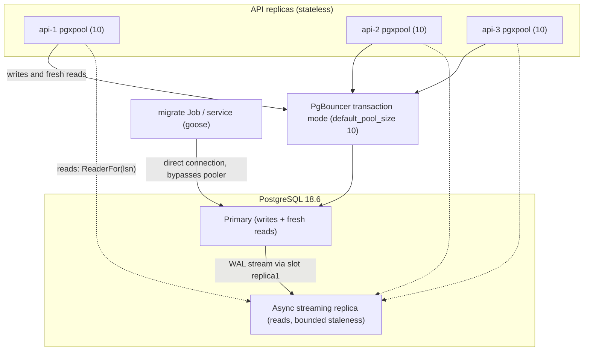
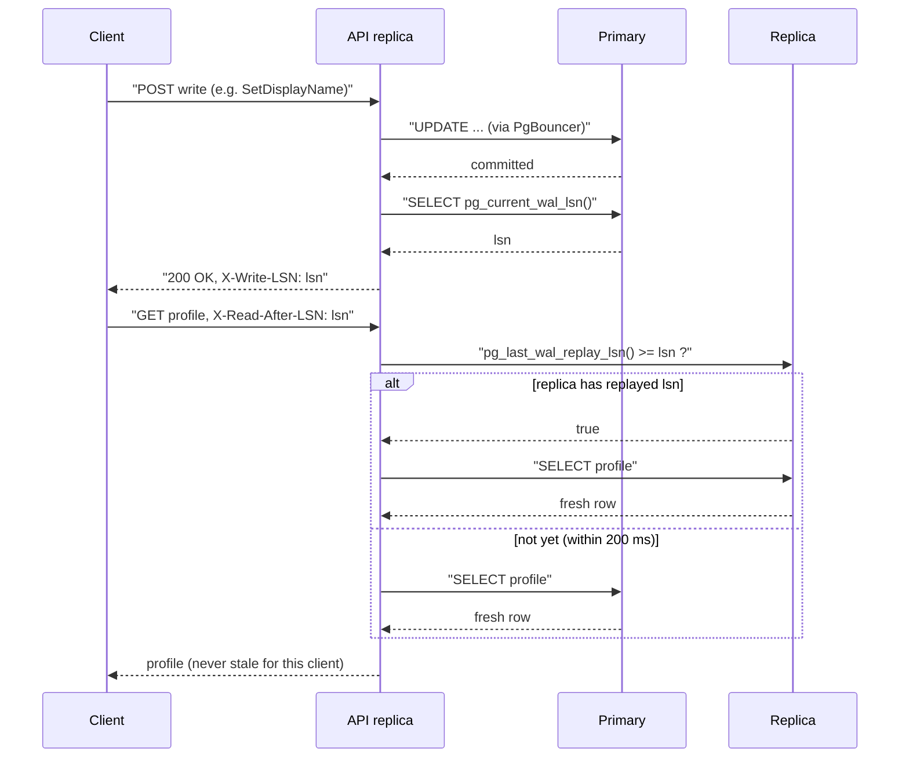
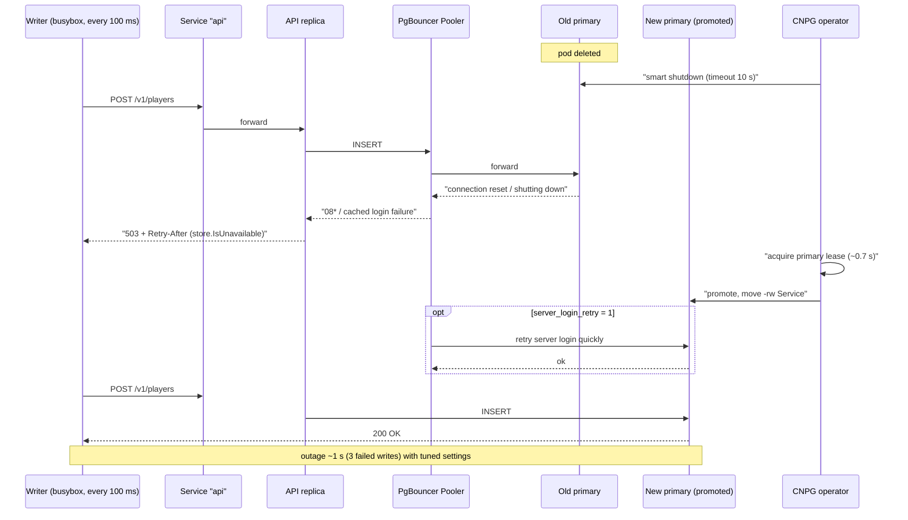

# ADR-0004 deep dive: PostgreSQL, PgBouncer, replicas, read-your-writes

Source decision: [`../../adr/0004-postgres-pooling-replicas.md`](../../adr/0004-postgres-pooling-replicas.md).
Evidence: [`../../experiments/002-week2-persistence/README.md`](../../experiments/002-week2-persistence/README.md).

## 1. TL;DR

- PostgreSQL 18.6 is the single source of truth for profiles, credits, inventory, purchases, lobbies and match history. Everything else (Valkey, Kafka state stores) is disposable acceleration.
- Each API process keeps a small `pgxpool` (default 10 connections); PgBouncer in **transaction mode** multiplexes many app connections onto few Postgres backends, because each backend costs about 5–10 MB of RAM.
- Reads vastly outnumber writes, so profile/history/catalog reads can go to an **asynchronous streaming replica**. A client that just wrote opts into consistency with a **read-your-writes LSN token** (`X-Write-LSN` / `X-Read-After-LSN`).
- Failover is handled by CloudNativePG (CNPG) through a Kubernetes lease. Two tuning knobs discovered in Experiment 002 cut the write outage from ~180 s to **1 s**: `smartShutdownTimeout: 10` and PgBouncer `server_login_retry: 1`.
- Every connection-class, shutdown, or read-only SQLSTATE maps to **503 + Retry-After** (`store.IsUnavailable`), never 500, so clients can safely retry across a failover.

## 2. Context and problem

LocalArena's durable data must stay correct under concurrency and survive restarts. Several concerns collide:

- **Connection cost.** A Postgres backend is a full OS process using roughly 5–10 MB. If you run 3 API replicas (Week 3) and later autoscale them, and each keeps a pool of, say, 20 connections, you quickly approach the `max_connections` ceiling (100 in this lab). Exhausting `max_connections` means *new* connections fail with `FATAL: sorry, too many clients already`, which is a hard outage, not graceful degradation.
- **Read/write ratio.** Profiles, match history and the cosmetics catalog are read far more often than they are written. Serving all of them from the primary wastes the primary's capacity.
- **Failover.** When the primary dies, something must promote a standby, and the application must not spend minutes returning 500s while that happens.
- **Correctness after a read offload.** If a player buys a cosmetic and immediately refreshes their profile from a replica, async replication lag can show the *old* credits/inventory. That is a visible correctness bug even though the database is internally consistent.

The decision has to pick a driver, a pooling strategy, a replication topology, a staleness policy, and an error-mapping policy, and it has to prove the failover numbers rather than guess them.

## 3. HLD

LocalArena puts a connection pooler between the stateless API replicas and Postgres, and a read replica alongside the primary. Writes always go to the primary. Reads go to the replica **only** when the client's requested LSN has been replayed; otherwise they fall back to the primary. In Kubernetes, CNPG owns promotion and moves the read-write Service to the new primary.

Key properties visible in the diagram:

- The pooler sits only on the **read-write path**. Replica reads go directly to the replica pool (`store.Replica`), because PgBouncer here is configured as an `rw` pooler against the primary.
- **Migrations bypass the pooler** entirely and connect directly to the primary, because they need session-scoped features (session advisory locks and `CREATE INDEX CONCURRENTLY`) that transaction pooling cannot preserve.
- The WAL stream is anchored by a **physical replication slot** (`replica1`), so the primary retains WAL the replica has not yet consumed instead of recycling it.

## 4. LLD

### 4.1 Components and responsibilities

| Component | Responsibility |
|---|---|
| `store.Store` | Holds a `Primary` pool and a `Replica` pool (equal to `Primary` when no replica is configured). All writes use `Primary`; reads pick a pool via `ReaderFor`. |
| `store.NewPool` | Opens a `pgxpool.Pool` with explicit limits and the OpenTelemetry + N+1 query tracer. |
| `store.ReaderFor` | Implements read-your-writes: returns the replica only if it has replayed the client's LSN within a bounded wait. |
| `store.WriteLSN` | Returns `pg_current_wal_lsn()` so a write response can hand the client its consistency token. |
| `store.IsUnavailable` | Classifies an error as "database temporarily unreachable" so the HTTP layer answers 503 + Retry-After. |
| PgBouncer (`edoburu/pgbouncer` / CNPG `Pooler`) | Multiplexes app connections onto few backends in transaction mode. |
| CNPG `Cluster` | Runs 2 instances, elects a primary through a Kubernetes lease, moves the `-rw` Service on failover. |
| `primary-init.sh` | Creates the `replicator` role and the physical slot `replica1` on first start. |
| `replica-entrypoint.sh` | Clones the primary with `pg_basebackup -R` and runs as a hot standby streaming from slot `replica1`. |

### 4.2 Data structures and config (exact values)

Pool configuration (`store.NewPool`):

| Setting | Value | Source |
|---|---|---|
| `MaxConns` | 10 (default per process) | `store.New` / `NewPool` arg |
| `MaxConnIdleTime` | 5 minutes | `NewPool` |
| `HealthCheckPeriod` | 30 seconds | `NewPool` |
| `ConnConfig.ConnectTimeout` | 5 seconds | `NewPool` |
| `Store.MaxRetries` | 10 | `store.New` |

PgBouncer (Compose `pgbouncer` service and CNPG `Pooler`):

| Setting | Value |
|---|---|
| `POOL_MODE` / `poolMode` | `transaction` |
| `DEFAULT_POOL_SIZE` | 10 |
| `MAX_CLIENT_CONN` | 500 |
| `MAX_PREPARED_STATEMENTS` | 200 |
| `QUERY_WAIT_TIMEOUT` | 5 (seconds) |
| `server_login_retry` (CNPG) | 1 |
| image (Compose) | `edoburu/pgbouncer:v1.26.0-p0` |

PostgreSQL server (Compose `x-pg-cmd` and CNPG `Cluster`):

| Setting | Value |
|---|---|
| image (Compose) | `postgres:18.6-alpine` |
| image (CNPG) | `ghcr.io/cloudnative-pg/postgresql:18.6-minimal-trixie` |
| CNPG instances | 2 |
| `max_connections` | 100 |
| `deadlock_timeout` | 200ms |
| `wal_level` | logical |
| `max_replication_slots` | 10 |
| `max_wal_senders` | 10 |
| `smartShutdownTimeout` (CNPG) | 10 |
| `primaryUpdateStrategy` (CNPG) | unsupervised |
| statement timeout (via migration 00007) | 2s |
| idle-in-transaction timeout | 5s |

Replica entrypoint runs `postgres -c hot_standby=on -c hot_standby_feedback=on`, and `pg_basebackup` uses `-X stream -S replica1 -R`.

### 4.3 Algorithms, step by step

**Read-your-writes (`store.ReaderFor`).**

1. If there is no separate replica (`Replica == Primary`) or the LSN token is empty, return the replica directly and accept bounded staleness.
2. Otherwise compute a deadline `now + wait` (the API uses 200 ms).
3. Loop: ask the replica `SELECT pg_last_wal_replay_lsn() >= $1::pg_lsn`.
   - If true, return the replica (consistent for this client).
   - If the query errors or the deadline passes, return the primary (fall back).
   - Otherwise sleep 5 ms and re-poll, or bail to the primary if the context is cancelled.

**Write + token handoff.** On a successful write, the handler calls `store.WriteLSN` (`SELECT pg_current_wal_lsn()::text`) and returns it as `X-Write-LSN`. A well-behaved client echoes it as `X-Read-After-LSN` on the next read, which the handler passes to `ReaderFor`.

**Bounded pool acquire.** `pgxpool.Acquire` is only ever called inside a request that already has a 3 s context (and a 2 s server-side `statement_timeout`). When the pool is empty, the acquire blocks only until the context deadline, so pool exhaustion surfaces as a timeout (then 503) rather than an unbounded queue. `EmptyAcquireCount` rises first, giving an early warning.

**Error classification (`store.IsUnavailable`).** Returns true for: `pgconn.ConnectError`, `io.EOF` / `io.ErrUnexpectedEOF` / `ECONNRESET` / `ECONNREFUSED` / `EPIPE`, any `net.Error`, `pgconn.SafeToRetry`, SQLSTATE class `08*` (connection exception, incl. PgBouncer login retry), and `57P01`/`57P02`/`57P03` (shutdown / cannot connect now) and `25006` (read-only transaction, i.e. writing to a just-demoted primary). All of these become 503 + Retry-After.

## 5. Sequence diagrams

### 5.1 Happy path: write then read-your-writes

### 5.2 Failure path: primary pod deleted (CNPG failover)

## 6. Concepts explained

### Connection pooling (pgxpool)

- **What it is.** A pool keeps a small set of open database connections and lends them to requests, avoiding the cost of a TCP+TLS+auth handshake per query. `pgxpool` is pgx v5's pool.
- **Why LocalArena uses it.** Opening a connection per request would be slow and would spike `max_connections`. `NewPool` sets `MaxConns`, idle time, health-check period, and a tracer, and bounds acquire waits with the request context.
- **What was measured.** `TestPoolExhaustionTimesOut`: pool of 2, both busy with `pg_sleep(1)`; a third `Exec` with a 200 ms context fails at the deadline with `context.DeadlineExceeded`, and `EmptyAcquireCount > 0`. The wait is bounded (asserted < 500 ms).
- **Where else.** Every multi-tenant web backend (Rails/Django/Spring with HikariCP), serverless functions sharing a pooler, and microservices hitting shared relational databases.

### PgBouncer transaction mode

- **What it is.** A lightweight pooler in front of Postgres. In **transaction** mode a server connection is bound to a client only for the duration of one transaction, then returned to the pool. This multiplexes many client connections onto few server backends.
- **Why LocalArena uses it.** Backends cost 5–10 MB each; N replicas × pool size can exhaust `max_connections`. Transaction pooling is the right trade for short API transactions. The cost: session features do not survive between transactions, so session `SET`, session advisory locks, and `LISTEN` are off-limits through the pooler (migrations therefore bypass it).
- **What was measured.** `TestPgBouncerQueueWaitTimeout`: 12 clients each hold a server connection for `pg_sleep(6)` against pool 10; **10 served, 2 rejected** after `query_wait_timeout=5s` (SQLSTATE `08P01`). This is the documented backpressure behavior.
- **Where else.** Any high-fanout service on Postgres: SaaS platforms, payment gateways, and especially serverless/edge deployments where thousands of short-lived functions would otherwise each open a backend.

### Prepared statements under a pooler

- **What it is.** The server parses and plans a statement once, then executes it by name with bound parameters. pgx caches prepared statements per connection automatically.
- **Why LocalArena uses it.** Faster, and it is the default pgx behavior. Under transaction pooling the server connection changes between transactions, so PgBouncer ≥ 1.21 must track prepared statements; `max_prepared_statements=200` is set so the cache survives.
- **What was measured.** Not measured directly; the config exists so that pgx's cached statements keep working under transaction pooling (otherwise "prepared statement does not exist" errors appear).
- **Where else.** Any OLTP system issuing the same parameterized queries repeatedly (banking ledgers, order systems) benefits from plan reuse and is immune to SQL injection on those parameters.

### Streaming replication and replication slots

- **What it is.** The primary ships its write-ahead log (WAL) to a standby, which replays it to stay a near-copy. A **replication slot** records how far the standby has consumed, so the primary keeps WAL the standby still needs instead of recycling it.
- **Why LocalArena uses it.** To offload reads and to have a promotable standby. `primary-init.sh` creates slot `replica1`; `replica-entrypoint.sh` clones with `pg_basebackup -X stream -S replica1 -R`.
- **What was measured.** `TestStaleReplicaReadAndReadYourWrites` exercises the slot path: pausing WAL replay produces a stale read, and resuming lets the replica catch up. CNPG manages its own standbys for the k8s path.
- **Where else.** Read-replica fleets for e-commerce product pages, analytics read stores, and cross-AZ hot standbys for durability.

### Async vs sync replication, RPO/RTO

- **What it is.** With **async** replication the primary commits without waiting for the standby, so a failover can lose the last few committed transactions. With **sync** replication the primary waits for a standby (or a quorum) to acknowledge, giving RPO = 0 at the cost of write latency. **RPO** (recovery point objective) is how much data you can lose; **RTO** (recovery time objective) is how long recovery takes.
- **Why LocalArena uses it.** Async by default: writes stay fast and a read replica is cheap. The ADR explicitly accepts RPO > 0 and defers synchronous commit (quorum) and RPO measurement to the Week 6 DR drill.
- **What was measured.** RTO-like numbers were measured: write outage dropped from ~180 s (defaults) to **1 s** after tuning. RPO is **not measured** yet (carried forward to Week 6).
- **Where else.** Banks often require sync replication for the ledger (RPO = 0) but async for reporting replicas; social feeds tolerate async everywhere.

### Replica lag

- **What it is.** The delay between a commit on the primary and its replay on the replica.
- **Why LocalArena uses (exposes) it.** `store.ReplicaLag` reports `now() - pg_last_xact_replay_timestamp()`; lag is the thing the LSN token protects you from on reads that matter.
- **What was measured.** The stale-read test reproduces lag deterministically by pausing replay; absolute steady-state lag on loopback is **not measured** as a headline number.
- **Where else.** Read-after-write bugs in any replica-backed app: "I posted but can't see my post", "I changed my address but checkout shows the old one".

### Read-your-writes via LSN

- **What it is.** A session-level consistency guarantee: a client never sees state older than its own last write. Here the mechanism is the WAL LSN: the client carries the LSN of its last write and reads wait for the replica to reach it (or fall back to the primary).
- **Why LocalArena uses it.** It gives per-client consistency *only when the client asks*, so the common case (reads with no token) still enjoys cheap replica reads.
- **What was measured.** `TestStaleReplicaReadAndReadYourWrites`: with replay paused, a plain replica read returns the old value, but `ReaderFor(lsn)` falls back to the primary and returns the new value; after resume it uses the replica.
- **Where else.** Session-consistent reads in e-commerce carts, "post then view" in social apps, and any CQRS read model that must honor the writer's own view.

### CAP and PACELC

- **What it is.** **CAP**: under a network partition you choose between consistency and availability. **PACELC** extends it: Else (no partition) you still trade Latency vs Consistency.
- **Why LocalArena uses it as framing.** During a primary↔replica partition, writes stay consistent (single primary) while replica reads stay available but stale — a CP-for-writes, AP-for-reads split. The LSN token is how a client opts into consistency. PACELC: even with no partition, reading the replica trades a little consistency for lower latency.
- **What was measured.** The stale-read test is the concrete demonstration of the AP-read branch; no separate partition experiment runs in Week 2.
- **Where else.** Choosing DynamoDB consistency levels, Cassandra tunable consistency, or whether a microservice reads a cache vs the primary.

### Leader election via a CNPG lease

- **What it is.** Exactly one primary at a time, chosen through a Kubernetes **Lease** object that acts as a fencing mechanism (holding the lease authorizes promotion; it prevents two primaries).
- **Why LocalArena uses it.** Automatic, unsupervised failover without split-brain. CNPG moves the `-rw` Service to the promoted instance.
- **What was measured.** The CNPG instance manager logs `Acquiring primary lease → Acquired primary lease → Promoting instance → server promoted` in about **0.7 s** (Experiment 002 §4).
- **Where else.** etcd/ZooKeeper leader election, Kubernetes controller leader election, and any HA database (Patroni, CNPG, RDS Multi-AZ) failover.

### Failover tuning (`smartShutdownTimeout`, `server_login_retry`)

- **What it is.** Postgres *smart shutdown* waits for existing sessions to finish; a pooler holding server connections keeps those sessions open, so the old primary never frees them and promotion is blocked. PgBouncer caches a server login failure and keeps returning it for `server_login_retry` seconds.
- **Why LocalArena uses it.** To make failover fast. Setting `smartShutdownTimeout: 10` stops the old primary waiting ~180 s for the pooler's sessions; `server_login_retry: 1` stops PgBouncer serving a cached login error for 15 s after the new primary is up.
- **What was measured.** Experiment 002 §4: defaults → ~180 s (no failover until smart shutdown expired); `smartShutdownTimeout: 10` → 48 failed writes, **15 s** outage; plus `server_login_retry: 1` → **3** failed writes, **1 s** outage.
- **Where else.** Tuning connection-draining and health-check intervals in any load-balanced, pooled datastore to minimize failover blast radius.

### 503 + Retry-After vs 500

- **What it is.** 500 means "the server is broken"; 503 + Retry-After means "temporarily unavailable, try again". Clients and proxies treat them very differently.
- **Why LocalArena uses it.** During failover the right answer is "retry shortly", not "give up". `store.IsUnavailable` drives this mapping; purchases carry an `Idempotency-Key` so retrying is safe.
- **What was measured.** `TestIsUnavailable` asserts the classification (`08P01`, `08006`, `57P01`, `25006` → true; `23505`, `40P01` → false; EOF/ECONNRESET/net timeouts → true). Before this mapping the API returned 500 during the failover drill.
- **Where else.** Any load-balanced API behind a rolling datastore upgrade; gateways retry 503 but not 500.

## 7. Code pointers

| Path (symbol / key) | What to look at |
|---|---|
| [`../../backend/internal/store/store.go`](../../backend/internal/store/store.go) (`Store`, `New`, `NewPool`) | Pool limits, primary/replica split, `MaxRetries=10`. |
| [`../../backend/internal/store/store.go`](../../backend/internal/store/store.go) (`IsUnavailable`) | SQLSTATE and network-error classification → 503. |
| [`../../backend/internal/store/store.go`](../../backend/internal/store/store.go) (`queryTracer`) | Per-query span + N+1 counter wiring. |
| [`../../backend/internal/store/profiles.go`](../../backend/internal/store/profiles.go) (`WriteLSN`, `ReaderFor`, `ReplicaLag`) | Read-your-writes token, replica selection, lag metric. |
| [`../../backend/internal/store/metrics.go`](../../backend/internal/store/metrics.go) (`PoolCollector`) | Pool stats incl. `empty_acquires_total`, `acquire_wait_seconds_total`. |
| [`../../backend/internal/store/errors_test.go`](../../backend/internal/store/errors_test.go) (`TestIsUnavailable`) | Proves the error mapping. |
| [`../../backend/internal/store/concurrency_test.go`](../../backend/internal/store/concurrency_test.go) (`TestPoolExhaustionTimesOut`, `TestPgBouncerQueueWaitTimeout`) | Bounded acquire; pooler queue-wait rejection. |
| [`../../infra/compose/postgres/primary-init.sh`](../../infra/compose/postgres/primary-init.sh) | Creates `replicator` role and slot `replica1`. |
| [`../../infra/compose/postgres/replica-entrypoint.sh`](../../infra/compose/postgres/replica-entrypoint.sh) | `pg_basebackup -R`, `hot_standby`, `hot_standby_feedback`. |
| [`../../infra/helm/localarena/templates/postgres.yaml`](../../infra/helm/localarena/templates/postgres.yaml) | CNPG `Cluster` (2 instances, `smartShutdownTimeout: 10`) and `Pooler` (`server_login_retry: 1`, `default_pool_size: 10`). |
| [`../../compose.yaml`](../../compose.yaml) (`postgres`, `postgres-replica`, `pgbouncer`) | Compose topology, `max_connections=100`, `query_wait_timeout=5`. |
| [`../../experiments/002-week2-persistence/failover.sh`](../../experiments/002-week2-persistence/failover.sh) | The primary-kill drill harness. |
| [`../../experiments/002-week2-persistence/results/failover.txt`](../../experiments/002-week2-persistence/results/failover.txt) | The 48→3 failed-writes evidence. |

## 8. Trade-offs and alternatives

| Option | Pros | Cons | Why (not) chosen |
|---|---|---|---|
| **PgBouncer transaction mode** (chosen) | Max multiplexing for short requests; few backends | No session features through the pooler; prepared-statement config needed | Matches API traffic shape; backends are scarce |
| Session pooling | Safe for all session features | Little multiplexing for short requests | Rejected: wastes the main benefit |
| No pooler, big app pools | Simplest | Works at 2–3 replicas, fails as replicas grow | Rejected: HPA later would exhaust `max_connections` |
| **Async replica + LSN token** (chosen) | Cheap reads; consistency on demand | RPO > 0; extra read path and token plumbing | Best fit for a read-heavy workload |
| Read replica unconditionally | Simplest read offload | Read-after-write bugs (buy then refresh shows stale) | Rejected: reproduced the bug in the stale-read test |
| Synchronous (quorum) replication | RPO = 0 | Higher write latency; standby outage can stall writes | Deferred to Week 6 DR drill |
| Only ever read the primary | No staleness ever | Wastes primary capacity | Rejected for read-heavy traffic |

## 9. Failure modes and how they were found

- **Pool exhaustion → bounded timeout.** Found by `TestPoolExhaustionTimesOut`; acquire fails at the context deadline, `EmptyAcquireCount > 0`. See [experiment §2](../../experiments/002-week2-persistence/README.md).
- **Pooler queue-wait rejection.** `TestPgBouncerQueueWaitTimeout`: 10 served, 2 rejected (`08P01`) after 5 s.
- **Stale replica read / read-your-writes.** `TestStaleReplicaReadAndReadYourWrites`: pausing WAL replay reproduces the stale read; `ReaderFor` falls back to the primary.
- **Pooler-amplified failover outage.** Found by the `failover.sh` drill: defaults gave ~180 s with no failover; tuning the two settings cut it to 1 s. See [`results/failover.txt`](../../experiments/002-week2-persistence/results/failover.txt).
- **500s during failover.** The drill showed raw 500s; fixed by `store.IsUnavailable` → 503 + Retry-After, locked in by `TestIsUnavailable`.
- **Carried forward:** RPO is unmeasured; both CNPG instances were co-scheduled (anti-affinity preferred, not required) so a true node-loss drill needs a second worker. See the experiment's "Remaining risks".

## 10. Interview questions

**1. Why put a pooler in front of Postgres at all?**
Each backend is a ~5–10 MB process and `max_connections` is finite (100 here). A pooler lets many short-lived app connections share few backends, so you avoid exhausting `max_connections` as you scale replicas.

**2. Transaction vs session pooling — what breaks in transaction mode?**
Anything that relies on session state surviving between transactions: session `SET`, session-scoped advisory locks, `LISTEN/NOTIFY`, and (without special handling) prepared statements. LocalArena sets `max_prepared_statements=200` and routes migrations (which need session locks) directly to Postgres.

**3. What is read-your-writes and how is it implemented here?**
A guarantee that a client never reads state older than its own last write. Here the write returns `pg_current_wal_lsn()` as `X-Write-LSN`; the client echoes it, and reads only use the replica once `pg_last_wal_replay_lsn() >= lsn` (waiting up to 200 ms), otherwise they hit the primary.

**4. Async vs sync replication — what is the trade in one sentence each?**
Async: fast writes, but a failover can lose the last few commits (RPO > 0). Sync/quorum: RPO = 0, but writes wait for a standby and can stall if it is down.

**5. Define RPO and RTO and give the measured numbers.**
RPO = max data loss on failure; RTO = time to recover. RTO-like write outage was measured at ~180 s (defaults) → 15 s → 1 s after tuning. RPO was not measured (deferred to Week 6).

**6. How does the system avoid an unbounded request queue when the pool is empty?**
Acquire is always bounded by the request's 3 s context (and 2 s server statement_timeout). An empty pool yields a timeout → 503, and `EmptyAcquireCount`/`acquire_wait_seconds_total` rise first as an early warning.

**7. Why was the failover outage 180 s with default settings?**
Postgres smart shutdown waits for existing sessions to drain; the pooler held server connections open, so the old primary stayed "Terminating" for ~180 s and promotion never happened until smart shutdown expired. `smartShutdownTimeout: 10` fixes the Postgres side.

**8. Even after that, writes still failed for 15 s. Why?**
PgBouncer cached the server login failure and kept returning it for `server_login_retry` (default 15 s) after the new primary was already up. Setting `server_login_retry: 1` cut the residual outage to ~1 s.

**9. Why 503 + Retry-After instead of 500 during failover?**
The condition is transient and retryable. 503 tells clients and proxies to retry; purchases carry an idempotency key so retries are safe. `store.IsUnavailable` maps connection-class/shutdown/read-only SQLSTATEs and connection-reset errors to this.

**10. Why can a dead connection appear as EOF/ECONNRESET rather than a SQLSTATE?**
If the backend dies mid-query (failover, partition), the TCP connection is torn down before any SQL error is returned, so pgx surfaces `io.EOF`/`ECONNRESET`. `IsUnavailable` handles both the SQLSTATE and the raw network error.

**11. What is CAP vs PACELC and where does this design sit?**
CAP: under a partition, pick C or A. PACELC: else, pick Latency or Consistency. Writes are CP (single primary), replica reads are AP (available but possibly stale); PACELC-wise replica reads trade a little consistency for latency even without a partition.

**12. How does the lease prevent split-brain?**
Only the instance holding the Kubernetes Lease may be primary; CNPG moves the `-rw` Service to the lease holder. Two primaries cannot both hold the lease, so there is no split-brain promotion.

**13. (Design) You now need 50 API replicas with HPA. What changes?**
Keep per-process pools small (10) and rely on the pooler; size `default_pool_size` so `pooler_pool_size × databases + admin headroom ≤ max_connections`. Consider multiple pooler instances, raise `max_client_conn`, and watch `empty_acquires_total`. The app pool can stay larger than backends because the pooler multiplexes.

**14. (Design / 100x) How would you cut RPO to near zero without killing write latency?**
Use synchronous replication with a quorum (`synchronous_commit` + `synchronous_standby_names` with `ANY 1 (...)`) so a commit waits for at least one of several standbys — RPO = 0 if that standby survives, while a single lagging standby cannot stall writes. Measure the write-latency cost and keep an async reporting replica for reads.

**15. How would you detect a slow/broken replica before users see stale reads?**
Alert on `store.ReplicaLag` (replay delay) and on the LSN-wait fallback rate (how often `ReaderFor` bails to the primary). A rising fallback rate means the replica is lagging past the 200 ms budget even for clients who asked for consistency.
