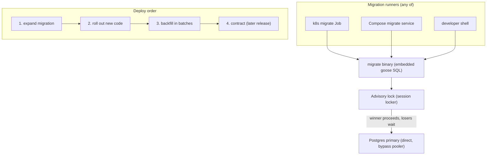
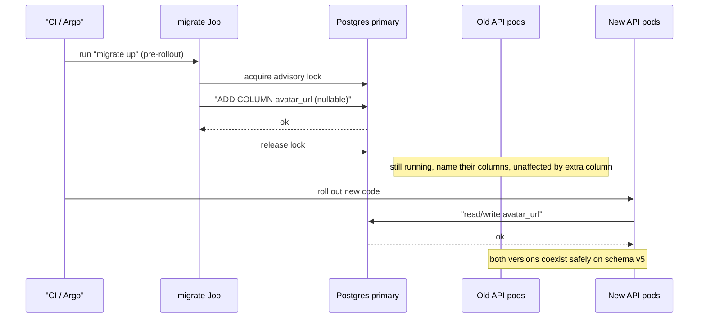
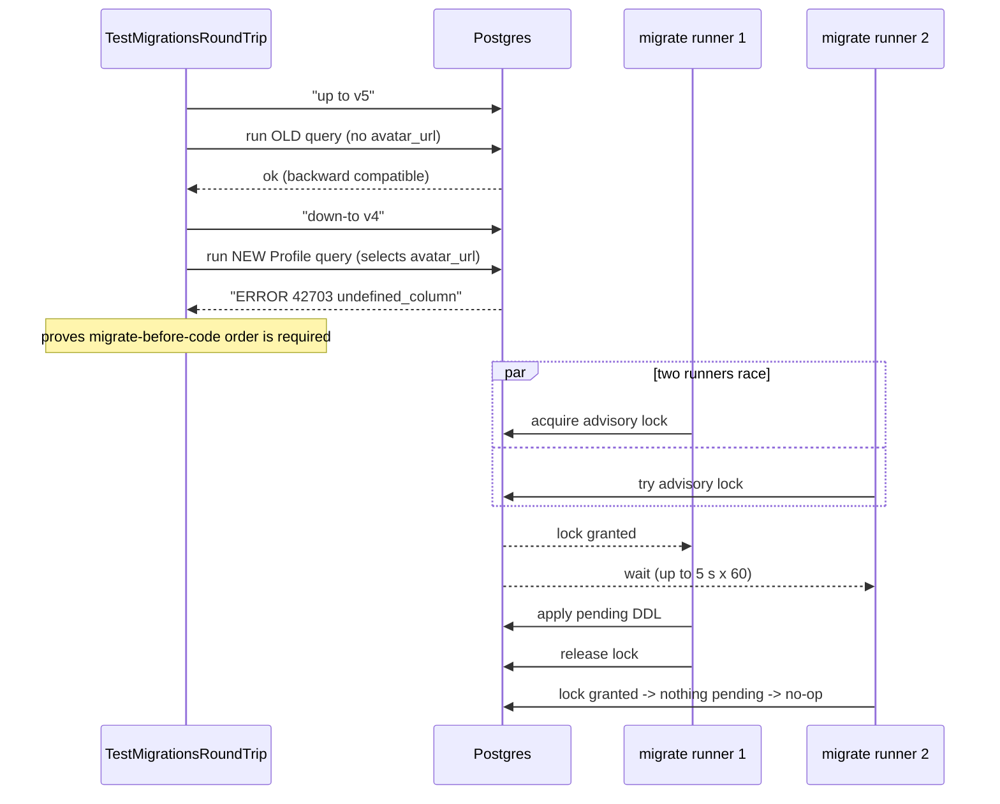

# ADR-0005 deep dive: schema migrations with goose, expand/contract

Source decision: [`../../adr/0005-migrations-expand-contract.md`](../../adr/0005-migrations-expand-contract.md).
Evidence: [`../../experiments/002-week2-persistence/README.md`](../../experiments/002-week2-persistence/README.md).

## 1. TL;DR

- Migrations use **pressly/goose v3** with SQL files **embedded** in the binary (`backend/migrations`, `cmd/migrate`), each with `-- +goose Up`/`-- +goose Down`.
- Concurrent migrators are serialized by a **Postgres advisory-lock session locker**, and migrations connect **directly** to Postgres (never through PgBouncer), because session locks and `CREATE INDEX CONCURRENTLY` need a stable session.
- Every change that touches existing columns follows **expand/contract**: add first (nullable columns, new tables, `CONCURRENTLY` indexes), deploy code that reads the new shape, backfill, then drop the old shape in a later release. Order is always **migrate (expand) → roll out code**.
- Rollback policy is **forward-fix**: a bad release rolls back the *code* (safe, because expand migrations are backward compatible); schema problems are fixed with a new migration. `Down` exists for development and the Week 7 drill only.
- `TestMigrationsRoundTripAndCompatibility` proves it: old queries work on schema v5, and the new `Profile` query fails on v4 with `42703 undefined_column`; the test also runs `up → down-to 0 → up`.

## 2. Context and problem

During a **rolling deploy**, old and new versions of the API run against the **same database at the same time**. If a migration changes the schema in a way the still-running old code cannot tolerate (dropping a column it selects, adding a `NOT NULL` column it does not populate, renaming something), the old pods start failing even though the new code is perfectly correct. That is a self-inflicted outage.

Two more constraints:

- **Migrations run from several places** — the Compose `migrate` service, a Kubernetes `Job`, and a developer shell — and must not race each other onto the same DDL.
- **Some DDL needs a session.** `CREATE INDEX CONCURRENTLY` cannot run inside a transaction and holds state across statements; the advisory lock that serializes migrators is session-scoped. Neither survives PgBouncer transaction pooling.

The decision must pick a tool, a locking strategy, a compatibility discipline, and a rollback policy, and it must be testable.

## 3. HLD

A single `migrate` binary embeds all SQL. Whoever runs it first takes a Postgres advisory lock; others wait. It connects straight to the primary, bypassing the pooler. Application rollout happens **after** the expand migration, so old and new code both tolerate the current schema.

## 4. LLD

### 4.1 Components and responsibilities

| Component | Responsibility |
|---|---|
| `migrations.FS` (`//go:embed *.sql`) | Embeds every SQL migration into the binary. |
| `migrations.Provider` | Builds a goose provider: opens a `database/sql` DB via the pgx stdlib adapter, sets `statement_timeout=0`, attaches a Postgres session locker. |
| `migrations.Up` | Convenience wrapper that applies all pending migrations. |
| `cmd/migrate/main.go` | CLI: `up | down | down-to N | status | version`; pings with retry; supports the failed-migration drill. |
| goose session locker | A Postgres advisory lock so concurrent runners serialize. |
| SQL files `00001`–`00012` | The versioned, numbered migrations. |

### 4.2 The migration set (exact)

| # | File | Kind | Notes |
|---|---|---|---|
| 00001 | `00001_accounts_economy.sql` | create | players, profiles, cosmetics, inventory, purchases, outbox + seed cosmetics; the invariant CHECKs/PKs/UNIQUEs live here |
| 00002 | `00002_lobbies.sql` | create | lobbies, lobby_members (PK on `player_id`), `lobby_members_lobby_idx` |
| 00003 | `00003_match_history.sql` | create | `matches` **range-partitioned by `started_at`**, four monthly partitions + `matches_default`, `match_players` with **no** `player_id` index on purpose |
| 00004 | `00004_history_index.sql` | expand (online) | `CREATE INDEX CONCURRENTLY match_players_player_started_idx` under `-- +goose NO TRANSACTION` |
| 00005 | `00005_profile_avatar.sql` | expand | `ALTER TABLE profiles ADD COLUMN avatar_url text CHECK (avatar_url ~ '^https://')` (nullable) |
| 00006 | `00006_idempotency_keys.sql` | create | generic `idempotency_keys (scope, key)` + `created_at` index |
| 00007 | `00007_timeouts.sql` | config | `ALTER DATABASE SET statement_timeout='2s'`, `idle_in_transaction_session_timeout='5s'` |
| 00008 | `00008_outbox_envelope.sql` | expand | `outbox ADD COLUMN envelope bytea` (nullable), `debezium_heartbeat` table |
| 00009 | `00009_reward_saga.sql` | Week 4 | reward saga tables |
| 00010 | `00010_identity.sql` | Week 5 | identity (`idp_sub`), bans |
| 00011 | `00011_avatars.sql` | Week 5 | avatar bytes table |
| 00012 | `00012_webhooks.sql` | Week 5 | `webhook_deliveries` |

### 4.3 Config values (exact)

| Setting | Value | Where |
|---|---|---|
| Lock timeout (session locker) | `WithLockTimeout(5, 60)` → 5 s between tries, 60 tries | `migrations.Provider` |
| `statement_timeout` during migrations | `0` (unlimited) | `migrations.Provider` (`RuntimeParams`) |
| Application `statement_timeout` | `2s` | migration 00007 |
| `idle_in_transaction_session_timeout` | `5s` | migration 00007 |
| CLI context timeout | 5 minutes | `cmd/migrate/main.go` |
| First-connect ping retry | up to 30 tries, 1 s apart | `cmd/migrate/main.go` |
| goose version | v3.29.0 | experiment §"System version" |

### 4.4 Algorithms, step by step

**Expand/contract for a column change (the ADR's canonical recipe):**

1. **Expand.** Add nullable columns / new tables / `CONCURRENTLY` indexes. Old code keeps working because every query names its columns (no `SELECT *`), so an extra column is invisible to it.
2. **Deploy code** that writes both shapes and reads the new one.
3. **Backfill** in batches (so you never hold a long lock or a giant transaction).
4. **Contract** in a *later* release: drop the old column/constraint once no running version reads it.

**Migration apply (`cmd/migrate run("up")`):**

1. Build the provider (`migrations.Provider`): connect via pgx stdlib, set `statement_timeout=0`, attach the session locker.
2. Ping with retry (up to 30×1 s) so a still-starting DB does not fail the run.
3. If `MIGRATE_FAIL_FOR_DRILL=1`, execute a deliberately bad `ALTER TABLE ... ADD COLUMN ... NOT NULL CHECK (drill_bad > 0)` and return an error — this is the Week 7 failed-migration drill.
4. Otherwise `provider.Up(ctx)` applies pending migrations under the advisory lock, printing each applied version.

**Advisory-lock serialization:** the first runner acquires the lock and runs; others block (up to 5 s × 60 tries) and then apply nothing because the schema is already current. No two runners execute the same DDL concurrently.

## 5. Sequence diagrams

### 5.1 Happy path: expand migration then rolling code deploy

### 5.2 Failure path: compatibility test and concurrent runners

## 6. Concepts explained

### Schema migrations and versioning

- **What it is.** Numbered, ordered, repeatable scripts that evolve the database schema; a `goose_db_version` table records which have been applied.
- **Why LocalArena uses it.** Reproducible schema across Compose, k8s and dev shells; the embedded SQL means the binary and its schema ship together.
- **What was measured.** `TestMigrationsRoundTripAndCompatibility` runs `up → down-to 0 → up` and the v4/v5 compatibility check; both pass.
- **Where else.** Rails migrations, Flyway/Liquibase in Java shops, Alembic in Python — every serious relational app versions its schema.

### Expand/contract (parallel change)

- **What it is.** Split a breaking change into non-breaking steps: expand (add), migrate reads/writes, backfill, contract (drop). Old and new code coexist at every step.
- **Why LocalArena uses it.** Rolling deploys run two code versions against one database. 00005 (add nullable `avatar_url`) and 00008 (add nullable `envelope`) are expand-only examples.
- **What was measured.** The compatibility test proves the expand half: old code works on the new schema. The contract half is a policy (dropped only after no version reads the column); no contract migration ran in Week 2.
- **Where else.** Renaming a column in any zero-downtime service, splitting a table, changing a type — Stripe-style "add, dual-write, backfill, cut over, drop".

### Migrate-before-code ordering

- **What it is.** Always apply the expand migration *before* rolling out the code that needs it; never the reverse.
- **Why LocalArena uses it.** New code on an old schema fails; old code on a new (expanded) schema is fine. So expand first is always safe.
- **What was measured.** Exactly this asymmetry: new `Profile` query on schema v4 → `42703 undefined_column`; old query on v5 → ok.
- **Where else.** Any CD pipeline with a pre-deploy migration step (Helm pre-upgrade hook, Argo sync wave, Rails `db:migrate` before `restart`).

### `CREATE INDEX CONCURRENTLY` and `NO TRANSACTION`

- **What it is.** `CONCURRENTLY` builds an index without taking a write-blocking `ACCESS EXCLUSIVE` lock on the table, so writes keep flowing — but it cannot run inside a transaction block.
- **Why LocalArena uses it.** 00004 adds `match_players_player_started_idx` online. Goose marks it `-- +goose NO TRANSACTION`, and it must go directly to Postgres, not through transaction pooling.
- **What was measured.** The index itself was the fix in Experiment 002 §3: it turned a `Parallel Seq Scan` (≈600k rows, 4,412 buffers) into an index scan (see ADR-0006 for the full plan numbers).
- **Where else.** Adding indexes to hot tables in production e-commerce/SaaS systems without taking write downtime.

### Advisory locks for migration serialization

- **What it is.** A `pg_advisory_lock` is an application-defined, session-scoped lock Postgres does not interpret; goose uses one so concurrent migrators serialize.
- **Why LocalArena uses it.** Multiple runners (Job + Compose + dev) must not race onto DDL. The session locker uses `WithLockTimeout(5, 60)`.
- **What was measured.** Not benchmarked; correctness is the goal — the loser waits and finds nothing pending. The *distributed-lock* story is noted in ADR-0006: this is the only cross-process lock, and correctness never depends on a lease-based lock without fencing.
- **Where else.** Leader-only cron jobs, one-writer backfills, and any "exactly one process may run this" coordination on a shared Postgres.

### `statement_timeout` and the migration exception

- **What it is.** `statement_timeout` cancels a statement that runs too long. The app sets 2 s (00007); migrations set it to `0` because an index build or backfill legitimately runs longer.
- **Why LocalArena uses it.** To keep a runaway app query from pinning a connection, while not killing a long but legitimate migration.
- **What was measured.** `TestStatementTimeout` proves the app's 2 s cancel (`57014 query_canceled` after ~2 s). Migrations run with `statement_timeout=0`.
- **Where else.** Any OLTP database that wants to bound query time but still allow maintenance/DDL windows.

### Forward-fix rollback policy

- **What it is.** In production you roll back the *code*, not the schema; schema problems are fixed with a new migration. `Down` is for dev and drills.
- **Why LocalArena uses it.** Expand migrations are backward compatible, so rolling back code is always safe; dropping a column that has received writes loses data, so routine schema rollback is dangerous.
- **What was measured.** The round-trip test proves every migration has a working `Down`; the Week 7 failed-migration drill (`MIGRATE_FAIL_FOR_DRILL=1`) exercises a bad migration failing a pre-upgrade hook.
- **Where else.** GitLab's and Stripe's published migration playbooks both favor forward-fix over schema rollback for exactly this reason.

### Range partitioning (migration 00003)

- **What it is.** `matches` is split into monthly child tables by `started_at`. Old months can be detached/dropped cheaply and time-bounded queries prune partitions. Covered in depth in ADR-0006; here it matters as a *migration* concern.
- **Why LocalArena uses it.** The partition key must be in every unique constraint (hence PK `(id, started_at)`), which is a migration-shape constraint, and new monthly partitions must be created ahead of time (a scheduled job in Week 6). A `matches_default` catches strays.
- **What was measured.** A one-month predicate scanned only `matches_2026_11` (111 buffers) — partition pruning works (Experiment 002 §3).
- **Where else.** Time-series retention in IoT/telemetry stores, log/event tables, and any "drop last year" compliance workflow.

### Embedded migrations (`//go:embed`)

- **What it is.** The SQL files are compiled into the binary, so there is no separate migrations directory to ship.
- **Why LocalArena uses it.** The binary and its schema version always match; the Compose/k8s `migrate` image needs no extra volume.
- **What was measured.** Not measured; it is a packaging choice.
- **Where else.** Any single-binary Go service that wants hermetic deploys (static assets, templates, migrations embedded).

## 7. Code pointers

| Path (symbol / key) | What to look at |
|---|---|
| [`../../backend/migrations/migrations.go`](../../backend/migrations/migrations.go) (`FS`, `Provider`, `Up`) | Embed, session locker `WithLockTimeout(5,60)`, `statement_timeout=0`. |
| [`../../backend/cmd/migrate/main.go`](../../backend/cmd/migrate/main.go) (`run`) | CLI verbs; ping-retry; `MIGRATE_FAIL_FOR_DRILL`. |
| [`../../backend/migrations/00003_match_history.sql`](../../backend/migrations/00003_match_history.sql) | Range partitioning, PK `(id, started_at)`, deliberate missing index. |
| [`../../backend/migrations/00004_history_index.sql`](../../backend/migrations/00004_history_index.sql) | `CREATE INDEX CONCURRENTLY` + `-- +goose NO TRANSACTION`. |
| [`../../backend/migrations/00005_profile_avatar.sql`](../../backend/migrations/00005_profile_avatar.sql) | Nullable expand column with CHECK. |
| [`../../backend/migrations/00007_timeouts.sql`](../../backend/migrations/00007_timeouts.sql) | `statement_timeout=2s`, idle-in-tx=5s, migrations override to 0. |
| [`../../backend/migrations/00008_outbox_envelope.sql`](../../backend/migrations/00008_outbox_envelope.sql) | Expand `outbox.envelope`, Debezium heartbeat table. |
| [`../../backend/migrations/00001_accounts_economy.sql`](../../backend/migrations/00001_accounts_economy.sql) | Invariant CHECK/PK/UNIQUE constraints. |
| [`../../compose.yaml`](../../compose.yaml) (`migrate` service) | Direct-to-primary DSN; runs before `api`. |
| [`../../infra/helm/localarena/templates/postgres.yaml`](../../infra/helm/localarena/templates/postgres.yaml) | CNPG cluster the k8s migrate Job targets directly. |
| [`../../experiments/002-week2-persistence/README.md`](../../experiments/002-week2-persistence/README.md) | `TestMigrationsRoundTripAndCompatibility` row and partition-pruning plan. |

## 8. Trade-offs and alternatives

| Option | Pros | Cons | Why (not) chosen |
|---|---|---|---|
| **goose v3, embedded SQL** (chosen) | Plain SQL, visible locks/DDL, integrated Go embedding, session locker | Manual expand/contract discipline | Best for *learning* the exact SQL and locks |
| golang-migrate | Similar | Locking and embedding less integrated | Rejected: weaker fit |
| Atlas (declarative) | Auto-computes diffs | Hides the exact SQL and locks | Rejected: the project is meant to learn those |
| ORM auto-migration | Zero manual SQL | No review, no expand/contract, no locking control | Rejected: unsafe for rolling deploys |
| **Forward-fix rollback** (chosen) | Safe with expand/contract; never loses written data | Breaking changes take 2–3 releases | Accepted cost for zero-downtime |
| Schema `Down` in production | One-step revert | Dropping a written column loses data | Rejected for production; kept for dev/drills |

## 9. Failure modes and how they were found

- **New code on old schema fails.** Found by `TestMigrationsRoundTripAndCompatibility`: `42703 undefined_column` on schema v4 — this is *why* migrate-before-code is mandatory. See [experiment §2](../../experiments/002-week2-persistence/README.md).
- **Concurrent migrators racing DDL.** Prevented by the advisory-lock session locker; the loser waits and no-ops.
- **Partition gaps / `DEFAULT` pile-up.** The ADR flags that rows in `matches_default` make a later split expensive; partition creation becomes a scheduled job (Week 6). Pruning was verified (111 buffers for one month).
- **A bad migration during deploy.** The `MIGRATE_FAIL_FOR_DRILL=1` path simulates a failed migration so the pre-upgrade hook fails (Week 7 drill; see ADR-0019).
- **Long locks from DDL.** Mitigated by `CONCURRENTLY`, naming columns (no `SELECT *`), no `NOT NULL`-without-default on large tables, and `lock_timeout` when a strong lock is needed.

## 10. Interview questions

**1. What is expand/contract and why does a rolling deploy need it?**
Split a breaking change into add → migrate code → backfill → drop, so old and new code coexist on the intermediate schema. A rolling deploy runs both versions against one DB; without expand/contract the old pods break.

**2. What order do you run migrations and code in, and why?**
Migrate (expand) first, then roll out code. New code on an old schema fails; old code on an expanded schema is fine, so expand-first is always safe.

**3. How is that asymmetry proven in this repo?**
`TestMigrationsRoundTripAndCompatibility`: the old query runs on schema v5, the new `Profile` query fails on v4 with `42703 undefined_column`.

**4. Why do migrations bypass PgBouncer?**
They need a stable session: the advisory lock that serializes runners and `CREATE INDEX CONCURRENTLY` both require session scope, which transaction pooling does not preserve. They connect directly to the primary.

**5. Why `CREATE INDEX CONCURRENTLY` and what is its catch?**
It builds the index without a write-blocking lock, so writes continue; the catch is it cannot run inside a transaction, hence `-- +goose NO TRANSACTION`, and it is slower/does two table scans.

**6. How are concurrent migrators (Job + manual + Compose) kept from racing?**
A Postgres advisory-lock session locker (`WithLockTimeout(5, 60)`): the first runner holds the lock, others wait up to 5 s × 60 and then find nothing pending.

**7. What is your production rollback policy?**
Forward-fix: roll back the *code* (safe because expand migrations are backward compatible) and fix schema problems with a new migration. `Down` is for dev and drills, because dropping a written column loses data.

**8. Why set `statement_timeout=0` for migrations but 2 s for the app?**
A legitimate index build or backfill can exceed 2 s, so migrations lift the limit; the app keeps 2 s so a runaway query cannot pin a connection. `TestStatementTimeout` proves the app limit.

**9. Why is the `matches` primary key `(id, started_at)` and not just `id`?**
`matches` is range-partitioned by `started_at`, and a partitioned table requires the partition key to be part of every unique constraint, so the PK must include `started_at`.

**10. What risk does the `matches_default` partition create?**
It prevents inserts outside the planned range from failing, but rows that accumulate there make the eventual split into a proper monthly partition expensive, so it must be monitored and partitions created ahead of time.

**11. (Design) Rename `profiles.display_name` to `nickname` with zero downtime. Steps?**
Expand: add nullable `nickname`. Deploy code that writes both and reads `nickname` (falling back to `display_name`). Backfill `nickname` in batches. Deploy code that reads only `nickname`. Contract: drop `display_name` in a later release.

**12. (Design / 100x) The `match_players` backfill now touches 2 billion rows. How do you run it safely?**
Batch by primary-key range with small commits and short sleeps to avoid long locks and WAL spikes; make it resumable (track the last key); throttle on replica lag; run `CONCURRENTLY` for indexes; and keep the column nullable with dual-writes until the backfill completes, then flip reads.

**13. A migration failed halfway in production. What do you do first?**
Check whether it ran in a transaction (atomic, so nothing partial) or `NO TRANSACTION` (may be partial, e.g. an invalid `CONCURRENTLY` index to drop and rebuild). Roll back the code to the last compatible release, then fix forward with a new migration rather than running `Down`.

**14. How do you make migrations idempotent and safe to re-run?**
goose tracks applied versions in `goose_db_version`, so re-running `up` is a no-op for applied versions; within a file, use `IF NOT EXISTS`/`IF EXISTS` (as 00004 does) so a partially applied `NO TRANSACTION` step is re-runnable.

**15. Why embed the SQL in the binary instead of shipping a migrations folder?**
The binary and its schema always match, deploys are hermetic (no extra volume/artifact), and the k8s `migrate` Job reuses the same image as the API.
