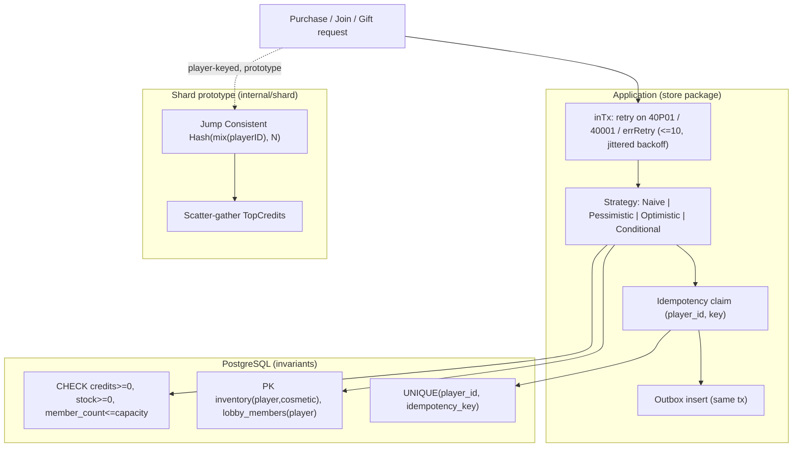
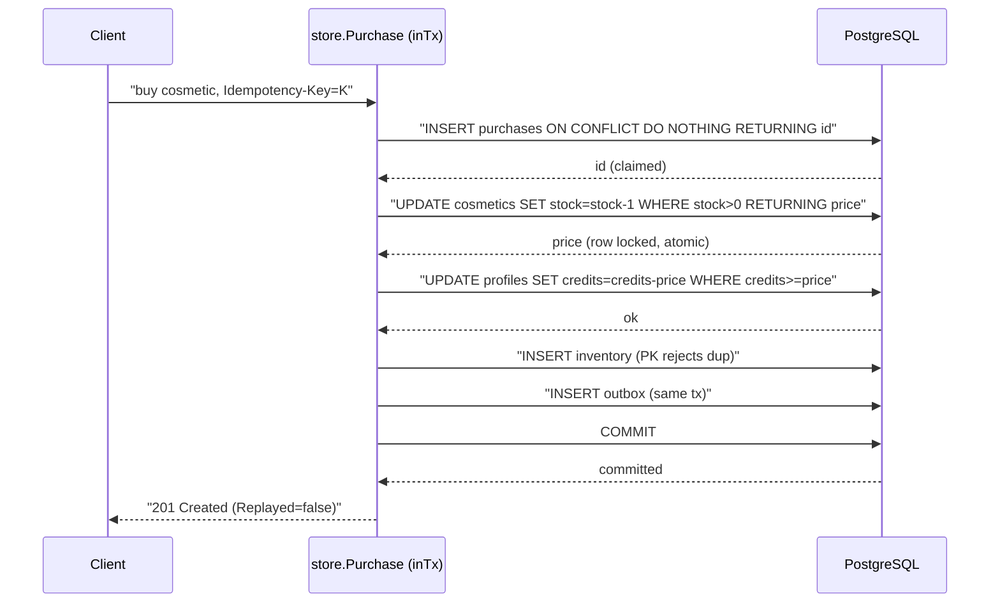
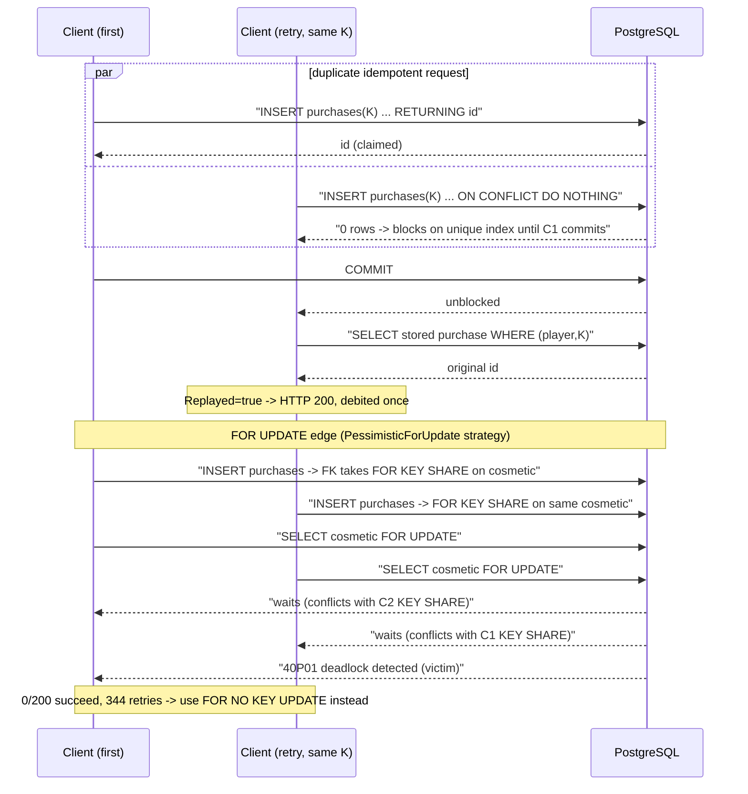

# ADR-0006 deep dive: concurrency control, idempotency, deadlocks, sharding

Source decision: [`../../adr/0006-concurrency-control-and-sharding.md`](../../adr/0006-concurrency-control-and-sharding.md).
Evidence: [`../../experiments/002-week2-persistence/README.md`](../../experiments/002-week2-persistence/README.md),
results [`purchase-strategies.md`](../../experiments/002-week2-persistence/results/purchase-strategies.md),
[`query-plans.md`](../../experiments/002-week2-persistence/results/query-plans.md).

## 1. TL;DR

- **Invariants live in the schema first:** `CHECK (credits >= 0)`, `CHECK (stock >= 0)`, `inventory PRIMARY KEY (player_id, cosmetic_id)`, `lobby_members PRIMARY KEY (player_id)`, `UNIQUE (player_id, idempotency_key)`. A buggy code path can lose an update but can never commit a negative balance or a second active lobby.
- **Purchases use single-statement conditional updates by default** (`UPDATE ... WHERE stock > 0` / `WHERE credits >= $p`). It was the fastest strategy measured: **129 ms** for 200 buyers vs 832 ms (optimistic) and 984 ms (pessimistic `FOR NO KEY UPDATE`).
- **Pessimistic locking uses `FOR NO KEY UPDATE`, not `FOR UPDATE`.** The purchase's foreign-key insert holds `FOR KEY SHARE` on the cosmetic, so `FOR UPDATE` deadlocks every buyer: **0 of 200 succeeded, 344 deadlock retries**.
- **Idempotency** is a `(player_id, Idempotency-Key)` unique index claimed inside the transaction; a concurrent duplicate blocks then **replays** the stored result (200 instead of 201). **Deadlocks** are avoided by fixed lock ordering and retried via `inTx` with jittered exponential backoff on `40P01`/`40001` (≤ 10 retries).
- **Sharding is a prototype:** Jump Consistent Hash over N pools, single-shard transactions only, cross-shard reads via **scatter-gather** (`TopCredits`). Growing 2→3 shards moves **33.3%** of keys, all to the new shard; global `UNIQUE(username)` is lost.

## 2. Context and problem

The Week 2 gate: **no overspending, no overselling of limited cosmetics, no duplicate active-lobby membership, and retries must not duplicate purchases.** All of these are concurrency problems — many clients racing on the same rows.

Concrete hazards:

- **Lost update.** Two buyers both read `stock = 20`, both compute `19`, both write `19`. Stock drops by one when two items were sold. A `CHECK (stock >= 0)` cannot catch it because neither write was negative.
- **Overselling / overspending.** Limited stock and finite credits must hold under hundreds of simultaneous buyers.
- **Duplicate purchase on retry.** A client that times out and retries must not be charged twice.
- **Deadlock.** Two transactions grabbing the same rows in opposite order can wedge each other.
- **Scale.** A sharding prototype must show what you *lose* (cross-shard uniqueness and transactions) before anyone reaches for it.

The ADR implements several strategies and **measures** them rather than asserting which is best.

## 3. HLD

Correctness is layered: the schema is the last line of defense (constraints), and the application adds the cheapest lock strategy that holds. All writes run through `inTx`, which retries on serialization failures and deadlocks. Idempotency and the outbox event are part of the same transaction. Sharding is a separate router used only by the prototype.

## 4. LLD

### 4.1 Components and responsibilities

| Component | Responsibility |
|---|---|
| `store.inTx` / `inTxOpts` | Run a closure in a primary transaction, retrying on `40P01` (deadlock), `40001` (serialization), and `errRetry` (optimistic conflict) with jittered backoff, ≤ `MaxRetries` (10). |
| `store.Purchase` | Claim idempotency key, debit (per strategy), grant item, write outbox — all in one transaction. |
| `store.debit` | Implements the five strategies (Naive, Pessimistic, Optimistic, Conditional, PessimisticForUpdate). |
| `store.Gift` | Credit transfer; `ordered` flag chooses lock order to show/avoid deadlock. |
| `store.JoinLobby` | Optimistic concurrency on `lobbies.version`; PK on `lobby_members.player_id` guarantees one lobby. |
| `shard.Jump` / `shard.mix` | Jump Consistent Hash and a SplitMix64 finalizer to spread sequential IDs. |
| `shard.Router` | Routes player-keyed queries; single-shard transactions; `TopCredits` scatter-gather. |

### 4.2 Schema invariants (exact, migration 00001/00002)

| Constraint | Table | Guarantees |
|---|---|---|
| `CHECK (credits >= 0)` | `profiles` | never overspend |
| `CHECK (stock >= 0)` | `cosmetics` | never oversell |
| `CHECK (price > 0)` | `cosmetics` | priced items |
| `PRIMARY KEY (player_id, cosmetic_id)` | `inventory` | own an item at most once |
| `UNIQUE (player_id, idempotency_key)` | `purchases` | a purchase request applied at most once |
| `PRIMARY KEY (player_id)` | `lobby_members` | one active lobby per player |
| `CHECK (member_count BETWEEN 0 AND capacity)` | `lobbies` | member-count backstop |
| `PRIMARY KEY (scope, key)` | `idempotency_keys` | generic dedupe (e.g. `POST /v1/players`) |
| `version bigint DEFAULT 0` | `profiles`, `cosmetics`, `lobbies` | optimistic-concurrency token |

### 4.3 Measured strategy numbers (200 buyers, 20 units, price 10, 1000 credits each)

| strategy | sold | out of stock | other errors | final stock | wall ms | deadlock retries | optimistic retries |
|---|---:|---:|---:|---:|---:|---:|---:|
| naive (read → check in Go → write) | **200** | 0 | 0 | **18** | 1244 | 0 | 0 |
| pessimistic `FOR UPDATE` | **0** | 0 | **200** | 20 | 59787 | 344 | 0 |
| pessimistic `FOR NO KEY UPDATE` | 20 | 180 | 0 | 0 | 984 | 0 | 0 |
| optimistic (`version` column) | 20 | 180 | 0 | 0 | 832 | 0 | 206 |
| conditional `UPDATE … WHERE stock > 0` | 20 | 180 | 0 | 0 | **129** | 0 | 0 |

### 4.4 Algorithms, step by step

**`inTx` retry loop.** For `attempt = 0, 1, 2, …`: run the closure in a transaction. On `nil` return success. On `errRetry` → reason `optimistic_conflict`; on `40P01` → `deadlock`; on `40001` → `serialization_failure`; anything else returns immediately. Increment `TxRetries{reason}`. If `attempt >= 10`, return `ErrConflict` (optimistic) or the raw error. Otherwise sleep `backoff + rand(backoff)` where `backoff = 2^min(attempt,6) ms` (jittered exponential backoff, capped at 64 ms base), unless the context is cancelled.

**`Purchase` (idempotent, one transaction):**
1. **Claim the key:** `INSERT INTO purchases (... idempotency_key) ON CONFLICT (player_id, idempotency_key) DO NOTHING RETURNING id`. If no row (`pgx.ErrNoRows`), a concurrent request already claimed it: block on the unique index, then read the stored purchase and **replay** (`Replayed=true`), returning the same `PurchaseID`; mismatched cosmetic → `ErrIdempotencyMismatch`.
2. **Debit** stock and credits via the chosen strategy (`debit`).
3. **Grant:** `INSERT INTO inventory` — the `(player_id, cosmetic_id)` PK rejects duplicates (`ErrAlreadyOwned`).
4. **Outbox:** insert the `CosmeticPurchased` protobuf envelope in the same transaction (deterministic event ID from the purchase ID). Debezium publishes it later (ADR-0010).
5. A business failure rolls the whole transaction back, so the key is **not** consumed and a retry may succeed later.

**`debit` strategies:**
- **Conditional (default):** `UPDATE cosmetics SET stock = stock - 1 WHERE id=$1 AND (stock IS NULL OR stock > 0) RETURNING price`, then `UPDATE profiles SET credits = credits - $p WHERE player_id=$1 AND credits >= $p RETURNING credits`. Zero rows → `ErrOutOfStock`/`ErrInsufficientCredits`. The check happens under the row lock, no read-modify-write window.
- **Optimistic:** read `version`, then `UPDATE ... WHERE version = $read`; zero rows → `errRetry` (whole transaction re-runs).
- **Pessimistic:** `SELECT ... FOR NO KEY UPDATE` the cosmetic then the profile (fixed order), check in Go, write.
- **PessimisticForUpdate:** same but `FOR UPDATE` — kept only to reproduce the deadlock.
- **Naive:** read, check in Go, write a computed value — demonstrates the lost update.

**Jump Consistent Hash (`shard.Jump`).** For a key and `buckets`, iterate a linear-congruential step; `j = floor((b+1) * (2^31 / ((key>>33)+1)))`; the last `b < buckets` is the bucket. `mix` (SplitMix64 finalizer) spreads sequential IDs first. `ShardOf(playerID) = Jump(mix(playerID), len(shards))`.

**Scatter-gather (`TopCredits`).** Ask every shard for its local top-n in parallel (`errgroup`), concatenate, sort by `(credits desc, player_id)`, take the first n. Correct because the global top-n ⊆ union of local top-n; latency is the slowest shard.

## 5. Sequence diagrams

### 5.1 Happy path: idempotent conditional purchase

### 5.2 Failure / edge paths: duplicate retry and FK lock-upgrade deadlock

## 6. Concepts explained

### Lost update

- **What it is.** Two transactions read the same value, each computes a new value from their stale read, and the second write clobbers the first — one update is silently lost.
- **Why LocalArena cares.** The `Naive` strategy exists solely to demonstrate it; correct strategies (locked or atomic) prevent it.
- **What was measured.** 200 buyers each read stock 20 and wrote ~19, so **200 items were granted for 2 units of stock** (final stock 18). `CHECK (stock >= 0)` could not catch it because no single write was negative.
- **Where else.** Double-spending a wallet balance, inventory counts in e-commerce, "likes" counters, bank-balance updates without locking.

### Row locks (`FOR UPDATE` vs `FOR NO KEY UPDATE`)

- **What it is.** `SELECT ... FOR UPDATE` takes the strongest row lock (blocks other `FOR UPDATE`, `FOR NO KEY UPDATE`, `FOR KEY SHARE`). `FOR NO KEY UPDATE` is weaker: it does **not** conflict with `FOR KEY SHARE` (the lock a foreign-key reference takes on the parent row).
- **Why LocalArena uses `FOR NO KEY UPDATE`.** The purchase inserts a `purchases` row first, whose FK to `cosmetics` takes `FOR KEY SHARE` on the cosmetic. With 200 buyers all holding KEY SHARE, upgrading to `FOR UPDATE` deadlocks everyone. `NO KEY UPDATE` does not conflict with KEY SHARE, so it works.
- **What was measured.** `FOR UPDATE`: **0 sold, 200 errors, 344 deadlock retries, 59,787 ms**. `FOR NO KEY UPDATE`: 20 sold, 984 ms, 0 deadlocks.
- **Where else.** Any parent/child write with FKs under contention: order + order_items, account + ledger_entries, booking + seats.

### Foreign-key lock levels (`FOR KEY SHARE`)

- **What it is.** Inserting a child row that references a parent takes `FOR KEY SHARE` on the parent to stop its key being deleted/changed mid-insert. It is a *shared* lock, so many inserts coexist — until someone tries to take a conflicting stronger lock.
- **Why LocalArena cares.** It is the hidden cause of the `FOR UPDATE` deadlock; understanding FK lock levels is the point.
- **What was measured.** Same 344-retry / 0-success result above is the evidence.
- **Where else.** High-insert-rate child tables (events, line items) referencing hot parent rows in OLTP systems.

### Optimistic locking (version column)

- **What it is.** Read a `version`, write `WHERE version = $read AND version = version+1`; if zero rows changed, someone else won — re-run. No lock is held between read and write.
- **Why LocalArena uses it.** For **lobbies**, where conflicts are rare and the read drives several decisions (status, capacity). For purchases it is available but not the default.
- **What was measured.** Optimistic purchases: 20 sold, **832 ms, 206 optimistic retries**. `TestLobbyLastSeats`: 20 joiners, 3 seats → exactly 3 in, `member_count = rows = 4`.
- **Where else.** CRDT-free document edits, shopping-cart quantity updates, any low-contention record with read-decides-write logic (JIRA issue edits, wiki pages).

### Conditional update

- **What it is.** Fold the check into the write: `UPDATE ... SET x = x - 1 WHERE x > 0`. The predicate is evaluated under the row lock the UPDATE already takes, so there is no read-modify-write window.
- **Why LocalArena uses it.** It is the **default** purchase strategy — one round trip per row, no retries, no separate read.
- **What was measured.** **Fastest: 129 ms** for 200 buyers, 0 retries. `TestLimitedStockNeverOversells` and `TestCreditsNeverOverspent` confirm correctness across strategies.
- **Where else.** Decrementing inventory/credits, "claim a coupon if unused", seat holds, rate-limit token decrements.

### Idempotency key

- **What it is.** A client-supplied key that makes a write safe to retry: the first request applies it, retries return the original result.
- **Why LocalArena uses it.** A purchase claims `(player_id, Idempotency-Key)` with `INSERT ON CONFLICT DO NOTHING`; a concurrent duplicate blocks on the unique index, then replays (200 not 201). `POST /v1/players` uses the generic `idempotency_keys` table with a `request_hash` to detect key reuse for a different request.
- **What was measured.** `TestPurchaseIdempotency`: same key sent 20× concurrently → **1 applied, 19 replays** with the same purchase ID, debited once; reusing the key for another item → **422** (`ErrIdempotencyMismatch`).
- **Where else.** Stripe's `Idempotency-Key` header, payment capture retries, webhook delivery dedupe, "create order" buttons double-clicked.

### Deadlock and lock ordering

- **What it is.** A deadlock is a cycle of transactions each waiting on a lock the other holds; Postgres detects it (after `deadlock_timeout`, 200 ms here) and aborts one victim with `40P01`. Taking locks in a **fixed global order** makes cycles impossible.
- **Why LocalArena uses it.** Locks are always taken cosmetic → profile, and for gifts in **ascending player ID**. `Gift(ordered=true)` sorts the IDs; `ordered=false` keeps argument order to demonstrate the deadlock.
- **What was measured.** `TestDeadlockIsDetected`: opposite-order updates → exactly **1 victim, `40P01` after `deadlock_timeout=200ms`**. `TestGiftLockOrdering`: unordered deadlocks under contention (an earlier 60-gift run: 34/60 failed, 560 retries); ordered: **0 deadlocks**, credits conserved both ways.
- **Where else.** Money transfers between accounts, any multi-row update across services, graph updates — always lock in a canonical order.

### Retry with jittered exponential backoff

- **What it is.** On a transient conflict, wait a growing, randomized interval before retrying, so retriers do not re-collide in lockstep.
- **Why LocalArena uses it.** `inTx` retries `40P01`/`40001`/`errRetry` with `backoff = 2^min(attempt,6) ms + rand(backoff)`, ≤ 10 attempts; then `ErrConflict`. The closure must have no side effects outside the transaction (it re-runs).
- **What was measured.** Optimistic purchases needed 206 retries and still finished (832 ms). Bounded retries did **not** save the `FOR UPDATE` deadlock (344 retries, 0 success) — a sign the strategy, not the backoff, was wrong.
- **Where else.** Client retries on 503, SQS/Kafka consumer retries, AWS SDK retry policies, optimistic-concurrency loops everywhere.

### Isolation levels

- **What it is.** Read Committed (Postgres default) sees each statement's own snapshot; `SERIALIZABLE` makes concurrent transactions behave as if run one at a time, aborting conflicts with `40001`.
- **Why LocalArena cares.** It runs the default (Read Committed) with explicit locks/conditional writes; `inTx` already retries `40001`, so `SERIALIZABLE` remains a drop-in option for complex multi-row rules later.
- **What was measured.** Not benchmarked as a strategy in Week 2 (the ADR lists it as an alternative). The `40001` retry path is exercised indirectly by the optimistic strategy's `errRetry`.
- **Where else.** Financial double-entry rules, inventory reservations with complex constraints, anywhere "serializable or bust" is cheaper to reason about than hand-placed locks.

### Pessimistic vs optimistic locking

- **What it is.** Pessimistic: lock the row before touching it (assume conflict). Optimistic: don't lock, detect conflict at write time and retry (assume no conflict).
- **Why LocalArena uses both.** Pessimistic (`FOR NO KEY UPDATE`) and conditional for hot contended counters; optimistic for low-contention, read-decides-write lobby logic.
- **What was measured.** Under heavy contention conditional (129 ms) beat pessimistic (984 ms) beat optimistic (832 ms with 206 retries); optimistic wins when conflicts are rare (lobbies).
- **Where else.** Pessimistic: seat/warehouse reservations. Optimistic: wikis, collaborative docs, low-contention admin edits.

### Idempotent outbox in the same transaction

- **What it is.** The state change and the event row commit atomically, so the event is never lost and never emitted without the state change.
- **Why LocalArena uses it.** `Purchase` inserts the `CosmeticPurchased` envelope in the same transaction (Debezium EventRouter column layout), with a deterministic event ID. Published in Week 4 (ADR-0010).
- **What was measured.** `TestLimitedStockNeverOversells` checks "5 outbox rows" alongside 5 inventory rows and 500 credits debited — outbox count tracks the real purchases.
- **Where else.** The transactional-outbox pattern in any event-driven system: order-placed events, payment-captured events, user-registered events.

### Sharding and jump consistent hash

- **What it is.** Split data across N databases by a shard key; Jump Consistent Hash (Lamping & Veach 2014) maps a key to a bucket with no ring or lookup table, is perfectly balanced, and moves only ~1/(N+1) of keys when you add a shard.
- **Why LocalArena uses it (prototype).** To learn what sharding *costs*: single-shard transactions only, no cross-shard `UNIQUE`, and shard-key-less queries become scatter-gather. `mix` spreads sequential IDs before hashing.
- **What was measured.** `TestJumpBalanceAndMinimalMovement`: 100k keys → **49.96/50.04%** balance; growing 2→3 moved **33.3%**, all to the new shard. `TestRouterAgainstTwoShards`: 48/52 split of 100 players, routed reads correct, and the **same username accepted on both shards** (no global UNIQUE).
- **Where else.** Horizontal partitioning in large social graphs, multi-tenant SaaS (shard per tenant range), Discord/Slack message stores, Instagram's user sharding.

### Scatter-gather

- **What it is.** Fan a query out to all shards in parallel and merge the partial results.
- **Why LocalArena uses it.** `TopCredits` asks every shard for its local top-n and merges, because the global top-n is a subset of the union of local top-ns.
- **What was measured.** `TestRouterAgainstTwoShards`: scatter-gather top-5 returns players 100,99,98,97,96 correctly. Latency = slowest shard (not separately benchmarked).
- **Where else.** Elasticsearch/Solr distributed search, cross-shard aggregations, federated GraphQL, map-reduce leaderboards.

### Distributed locks and fencing (noted, not used)

- **What it is.** A lock held across processes (e.g. a Redis/Valkey lease). Without a **fencing token** a paused lock holder can resume and clobber newer state.
- **Why LocalArena avoids it.** Correctness never depends on a lease-based lock without fencing; the only cross-process lock is the Postgres advisory lock that serializes migrations (ADR-0005).
- **What was measured.** Not measured (deliberately not used for purchases).
- **Where else.** Redlock debates, leader-only jobs, Zookeeper/etcd locks — all need fencing to be safe.

## 7. Code pointers

| Path (symbol / key) | What to look at |
|---|---|
| [`../../backend/internal/store/store.go`](../../backend/internal/store/store.go) (`inTx`, `inTxOpts`) | Retry loop, `TxRetries`, jittered backoff `2^min(attempt,6)`. |
| [`../../backend/internal/store/purchases.go`](../../backend/internal/store/purchases.go) (`Purchase`, `debit`, `Strategy`) | Idempotency claim, five strategies, FK lock-upgrade comment. |
| [`../../backend/internal/store/purchases.go`](../../backend/internal/store/purchases.go) (`Gift`) | `ordered` lock ordering to show/avoid deadlock. |
| [`../../backend/internal/store/purchases.go`](../../backend/internal/store/purchases.go) (`insertOutbox`) | Same-transaction outbox envelope. |
| [`../../backend/internal/store/lobbies.go`](../../backend/internal/store/lobbies.go) (`JoinLobby`) | Optimistic `version` + membership PK. |
| [`../../backend/internal/store/profiles.go`](../../backend/internal/store/profiles.go) (`CreatePlayerIdempotent`) | Generic `idempotency_keys` claim + `request_hash`. |
| [`../../backend/internal/shard/shard.go`](../../backend/internal/shard/shard.go) (`Jump`, `mix`, `Router`, `TopCredits`) | Jump hash, SplitMix64 finalizer, scatter-gather. |
| [`../../backend/migrations/00001_accounts_economy.sql`](../../backend/migrations/00001_accounts_economy.sql) | All invariant CHECK/PK/UNIQUE constraints. |
| [`../../backend/migrations/00002_lobbies.sql`](../../backend/migrations/00002_lobbies.sql) | `lobby_members` PK, `member_count` CHECK. |
| [`../../backend/migrations/00006_idempotency_keys.sql`](../../backend/migrations/00006_idempotency_keys.sql) | Generic idempotency table. |
| [`../../backend/internal/store/concurrency_test.go`](../../backend/internal/store/concurrency_test.go) | `TestDeadlockIsDetected`, `TestGiftLockOrdering`, `TestLobbyLastSeats`. |
| [`../../backend/internal/store/purchases_test.go`](../../backend/internal/store/purchases_test.go) | Oversell/overspend/idempotency assertions. |
| [`../../backend/internal/shard/shard_test.go`](../../backend/internal/shard/shard_test.go) | Balance/movement 33.3%, duplicate username across shards. |
| [`../../experiments/002-week2-persistence/results/purchase-strategies.md`](../../experiments/002-week2-persistence/results/purchase-strategies.md) | The strategy-comparison table. |

## 8. Trade-offs and alternatives

| Option | Pros | Cons | Why (not) chosen |
|---|---|---|---|
| **Conditional update** (chosen default) | Fastest (129 ms), 1 round trip, no retries | One statement per row; check must fit a predicate | Best for hot contended counters |
| Optimistic (version) | No locks held; great when conflicts rare | Retries under contention (206) | Chosen for **lobbies**, not hot purchases |
| Pessimistic `FOR NO KEY UPDATE` | Simple to reason about; correct | Slower (984 ms); still serializes buyers | Fine but beaten by conditional |
| Pessimistic `FOR UPDATE` | — | Deadlocks every buyer via FK KEY SHARE (0/200) | Rejected; kept only to reproduce the bug |
| `SERIALIZABLE` everywhere | Least reasoning; correct by construction | Every conflict is a retry | Kept as a future option for complex rules |
| Valkey/Redis locks for purchases | Fast lock acquisition | Second source of truth; needs fencing tokens | Rejected: unsafe without fencing |
| **App-side jump-hash router** (chosen, prototype) | Teaches routing; balanced; minimal movement | No cross-shard tx/UNIQUE; no rebalance | Chosen to *learn* sharding costs |
| Citus / Vitess | Production-grade sharding | Hides the routing this week teaches | Rejected for the learning goal |

## 9. Failure modes and how they were found

- **Lost update (Naive).** Found by the purchase-strategy experiment: 200 granted for 2 units. See [experiment §1](../../experiments/002-week2-persistence/README.md).
- **FK lock-upgrade deadlock (`FOR UPDATE`).** Found by the same experiment: 0/200, 344 retries, ~60 s. Fixed by `FOR NO KEY UPDATE`.
- **Opposite-direction gift deadlock.** Found by `TestGiftLockOrdering`; fixed by ascending-ID lock ordering (0 deadlocks).
- **Duplicate purchase on retry.** Prevented and verified by `TestPurchaseIdempotency` (1 applied, 19 replays; key reuse for a different item → 422).
- **Lost global username uniqueness under sharding.** Found by `TestRouterAgainstTwoShards`: the same username is accepted on two shards — a production design needs a username directory/reservation table on one shard. Carried forward in the ADR.
- **No shard rebalance.** `TestJumpBalanceAndMinimalMovement` shows 33.3% move on 2→3, which still needs an online copy-and-cutover process (not implemented).

## 10. Interview questions

**1. What is a lost update and why can't a `CHECK` constraint catch it?**
Two transactions read the same value, each writes a value computed from their stale read, and the second clobbers the first. A `CHECK (stock >= 0)` can't catch it because each individual write (e.g. 20→19) is valid; the bug is that two writes both produced 19. Only atomic or locked writes prevent it.

**2. Explain the `FOR UPDATE` deadlock in the purchase path.**
The transaction first inserts a `purchases` row, whose foreign key takes `FOR KEY SHARE` on the cosmetic. Every concurrent buyer holds that shared lock. `FOR UPDATE` conflicts with `FOR KEY SHARE`, so each buyer waits for all the others to release — a deadlock cycle. 0 of 200 succeeded with 344 retries.

**3. How does `FOR NO KEY UPDATE` fix it?**
`FOR NO KEY UPDATE` does not conflict with `FOR KEY SHARE`, so the FK locks held by concurrent buyers don't block it. It locks the row for a non-key update, which is exactly what decrementing stock/credits needs.

**4. Why was the conditional update the fastest?**
It is one round trip per row and folds the check into the write (`WHERE stock > 0`), so the check happens under the row lock the UPDATE already takes — no separate read, no read-modify-write window, nothing to retry. 129 ms vs 832/984 ms.

**5. When is optimistic locking the right choice, and where is it used here?**
When conflicts are rare and the read drives decisions. It's used for lobbies (`JoinLobby`): read `version`, update `WHERE version = $read`, re-run on zero rows. Under heavy purchase contention it needed 206 retries, so it's not the default there.

**6. How does the idempotency key make a purchase safe to retry?**
The purchase claims `(player_id, Idempotency-Key)` with `INSERT ... ON CONFLICT DO NOTHING` inside the transaction. A concurrent duplicate blocks on the unique index, then reads and replays the original result (HTTP 200, not 201). A business failure rolls back the claim, so the key can be retried.

**7. What happens if the same key is reused for a *different* item?**
The stored purchase's cosmetic doesn't match, so the store returns `ErrIdempotencyMismatch` → HTTP 422. `CreatePlayerIdempotent` does the same via a `request_hash` comparison.

**8. How are deadlocks prevented, and how are the unavoidable ones handled?**
Locks are always taken in a fixed global order (cosmetic → profile, gifts by ascending player ID), which makes lock-order cycles impossible. Any remaining `40P01`/`40001` is retried by `inTx` with jittered exponential backoff (≤ 10 attempts). `TestGiftLockOrdering` shows ordered = 0 deadlocks.

**9. Why does the retry use jitter?**
Without jitter, all victims retry at the same instant and re-collide in lockstep. `backoff = 2^min(attempt,6) ms + rand(backoff)` spreads them out. The closure must be side-effect-free outside the transaction because it re-runs.

**10. What is Jump Consistent Hash and why not a hash ring?**
It maps a key to one of N buckets with no lookup table or ring, is perfectly balanced, and moves only ~1/(N+1) of keys when you add a shard. Measured: 49.96/50.04% balance and 33.3% moved on 2→3, all to the new shard. A ring needs virtual nodes and a stored structure to balance well.

**11. What does `mix` (SplitMix64) do and why is it needed?**
Sequential IDs (1, 2, 3, …) hash poorly, clustering in buckets. `mix` is a SplitMix64 finalizer that avalanches the bits first, so `Jump(mix(id), N)` is well distributed.

**12. What do you lose by sharding, concretely, in this prototype?**
Cross-shard transactions (single-shard only), cross-shard `UNIQUE` (the same username is accepted on two shards), and shard-key-less queries become scatter-gather. There's also no rebalance, so growth needs an online copy-and-cutover.

**13. How does scatter-gather `TopCredits` stay correct?**
The global top-n is always a subset of the union of each shard's local top-n, so asking each shard for its top-n and merging (sort by credits desc, player_id) yields the correct global top-n. Latency is bounded by the slowest shard.

**14. (Design) You now sell 10,000 of a limited cosmetic to 1M buyers in a flash sale. What breaks and what do you change?**
A single hot row serializes every buyer. Options: shard the stock into K counter rows and decrement a random one (sum = K×cap/K), reserve stock in batches per API node, or move the hot counter to an in-memory allocator with a durable periodic flush. Keep the conditional-update invariant per counter and reconcile. Watch `TxRetries` and the single-row lock-wait time.

**15. (Design / 100x) You must restore global username uniqueness across shards. How?**
Add a single-shard username directory/reservation table keyed by username; registration first reserves the name there (unique index), then creates the player on its owning shard, releasing the reservation on failure (a small saga). IDs move off `GENERATED ALWAYS` to globally unique IDs (snowflake-style) so they're unique across shards. Reads that need "is this name taken" hit the directory, not every shard.
