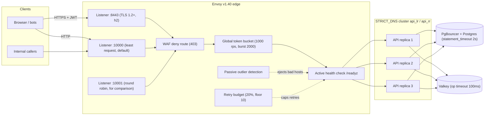
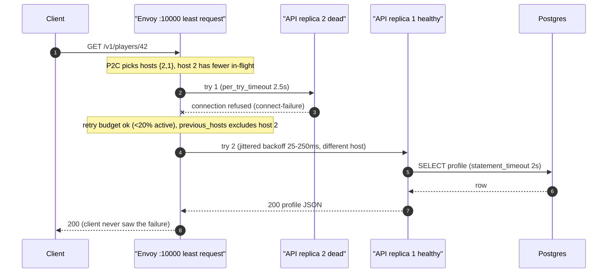
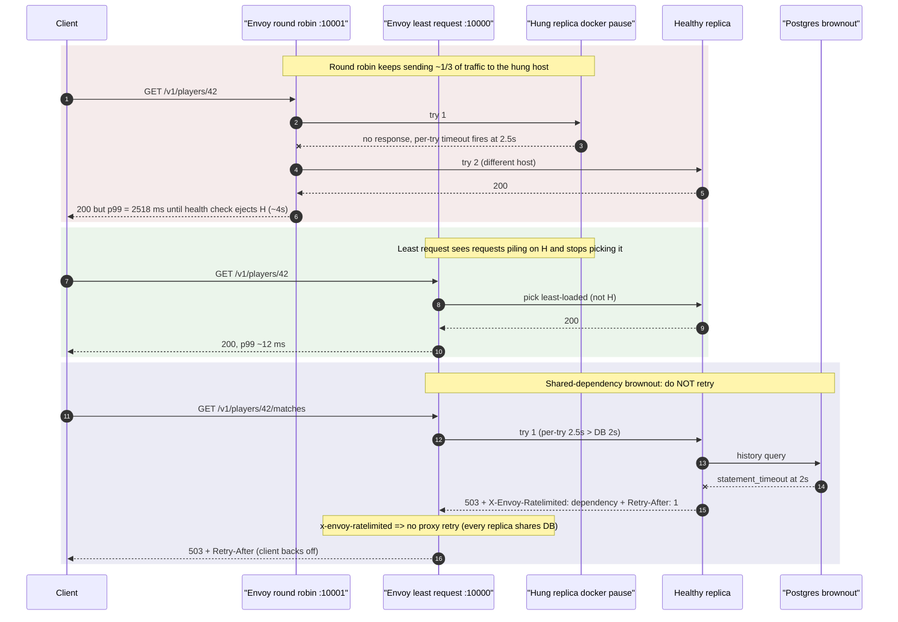

# ADR-0007 deep dive: Envoy edge, load balancing, timeout budgets, retries

> Source decision: [`../../adr/0007-edge-timeouts-retries.md`](../../adr/0007-edge-timeouts-retries.md)
> Evidence: [`../../experiments/003-week3-resilience/README.md`](../../experiments/003-week3-resilience/README.md)
> Related: [ADR-0008 caching, rate limiting, circuit breaker](ADR-0008-caching-ratelimit-breaker.md), [ADR-0004 Postgres pooling and replicas](ADR-0004-postgres-pooling-replicas.md), [architecture overview](../00-architecture.md)

---

## 1. TL;DR

- LocalArena runs **three stateless Go API replicas** behind an **Envoy v1.40 edge**. Losing or hanging one replica must cause **zero failed requests** (Week 3 gate), and that gate was met: `docker kill`, `docker stop`, `docker pause`, and CPU-starving a replica all produced **0 failures out of ~9,000 requests** at 300 rps.
- Two Envoy listeners run over the same three replicas for comparison: `:10000` **least request** (power-of-two-choices, the default) and `:10001` **round robin**. A *hung* host is worse than a *dead* one; least request routes around it almost instantly (p99 **12 ms vs 2,518 ms** under `docker pause`).
- A deliberately ordered **timeout budget** — Postgres `statement_timeout` 2 s < Envoy per-try 2.5 s < API request context 3 s < Envoy route 4 s — makes a slow *shared* database answer as a non-retryable API 503 instead of an Envoy timeout, so only a genuinely hung replica is cut off and retried elsewhere.
- **Retries are safe by construction**: idempotent methods (GET/PUT) and writes carrying an `Idempotency-Key` are retried on a *different* host; everything else is retried only if it never reached an upstream. A **retry budget** (20% of active requests, floor 10) stops a retry storm, and shared-dependency 503s are tagged `x-envoy-ratelimited` so the proxy never multiplies a dependency outage.
- **Graceful drain**: on SIGTERM the API fails `/readyz` for 5 s (2.5 health intervals) while still serving, then calls `http.Server.Shutdown`. A **PodDisruptionBudget** (`minAvailable: 1`) and **topology spread** (`DoNotSchedule`, one replica per node) remove the single points of failure that the Kubernetes node-loss drill exposed.

---

## 2. Context and problem

By Week 3 the API has grown from one process into **three stateless replicas**. The Week 3 gate (see [`../../README.md`](../../README.md)) is explicit:

> one stateless failure causes no API outage; cache failure does not lose durable data; retries cannot duplicate writes.

That raises four problems that a single process never had:

1. **How do clients reach three replicas?** Clients should not know how many replicas exist, nor track their health. Something in front must discover them and balance load.
2. **What happens when one replica fails?** Failures come in flavours: a *crash* (process exits, connections refused), a *hang* (process alive but unresponsive — the nasty one), *CPU starvation* (slow but alive), and a *deploy* (intentional, graceful). Each needs a different reaction.
3. **How do retries not cause harm?** Retrying a failed request is the obvious fix for a transient failure, but a naive retry can (a) **duplicate a write** (charge a player twice) and (b) **amplify an outage** — if every replica shares one slow database, retrying on "another" replica just hammers the same database (a *retry storm*).
4. **How does a replica leave cleanly?** During a rolling deploy a replica must stop receiving *new* traffic, finish *in-flight* traffic, and only then exit, or clients see spurious errors during every deploy.

The decision in ADR-0007 answers all four with an **Envoy edge proxy**, a **strict timeout budget**, **method-aware retries with a budget**, and a **graceful-drain** lifecycle. The companion [ADR-0008](ADR-0008-caching-ratelimit-breaker.md) covers caching, rate limiting, the circuit breaker, and the CDN-style asset edge; this file focuses on the *edge and resilience* half.

A subtle but central invariant comes from the README: **Valkey is disposable acceleration, and Postgres is authoritative for money-like data.** That is why a dependency outage must *degrade* rather than fail, and why retries must never be allowed to double a durable write.

---

## 3. HLD

Envoy sits between every client (browser, bot, internal caller) and the three API replicas. It terminates TLS, applies a coarse WAF deny-list and a global edge rate limit (both detailed in [ADR-0015](ADR-0015-api-evolution-edge-security.md) and ADR-0008), discovers replicas by DNS, balances load, checks health, retries safely, and sheds overload before it reaches the API.



Key HLD choices:

- **The edge, not the clients, owns health/retry/balancing logic.** Putting it in Envoy means every client language gets it for free (an alternative — client-side load balancing — was rejected for exactly this reason).
- **Two listeners, same replicas.** `:10000` (least request) and `:10001` (round robin) exist so the experiment can measure the difference under identical conditions. In production you would keep only least request.
- **The database is shared.** Envoy cannot "route around" a slow database because *every* replica talks to it. This is why the timeout budget and the `x-envoy-ratelimited` tag exist: to distinguish a bad *replica* (retry elsewhere) from a bad *dependency* (do not retry at all).

---

## 4. LLD

### 4.1 Components and responsibilities

| Component | Responsibility | Where |
|---|---|---|
| Envoy listeners `rr`/`lr`/`tls` | Accept downstream requests; run the HTTP connection manager, WAF route, global rate-limit filter, router filter | [`../../infra/compose/envoy/envoy.yaml`](../../infra/compose/envoy/envoy.yaml) `static_resources.listeners[]` |
| Clusters `api_rr` / `api_lr` | Discover replicas (`STRICT_DNS` on `api:8081`), choose an LB policy, run health checks, outlier detection, panic threshold, circuit breakers + retry budget | same file, `static_resources.clusters[]` |
| Route retry policies | Decide *which* requests retry, on *what* conditions, *how many* times, with *what* backoff, avoiding the *same* host | `routes[].route.retry_policy` |
| API `run()` | Start the HTTP server with sane `Read/Write/Idle` timeouts; handle SIGTERM; drain readiness then shut down | [`../../backend/cmd/api/main.go`](../../backend/cmd/api/main.go) |
| API `Server.ready` | Report whether *this* replica should get traffic (fails only while draining; shared-dependency loss is "degraded", not "not ready") | [`../../backend/internal/api/api.go`](../../backend/internal/api/api.go) `ready` |
| API `noProxyRetry` / `fail` | Tag dependency-caused 503s with `x-envoy-ratelimited` so Envoy does not retry them; map domain errors to status codes + `Retry-After` | `api.go` `noProxyRetry`, `fail` |
| Helm `api.yaml` | Deployment, Service, `PodDisruptionBudget`, HPA, probes, `terminationGracePeriodSeconds` | [`../../infra/helm/localarena/templates/api.yaml`](../../infra/helm/localarena/templates/api.yaml) |
| Helm `la.spread` | Topology spread — one API pod per node | [`../../infra/helm/localarena/templates/_helpers.tpl`](../../infra/helm/localarena/templates/_helpers.tpl) |
| Migration `00007` | Set the database-wide `statement_timeout = 2s` (innermost timeout) | [`../../backend/migrations/00007_timeouts.sql`](../../backend/migrations/00007_timeouts.sql) |

### 4.2 Config values (exact numbers from the repo)

**Cluster discovery and connections** (`envoy.yaml`, both clusters):

| Key | Value | Meaning |
|---|---|---|
| `type` | `STRICT_DNS` | resolve `api` to all A-records (one per replica) |
| `dns_refresh_rate` | `2s` | re-resolve DNS every 2 s |
| `respect_dns_ttl` | `false` | ignore the record TTL, use the refresh rate |
| `connect_timeout` | `0.25s` | TCP connect budget (was 0.5 s; shortened in Exp 003) |
| `lb_policy` | `ROUND_ROBIN` (`api_rr`) / `LEAST_REQUEST` (`api_lr`) | load-balancing algorithm |
| `least_request_lb_config.choice_count` | `2` | power-of-two-choices sample size |

**Active health check** (both clusters):

| Key | Value |
|---|---|
| `timeout` | `1s` |
| `interval` | `2s` |
| `unhealthy_threshold` | `2` (two failures eject) |
| `healthy_threshold` | `1` (one success restores) |
| `http_health_check.path` | `/readyz` |

**Passive outlier detection** (both clusters):

| Key | Value |
|---|---|
| `consecutive_5xx` | `5` |
| `consecutive_gateway_failure` | `3` |
| `interval` | `2s` |
| `base_ejection_time` | `10s` |
| `max_ejection_percent` | `34` (never eject more than one of three hosts' worth) |

**Panic threshold** (`common_lb_config`): `healthy_panic_threshold.value = 34`. If fewer than 34% of hosts are healthy, Envoy *stops honouring health* and load-balances across **all** hosts — better to try an unhealthy host than to send traffic to zero hosts.

**Circuit breakers + retry budget** (per cluster `circuit_breakers.thresholds[0]`):

| Key | Value |
|---|---|
| `max_connections` | `1024` |
| `max_pending_requests` | `256` |
| `max_requests` | `1024` |
| `retry_budget.budget_percent` | `20.0` |
| `retry_budget.min_retry_concurrency` | `10` (was 3; a floor of 3 overflowed when a replica died, Exp 003) |

**Retry policy** (idempotent/keyed routes):

| Key | Value |
|---|---|
| `retry_on` | `connect-failure,refused-stream,reset-before-request,5xx,gateway-error` |
| `num_retries` | `2` |
| `per_try_timeout` | `2.5s` |
| `retry_host_predicate` | `previous_hosts` (avoid the host that just failed) |
| `host_selection_retry_max_attempts` | `3` (tries up to 3 times to pick a *new* host) |
| `retry_back_off.base_interval` | `0.025s` (25 ms) |
| `retry_back_off.max_interval` | `0.25s` (250 ms) |

The **catch-all route** (non-idempotent writes with no key) uses a *narrower* `retry_on`: only `connect-failure,refused-stream,reset-before-request` and **no** `per_try_timeout`.

**Listener HTTP settings** (all listeners): `request_timeout: 10s`, `idle_timeout: 60s`, `max_requests_per_connection: 10000`, `max_request_headers_kb: 16`, `use_remote_address: true` (so `X-Forwarded-For` is trustworthy at the rightmost hop).

**Route timeout**: every forwarding route has `timeout: 4s` (the whole-request budget across all tries).

**API server** (`main.go`): `ReadHeaderTimeout: 5s`, `ReadTimeout: 5s`, `WriteTimeout: 5s` (deliberately `> 3s` request budget so handlers can write their own error replies), `IdleTimeout: 60s`. Request context budget = `requestTimeout = 3 * time.Second` (`api.go`). `DRAIN_SECONDS` defaults to 5 (`main.go`, compose `DRAIN_SECONDS: "5"`, `stop_grace_period: 20s`).

**Database** (`00007_timeouts.sql`): `ALTER DATABASE ... SET statement_timeout = '2s'`.

**The timeout budget, innermost shortest:**

| Layer | Timeout | Why this value |
|---|---|---|
| Valkey operation | 100 ms (`cache.OpTimeout`) | a healthy local cache answers in <1 ms; slower = failure |
| Postgres `statement_timeout` | 2 s | server-side kill of a runaway query |
| Envoy per-try timeout | 2.5 s | **longer than the DB** on purpose |
| API request context | 3 s | bounds all DB work incl. pool waits |
| Envoy route timeout | 4 s | the whole request, across both tries |

### 4.3 Algorithms, step by step

**Least request (power of two choices, P2C):**
1. On each request, pick `choice_count = 2` hosts uniformly at random from the healthy set.
2. Compare their *active request counts*.
3. Route to the one with fewer in-flight requests.

P2C needs only two counters per decision (O(1)), yet gets most of the benefit of "pick the globally least-loaded host" and — critically here — a host whose requests are *piling up* (a hang) quickly looks overloaded and stops being picked.

**Health + outlier ejection:**
1. Active: every 2 s, GET `/readyz` on each host (1 s timeout). 2 consecutive failures → eject; 1 success → restore.
2. Passive (outlier detection): watch real traffic. 5 consecutive 5xx or 3 consecutive gateway failures → eject for `base_ejection_time` (10 s, scaling with repeat offences).
3. Cap: never eject more than `max_ejection_percent` (34%).
4. Panic: if healthy hosts drop below the panic threshold (34%), ignore health and spread over everyone.

**Retry decision (per request):**
1. Match the route: WAF deny (403), then GET/PUT, then `Idempotency-Key present`, then catch-all.
2. If the method is GET/PUT or carries an idempotency key, `retry_on` includes `5xx,gateway-error` and the per-try timeout (2.5 s) is armed; otherwise only connection-level failures retry and there is no per-try timeout.
3. On a retryable failure, check the **retry budget** (active retries ≤ 20% of active requests, min 10). If the budget is exhausted, do *not* retry.
4. Pick a *different* host (`previous_hosts` predicate, up to 3 attempts).
5. Back off `uniform(0, min(max_interval, base * 2^n))` — jittered exponential, 25–250 ms.
6. Stop after `num_retries = 2` or the route timeout (4 s).

**The budget-ordering trick:** per-try (2.5 s) > DB `statement_timeout` (2 s) means a slow *shared* database returns a query error, the API turns it into a 503 tagged `x-envoy-ratelimited`, and Envoy does **not** retry it. Only a replica that is genuinely hung (no response within 2.5 s) trips the per-try timeout and gets retried on another host. Reverse this order (per-try 1.5 s < DB 2 s) and Envoy times out and retries the slow DB on every replica — Exp 003 measured **7,482 proxy retries** during a DB brownout before the fix.

**Graceful drain (`main.go`):**
1. SIGTERM arrives → `ctx.Done()`.
2. `apiSrv.Drain()` sets `draining = true` so `/readyz` returns 503.
3. `time.Sleep(DRAIN_SECONDS = 5s)` — long enough for 2.5 health intervals (2 s each) so Envoy and Kubernetes endpoints both stop routing here.
4. `srv.Shutdown(10s ctx)` stops accepting new connections and waits for in-flight ones.
5. Kubernetes bounds the whole thing with `terminationGracePeriodSeconds: 20`; Compose with `stop_grace_period: 20s`.

---

## 5. Sequence diagrams

### 5.1 Happy path: a GET through least request, retried once past a dead replica



This is the `docker kill` case from Exp 003: **0 failed requests**, 5 connect failures, 5 retries, all succeeded, 1 outlier ejection.

### 5.2 Failure/edge path: a hung replica and a shared-DB brownout (why least request wins, why the proxy must not retry a dependency)



The first two blocks are the `docker pause` rows of Exp 003 §1 (p99 **2,518 ms** round robin vs **12–625 ms** least request). The third block is the fix that removed **637 useless presence retries** and the **7,482 brownout retries** (Exp 003 §2 and §4).

---

## 6. Concepts explained

### 6.1 Reverse proxy vs API gateway vs load balancer

- **What it is.** A **load balancer** spreads connections/requests across backends (L4 by IP/port, or L7 by HTTP). A **reverse proxy** terminates the client connection and forwards to backends, often adding TLS, caching, header rewriting. An **API gateway** is an L7 reverse proxy specialised for APIs: routing by path/method, auth, rate limiting, request transformation, versioning. Envoy is all three at once here.
- **Why LocalArena uses it.** One component ([`envoy.yaml`](../../infra/compose/envoy/envoy.yaml)) terminates TLS (`:8443`), routes by method and path (WAF deny, GET/PUT vs keyed writes), rate-limits globally, balances load, and health-checks — the responsibilities a plain LB could not cover.
- **What was measured.** Not measured as a category comparison; the *behaviours* (balancing, health, retries) were measured in Exp 003 §1.
- **Where else it is used.** API gateways front **banking** open-banking APIs (routing + throttling + auth), **e-commerce** storefronts (Kong/Apigee splitting `/cart`, `/catalog`), **ride-hailing** mobile backends (edge auth + request shaping), and **SaaS** multi-tenant platforms (per-tenant quotas at the edge).

### 6.2 Round robin vs least request (power of two choices, P2C)

- **What it is.** Round robin sends request *n* to host *n mod k*, ignoring load. Least request with P2C samples 2 random hosts and picks the one with fewer in-flight requests. P2C is near-optimal yet O(1).

  ```text
  round robin:  R1->A R2->B R3->C R4->A ...   (blind rotation)
  P2C:          sample {B,C}; B has 3 in-flight, C has 1 -> pick C
  ```
- **Why LocalArena uses it.** A *hung* replica still accepts connections but never replies, so its in-flight count climbs. Round robin keeps feeding it 1/3 of traffic until health checks eject it; least request notices the pile-up immediately. Least request is the default on `:10000` (`least_request_lb_config.choice_count: 2`).
- **What was measured.** `docker pause` 15 s: round robin **p99 2,518 ms** (207 per-try timeouts), least request **p99 12–625 ms** (76 per-try timeouts) — Exp 003 §1.
- **Where else it is used.** **Social feeds** fanout services (uneven per-request CPU), **payment** processors (slow issuer calls pile up on one node), **search** clusters (tail-latency-sensitive), **video** transcoding pools (heterogeneous job cost).

### 6.3 Active health checks

- **What it is.** The LB periodically probes an explicit endpoint and ejects hosts that fail, independent of live traffic.
- **Why LocalArena uses it.** Envoy GETs `/readyz` every 2 s (1 s timeout); 2 failures eject, 1 success restores. This is what makes a `docker stop` graceful drain show **3 health-check failures, 0 retries needed** (Exp 003 §1) — the host is removed before it stops answering.
- **What was measured.** Drain detection ≈ 2.5 intervals; a `docker kill` host ejected after 1 outlier ejection (Exp 003 §1).
- **Where else it is used.** Every cloud LB target group (**AWS ALB**/GCP), **database** proxies checking primary liveness, **Kubernetes** readiness gating Service endpoints, **IoT** fleet gateways probing device-facing shards.

### 6.4 Outlier detection (passive health)

- **What it is.** Eject hosts based on their *real traffic* error pattern, not a synthetic probe: too many consecutive 5xx/gateway failures → temporary ejection.
- **Why LocalArena uses it.** Active checks only test `/readyz`; a host could pass `/readyz` yet fail real queries. Outlier detection (`consecutive_5xx: 5`, `consecutive_gateway_failure: 3`, `base_ejection_time: 10s`) catches that, capped by `max_ejection_percent: 34`.
- **What was measured.** 1 outlier ejection observed during `docker kill` (Exp 003 §1).
- **Where else it is used.** **Service meshes** (Istio/Linkerd) default to it, **CDN** origin pools dropping a flaky origin, **ad-serving** ejecting a bad shard, **fraud-scoring** fleets isolating a poisoned model replica.

### 6.5 Panic threshold

- **What it is.** When the healthy fraction drops below a threshold, the LB *stops trusting health* and balances over all hosts — because a wrong health signal that empties the pool is worse than trying an unhealthy host.
- **Why LocalArena uses it.** `healthy_panic_threshold: 34`. With only 3 replicas, a correlated blip (e.g. everyone briefly failing `/readyz`) must not send traffic to zero hosts. This pairs with the Exp 003 finding that `/readyz` must *not* fail on shared-dependency loss (see 6.14).
- **What was measured.** Not measured directly; its necessity is argued from the node-loss drill (Exp 003 §6) where all replicas went unready at once.
- **Where else it is used.** Any LB during **mass failover** (all backends momentarily unhealthy), **region evacuation**, **thundering readiness** after a config push, **cold start** fleets where every new pod is briefly unready.

### 6.6 Timeout budget (nested, innermost shortest)

- **What it is.** Each layer's timeout is strictly shorter as you go *inward*, so an inner layer fails and reports *before* the outer layer gives up — the failure is attributed to the right place.

  ```text
  Valkey 100ms  <  DB 2s  <  per-try 2.5s  <  request ctx 3s  <  route 4s
  ```
- **Why LocalArena uses it.** The ordering is the point: per-try (2.5 s) **longer** than DB (2 s) means a slow DB answers as an API 503 (not an Envoy timeout), so only a hung replica is retried. Reversing it caused the 7,482-retry storm.
- **What was measured.** Exp 003 §4: per-try 1.5 s < DB 2 s produced **7,482** Envoy retries during a brownout; reordering removed them.
- **Where else it is used.** **Payments** (gateway > acquirer > issuer timeouts), **microservice** call chains (each hop shorter than its caller), **gRPC** deadline propagation, **batch ETL** step timeouts.

### 6.7 Per-try timeout vs route (overall) timeout

- **What it is.** The **per-try** timeout bounds one attempt; the **route** timeout bounds the whole request across all attempts. `route 4s` must exceed `num_retries × per_try` roughly, or retries can't happen.
- **Why LocalArena uses it.** `per_try_timeout: 2.5s`, `timeout: 4s`, `num_retries: 2`. Two 2.5 s tries would be 5 s; the 4 s route cap means the second try is cut short if the first nearly used the budget — bounding worst-case latency.
- **What was measured.** Round-robin hang p99 = per-try timeout (2.5 s), confirming the per-try bound (Exp 003 §1).
- **Where else it is used.** **CDN** origin fetch (per-try vs total), **search** federated queries, **mobile** API SDKs, **gRPC** (`grpc-timeout` is overall; per-try is a client policy).

### 6.8 Retries

- **What it is.** Re-issuing a failed request, usually on a different host, hoping the failure was transient.
- **Why LocalArena uses it.** It is how one dead/hung replica becomes invisible to clients. Envoy retries at the edge; k6 clients retry logically (`retry-storm.js`).
- **What was measured.** `docker kill`: 5 connect failures, 5 retries, **0 failures** (Exp 003 §1).
- **Where else it is used.** Everywhere transient failures exist: **S3** SDK retries, **payment** idempotent re-submits, **message consumers**, **DNS** resolvers.

### 6.9 Idempotency and retry safety

- **What it is.** An operation is **idempotent** if applying it twice equals applying it once. Only idempotent operations are safe to retry blindly. GET/PUT are idempotent by HTTP semantics; POST generally is not, unless an **idempotency key** makes the server deduplicate.
- **Why LocalArena uses it.** Envoy retries GET/PUT and any request carrying `Idempotency-Key` on 5xx/timeouts; non-keyed POSTs retry only on connection failures that *provably never reached* an upstream. Purchases *require* an `Idempotency-Key` (`purchase` handler) so a retried charge is a replay (returns 200), not a double charge. Presence `PUT` is idempotent, so it was moved to the retryable route after Exp 003 §1 caught it on the non-retryable one.
- **What was measured.** Mixed load's purchase step (`Idempotency-Key: k6-<id>-<item>`) repeats are idempotent replays — 0 duplicate charges across runs (`api-mixed.js`, Exp 003 §2). Deeper purchase idempotency is in [ADR-0006](ADR-0006-concurrency-sharding.md).
- **Where else it is used.** **Stripe** (`Idempotency-Key` header), **order placement** in e-commerce, **bank transfers** (end-to-end IDs), **webhook** receivers.

### 6.10 Retry budget

- **What it is.** A ceiling on retries as a fraction of live traffic, so retries can never dominate load. Envoy: `budget_percent: 20`, `min_retry_concurrency: 10`.
- **Why LocalArena uses it.** A floor of 3 overflowed when a replica died (a burst of connect failures), causing **27 failed requests** (`upstream_rq_retry_overflow 27`); raising the floor to 10 and shortening `connect_timeout` to 0.25 s brought it to 0 (Exp 003 §1). The k6 backoff client has its own per-VU budget (10% of requests, burst 10).
- **What was measured.** Exp 003 §1 (floor 3 → 27 fails → 0 after fix) and §4 (budget client: amplification **1.31** vs naive **4.04**; **2,099** retries denied).
- **Where else it is used.** **gRPC** retry budgets, **Finagle/Envoy** service meshes, **mobile** SDKs that cap background retries, **payment** retry governors.

### 6.11 Exponential backoff with jitter

- **What it is.** Wait longer after each failure (`base·2^n`), randomised (**jitter**) so retries from many clients don't align into synchronised waves.

  ```text
  full jitter: sleep = uniform(0, min(cap, base * 2^n))
  ```
- **Why LocalArena uses it.** Envoy uses jittered backoff 25–250 ms. The k6 backoff client uses full jitter `uniform(0, min(1000, 50·2^n))` ms and honours `Retry-After`.
- **What was measured.** Exp 003 §4: naive (immediate) client p50 **6,784 ms**, offered **446 attempts/s**; backoff+jitter+budget p50 **42 ms**, offered **188 attempts/s** (58% lower load, 160× lower median).
- **Where else it is used.** **AWS SDKs** (default), **Kafka** producers, **TCP** congestion control, **mobile** sync clients.

### 6.12 Retry storms

- **What it is.** A feedback loop: a slow dependency causes timeouts → clients retry → more load on the already-slow dependency → more timeouts. Retries *amplify* the outage.
- **Why LocalArena uses it (defends against).** Two defences: the retry budget (bounds client amplification) and `x-envoy-ratelimited` tagging (the proxy never retries a shared-dependency failure). Exp 003 is built to reproduce the storm and prove the fix.
- **What was measured.** Naive amplification **4.04×** vs budgeted **1.31×** (Exp 003 §4); proxy brownout retries **7,482 → 0** after reordering the timeout budget; presence 503 retries **637 → 0** after tagging (Exp 003 §2).
- **Where else it is used.** Classic in **payment gateways**, **auth services** (login storms), **DNS**, **mobile push** fan-ins, any **thundering-herd** on recovery.

### 6.13 Graceful drain / readiness

- **What it is.** Before exit, a replica fails readiness so the LB stops sending *new* traffic, keeps serving in-flight, then shuts down. The gap between "fail readiness" and "stop accepting" must cover at least one or two health intervals.
- **Why LocalArena uses it.** On SIGTERM, `Drain()` → `/readyz` 503 → sleep `DRAIN_SECONDS=5s` (2.5 × 2 s intervals) → `Shutdown(10s)`. Compose `stop_grace_period: 20s`; k8s `terminationGracePeriodSeconds: 20`. Probes: `readinessProbe` period 3 s / failureThreshold 2, `startupProbe` 2 s × 30, `livenessProbe` 10 s.
- **What was measured.** `docker stop` (graceful) → **0 failures, 0 retries needed**, 3 health-check failures observed (Exp 003 §1).
- **Where else it is used.** **Rolling deploys** of any stateless web tier, **connection draining** on cloud LBs, **game servers** draining match rounds (see [ADR-0018](ADR-0018-gameserver-lifecycle.md)), **queue workers** finishing in-flight messages.

### 6.14 PodDisruptionBudgets (PDBs)

- **What it is.** A Kubernetes guarantee that voluntary disruptions (drains, upgrades) never take the ready replica count below `minAvailable`.
- **Why LocalArena uses it.** `PodDisruptionBudget minAvailable: 1` on `app: api, track: stable` ([`api.yaml`](../../infra/helm/localarena/templates/api.yaml)) so a node drain can't evict all API pods at once.
- **What was measured.** Not measured as a PDB figure; the related SPOFs (all API pods on one node) were found in the node-loss drill and fixed with topology spread (Exp 003 §6).
- **Where else it is used.** **Cluster upgrades** of any HA web tier, **spot-instance** fleets, **stateful** quorum services (keep a majority), **node autoscaler** scale-down safety.

### 6.15 Topology spread and single points of failure (SPOFs)

- **What it is.** Spread replicas across failure domains (nodes/zones) so losing one domain loses at most one replica. `whenUnsatisfiable: DoNotSchedule` enforces it hard.
- **Why LocalArena uses it.** `la.spread`: `maxSkew: 1`, `topologyKey: kubernetes.io/hostname`, `DoNotSchedule`, `nodeTaintsPolicy: Honor`, `matchLabelKeys: [pod-template-hash]`. The node-loss drill found that `ScheduleAnyway` had put both API pods on one node, and that `nodeTaintsPolicy` had to **honor** the tainted control plane or a tainted empty domain deadlocked rollouts. `matchLabelKeys: [pod-template-hash]` stops a rollout from counting the old ReplicaSet.
- **What was measured.** Exp 003 §6 lists four SPOFs invisible in Compose: one CNPG operator pod, one PgBouncer pod, both API pods co-located, and `/readyz` checking a shared dependency. Final write outage after fixes ≈ **60 s**, dominated by node-failure detection.
- **Where else it is used.** **Multi-AZ** web tiers, **Kafka** rack-awareness, **quorum** databases spread across zones, **CDN** PoP diversity.

### 6.16 `STRICT_DNS` service discovery

- **What it is.** Envoy resolves a DNS name to all its A-records and treats each as an endpoint, re-resolving on a timer.
- **Why LocalArena uses it.** `type: STRICT_DNS`, address `api:8081`, `dns_refresh_rate: 2s`, `respect_dns_ttl: false` — Docker Compose's service DNS returns one record per replica, so scaling the replica count is picked up within 2 s with no config change.
- **What was measured.** Not measured directly; it is the mechanism behind the replica-failure tests.
- **Where else it is used.** **Kubernetes** headless Services, **Consul**/CoreDNS discovery, **internal** service-to-service routing, **ECS** service discovery.

---

## 7. Code pointers

| Path (symbol / key) | Look at |
|---|---|
| [`infra/compose/envoy/envoy.yaml`](../../infra/compose/envoy/envoy.yaml) (`clusters[].lb_policy`) | round robin vs least request, `choice_count: 2` |
| `envoy.yaml` (`clusters[].health_checks`) | active `/readyz` check (interval 2 s, unhealthy 2) |
| `envoy.yaml` (`clusters[].outlier_detection`) | passive ejection (5 consecutive 5xx, 34% cap) |
| `envoy.yaml` (`common_lb_config.healthy_panic_threshold`) | panic threshold 34 |
| `envoy.yaml` (`routes[].route.retry_policy`) | per-try 2.5 s, num_retries 2, previous_hosts, jitter 25–250 ms |
| `envoy.yaml` (`circuit_breakers.thresholds[].retry_budget`) | 20% budget, floor 10 |
| `envoy.yaml` (`connect_timeout`, `dns_refresh_rate`) | 0.25 s connect, STRICT_DNS refresh 2 s |
| [`backend/cmd/api/main.go`](../../backend/cmd/api/main.go) (`run`) | server timeouts, SIGTERM, `Drain()`, `Shutdown` |
| [`backend/internal/api/api.go`](../../backend/internal/api/api.go) (`Server.ready`) | readiness fails only while draining; DB loss = "degraded" |
| `api.go` (`noProxyRetry`, `fail`) | `x-envoy-ratelimited` tagging, `Retry-After`, status mapping |
| `api.go` (`withTimeout`, `requestTimeout`) | 3 s request context, 4 KB body cap |
| `api.go` (`clientIP`) | rightmost `X-Forwarded-For` behind the proxy |
| [`backend/internal/api/handlers.go`](../../backend/internal/api/handlers.go) (`heartbeat`, `purchase`) | idempotent PUT; purchase requires `Idempotency-Key` |
| [`backend/migrations/00007_timeouts.sql`](../../backend/migrations/00007_timeouts.sql) | database `statement_timeout = 2s` |
| [`infra/helm/localarena/templates/api.yaml`](../../infra/helm/localarena/templates/api.yaml) | PDB `minAvailable: 1`, probes, `terminationGracePeriodSeconds: 20`, rolling strategy |
| [`infra/helm/localarena/templates/_helpers.tpl`](../../infra/helm/localarena/templates/_helpers.tpl) (`la.spread`) | topology spread `DoNotSchedule`, `nodeTaintsPolicy: Honor` |
| [`load-tests/api-mixed.js`](../../load-tests/api-mixed.js) | mixed load, per-endpoint thresholds, idempotent purchase |
| [`load-tests/retry-storm.js`](../../load-tests/retry-storm.js) | naive vs backoff+jitter+budget client |
| [`experiments/003-week3-resilience/run.sh`](../../experiments/003-week3-resilience/run.sh) | replica-failure and brownout drivers |
| [`experiments/003-week3-resilience/node-loss.sh`](../../experiments/003-week3-resilience/node-loss.sh) | kind node-loss SPOF drill |

---

## 8. Trade-offs and alternatives

| Option | Pros | Cons | Why (not) chosen |
|---|---|---|---|
| **Envoy edge** | Rich retry budget, outlier detection, stats; returns in later weeks (mesh, gRPC) | More config surface than NGINX | **Chosen** — the resilience features are first-class |
| NGINX / HAProxy gateway | Capable, familiar | Weaker retry budget / outlier semantics; less reused later | Not chosen for the API edge (NGINX *is* used for the asset edge, ADR-0008) |
| Client-side load balancing | Removes a network hop | Every client language must implement health/retry/budget | Not chosen — too much duplicated logic |
| **Least request (P2C)** default | Routes around hangs instantly (p99 12 ms) | Slightly more per-decision work than RR | **Chosen** as the default (`:10000`) |
| Round robin default | Simplest, even spread when all healthy | A hang stays in rotation (p99 2,518 ms) until ejection | Kept only on `:10001` for comparison |
| Retry everything on 5xx | Maximises success on transient faults | Doubles writes; amplifies dependency outages | Rejected — only idempotent/keyed requests retry on 5xx |
| Retry budget floor 3 | Smaller blast radius for a healthy fleet | Overflowed on a replica-death burst (27 fails) | Rejected — raised to 10 |
| Per-try < DB timeout | "Faster" edge failure | Proxy retries a slow shared DB (7,482 retries) | Rejected — per-try 2.5 s > DB 2 s |
| `/readyz` fails on DB loss | Simple "am I fully healthy" probe | All replicas unready at once → empty pool, even cache reads stop | Rejected — readiness reflects only draining |

---

## 9. Failure modes and how they were found

All in [Experiment 003 — Week 3 resilience](../../experiments/003-week3-resilience/README.md):

- **Replica crash (`docker kill`)** — §1. 0 failures; 5 connect failures retried.
- **Replica hang (`docker pause`)** — §1. The hardest case; round robin p99 2,518 ms vs least request 12 ms. Drove least request to default.
- **CPU starvation** — §1. 0 failures, elevated p99 (43.6 ms RR / 26.6 ms LR).
- **Retry-budget overflow** — §1. Floor 3 → 27 fails → 0 after raising to 10 + shortening connect_timeout.
- **Non-idempotent presence PUT on the wrong route** — §1. 10 × 504 on the paused host; moved PUT to the retryable route.
- **Shared-dependency retry storm (presence)** — §2. 637 useless proxy retries → 0 after `x-envoy-ratelimited` tagging.
- **Database brownout + proxy retries** — §4. per-try 1.5 s < DB 2 s → 7,482 retries; reordered to per-try 2.5 s > DB 2 s.
- **Node loss / SPOFs** — §6. Four Compose-invisible SPOFs; fixed with CNPG ×2, pooler ×2, topology spread, and dependency-independent readiness. See also the DR drill in [ADR-0017](ADR-0017-slos-recovery.md).

---

## 10. Interview questions

**1. (Beginner) What is the difference between a load balancer, a reverse proxy, and an API gateway?**
A load balancer spreads traffic across backends. A reverse proxy terminates the client connection and forwards upstream, often adding TLS/caching. An API gateway is an L7 reverse proxy specialised for APIs — path/method routing, auth, rate limiting, versioning. Envoy plays all three roles in LocalArena.

**2. (Beginner) Why is a hung replica worse than a crashed one?**
A crashed replica refuses connections, so the proxy fails fast (connect-failure) and retries within milliseconds, and health checks eject it. A hung replica *accepts* the connection and then says nothing, so every request waits the full per-try timeout (2.5 s here). Measured p99 jumped to 2,518 ms under `docker pause` with round robin.

**3. (Beginner) Why did LocalArena make least request the default?**
Because least request (P2C) notices requests piling up on a stuck host and stops picking it almost immediately, cutting the hung-replica p99 from 2,518 ms (round robin) to ~12 ms.

**4. (Intermediate) Explain the timeout budget ordering and why per-try is longer than the DB timeout.**
Innermost shortest: Valkey 100 ms < DB 2 s < per-try 2.5 s < request 3 s < route 4 s. Per-try is *longer* than the DB timeout so a slow *shared* database answers as an API 503 (which Envoy won't retry) rather than tripping an Envoy timeout that would retry the same slow DB on every replica. Reversing it produced 7,482 proxy retries in Exp 003.

**5. (Intermediate) Which requests does Envoy retry, and on what conditions?**
GET/PUT (idempotent) and any request with an `Idempotency-Key`: retry on connect-failure, refused-stream, reset-before-request, 5xx, gateway-error, with a per-try timeout, on a different host. Everything else: retry only on those connection-level failures that prove the request never reached an upstream, with no per-try timeout. All retries are capped by a 20% budget (floor 10) and use jittered backoff (25–250 ms).

**6. (Intermediate) What is a retry budget and why not just cap `num_retries`?**
`num_retries` limits retries *per request*; a budget limits retries as a *fraction of total live traffic*. During a correlated failure, many requests each retrying twice can still overwhelm a backend. The budget (20%, floor 10) bounds the aggregate. A floor of 3 overflowed on a replica-death burst (27 failed requests) before it was raised to 10.

**7. (Intermediate) What is `x-envoy-ratelimited` doing on a 503?**
The API sets it on 503s caused by a *shared* dependency (Postgres/Valkey down or timing out). Envoy never retries responses carrying that header, so a dependency outage is not multiplied by the proxy trying every replica (every replica shares the same dependency). Clients still get `Retry-After`. This removed 637 useless presence retries in Exp 003.

**8. (Intermediate) Why does `/readyz` not fail when Postgres is down?**
Because every replica shares Postgres, so they would *all* go unready simultaneously, leaving the LB with zero endpoints — even cache-served reads would stop. Readiness therefore reflects only *this* replica's state (draining); a dependency being down is reported as "degraded" in the body. This was learned in the node-loss drill (Exp 003 §6).

**9. (Intermediate) Walk through the graceful-drain sequence.**
SIGTERM → `Drain()` sets `/readyz` to 503 → sleep `DRAIN_SECONDS=5s` (2.5 health intervals, so Envoy and k8s stop routing) → keep serving in-flight → `Shutdown(10s)` stops accepting and waits for stragglers. Bounded by `terminationGracePeriodSeconds: 20`. A `docker stop` showed 0 failures and 0 retries needed.

**10. (Senior) What is the panic threshold and why have one?**
If fewer than 34% of hosts are healthy, Envoy stops honouring health and balances across *all* hosts. A health signal that empties the pool (e.g. a correlated readiness blip) is worse than sending to an unhealthy host. With three replicas and a shared DB, a correlated blip is realistic.

**11. (Senior) The retry budget is 20%. How would you pick that number?**
It is a cap on amplification: at worst, offered load = 1.2× real load during a failure, so a backend sized for peak has headroom. Too low and legitimate transient retries get denied (fail-fast); too high and you risk a storm. Exp 003 showed the budgeted client's amplification was 1.31× vs 4.04× naive, with 2,099 retries denied when the budget was exhausted — the intended fail-fast behaviour.

**12. (Senior) Why is presence PUT safe to retry but a POST purchase is not — yet both can be retried here?**
PUT presence heartbeat is idempotent (setting "online with TTL" twice equals once), so it is on the retryable route. A POST purchase is only safe because it *requires* an `Idempotency-Key`: the server deduplicates, turning a retried charge into a replayed 200 instead of a double charge. Envoy keys its retry decision off the method or the presence of that header.

**13. (Senior, design) Design the edge for 100× the traffic (hundreds of replicas, multiple zones). What changes?**
Move from `STRICT_DNS` to **EDS** (xDS control plane) for faster, richer endpoint updates; add **zone-aware / locality-weighted** routing to keep traffic in-zone; keep least request but consider **subsetting** so each Envoy only balances a slice of backends; make the retry budget *per upstream* and add **hedging** (`hedge_on_per_try_timeout`) for idempotent GETs to shave tail latency; add adaptive concurrency limits (overload detection) upstream of the retry budget; and run Envoy itself as a horizontally scaled fleet behind an L4 LB. Capacity-plan the budget so 100× retries still fit.

**14. (Senior, design) A downstream dependency is flapping (up 5 s, down 5 s). Design the client+edge behaviour so users see graceful degradation, not a storm.**
Edge: don't retry shared-dependency failures (tag them), use outlier detection to shed genuinely bad replicas, and cap retries with a budget. Client: full-jitter exponential backoff honouring `Retry-After`, a per-client retry budget, and fail-fast when the budget is exhausted. Add a **circuit breaker** (ADR-0008) so after N consecutive failures calls fail in microseconds instead of queueing, and serve degraded responses (cached/"unknown") where correctness allows. Exp 003 §4 is exactly this shape: backoff+budget cut offered load 58% and median latency 160×.

**15. (Senior) How would you detect that your timeout budget is mis-ordered in production, before it causes a storm?**
Alert on `upstream_rq_retry` / `upstream_rq_retry_overflow` spiking without a matching rise in *host* ejections (retries against a healthy-looking fleet point at a shared-dependency timeout being retried). Compare per-try timeout metrics against DB `statement_timeout`; a brownout that shows Envoy per-try timeouts *before* DB statement timeouts means per-try < DB. Exp 003 found this via `upstream_rq_retry 7482` during a brownout.
