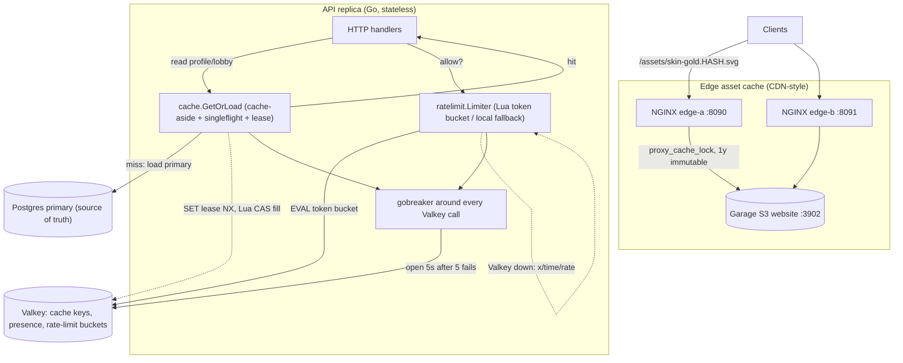
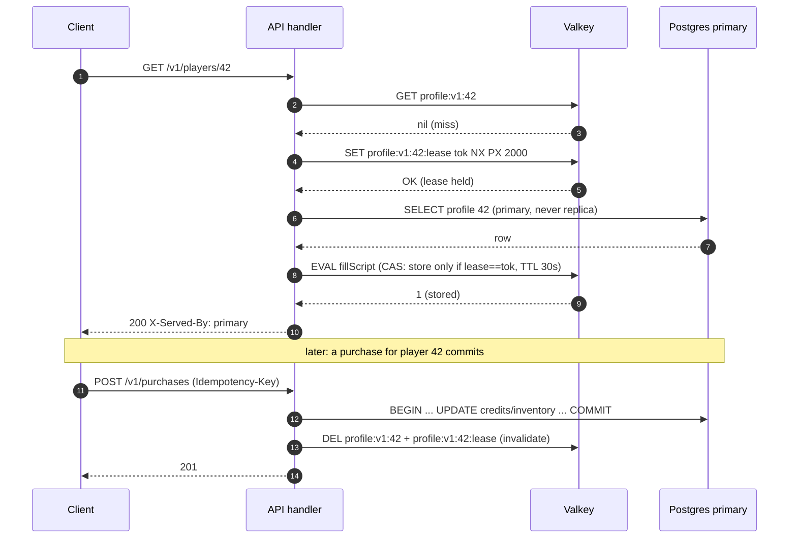
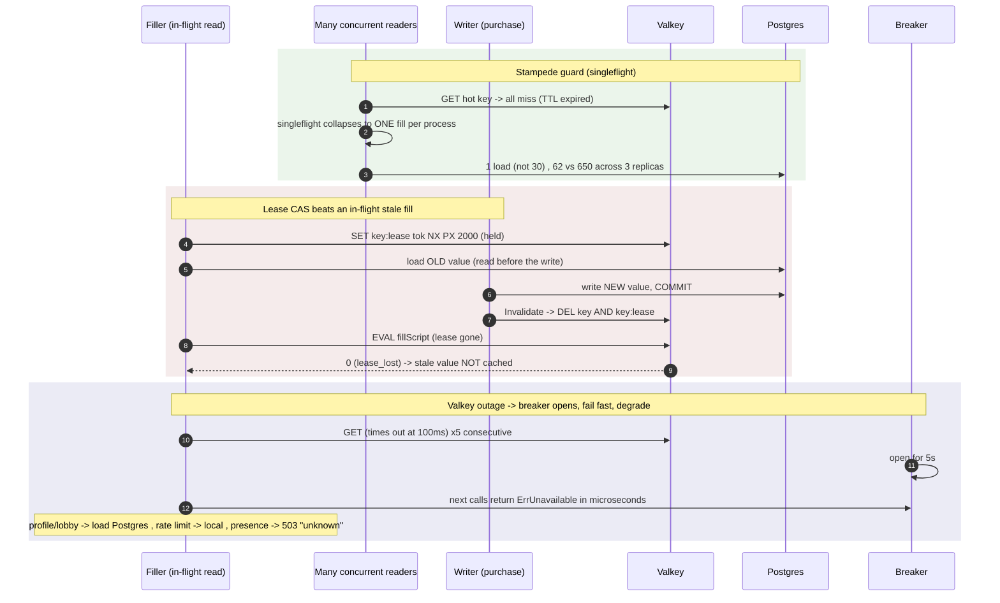
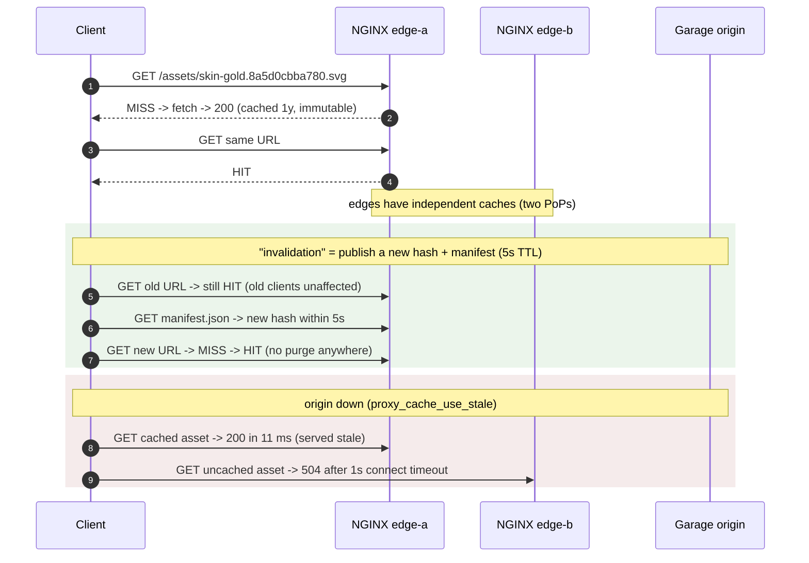

# ADR-0008 deep dive: Caching, rate limiting, circuit breaker, CDN-style edge cache

> Source decision: [`../../adr/0008-caching-ratelimit-breaker-edge.md`](../../adr/0008-caching-ratelimit-breaker-edge.md)
> Evidence: [`../../experiments/003-week3-resilience/README.md`](../../experiments/003-week3-resilience/README.md) (incl. [`edge.sh`](../../experiments/003-week3-resilience/edge.sh))
> Related: [ADR-0007 Envoy edge, timeouts, retries](ADR-0007-edge-timeouts-retries.md), [ADR-0004 Postgres pooling and replicas](ADR-0004-postgres-pooling-replicas.md), [architecture overview](../00-architecture.md)

---

## 1. TL;DR

- **Valkey is acceleration, never a source of truth.** Every cache/presence/rate-limit path has a fallback, and losing Valkey must not lose durable data or stall the API. A 10 s Valkey outage at 300 rps produced **0 failures on durable paths** (profile/history/purchase) and degraded only presence (Valkey-only data).
- **Cache-aside with lease-protected fills.** Profiles (TTL **30 s**) and lobbies (TTL **10 s**) are cached as versioned JSON (`profile:v1:<id>`). Fills read the **primary** (never the replica, so lag isn't cached), invalidate-after-commit (delete, not update), and a Lua **compare-and-set on a lease** guarantees a stale in-flight fill can't overwrite an invalidation.
- **Stampede control.** In-process `singleflight` collapses concurrent misses per key: a hot key at 1,000 rps with a 1 s TTL produced **62** DB loads with singleflight vs **650** without (~10.5× less DB work).
- **Distributed token-bucket rate limiting in one Lua script**, clocked by Valkey `TIME` so skewed replica clocks still agree (purchases 2/s burst 5 per player; account creation 5/s burst 20 per IP). Valkey down → per-replica `x/time/rate` fallback (effective limit N× rule) — deliberately neither fail-open nor fail-closed.
- **Circuit breaker** (`sony/gobreaker/v2`) around every Valkey call: opens after **5** consecutive failures, stays open **5 s**, admits one half-open probe; a miss or a cancellation is *not* a failure. A dead cache then fails in microseconds (presence p99 **3.9 ms** while down). **Edge asset cache**: Garage (S3) behind two NGINX PoPs, immutable content-hashed URLs cached **1 year**, `proxy_cache_lock` collapsing 200 concurrent misses to **2** origin fetches, `proxy_cache_use_stale` serving cached assets while the origin is down.

---

## 2. Context and problem

By Week 3 the API is three stateless replicas behind Envoy ([ADR-0007](ADR-0007-edge-timeouts-retries.md)). Profile and lobby **reads dominate** traffic (the mixed load is 70% profile reads). That creates four needs, each with a correctness trap:

1. **Read acceleration without lying.** Caching profiles cuts database load, but a cache can (a) serve data from a *lagging replica*, (b) serve *stale* data after a write, or (c) let a thundering herd of misses stampede the database. Worse, the README invariant says **Valkey is disposable** — so the cache must never be the only copy, and must never *fail* a request, only make it slower.
2. **Rate limits that hold across replicas.** A per-replica limit of 2/s becomes 6/s with three replicas. Limits for money-like actions (purchases) must be *global*, and must survive clock skew between replicas.
3. **Degrade safely when the cache is gone.** A dead Valkey must not add latency (every call timing out) and must not collapse into the database (writing presence heartbeats to Postgres during a cache outage just moves the spike onto the source of truth).
4. **CDN-like asset delivery with safe invalidation.** Maps/skins/replay files need edge caching across "PoPs", but cache **invalidation** is famously hard — purging every edge on every deploy is slow, racy, and error-prone.

ADR-0008 answers all four: **cache-aside with leases and singleflight**, a **distributed Lua token bucket with a local fallback**, a **circuit breaker with per-feature degradation**, and an **immutable content-hashed asset edge** that never needs a purge.

---

## 3. HLD



Two independent caching systems share the "acceleration, never truth" philosophy:

- **In-process + Valkey cache-aside** for dynamic data (profiles, lobbies, presence, rate-limit state), guarded by a circuit breaker.
- **NGINX edge cache** for static assets, made trivial by **immutable content-hashed URLs**: a new asset is a new URL, so caches never need invalidation.

---

## 4. LLD

### 4.1 Components and responsibilities

| Component | Responsibility | Where |
|---|---|---|
| `cache.Cache` | Valkey client (background connect + retry), breaker-wrapped `do()`, `GetOrLoad`, `Invalidate`, `Touch`, `Exists`, `Eval` | [`../../backend/internal/cache/cache.go`](../../backend/internal/cache/cache.go) |
| `cache.GetOrLoad[T]` | Cache-aside: GET → miss → lease → load primary → Lua CAS fill; singleflight collapse | `cache.go` |
| `fillScript` (Lua) | Store only if the lease still belongs to this filler (CAS), then delete the lease | `cache.go` |
| `ratelimit.Limiter` | Global token bucket via Lua + per-replica `x/time/rate` fallback | [`../../backend/internal/ratelimit/ratelimit.go`](../../backend/internal/ratelimit/ratelimit.go) |
| `tokenBucket` (Lua) | Atomic refill+consume using Valkey `TIME` as the clock | `ratelimit.go` |
| `gobreaker.CircuitBreaker` | Trip after 5 consecutive failures, open 5 s, one half-open probe; miss/cancel ≠ failure | `cache.go` `New` |
| API handlers | Invalidate-after-commit, presence degradation, `X-Served-By`, `X-RateLimit-Backend` | [`../../backend/internal/api/handlers.go`](../../backend/internal/api/handlers.go), [`api.go`](../../backend/internal/api/api.go) |
| NGINX edge | Content-hashed URL caching, `proxy_cache_lock`, `proxy_cache_use_stale`, query-insensitive key | [`../../infra/compose/assets/nginx-edge.conf`](../../infra/compose/assets/nginx-edge.conf) |
| Garage | Single-node S3 website endpoint (lab origin) | [`../../infra/compose/assets/garage.toml`](../../infra/compose/assets/garage.toml) |
| `publish.sh` | Content-hash assets, upload, write `manifest.json` (idempotent) | [`../../infra/compose/assets/publish.sh`](../../infra/compose/assets/publish.sh) |

### 4.2 Data structures, schemas, config (exact numbers)

**Cache keys and TTLs** (`api.go`, `handlers.go`):

| Key | TTL | Source |
|---|---|---|
| `profile:v1:<id>` | 30 s (`ProfileTTL`, `PROFILE_TTL` env; experiments use 1 s) | `profileKey`, `getProfile` |
| `lobby:v1:<id>` | 10 s (literal in `getLobby`) | `lobbyKey`, `getLobby` |
| `presence:<id>` | 30 s (`PresenceTTL`) | `heartbeat` |
| `<key>:lease` | 2000 ms (`PxMilliseconds(2000)`) | `leaseKey`, `GetOrLoad` |
| `rl:<key>` (hash `tokens`,`ts`) | `ceil(burst/rate)+1` s | `tokenBucket` Lua |

The `:v1:` version segment lets a schema change bump the key prefix instead of flushing the whole cache.

**Circuit breaker settings** (`cache.New`):

| Setting | Value |
|---|---|
| `MaxRequests` (half-open) | 1 (one probe) |
| `Timeout` (`BreakerOpen`) | 5 s (default) |
| `ReadyToTrip` | `ConsecutiveFailures >= TripAfter` (default 5) |
| `IsSuccessful` | `err == nil || IsValkeyNil(err) || errors.Is(err, context.Canceled)` |
| `cache.OpTimeout` | 100 ms per Valkey call |
| connect `Dialer.Timeout` | 500 ms; `ConnWriteTimeout` 1 s; connect backoff 100 ms → cap 5 s |

A **miss** (`nil` reply) is a *healthy* answer and a **caller cancellation** is not Valkey's fault, so neither counts toward tripping the breaker. The breaker state is exported as `localarena_cache_breaker_state` (0 closed, 1 half-open, 2 open).

**Rate-limit rules** (`api.go` defaults):

| Action | Rate | Burst | Key |
|---|---|---|---|
| Purchase | 2/s | 5 | `purchase:player:<id>` |
| Account creation | 5/s | 20 | `create:ip:<rightmost XFF>` |

**`fillScript` (Lua, compare-and-set on the lease):**
```lua
if redis.call('GET', KEYS[2]) == ARGV[1] then   -- KEYS[2]=lease, ARGV[1]=my token
  redis.call('SET', KEYS[1], ARGV[2], 'PX', ARGV[3])  -- KEYS[1]=value, ARGV[2]=json, ARGV[3]=ttl ms
  redis.call('DEL', KEYS[2])
  return 1
end
return 0
```

**`tokenBucket` (Lua, clocked by Valkey `TIME`):**
```lua
local rate, burst, cost = tonumber(ARGV[1]), tonumber(ARGV[2]), tonumber(ARGV[3])
local t = redis.call('TIME'); local now = tonumber(t[1]) + tonumber(t[2]) / 1e6
local b = redis.call('HMGET', KEYS[1], 'tokens', 'ts')
local tokens = tonumber(b[1]) or burst
local ts = tonumber(b[2]) or now
tokens = math.min(burst, tokens + math.max(0, now - ts) * rate)
local allowed, wait = 0, 0
if tokens >= cost then tokens = tokens - cost; allowed = 1
else wait = (cost - tokens) / rate end
redis.call('HSET', KEYS[1], 'tokens', tokens, 'ts', now)
redis.call('EXPIRE', KEYS[1], math.ceil(burst / rate) + 1)
return {allowed, tostring(tokens), tostring(wait)}
```

**NGINX edge** (`nginx-edge.conf`):

| Directive | Value | Purpose |
|---|---|---|
| `proxy_cache_path ... keys_zone=assets:10m max_size=256m inactive=7d` | | 256 MB cache, 7-day idle eviction |
| asset location regex | `^/assets/[A-Za-z0-9_-]+\.[0-9a-f]{12}\.[a-z0-9]+$` | only content-hashed names (12 hex) |
| `proxy_cache_key` | `$uri` | query strings never fragment the cache |
| `proxy_cache_valid 200` | `365d` | immutable assets cached 1 year |
| `proxy_cache_valid 404` | `10s` | a not-yet-uploaded asset is retried soon |
| `proxy_cache_lock` | `on` (timeout 5 s) | collapse concurrent misses to one origin fetch |
| `proxy_cache_use_stale` | `error timeout updating http_500..504` | serve cached while origin is down |
| `proxy_cache_background_update` | `on` | refresh asynchronously |
| `add_header Cache-Control` | `public, max-age=31536000, immutable` | 1-year browser caching |
| `proxy_connect_timeout` / `proxy_read_timeout` | 1 s / 5 s | fail fast on a dead origin |
| manifest `proxy_cache_valid 200` | `5s` | the only short-lived object |

**Garage** (`garage.toml`): `replication_factor = 1`, `db_engine = "sqlite"`, website `bind_addr [::]:3902`, root domain `.web.garage.localhost`. Single node → **no durability** (re-publishable build artifacts only).

### 4.3 Algorithms, step by step

**`GetOrLoad` (cache-aside with lease + singleflight):**
1. If the cache is disabled, call `load()` and return (`fromCache=false`).
2. `GET key`. On a hit that decodes, increment `get/hit`, return the value with `fromCache=true`.
3. On miss (`nil`) or usable error, define `fill`:
   - If the cache is usable, `SET key:lease token NX PX 2000` (take a lease). If that fails (someone else holds it, or the cache errored), set `token=""` → will load but *not* store.
   - `load(ctx)` from the **primary**.
   - If `token != ""`, run `fillScript` (CAS): store the value and TTL *only if the lease is still ours*, then delete the lease. If the lease was deleted by an `Invalidate` meanwhile, the CAS returns 0 (`lease_lost`) and nothing is cached.
4. If `Singleflight` is on, run `fill` under `group.Do(key, fill)` so concurrent misses in this process share one load (and one lease attempt).
5. On any cache failure, fall through to `load()` — the cache can make a request faster, never fail it.

**Invalidate-after-commit:** after a committed write (`purchase` → profile, `joinLobby`/`leaveLobby` → lobby), call `Invalidate(key)` which `DEL`s both `key` and `key:lease`. Deleting the lease is what makes a racing stale fill a no-op (proven by `TestInvalidationBeatsInFlightFill`). Failure is *logged, not returned*: the write already succeeded and the entry expires within its TTL.

**Read-your-writes bypass:** a request carrying `X-Read-After-LSN` skips the cache entirely and uses LSN-aware replica routing (`getProfile`), so a client reading its own just-committed write never sees a stale cache entry. (RYW detail in [ADR-0004](ADR-0004-postgres-pooling-replicas.md).)

**Token-bucket `Allow`:**
1. `EVAL tokenBucket` with `rate, burst, cost=1`. If it returns `{allowed, tokens, wait}`, decide and tag `Backend: "valkey"`.
2. If Valkey is unavailable (breaker open, error), fall back to a per-key `x/time/rate` limiter in a bounded map (`maxLocal = 10_000`; reset forgives clients = fail-open-ish). Tag `Backend: "local"`. Effective global limit becomes N× rule.
3. On rejection, write 429 + `Retry-After` and set `X-RateLimit-Backend`.

**Circuit breaker `do()`:** every Valkey command runs inside `breaker.Execute`, which wraps the call with `OpTimeout` (100 ms). On `ErrOpenState`/`ErrTooManyRequests`, return `ErrUnavailable` immediately (microseconds, no network). 5 consecutive real failures open the breaker for 5 s; then one probe decides.

**Presence degradation:** presence lives *only* in Valkey. On a heartbeat write failure, return **503 + Retry-After + `x-envoy-ratelimited`** (so Envoy won't retry a shared-dependency failure). On a presence read failure, return `"unknown"` for each id. It deliberately does **not** fall back to Postgres, to avoid moving the write spike onto the source of truth.

---

## 5. Sequence diagrams

### 5.1 Happy path: cache-aside read, then a write invalidates it



### 5.2 Failure/edge paths: lease race, stampede, and a Valkey outage



Block 1 is Exp 003 §3 (62 vs 650 loads). Block 2 is `TestInvalidationBeatsInFlightFill`. Block 3 is Exp 003 §2 (presence p99 3.9 ms while Valkey is down because the breaker is open).

### 5.3 Edge asset cache: cold miss, publish-a-new-hash "invalidation", origin down



This is Exp 003 §5 (`edge.sh`): cold→warm MISS→HIT per edge; query strings stay HIT; publish a new version → new URL MISS→HIT, old URL still HIT; 200 concurrent cold → 2 MISS / 199 HIT via `proxy_cache_lock`; origin stopped → cached 200 in 11 ms, uncached 504.

---

## 6. Concepts explained

### 6.1 Cache-aside (lazy loading)

- **What it is.** The application checks the cache; on a miss it loads from the source of truth and *populates* the cache. The cache is a side store, not in the write path.
- **Why LocalArena uses it.** `cache.GetOrLoad` for profiles/lobbies; fills read the primary. Reads dominate (70%), so caching cuts DB load without the cache ever being authoritative.
- **What was measured.** With singleflight, a hot profile at 1,000 rps caused **62** DB loads vs **650** without (Exp 003 §3); a 10 s Valkey outage caused **0** failures on cached reads (served from Postgres, Exp 003 §2).
- **Where else it is used.** **E-commerce** product pages (Redis in front of the catalog DB), **social feeds** (user profile cache), **banking** reference data (account metadata), **IoT** device-shadow reads.

### 6.2 Cache invalidation (delete, not update; after commit)

- **What it is.** Keeping cache and truth consistent. LocalArena *deletes* on write (next read re-fills) rather than *updating* (which can race with concurrent fills), and only *after the DB commits*.
- **Why LocalArena uses it.** `invalidate(profileKey)` after purchase, `invalidate(lobbyKey)` after join/leave. Deleting is simpler and composes with the lease (it deletes `:lease` too). A missed invalidation (Valkey blip during a write) serves a stale profile for at most the 30 s TTL, and the warning is logged.
- **What was measured.** Bound = TTL (≤ 30 s worst case, stated and logged); correctness preserved because purchases re-check Postgres (Exp 003 "Remaining risks").
- **Where else it is used.** **CDN** purge APIs, **CMS** page caches, **pricing** services, **search** index freshness.

### 6.3 Lease-based fills (compare-and-set on a lease)

- **What it is.** A filler takes a short-lived **lease** before loading, and stores only if the lease is still theirs (CAS). An `Invalidate` deletes the lease, so a fill that read a now-stale value cannot overwrite the invalidation.
- **Why LocalArena uses it.** `SET key:lease token NX PX 2000`, then `fillScript` CAS. Without it, this race exists: reader reads old value → writer writes new value + invalidates → reader stores old value → cache is stale indefinitely. The lease closes the window (`TestInvalidationBeatsInFlightFill`).
- **What was measured.** Correctness proven by unit test (not a load number); `fills_total{result="lease_lost"}` counts the saves.
- **Where else it is used.** **Distributed locks** (Redlock-style leases), **leader election** leases, **job schedulers** claiming work, **cache-coherence** protocols.

### 6.4 Stampede / thundering herd / singleflight

- **What it is.** When a hot key expires, many concurrent misses all load the source at once (a *stampede*). **Singleflight** collapses duplicate concurrent loads for the same key into one, sharing the result.
- **Why LocalArena uses it.** `golang.org/x/sync/singleflight` in `GetOrLoad` (toggleable via `CACHE_SINGLEFLIGHT`). It is per-process, so N replicas can still do N loads per expiry — the lease limits *stores*, singleflight limits *loads per process*.
- **What was measured.** 1,000 rps, 1 s TTL, 30 ms fill: **62** loads with singleflight, **650** without (~10.5×); unit test: 100 concurrent misses → 1 load with, 100 without (Exp 003 §3). Key insight: stampedes are a function of *fill cost × rate*, not rate alone — a 1 ms fill showed no stampede.
- **Where else it is used.** **CDN** request coalescing, **GraphQL** dataloaders, **config** fetchers, **feature-flag** SDKs.

### 6.5 TTL (time-to-live)

- **What it is.** An expiry on a cached entry, bounding staleness even without explicit invalidation.
- **Why LocalArena uses it.** Profile 30 s, lobby 10 s, presence 30 s, lease 2 s, rate-limit hash `ceil(burst/rate)+1` s, asset 1 year, manifest 5 s. TTL is the backstop when invalidation is missed.
- **What was measured.** Worst-case stale profile = 30 s (stated bound, Exp 003 "Remaining risks").
- **Where else it is used.** **DNS** records, **JWT** expiry, **session** stores, **HTTP** `Cache-Control: max-age`.

### 6.6 Token bucket

- **What it is.** A bucket holds up to `burst` tokens, refilled at `rate`/s; each request spends one; empty bucket → reject (or wait). Allows short bursts while bounding the sustained rate.

  ```text
  tokens = min(burst, tokens + elapsed * rate); if tokens >= 1 then allow, tokens-- else reject
  ```
- **Why LocalArena uses it.** Purchases 2/s burst 5, account creation 5/s burst 20. Bursts are legitimate (a player clicking a few times); sustained abuse is not.
- **What was measured.** 429s are an *expected* outcome in the mixed load (not a failure); node-loss writer stays at 4/s to sit under the 5/s create limit (`node-loss.sh`). Exact allow/deny counts not tabulated.
- **Where else it is used.** **API quotas** (Stripe/GitHub), **login throttling**, **SMS/email** send limits, **ride-hailing** request caps per rider.

### 6.7 Distributed rate limiting with Lua (and clock agreement)

- **What it is.** Shared limit state in Valkey, updated atomically by a single Lua script (read-modify-write in one round trip, no races between replicas). The clock comes from Valkey `TIME`, so replicas with skewed wall clocks still agree on refill.
- **Why LocalArena uses it.** A per-replica 2/s becomes 6/s across three replicas; a *global* bucket keeps 2/s regardless of replica count. Using the server clock avoids a replica with a fast clock over-refilling.
- **What was measured.** `X-RateLimit-Backend` distinguishes `valkey` (global) vs `local` (fallback); the Valkey-outage run (Exp 003 §2) showed durable paths served under the local fallback.
- **Where else it is used.** **Multi-instance API gateways**, **auth clusters**, **ad bidders** (global QPS caps), **payment** fraud throttles.

### 6.8 In-process fallback (fail-open-ish)

- **What it is.** When the shared limiter is unavailable, each replica enforces the rule locally. The effective global limit becomes N× rule — deliberately between fail-closed (block everyone) and fail-open (no protection).
- **Why LocalArena uses it.** `x/time/rate` limiters in a bounded map (`maxLocal=10_000`, reset on overflow). During a Valkey outage, protection degrades to N× rather than vanishing or blocking.
- **What was measured.** Durable paths kept working under the fallback during the 10 s outage (Exp 003 §2).
- **Where else it is used.** **Sidecar** rate limiters, **mobile** client-side throttles backing a server limit, **CDN** edge limits backing origin limits.

### 6.9 Circuit breaker (states: closed, open, half-open)

- **What it is.** A state machine that stops calling a failing dependency. **Closed**: calls pass, failures counted. **Open** (after N consecutive failures): calls fail instantly for a cooldown. **Half-open**: one probe; success → closed, failure → open again.

  ```text
  closed --5 consecutive fails--> open --5s--> half-open --probe ok--> closed
                                                        --probe fail--> open
  ```
- **Why LocalArena uses it.** `sony/gobreaker/v2` around every Valkey call: 5 fails → open 5 s → 1 probe. A dead cache then costs microseconds, not a 100 ms timeout per call. Crucially, a **miss** and a **caller cancellation** are *not* failures (`IsSuccessful`), so normal misses or client-timeouts don't trip the breaker.
- **What was measured.** Presence failed fast at **p99 3.9 ms** while Valkey was down because the breaker was open (Exp 003 §2); breaker state exported as a gauge.
- **Where else it is used.** **Payments** (issuer down), **recommendation** services, **third-party API** calls, **microservice** dependency isolation (Hystrix/resilience4j/Envoy).

### 6.10 Graceful degradation (per feature)

- **What it is.** When a dependency fails, each feature chooses the *least-bad* behaviour instead of a blanket error.
- **Why LocalArena uses it.** Per-feature table: profile/lobby reads → Postgres; rate limits → per-replica; presence → 503 + "unknown". Presence deliberately does **not** fall back to Postgres (that would move the write spike onto the source of truth).
- **What was measured.** Exp 003 §2: durable paths 0 failures, presence 52% (337) fails by design, total 3.7% (entirely presence) — crossing the k6 global `<1%` threshold *intentionally*, which is why per-endpoint thresholds are the right SLO unit.
- **Where else it is used.** **Netflix** fallbacks (default rows when personalization is down), **e-commerce** (hide reviews, keep checkout), **maps** (cached tiles), **search** (degraded ranking).

### 6.11 CDN / edge caching

- **What it is.** Caching static content close to users at points of presence (PoPs), each with its own cache, offloading the origin.
- **Why LocalArena uses it.** Two NGINX edges (`edge-a:8090`, `edge-b:8091`) with independent caches front the Garage website endpoint, simulating two PoPs.
- **What was measured.** Exp 003 §5: MISS→HIT independently per edge; warm throughput ~120 req/s ≈ 240 MB/s for a 2 MB object (loopback), p50 416 ms.
- **Where else it is used.** **CloudFront/Fastly/Cloudflare** for web assets, **video** segment caches, **game** patch distribution, **package** mirrors.

### 6.12 Immutable, content-hashed assets

- **What it is.** The URL contains a hash of the content (`/assets/skin-gold.8a5d0cbba780.svg`). Different content ⇒ different URL, so a cached URL is *never* stale and can be cached forever.
- **Why LocalArena uses it.** `publish.sh` hashes each file (`sha256 | cut -c1-12`) and writes a `manifest.json` mapping logical names → hashed URLs. "Invalidation" is publishing a new hash + manifest (5 s TTL); old URLs stay valid for old clients. No purge ever.
- **What was measured.** Exp 003 §5: publish a new version → new URL MISS→HIT, old URL still HIT; query strings don't fragment (`proxy_cache_key $uri`).
- **Where else it is used.** **Webpack/Vite** fingerprinted bundles, **npm/Docker** content-addressed artifacts, **Git** object store, **S3** immutable object versions.

### 6.13 Cache locks (`proxy_cache_lock` / request coalescing)

- **What it is.** When many requests miss the same cold object, only one goes to the origin; the rest wait for it to fill (up to a timeout). The edge equivalent of singleflight.
- **Why LocalArena uses it.** `proxy_cache_lock on; proxy_cache_lock_timeout 5s` so a cold large asset isn't fetched N times under a burst.
- **What was measured.** Exp 003 §5: 200 concurrent requests for a cold 2 MB object → **2 MISS / 199 HIT** (≈2 origin fetches).
- **Where else it is used.** **CDN** origin shielding, **image** resize services, **tile** servers, **package** proxy caches.

### 6.14 `stale-if-error` / serve-stale

- **What it is.** Keep serving a cached (possibly expired) copy when the origin errors or times out, trading freshness for availability.
- **Why LocalArena uses it.** `proxy_cache_use_stale error timeout updating http_500..504` + `proxy_cache_background_update on`. A dead Garage still serves cached assets.
- **What was measured.** Exp 003 §5: origin stopped → cached object **200 in 11 ms**; uncached object **504 after the 1 s connect timeout** (fails fast, doesn't hang).
- **Where else it is used.** **HTTP `stale-while-revalidate`/`stale-if-error`**, **CDN** origin-outage survival, **DNS** serve-stale (RFC 8767), **config** services returning last-known-good.

### 6.15 Topology spread and SPOFs (cache edition)

- **What it is.** Avoiding single points of failure for the acceleration tier. Valkey is one pod in the lab, so its node loss costs caching + presence (not durable data).
- **Why LocalArena uses it.** The degradation design (6.10) means a single Valkey is *tolerable*: the breaker opens, reads go to Postgres, rate limits go local, presence degrades. Edge caches are two independent PoPs so one edge failing is not total.
- **What was measured.** Exp 003 §6: Valkey still a single pod; losing its node costs caching/presence for ~5 min (default eviction) but **no durable data**.
- **Where else it is used.** **Redis Sentinel/Cluster** HA, **multi-PoP CDNs**, **memcached** consistent-hash pools, **edge** replica diversity.

---

## 7. Code pointers

| Path (symbol / key) | Look at |
|---|---|
| [`backend/internal/cache/cache.go`](../../backend/internal/cache/cache.go) (`GetOrLoad`) | cache-aside, lease, singleflight, CAS fill |
| `cache.go` (`fillScript`) | Lua compare-and-set on the lease |
| `cache.go` (`New`, `gobreaker.Settings`) | breaker: 5 fails, 5 s open, miss/cancel ≠ failure |
| `cache.go` (`OpTimeout`, `connect`) | 100 ms op budget; background connect + retry |
| `cache.go` (`Invalidate`, `leaseKey`) | delete key *and* lease after commit |
| [`backend/internal/ratelimit/ratelimit.go`](../../backend/internal/ratelimit/ratelimit.go) (`tokenBucket`) | Lua token bucket using Valkey `TIME` |
| `ratelimit.go` (`Allow`, `maxLocal`) | global decision + per-replica fallback |
| [`backend/internal/api/handlers.go`](../../backend/internal/api/handlers.go) (`getProfile`, `getLobby`) | cache-aside reads, `X-Served-By`, RYW bypass |
| `handlers.go` (`purchase`, `joinLobby`, `leaveLobby`) | invalidate-after-commit |
| `handlers.go` (`heartbeat`, `presence`) | presence degradation (503 / "unknown") |
| [`backend/internal/api/api.go`](../../backend/internal/api/api.go) (`allow`, `profileKey`, `lobbyKey`, `invalidate`, `noProxyRetry`) | rate-limit wiring, key helpers, `x-envoy-ratelimited` |
| [`backend/cmd/api/main.go`](../../backend/cmd/api/main.go) (`cache.New`, `PROFILE_TTL`, `CACHE_SINGLEFLIGHT`) | cache/env wiring |
| [`infra/compose/assets/nginx-edge.conf`](../../infra/compose/assets/nginx-edge.conf) | content-hash regex, `proxy_cache_lock`, `use_stale`, query-insensitive key |
| [`infra/compose/assets/garage.toml`](../../infra/compose/assets/garage.toml) | single-node S3 website, `replication_factor 1` |
| [`infra/compose/assets/publish.sh`](../../infra/compose/assets/publish.sh) | content-hashing + manifest publish |
| [`load-tests/api-mixed.js`](../../load-tests/api-mixed.js) | `HOT` key stampede driver, cache-hit counter |
| [`experiments/003-week3-resilience/edge.sh`](../../experiments/003-week3-resilience/edge.sh) | the edge-cache experiment |
| [`backend/internal/cache/cache_test.go`](../../backend/internal/cache/cache_test.go) | `TestInvalidationBeatsInFlightFill`, singleflight test |

---

## 8. Trade-offs and alternatives

| Option | Pros | Cons | Why (not) chosen |
|---|---|---|---|
| **Cache-aside + invalidate-on-delete** | Simple reads; cache never in write path; failed cache ≠ failed write | Up to TTL staleness on a missed invalidation | **Chosen** — matches "Valkey is disposable" |
| Write-through caching | Simpler reads; always warm | Every write path must update cache correctly; a failed cache write blocks the request | Rejected — couples writes to the cache |
| Probabilistic early expiry (XFetch) | Avoids synchronized expiry without locks | More complex; not needed yet | Noted as a follow-up if lease contention appears |
| **Lease CAS fill** | Closes the stale-fill race deterministically | Extra SET + Lua per miss | **Chosen** — correctness over a couple of ops |
| **Per-process singleflight** | Cheap, no coordination | N replicas still do N loads/key | **Chosen** — 62 loads is acceptable; shared lease-and-wait deferred |
| Shared lease-and-wait (only holder loads) | 1 load per key globally | Cross-replica coordination, more latency | Deferred — not needed at this scale |
| **Distributed Lua token bucket** | Global limit, atomic, clock-agnostic | Depends on Valkey | **Chosen**, with a local fallback |
| Per-replica limit only | No shared dependency | N× the intended limit | Rejected as the primary; used only as fallback |
| **Circuit breaker** | Dead cache costs microseconds | One more component/state to reason about | **Chosen** — avoids per-call timeouts |
| **Immutable content-hashed URLs** | No purge ever; old clients unaffected; cache 1y | A publish step must hash + manifest | **Chosen** — invalidation is the hard part |
| Purge edge caches per deploy | Conceptually simple | Slow, racy across PoPs, races in-flight fills | Rejected |
| Garage `replication_factor 1` | Simple single node for the lab | No durability | Accepted for build artifacts only; replays need rep 3 / backups |

---

## 9. Failure modes and how they were found

All in [Experiment 003 — Week 3 resilience](../../experiments/003-week3-resilience/README.md):

- **Valkey outage** — §2. Durable paths 0 failures; presence 52% by design; total 3.7% all presence; 637 useless proxy retries fixed by `x-envoy-ratelimited`. Presence p99 3.9 ms (breaker open).
- **Cache stampede** — §3. Singleflight 62 vs 650 DB loads; discovered that a 1 ms fill shows no stampede (needs 30 ms fill to reproduce).
- **Stale-fill race** — `TestInvalidationBeatsInFlightFill` (lease CAS); carried risk: missed invalidation serves stale ≤ 30 s, purchases re-check Postgres.
- **Edge cache behaviours** — §5 (`edge.sh`): cold/warm per edge, query-insensitive key, publish-new-hash "invalidation", 200→2 origin fetches via lock, origin-down serve-stale (200 in 11 ms) vs uncached 504.
- **Valkey as a SPOF** — §6: single pod; node loss costs caching/presence ~5 min, no durable data.

Related incidents/degradation appear in the [final report](../../FINAL_REPORT.md) failure table and the observability DR drills ([ADR-0017](ADR-0017-slos-recovery.md)).

---

## 10. Interview questions

**1. (Beginner) What is cache-aside and why read the primary (not the replica) on a fill?**
The app checks the cache, and on a miss loads from the source of truth and populates the cache. LocalArena fills from the *primary* so replication lag can never be baked into the cache — otherwise a stale replica read would persist for the whole TTL.

**2. (Beginner) Why delete the cache entry on a write instead of updating it?**
Deleting is simpler and avoids a race between the update and a concurrent fill: the next read re-fills from the primary. Updating in place can store an older value if a fill is in flight. LocalArena deletes *after* the DB commits.

**3. (Beginner) What is a TTL and why keep one if you already invalidate?**
A TTL bounds staleness even when invalidation is missed (e.g. a Valkey blip during a write). LocalArena's 30 s profile TTL means a missed invalidation serves stale data for at most 30 s, and the warning is logged.

**4. (Intermediate) Explain the lease and why it is needed on top of invalidation.**
A reader may load the *old* value just before a writer commits the new one. Without a lease, the reader then stores the old value and the cache is stale indefinitely. The lease (CAS): the reader stores only if its lease still exists, and `Invalidate` deletes the lease, so the racing store becomes a no-op. Proven by `TestInvalidationBeatsInFlightFill`.

**5. (Intermediate) What is a cache stampede and how does singleflight help? What's its limit here?**
A stampede is many concurrent misses all loading the source when a hot key expires. Singleflight collapses concurrent loads for one key into one per process. Its limit: it is *per process*, so with 3 replicas you can still get 3 loads per expiry (62 total vs 650 without, measured). The lease limits *stores*, not cross-replica loads.

**6. (Intermediate) Why clock the token bucket with Valkey `TIME` instead of the replica's clock?**
Because the limit is global and shared across replicas; if each replica used its own (possibly skewed) wall clock, a fast clock would over-refill the bucket. Reading the server clock in the Lua script makes all replicas agree.

**7. (Intermediate) Describe the three circuit-breaker states and the LocalArena thresholds.**
Closed (calls pass, failures counted), Open (after 5 consecutive failures, calls fail instantly for 5 s), Half-open (one probe decides). A miss and a caller cancellation do not count as failures. A dead cache then costs microseconds; presence failed fast at p99 3.9 ms while Valkey was down.

**8. (Intermediate) Why doesn't presence fall back to Postgres when Valkey is down?**
Presence is ephemeral and Valkey-only by design. Writing heartbeats to Postgres during a cache outage would move the write spike onto the source of truth — the opposite of protecting it. Instead presence returns 503 + Retry-After for writes and "unknown" for reads.

**9. (Senior) The Valkey-outage test "failed" the k6 global threshold. Why is that correct?**
The only failures were presence (a Valkey-only feature) returning 503 by design — 3.7% overall, all presence. Durable paths had 0 failures. A single global failure threshold hides this; per-endpoint SLOs are the right unit, and presence's 503s are *intended* degradation, not an incident.

**10. (Senior) Why are immutable content-hashed URLs better than purging edges on deploy?**
Because invalidation is the hard part. With hashed URLs, new content is a new URL, so caches are never stale and can be cached for a year; old URLs stay valid for clients that still reference them. Purging every PoP on every deploy is slow, error-prone, and races in-flight fills. Measured: publish a new version → new URL MISS→HIT, old URL still HIT, no purge.

**11. (Senior) Compare `proxy_cache_lock` and singleflight. When would one leak misses the other wouldn't?**
Both coalesce concurrent misses for one key. `proxy_cache_lock` is at the NGINX edge (per edge); singleflight is in the Go process (per replica). Neither is global: two edges each fetch once (two PoPs), and three API replicas each load once. If you need exactly-one load globally you need a shared lease-and-wait, which LocalArena deferred.

**12. (Senior) What does `stale-if-error` buy you and what's the risk?**
It serves a cached copy when the origin errors/times out, trading freshness for availability — a dead Garage still served cached assets (200 in 11 ms) while uncached ones failed fast (504 in ~1 s). The risk is serving outdated content during a long outage; it is safe here because assets are immutable, so "stale" and "current" are identical for a given URL.

**13. (Senior, design) Design rate limiting for 100× traffic across many regions. What changes?**
Keep the token bucket but shard bucket keys across a Valkey/Redis cluster (hash-slot per key) to spread load; consider a two-tier design (local pre-filter that admits obvious-OK traffic, global limiter only for the marginal cases) to cut round trips; make the limiter region-local with periodic reconciliation for global caps where eventual consistency is acceptable; and treat the limiter as best-effort with the breaker + N× local fallback so a cluster hiccup never blocks all traffic. Expose `X-RateLimit-*` headers so clients self-throttle.

**14. (Senior, design) Design the caching tier so a single Valkey node is not a SPOF, without changing the correctness model.**
Run Valkey in HA (Sentinel or Cluster) with replicas and automatic failover; keep the breaker so a failover blip degrades to Postgres/local rather than erroring; keep cache-aside (no write-through) so a cache node loss never risks durable data; and keep TTLs short enough that a cold cache after failover re-warms quickly without a stampede (singleflight + lock still apply). The key property to preserve: the cache is always *reconstructible from the source of truth*, so losing it is a performance event, not a data event.

**15. (Senior) A profile shows stale for a user right after they bought an item. Walk the debugging path and the guarantee that prevents a *wrong* purchase.**
Likely a missed `Invalidate` (Valkey blip during the write), bounded to ≤ 30 s by the TTL, and logged as "cache invalidation failed; stale until TTL". Confirm via the log and `fills_total`/`ops_total` metrics. For a read-your-writes correctness guarantee, the client can send `X-Read-After-LSN` to bypass the cache. Crucially, *purchases always re-check credits/inventory in Postgres at purchase time*, so a stale read can never authorize a bad write — staleness is a display issue, not a money issue.
