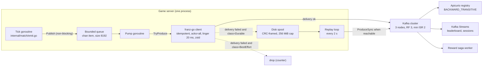
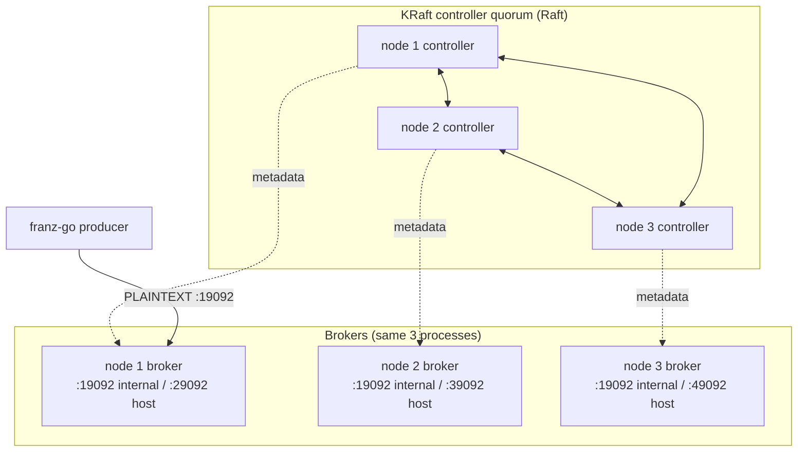
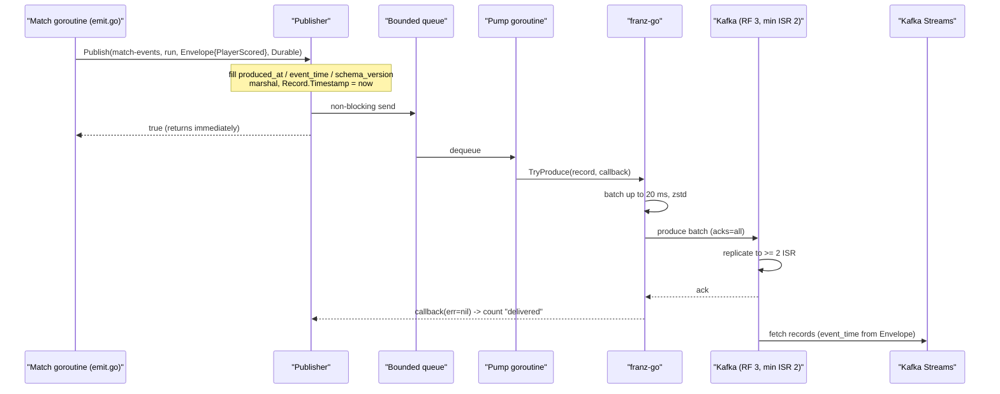
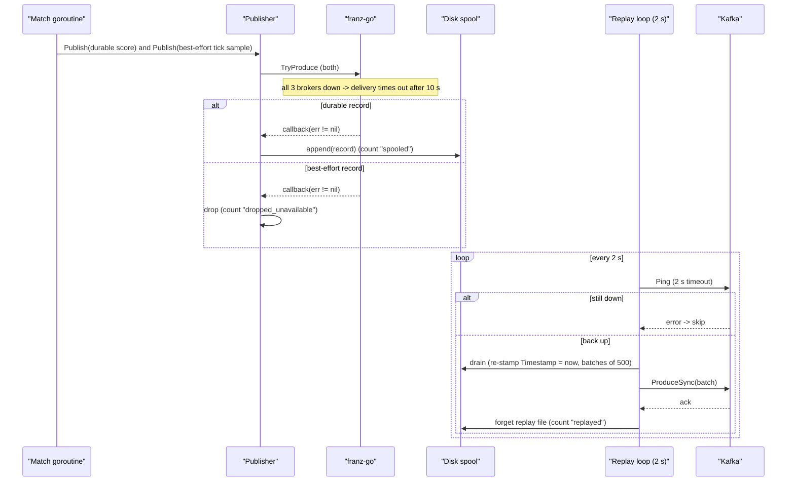
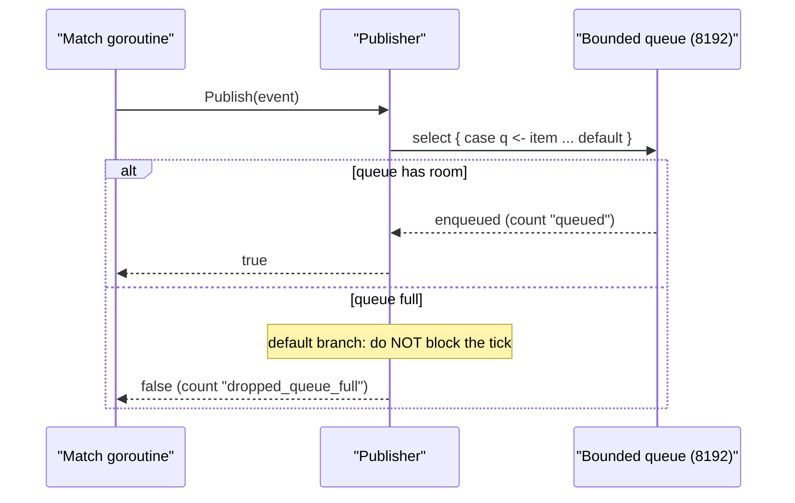

# ADR-0009 deep dive: Kafka backbone, topic design, protobuf contracts, non-blocking producer

> Source decision: [`../../adr/0009-event-backbone-contracts.md`](../../adr/0009-event-backbone-contracts.md)
> Evidence: [`../../experiments/004-week4-streaming/README.md`](../../experiments/004-week4-streaming/README.md)
> Related: [ADR-0010 (outbox/CDC)](ADR-0010-outbox-cdc.md), [ADR-0011 (Kafka Streams)](ADR-0011-kafka-streams.md), [ADR-0012 (saga)](ADR-0012-saga.md)

## 1. TL;DR

- LocalArena runs **Kafka 4.3.1 in KRaft mode**, 3 combined broker+controller nodes, replication factor 3, `min.insync.replicas=2`, and **auto topic creation off** so every topic (key, partitions, retention, cleanup policy) is an explicit, reviewed decision in [`scripts/kafka-topics.sh`](../../scripts/kafka-topics.sh).
- Every event is wrapped in one protobuf `Envelope` (`event_id`, `event_time`, `produced_at`, `schema_version`, `correlation_id`, `causation_id`, `source`, plus a `oneof` payload) registered in Apicurio with **`BACKWARD_TRANSITIVE`** compatibility. A breaking change forces a new package and a `.v2` topic.
- The producer in [`backend/internal/events`](../../backend/internal/events) makes `Publish` a **non-blocking channel send**: the 20 Hz game tick never waits for Kafka. A pump calls franz-go `TryProduce` with an **idempotent producer, `acks=all`, 20 ms linger, zstd compression**.
- Durability is **per class**: durable gameplay events that cannot be delivered within 10 s go to a bounded, CRC-framed **disk spool** and replay later; best-effort telemetry is dropped under pressure.
- Measured in [Experiment 004](../../experiments/004-week4-streaming/README.md): with all 3 brokers down for 60 s under 100-bot load, **tick p99 was 0.44 ms, 0 overruns, 372 events spooled and all 372 replayed, 883 queued = 883 distinct IDs in Kafka, 0 lost, 0 duplicates**.

## 2. Context and problem

LocalArena is a server-authoritative arena. The hot path is a fixed-tick simulation loop (20 Hz = one tick every 50 ms; see [ADR-0001](ADR-0001-authoritative-server.md) and [ADR-0003](ADR-0003-match-actor-backpressure.md)). The server decides what happened — positions, scores, match outcomes — and must then publish those facts for downstream analytics, the live leaderboard ([ADR-0011](ADR-0011-kafka-streams.md)), and the reward saga ([ADR-0012](ADR-0012-saga.md)).

Three requirements collide:

1. **The tick must never block on Kafka.** If a producer did a synchronous send inside the simulation step, a slow or unavailable broker would stall every match on that server. The tick budget is 50 ms; a broker round-trip or a retry storm would blow it instantly.
2. **Durable facts must not be lost** just because Kafka was briefly unavailable. "Match completed" and "player scored" drive rewards and leaderboards; silently dropping them corrupts player-visible state.
3. **Consumers must tolerate duplicates and schema change.** Kafka and the outbox ([ADR-0010](ADR-0010-outbox-cdc.md)) are at-least-once, so the same fact can arrive twice; and the event shape will evolve over weeks without a flag-day migration of every consumer.

The README's runtime invariants make this explicit: *"The game tick never waits synchronously for Kafka acknowledgements; a bounded background producer batches events"* and *"Every event has `event_id`, `event_time`, `produced_at`, `schema_version`, `correlation_id`, and `causation_id`"* and *"Event consumers are idempotent because at-least-once delivery can duplicate events."*

The decision in ADR-0009 answers "how do we get facts off the game server into a durable, replayable log without ever coupling the simulation to the log's availability, and without letting schema drift break consumers."

## 3. HLD

Kafka is deliberately **outside** the frame-by-frame hot path. Player input and world snapshots travel over WebSocket directly to the authoritative server (ADR-0002/0003). Only *after* the server decides an outcome does it emit an asynchronous durable event. The path from tick to Kafka is entirely non-blocking:

- The match goroutine (`internal/match/emit.go`) builds an `Envelope` and calls `Publisher.Publish`, which is a non-blocking send into a bounded in-memory queue.
- A single **pump** goroutine drains the queue into franz-go via `TryProduce`.
- franz-go batches (20 ms linger), compresses (zstd), and sends with `acks=all` from an idempotent producer.
- On delivery failure, a **promise callback** routes the record by class: durable records go to a disk spool, best-effort records are dropped.
- A **replay loop** drains the spool back into Kafka when the brokers answer.



The cluster is 3 combined KRaft nodes. "Combined" means each node is **both** a broker (stores partitions, serves produce/fetch) **and** a controller (participates in the Raft quorum that owns cluster metadata). There is no ZooKeeper.



## 4. LLD

### 4.1 Components and responsibilities

| Component | File | Responsibility |
|---|---|---|
| `Publisher` | [`backend/internal/events/publisher.go`](../../backend/internal/events/publisher.go) | Non-blocking `Publish`, pump, delivery-result routing, replay loop, metrics. |
| `spool` | [`backend/internal/events/spool.go`](../../backend/internal/events/spool.go) | Append-only, bounded, CRC-framed, crash-tolerant disk log of undelivered durable records. |
| `eventid.New` | [`backend/internal/eventid/eventid.go`](../../backend/internal/eventid/eventid.go) | Deterministic 128-bit event IDs (SHA-256 of joined parts). |
| `emitter` | [`backend/internal/match/emit.go`](../../backend/internal/match/emit.go) | Turns authoritative match state changes into envelopes; chooses topic, key, class, ID, and event time. |
| `Envelope` + payloads | [`schemas/localarena/events/v1/events.proto`](../../schemas/localarena/events/v1/events.proto) | The contract: metadata wrapper plus a `oneof` of domain messages. |
| Topic DDL | [`scripts/kafka-topics.sh`](../../scripts/kafka-topics.sh) | Explicit per-topic partitions, retention, cleanup policy, documented key. |
| Schema registration | [`scripts/register-schemas.sh`](../../scripts/register-schemas.sh) | Registers the proto in Apicurio with `BACKWARD_TRANSITIVE` + `VALIDITY FULL`; `--check` is the CI dry-run. |
| Cluster config | [`compose.yaml`](../../compose.yaml) streaming profile | 3 KRaft nodes, RF/min-ISR defaults, auto-create off, heap caps. |

### 4.2 The Envelope contract

From `events.proto` (package `localarena.events.v1`):

```proto
message Envelope {
  string event_id = 1;                       // deterministic; a resend keeps the same id
  google.protobuf.Timestamp event_time = 2;  // domain time (game tick time) -> windows
  google.protobuf.Timestamp produced_at = 3; // when the producer created the record
  uint32 schema_version = 4;                 // bumped only for breaking changes (= new package/topic)
  string correlation_id = 5;                 // the request/match, end to end
  string causation_id = 6;                   // the event/request that directly caused this one
  string source = 7;                         // e.g. "gameserver/<host>" or "api/economy"
  oneof payload {
    MatchStarted match_started = 20;
    MatchCompleted match_completed = 21;
    PlayerScored player_scored = 22;
    PlayerJoined player_joined = 23;
    PlayerLeft player_left = 24;
    CosmeticPurchased cosmetic_purchased = 30;
    RewardGranted reward_granted = 31;
    RewardCommand reward_command = 32;
    TickSample tick_sample = 40;
  }
}
```

Field-number gaps are intentional: gameplay payloads sit at 20–24, economy at 30–32, telemetry at 40, leaving room to add siblings without renumbering. `PlayerScored.score` is documented as **the new total for this match, not a delta**, "so applying it twice is harmless" — idempotency designed into the payload itself.

The evolution rules are written in the proto header and enforced by Apicurio:

- never change a field number or type; never reuse a number (use `reserved`);
- add fields only as new numbers (old consumers ignore them);
- removing a field means marking it `reserved` and keeping consumers tolerant of absence;
- a breaking change is a new package (`v2`) and a new topic (`*.v2`).

### 4.3 Topics (exact config from `scripts/kafka-topics.sh`)

| Topic | Partitions | Key | Cleanup / retention |
|---|---|---|---|
| `game.match-events.v1` | 6 | `match_id` | retention 604800000 ms (7 d) |
| `game.player-events.v1` | 6 | `player_id` | retention 604800000 ms (7 d) |
| `game.economy-events.v1` | 6 | `player_id` | retention 2592000000 ms (30 d) |
| `game.matchmaking-events.v1` | 3 | `region:skill_bucket` | retention 259200000 ms (3 d) |
| `game.server-telemetry.v1` | 3 | `server_id` | retention 86400000 ms (1 d), `compression.type=zstd` |
| `game.profile-table.v1` | 6 | `player_id` | `cleanup.policy=compact`, `min.compaction.lag.ms=60000` |
| `game.rules-table.v1` | 1 | `rule_id` | `cleanup.policy=compact` |
| `game.invalid-events.v1` | 3 | original key | retention 1209600000 ms (14 d) |
| `game.leaderboard-updates.v1` | 6 | `player_id` | `cleanup.policy=compact` |
| `game.player-sessions.v1` | 6 | `player_id` | retention 604800000 ms (7 d) |
| `game.reward-commands.v1` | 6 | `player_id` | retention 604800000 ms (7 d) |
| `game.reward-commands-retry.v1` | 6 | `player_id` | retention 604800000 ms (7 d) |
| `game.reward-commands-dlq.v1` | 3 | `player_id` | retention 2592000000 ms (30 d) |

RF 3 and `min.insync.replicas=2` are not per-topic flags here; they come from the broker defaults set in `compose.yaml` (`KAFKA_DEFAULT_REPLICATION_FACTOR: 3`, `KAFKA_MIN_INSYNC_REPLICAS: 2`). The script is idempotent (`--create --if-not-exists`).

### 4.4 Producer configuration (exact values)

From `events.New` in `publisher.go`:

- `kgo.RequiredAcks(kgo.AllISRAcks())` — `acks=all`.
- Idempotent producer (franz-go default when acks=all) — broker-side dedupe of retried batches.
- `kgo.ProducerLinger(20*time.Millisecond)` — batch up to 20 ms; comment: "one batch per tick at 20 Hz".
- `kgo.ProducerBatchCompression(Zstd, Lz4, None)` — negotiated preference order.
- `kgo.MaxBufferedRecords(opts.MaxBuffered)` — default **10000** buffered records before `TryProduce` fails.
- `kgo.RecordDeliveryTimeout(opts.DeliveryTimeout)` — default **10 s** per record; on expiry a durable record is spooled.
- `kgo.UnknownTopicRetries(-1)` — retry forever on "unknown topic" (topic not created yet).

`Options` defaults: `MaxSpoolBytes = 256 << 20` (256 MiB), `QueueSize = 8192`, `MaxBuffered = 10000`, `DeliveryTimeout = 10s`, `ReplayInterval = 2s`.

### 4.5 Algorithm: `Publish` (non-blocking)

1. If the `*Publisher` is nil, return false (a nil publisher is a valid no-op; events are optional).
2. Fill envelope metadata: `ProducedAt = now` if unset, `EventTime = ProducedAt` if unset, `SchemaVersion = 1`, `Source` default.
3. `proto.Marshal` the envelope; on error count `failed`, return false.
4. Build a `kgo.Record` with `Timestamp: now` (produce time, **not** event time — see §6 "the Record.Timestamp bug"), key = the caller's key, headers `event_id` and `content-type`.
5. Non-blocking send: `select { case p.q <- item: count "queued"; default: count "dropped_queue_full" }`. The `default` branch is what makes it non-blocking — if the queue is full, the event is dropped and counted, the caller never waits.

### 4.6 Algorithm: pump and delivery routing

- `pump` loops: on `<-p.q`, update the `queue_length` gauge and `produce(it)`.
- `produce` calls `cl.TryProduce(ctx, rec, callback)`. `TryProduce` returns immediately; it does not block even if the franz-go buffer is full (it fails the record instead).
- `onResult(class, rec, err)` runs on franz-go's promise goroutine:
  - `err == nil` → count `delivered`.
  - `err == context.Canceled` (shutting down) → `spoolOrDrop` (keep durable events).
  - best-effort and any other error → `dropped_unavailable`.
  - durable and any other error → `spoolOrDrop`.
- `spoolOrDrop`: if not durable or no spool → `dropped_unavailable`; else `spool.append`, counting `spooled` / `dropped_spool_full` / `failed`.

### 4.7 Algorithm: the disk spool

Frame format (from `spool.go`): `crc32c(4) | length(4) | payload`, where payload is uvarint-prefixed `topic`, `key`, `event_id`, then a varint `Timestamp` (ms) and the `value` bytes.

- `append`: encode, lock, reject with `errSpoolFull` if `cur + held + len > max`, write, `Flush` to the OS (no `fsync` per record — documented bounded host-crash loss window), advance `cur`.
- `drain(send)`: rotate the active `spool.log` to `spool-<ns>.replay`, open a fresh active file (so new failures spool while old ones replay), then read each replay file with `readAll`, send in batches of **500**, and on success `forget` (delete) the file. On send error, the unsent remainder is re-appended and the error returned.
- `readAll`: reads frames until a torn header, a torn frame, a bad CRC, or a decode error — any of which ends reading cleanly (returns what was valid). This is how a crash mid-append is tolerated: the half-written last frame is simply ignored.

### 4.8 Algorithm: replay loop

Every `ReplayInterval` (2 s): if the spool is empty and has no pending replay files, skip. Otherwise `Ping` Kafka with a 2 s timeout; if unreachable, skip. If reachable, `drain` with a send function that **re-stamps every record's timestamp to now** and calls `ProduceSync` with a `DeliveryTimeout` deadline. Count the replayed records and update `spool_bytes`.

### 4.9 Event emission from the match (`emit.go`)

- `startRound` sets a globally-unique run ID `instance/match/r<round>`, records `roundStart = now()` **once per round**, and emits `MatchStarted` (durable, key = run, id = `EventID("started", run)`).
- `at(tick)` converts a tick to event time as `roundStart + tick * (1s / tickHz)`. Wall clock is read once per round, never per event, so events are ordered by tick even if the host clock jumps.
- `joined` / `left` → `game.player-events.v1`, key = player ID, durable.
- `afterStep` → `PlayerScored` (durable, new total) per changed score, and a `TickSample` **best-effort** once per second (`tick % tickHz == 0`), keyed by server instance, to `game.server-telemetry.v1`.
- `completed` → `MatchCompleted` (durable) with per-player results.

Deterministic IDs: `EventID("scored", run, playerID, tick)` etc., so a crash-and-resend or a spool replay produces the *same* ID and consumers dedupe it.

## 5. Sequence diagrams

### 5.1 Happy path: tick emits a score, event reaches Streams



### 5.2 Failure path: Kafka down, durable spools and replays; best-effort drops



### 5.3 Edge path: queue full (producer slower than the tick)



## 6. Concepts explained

### 6.1 Event log vs message queue

**What it is.** A classic queue (RabbitMQ, SQS) deletes a message once a consumer acknowledges it; a message has one logical destination and is gone after processing. A **log** (Kafka) is an append-only, offset-addressed sequence retained for a time/size policy; many independent consumer groups read the same records at their own offsets, and records can be **re-read (replayed)**.

```text
queue:  [m1][m2][m3]  -- consumer pops m1, m1 is gone
log:    0:e0 1:e1 2:e2 3:e3 ...   groupA at offset 2, groupB at offset 0 (replaying)
```

**Why LocalArena uses it.** The same `MatchCompleted` must feed the leaderboard, the reward saga, and the replay/analytics jobs independently, and the plan explicitly requires **replay a whole season while live traffic continues**. A queue cannot do that; a log can.

**What was measured.** The duplicate test re-produced 46 real records "byte for byte" and credits/leaderboard were unchanged — only possible because the log can be re-read and consumers are idempotent.

**Where else.** Payments event sourcing and audit trails; e-commerce order pipelines where inventory, shipping, and recommendation systems each consume the same order stream; bank transaction ledgers; social-feed fan-out.

### 6.2 KRaft (Kafka Raft metadata mode)

**What it is.** Since Kafka 3.3/4.x, cluster metadata (topics, partitions, ISR, configs) lives in an internal Raft-replicated metadata log managed by **controllers**, replacing ZooKeeper. In "combined" mode a process is both broker and controller.

**Why LocalArena uses it.** Simpler local footprint (no ZooKeeper container), current Kafka 4.3.1, and a real quorum (3 controllers) to study leader election and ISR behavior. Config: `KAFKA_PROCESS_ROLES: broker,controller`, `KAFKA_CONTROLLER_QUORUM_VOTERS: 1@kafka-1:9093,...`.

**What was measured.** The broker-loss experiment exercised controller-driven leader election and ISR shrink: killing one broker produced 61 under-replicated partitions with ISR 2/3, writes continuing; a second kill dropped below min ISR.

**Where else.** Any modern Kafka deployment (fintech, logistics, telemetry backbones) that has migrated off ZooKeeper; conceptually, etcd/Consul use the same Raft idea for cluster metadata.

### 6.3 Brokers and controllers

**What it is.** A **broker** stores partition replicas and serves produce/fetch. A **controller** is the elected authority over metadata (who leads which partition, ISR membership). KRaft controllers form a Raft quorum.

**Why LocalArena uses it.** Three combined nodes give a tolerant quorum: the metadata quorum survives one node loss, and partitions (RF 3) survive one node loss while still meeting min ISR 2.

**What was measured.** Not isolated on its own; observed via leader/ISR changes in `broker-loss.txt` ("Leader: 3 Replicas: 3,1,2 Isr: 1,3").

**Where else.** Distributed databases (a coordinator/metadata node vs data nodes), Elasticsearch (master-eligible vs data nodes), HDFS NameNode vs DataNodes.

### 6.4 Partitions and keys

**What it is.** A topic is split into N partitions; a record's key is hashed to pick a partition (`hash(key) % N`). All records with the same key land in the same partition.

**Why LocalArena uses it.** Keys are chosen so that the thing that must stay ordered shares a partition: match events keyed by `match_id` (per-match order), player/economy keyed by `player_id` (per-player order). Partition counts (6 for high-volume gameplay/economy, 3 for matchmaking/telemetry, 1 for the rules table) are explicit in `kafka-topics.sh`.

**What was measured.** Hot-partition test: 1 match (20 bots) put **all 24 records in one partition**; 10 matches spread 56/69/29/0/46/75 across 6 partitions. One empty partition (the "0") shows hash skew with few keys.

**Where else.** Ride-hailing keyed by driver/region; IoT keyed by device ID; banking keyed by account ID; order systems keyed by order/customer ID.

### 6.5 Ordering

**What it is.** Kafka guarantees order **only within a partition**, not across a topic. Cross-partition order is undefined.

**Why LocalArena uses it.** Per-match and per-player causal order matter (scores, joins/leaves). By keying on match/player, the events that must be ordered are in one partition. The README states this directly and notes a match-keyed event must be **repartitioned by `player_id`** for player analytics (done in Streams, ADR-0011).

**What was measured.** The single-match hot-partition result (all 24 records in one partition) is exactly the ordering guarantee in action.

**Where else.** Account ledgers (debits/credits per account must be ordered), chat per-conversation ordering, device telemetry per sensor.

### 6.6 Replication factor, ISR, and `min.insync.replicas`

**What it is.** **RF** = how many copies of each partition. **ISR** (in-sync replicas) = the replicas currently caught up to the leader. `min.insync.replicas` = how many ISR must acknowledge a write (with `acks=all`) for it to succeed.

**Why LocalArena uses it.** RF 3 + min ISR 2 means a write survives one broker loss but is **refused** when fewer than 2 replicas are in sync — durability chosen over availability. This is a deliberate tradeoff stated in ADR-0009's consequences.

**What was measured.** Broker-loss: 1 broker killed → 61 under-replicated partitions, ISR 2/3, writes continue; 2 killed → below min ISR, `acks=all` refuses writes and events spool; after restart → 0 under-replicated, spool drained (531 replayed).

**Where else.** Any data store with quorum writes: Cassandra/DynamoDB quorum, etcd/Consul, replicated SQL (e.g. Postgres synchronous replicas in banking).

### 6.7 `acks` (producer acknowledgement level)

**What it is.** `acks=0` (fire and forget), `acks=1` (leader only), `acks=all` (all in-sync replicas). Higher acks = more durability, more latency.

**Why LocalArena uses it.** `acks=all` (`kgo.AllISRAcks()`) because gameplay facts drive money/leaderboards — a leader-only ack could lose a record on leader failover. Latency is hidden by batching and by the non-blocking producer.

**What was measured.** The broker-loss result ("below min ISR, `acks=all` refuses writes, events spool") is the direct, observable behavior of `acks=all` interacting with min ISR.

**Where else.** Payment capture events, order confirmations, any "lose this and a customer is wrong" stream.

### 6.8 Idempotent producer

**What it is.** The producer tags batches with a producer ID and per-partition sequence numbers; the broker rejects duplicate sequence numbers, so an automatically retried batch is written **exactly once** to the partition (no producer-side duplicates from retries).

**Why LocalArena uses it.** Retries are inevitable (transient broker hiccups). Idempotence stops a retry from writing the same record twice at the Kafka level. It is a franz-go default under `acks=all`; the connector also sets `producer.override.enable.idempotence: true`.

**What was measured.** Part of why the Kafka-down run reported "883 queued = 883 distinct IDs in Kafka, 0 duplicates" — retries during recovery did not duplicate. (Note: cross-restart dedupe relies on the deterministic **event IDs**, since the producer-ID/sequence reset on restart; see §6.14.)

**Where else.** Any at-least-once pipeline wanting producer-side dedupe: Flink/Spark sinks, CDC producers, payment event emitters.

### 6.9 Batching, linger, and compression

**What it is.** The producer groups records into batches; `linger` is how long it waits to fill a batch before sending; compression shrinks the batch on the wire and on disk.

**Why LocalArena uses it.** `ProducerLinger(20ms)` is tuned to the 20 Hz tick ("one batch per tick"), amortizing the per-request cost. zstd (then lz4, then none) balances CPU and ratio; the telemetry topic also sets `compression.type=zstd` at the broker.

**What was measured.** Not isolated as a throughput number; the spool growth under outage (e.g. 42 KB for 372 events ≈ 113 B/event marshalled) gives a sense of per-event size.

**Where else.** High-volume log/metric pipelines, clickstream ingestion, IoT batching to save bandwidth and storage.

### 6.10 Consumer groups, offsets, and rebalancing

**What it is.** A **consumer group** shares a topic's partitions among its members; each member owns some partitions and commits **offsets** (its read position). When a member joins/leaves, a **rebalance** reassigns partitions.

**Why LocalArena uses it.** Streams and the saga worker are consumer groups; scaling them out splits partitions, and a crash triggers rebalance + state restore. ADR-0009 sets the producer side; the consumer side is ADR-0011/0012, but the topic/partition design here determines parallelism (6 partitions = up to 6 active consumers per group).

**What was measured.** Streams failover: killing one of two instances moved all partitions to the survivor after **11 s** (tuned from a 46 s default via `session.timeout.ms=10s`, 1 s heartbeats).

**Where else.** Any horizontally-scaled stream worker: fraud scoring, recommendation updates, notification fan-out, ETL.

### 6.11 Retention vs compaction

**What it is.** **Retention** (`retention.ms`) deletes records older than a window regardless of key. **Compaction** (`cleanup.policy=compact`) keeps the **latest** record per key forever, deleting superseded ones — a changelog/snapshot of current state.

**Why LocalArena uses it.** Event topics use time retention (7/30/3/1 days per volume and value). "Table" topics — `profile-table`, `rules-table`, `leaderboard-updates` — use compaction because consumers want current state per key, not history. `min.compaction.lag.ms=60000` on the profile table keeps recent updates readable before compaction.

**What was measured.** Not benchmarked as a number; retention values are design-documented in `kafka-topics.sh`.

**Where else.** Compacted "current-state" topics back CDC materialized views, user-profile caches, config distribution; time retention backs audit logs and metrics.

### 6.12 Hot partitions

**What it is.** When one key (or few keys) carries most of the traffic, its partition becomes a bottleneck while others sit idle — a consequence of key-based partitioning.

**Why LocalArena uses it / accepts it.** Per-match ordering *requires* one partition per match, so one very active match is one hot partition. ADR-0009 names this explicitly as "the price of per-match ordering."

**What was measured.** 1 match = all 24 records in one partition; 10 matches spread across 6 (one partition got 0 — skew). The remaining-risks note the mitigation: sub-keying (match/shard) with per-shard ordering for a very large match.

**Where else.** A celebrity account in social fan-out; a mega-merchant on Black Friday; a single high-frequency device/account dominating a shard.

### 6.13 Event envelopes

**What it is.** A common metadata wrapper around every message so infrastructure (dedupe, ordering, tracing, schema routing) works without parsing the payload.

**Why LocalArena uses it.** The `Envelope` carries `event_id` (dedupe), `event_time` (windowing), `produced_at`, `schema_version`, `correlation_id`/`causation_id` (tracing/causality), and `source`. Consumers dedupe and trace generically; the `oneof` lets one topic carry several related payload types with per-type payload numbers.

**What was measured.** The producer test `TestDeliversWithKeyAndEnvelope` asserts `Source`, `SchemaVersion==1`, non-nil `ProducedAt`, and payload round-trip for every delivered record.

**Where else.** CloudEvents (CNCF) is exactly this pattern; most enterprise event buses wrap domain payloads in an envelope with trace/causation IDs.

### 6.14 Deterministic event IDs

**What it is.** An ID computed as a hash of the fact's identity (here `sha256(join(parts, 0x1f))[:16]`, 128 bits, also a valid UUID literal), so the *same logical fact* always gets the *same* ID.

**Why LocalArena uses it.** At-least-once delivery and spool replay can resend a record; a deterministic ID makes the resend a **recognisable duplicate** rather than a new fact, so idempotent consumers drop it. The run ID (`instance/match/round`) is globally unique, so a server restart never reuses a match identity. Purchase outbox rows also use `eventid.New("purchase", id)`.

**What was measured.** Kafka-down run: "883 queued = 883 distinct IDs in Kafka, 0 duplicates." `TestEventIDDeterministic` asserts stability and unambiguity.

**Where else.** Idempotency keys in payment APIs (Stripe), dedupe keys in webhook processing, content-addressed storage, dedupe in analytics ingestion.

### 6.15 Schema registry and compatibility modes

**What it is.** A registry (Apicurio) stores schema versions and enforces a **compatibility rule** on new versions. `BACKWARD` = new schema can read data written by the previous schema; `BACKWARD_TRANSITIVE` = can read data written by **all** previous versions; `FORWARD` = old schema can read new data; `FULL` = both.

**Why LocalArena uses it.** `register-schemas.sh` sets `BACKWARD_TRANSITIVE` (checked against all previous versions) plus `VALIDITY FULL`. This lets newer consumers read any older record while blocking breaking changes. CI uses `--check` as a dry-run gate.

**What was measured.** Breaking-schema test: changing `PlayerScored.player_id` from `int64` to `string` was **REJECTED (400)** with "Field type changed"; an additive field was "compatible (dry run)".

**Where else.** Confluent Schema Registry in finance/retail event buses; gRPC/proto API gateways; GraphQL schema checks; database migration compatibility gates.

### 6.16 Protobuf evolution

**What it is.** Proto3 rules that keep wire compatibility: field numbers are the identity; adding a new numbered field is safe (old readers ignore it), changing a field's type/number is breaking, deleting means reserving the number.

**Why LocalArena uses it.** It matches the Go/gRPC stack, and the rules are codified in the proto header and enforced by the registry. Payload numbering (20s gameplay, 30s economy, 40 telemetry) leaves room to grow.

**What was measured.** Same as 6.15: additive accepted, type change rejected.

**Where else.** Internal RPC at scale (Google, most microservice shops), mobile app/server contracts that must tolerate old app versions.

### 6.17 Delivery semantics (at-most-once / at-least-once / exactly-once)

**What it is.** *At-most-once*: may lose, never duplicate (acks=0, drop on failure). *At-least-once*: never lose, may duplicate (retries). *Exactly-once*: neither — hard, and only end-to-end within specific boundaries.

**Why LocalArena uses it.** Per class: best-effort telemetry is **at-most-once** (dropped under pressure); durable gameplay is **at-least-once** (spool + replay, dedupe downstream). The system explicitly does **not** claim exactly-once delivery; it achieves correct *effects* via idempotent consumers. EOS v2 (ADR-0011) covers only Kafka→Kafka inside Streams, not external side effects.

**What was measured.** Kafka-down: 0 lost durable, 342 of 606 telemetry dropped. Duplicate test: effects unchanged despite re-delivery.

**Where else.** Payments (at-least-once + idempotency keys is the industry norm), order processing, email/SMS (at-least-once, dedupe by message ID).

### 6.18 The disk spool and the `Record.Timestamp` bug

**What it is.** A local, bounded, append-only log that holds durable records Kafka could not accept, replayed when Kafka returns. The **bug**: franz-go measures the **delivery timeout from `Record.Timestamp`**. Early code stamped the record with *event time*. On replay, a record older than the 10 s delivery timeout was failed **instantly, forever**, so the spool never drained.

**Why LocalArena uses it / the fix.** The spool is the durability mechanism for gameplay events (as opposed to the outbox for economy events). The fix: `Record.Timestamp = produce time`, re-stamped on every replay; **event time lives in the Envelope**, where the Streams timestamp extractor reads it. This separation (transport timestamp vs domain timestamp) is the key insight.

**What was measured.** After the fix, 372 spooled events all replayed; regression test `TestReplayAfterDeliveryTimeoutElapsed` writes 50 records stamped an hour old and asserts all 50 replay. `TestSpoolIsBounded` asserts 3 × 300 B records fit a 1 KiB cap then `errSpoolFull`; `TestSpoolToleratesTornTail` asserts a half-written frame is ignored and the 5 good records recovered.

**Where else.** Store-and-forward queues in offline-first mobile/IoT; email MTAs spooling undeliverable mail; CDC agents buffering to local disk during sink outages; the general "transport time vs event time" lesson applies to any streaming system.

## 7. Code pointers

| Path (symbol / key) | Look at |
|---|---|
| [`schemas/localarena/events/v1/events.proto`](../../schemas/localarena/events/v1/events.proto) (`Envelope`, payload `oneof`) | The contract and the evolution rules in the header comment. |
| [`backend/internal/events/publisher.go`](../../backend/internal/events/publisher.go) (`New`, `Publish`, `pump`, `onResult`, `spoolOrDrop`, `replayLoop`, `Close`) | Producer config, non-blocking send, delivery routing, replay, ordered shutdown. |
| [`backend/internal/events/publisher.go`](../../backend/internal/events/publisher.go) (`Options`, `Class`, `Topic*` consts) | Default values (256 MiB, 8192, 10000, 10s, 2s) and topic name constants. |
| [`backend/internal/events/spool.go`](../../backend/internal/events/spool.go) (`spool`, `encode`, `decode`, `append`, `drain`, `readAll`) | Frame format, bounding, rotation, crash tolerance. |
| [`backend/internal/eventid/eventid.go`](../../backend/internal/eventid/eventid.go) (`New`) | Deterministic 128-bit ID derivation. |
| [`backend/internal/match/emit.go`](../../backend/internal/match/emit.go) (`emitter`, `startRound`, `at`, `afterStep`, `completed`) | Topic/key/class/ID/event-time choices per event. |
| [`backend/internal/events/publisher_test.go`](../../backend/internal/events/publisher_test.go) (`TestDeliversWithKeyAndEnvelope`, `TestKafkaDownSpoolsThenReplays`, `TestReplayAfterDeliveryTimeoutElapsed`, `TestSpoolIsBounded`, `TestSpoolToleratesTornTail`) | Executable proof of every claim above. |
| [`scripts/kafka-topics.sh`](../../scripts/kafka-topics.sh) (`topics` array) | Exact partitions/retention/cleanup/key per topic. |
| [`scripts/register-schemas.sh`](../../scripts/register-schemas.sh) (`BACKWARD_TRANSITIVE`, `--check`) | Compatibility rule registration and CI dry-run. |
| [`compose.yaml`](../../compose.yaml) (`kafka-1`..`kafka-3`, `KAFKA_*`) | KRaft roles, RF/min-ISR defaults, auto-create off, heap caps, listeners. |
| [`experiments/004-week4-streaming/README.md`](../../experiments/004-week4-streaming/README.md) | Hypotheses, results table, bugs found, root explanation. |
| [`experiments/004-week4-streaming/results/kafka-down.txt`](../../experiments/004-week4-streaming/results/kafka-down.txt) | Raw spool/replay/tick numbers for the Kafka-down scenario. |
| [`experiments/004-week4-streaming/results/broker-loss.txt`](../../experiments/004-week4-streaming/results/broker-loss.txt) | Under-replicated partitions, ISR, min-ISR refusal. |
| [`experiments/004-week4-streaming/results/hot-partition.txt`](../../experiments/004-week4-streaming/results/hot-partition.txt) | Per-partition record counts for 1 vs 10 matches. |
| [`experiments/004-week4-streaming/results/schema.txt`](../../experiments/004-week4-streaming/results/schema.txt) | Additive-accepted / type-change-rejected output. |

## 8. Trade-offs and alternatives

| Option | Pros | Cons | Why (not) chosen |
|---|---|---|---|
| Non-blocking producer + spool (**chosen**) | Tick never blocks; durable events survive outages; best-effort shed under pressure | More code (queue, pump, spool, replay); host-crash loss window (no per-record fsync) | Meets the hard invariant "tick never waits for Kafka" and "no durable loss"; measured tick p99 0.44 ms with Kafka down |
| Synchronous produce from the tick | Simplest code | Freezes every match when Kafka is slow/down | Rejected in ADR-0009: unacceptable coupling of simulation to log availability |
| Avro instead of protobuf | Equally good with Apicurio; rich schema evolution | Second serialization stack; mismatch with Go/gRPC | Rejected: protobuf matches the existing stack |
| RF 3 / min ISR 2 (**chosen**) | Survives one broker loss; strong durability | Writes refused below 2 ISR (availability sacrificed) | Durability > availability for money/leaderboard facts; spool absorbs the write refusal |
| Auto topic creation on | Zero setup | Hidden wrong defaults (1 partition, RF 1), no documented key | Rejected: topics are explicit design decisions in `kafka-topics.sh` |
| Compaction for event topics | Smaller storage | Loses history needed for replay/audit | Only "table" topics are compacted; event topics use time retention |
| fsync per spooled record | No host-crash loss | Too costly under burst | Rejected: documented bounded loss window instead |

## 9. Failure modes and how they were found

All found in [Experiment 004](../../experiments/004-week4-streaming/README.md):

- **Kafka fully down** → [`results/kafka-down.txt`](../../experiments/004-week4-streaming/results/kafka-down.txt): tick p99 0.44 ms, 372 spooled/372 replayed, 0 lost, 0 duplicates.
- **Broker loss / below min ISR** → [`results/broker-loss.txt`](../../experiments/004-week4-streaming/results/broker-loss.txt): 61 under-replicated at ISR 2/3; writes refused below 2; 531 replayed after restart.
- **Hot partition** → [`results/hot-partition.txt`](../../experiments/004-week4-streaming/results/hot-partition.txt): all 24 match records in one partition.
- **Breaking schema** → [`results/schema.txt`](../../experiments/004-week4-streaming/results/schema.txt): type change rejected, additive accepted.
- **The spool-never-replayed bug** (the `Record.Timestamp` timeout bug) was discovered *during* the experiment and fixed; regression test `TestReplayAfterDeliveryTimeoutElapsed`. The runaway replay tool bug accidentally produced ~1.45 M duplicates and still left credits/leaderboard unchanged — an unplanned large-scale duplicate test.

Remaining risks (from the experiment): the spool flushes but does not fsync per record (host-crash loss window); hot partitions are inherent to per-match keys and would need sub-keying for a very large match.

## 10. Interview questions

**Q1 (beginner). Why not just call the Kafka producer synchronously inside the game tick?**
Because the tick has a 50 ms budget (20 Hz) and must never block. A synchronous send waits for broker acks (and retries on failure), so a slow or down broker would stall every match on that server. LocalArena makes `Publish` a non-blocking channel send; all slow work happens on other goroutines. Measured tick p99 stayed at 0.44 ms with all brokers down.

**Q2 (beginner). What is the difference between an event log and a message queue?**
A queue deletes a message after one consumer acks it; a log is append-only and retains records so many consumer groups read independently and can re-read (replay). LocalArena needs one `MatchCompleted` to feed leaderboard, saga, and analytics, and to replay a season — only a log does that.

**Q3 (beginner). What does `acks=all` with `min.insync.replicas=2` guarantee?**
A write is acknowledged only after at least 2 in-sync replicas have it, so it survives losing one broker. If fewer than 2 replicas are in sync, the write is **refused** rather than risking loss. In the experiment, killing 2 of 3 brokers put the cluster below min ISR and writes were refused, so the producer spooled them.

**Q4 (intermediate). How are message ordering and partitioning related here?**
Kafka orders only within a partition. LocalArena keys match events by `match_id` and player/economy events by `player_id`, so everything that must stay ordered lands in one partition. The cost is hot partitions: one busy match put all 24 records in a single partition.

**Q5 (intermediate). Why deterministic event IDs instead of random UUIDs?**
At-least-once delivery and spool replay resend records. A deterministic ID (hash of run/player/tick/kind) makes a resend a recognisable duplicate, so idempotent consumers drop it. Random IDs would turn every resend into a "new" fact and corrupt counts. Measured: 883 queued = 883 distinct IDs, 0 duplicates.

**Q6 (intermediate). The producer is idempotent — doesn't that already give exactly-once?**
Only within a producer session and per partition: it stops *retries* from duplicating a batch. It does not survive a producer restart (producer ID resets) and does not cover downstream effects. LocalArena gets correct effects from idempotent *consumers* plus deterministic IDs, not from a delivery guarantee. The system explicitly does not claim exactly-once delivery.

**Q7 (intermediate). Why separate `event_time` from `produced_at` and from the Kafka record timestamp?**
`event_time` is domain time (game tick time) used for Streams windows; `produced_at` is when the producer created the record; the Kafka record timestamp is produce time. They were conflated once, causing the spool-never-replayed bug: franz-go measured the delivery timeout from the record timestamp, so replayed records stamped with old event time failed instantly forever. Fix: record timestamp = produce time (re-stamped on replay); event time stays in the Envelope.

**Q8 (intermediate). How does the disk spool tolerate a crash mid-write?**
Each frame is `crc32c | length | payload`. On read, a torn header, torn frame, or bad CRC ends reading cleanly, returning only the complete records — the half-written last frame is ignored. `drain` rotates the active file before replaying, so new failures spool while old ones drain, and the send is re-stamped. `TestSpoolToleratesTornTail` proves it.

**Q9 (intermediate). Why is best-effort telemetry allowed to drop but gameplay is not?**
Durability is matched to value. Tick samples are diagnostics; freezing or spooling them under pressure would hurt the thing they measure. Gameplay facts drive rewards and leaderboards, so they spool and replay. In the Kafka-down run, 342 of 606 telemetry were dropped while 0 durable events were lost.

**Q10 (senior). Explain the `BACKWARD_TRANSITIVE` choice and what it blocks.**
`BACKWARD` lets a new schema read data written by the immediately previous schema; `_TRANSITIVE` extends that to all previous versions, so a fully-upgraded consumer can read any historical record. It blocks type/number changes and field reuse. In the experiment, changing `player_id` int64→string was rejected; adding a field was accepted. Breaking changes are not done in place: they get a new package and a `.v2` topic.

**Q11 (senior). Walk through what happens to a `PlayerScored` event from tick to leaderboard, including the failure case.**
`emit.go` builds an Envelope (deterministic ID, event time from the tick, key = run/player), calls non-blocking `Publish`; the pump `TryProduce`s it; franz-go batches (20 ms) and sends with `acks=all`; ≥2 ISR ack; Streams fetches it and reads event time from the Envelope. If Kafka is down, the promise callback spools the durable record; the replay loop re-stamps and `ProduceSync`s it when Kafka returns; the deterministic ID lets Streams dedupe any record that was actually delivered before the failure.

**Q12 (senior). Why RF 3 and min ISR 2 specifically, and what's the availability cost?**
RF 3 tolerates one broker loss for data; min ISR 2 ensures an ack means ≥2 copies, so a single failover can't lose an acked write. The cost is that losing 2 brokers makes the partition unavailable for writes (below min ISR). LocalArena accepts that for economy/gameplay streams and relies on the spool to hold writes until the cluster recovers.

**Q13 (senior, design). Design the event backbone for this game at 100x scale (thousands of concurrent matches).**
Keep per-match ordering but add **sub-keying** (`match_id:shard`) so a single mega-match no longer pins one partition, with per-shard ordering and a reducer that merges shard results. Raise partition counts and add brokers; isolate telemetry onto its own cluster or tier (it's lossy anyway). Replace in-memory Apicurio with a persistent, HA registry. Add producer-side back-pressure metrics and autoscale consumers on lag. Consider tiered storage so long retention (for replay) doesn't blow local disk. Keep the non-blocking producer + spool — it scales per server and decouples the hot path regardless of cluster size.

**Q14 (senior, design/what-would-you-change). The spool has no per-record fsync; a host crash can lose the last few events. How would you close that gap without hurting the tick?**
Options: (a) a group-commit fsync on the spool every N ms or N bytes on the *replay/pump* goroutine (never the tick), bounding loss to a small window with amortized cost; (b) write the spool to a battery-backed/`O_DSYNC` device; (c) for truly critical facts, route them through the outbox path (ADR-0010) instead of the spool, since the DB transaction already provides durability. The cleanest answer is (c) for money and (a) for gameplay — matching durability mechanism to value, which is already the system's design philosophy.

**Q15 (senior). A single match suddenly produces 10x the events and its partition lags. What do you observe and do?**
Symptoms: consumer lag concentrated on one partition, uneven partition sizes, possibly producer buffer pressure for that key. Short term: it's ordered correctly, so the lag is the main issue — scale consumers can't help a single partition, so throttle non-essential sampling. Long term: sub-key the match (`match_id:shard`) to spread load across partitions with per-shard ordering and a merge step, exactly the mitigation noted in the experiment's remaining risks.
