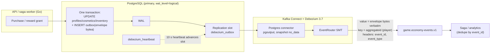
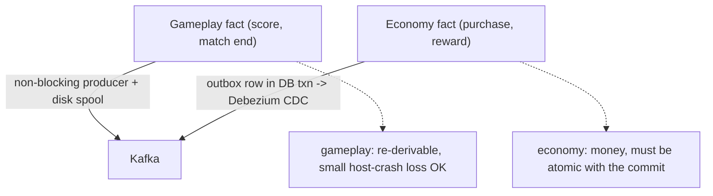
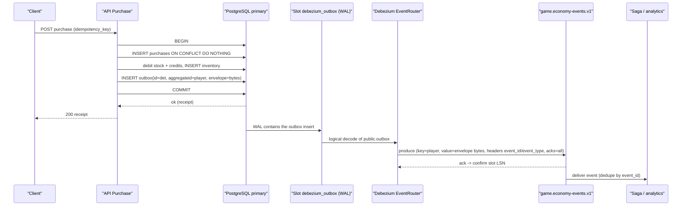
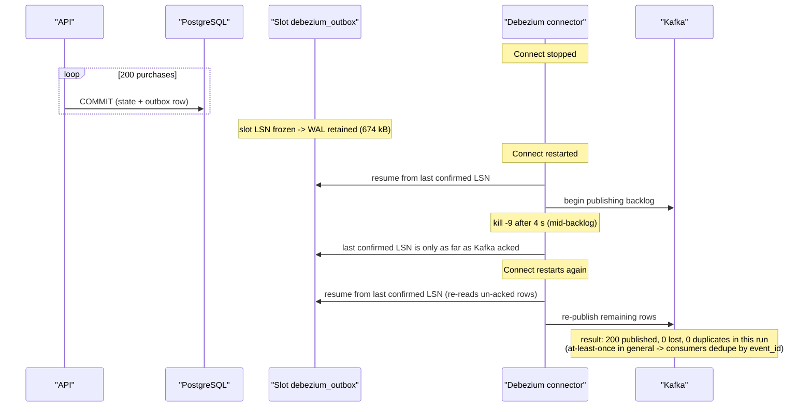
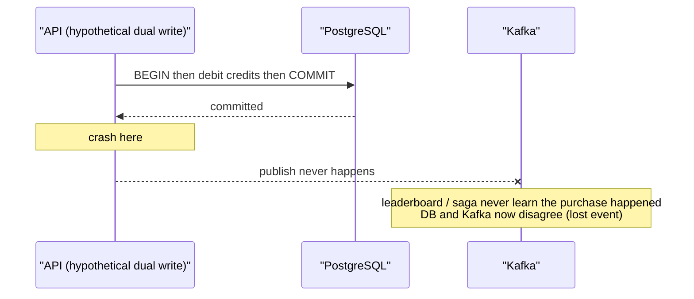

# ADR-0010 deep dive: Critical economy events via transactional outbox and Debezium CDC

> Source decision: [`../../adr/0010-outbox-cdc.md`](../../adr/0010-outbox-cdc.md)
> Evidence: [`../../experiments/004-week4-streaming/README.md`](../../experiments/004-week4-streaming/README.md)
> Related: [ADR-0009 (Kafka/producer)](ADR-0009-kafka-contracts-producer.md), [ADR-0006 (concurrency/idempotency)](ADR-0006-concurrency-sharding.md), [ADR-0012 (saga)](ADR-0012-saga.md)

## 1. TL;DR

- Economy writes (a cosmetic purchase, a reward grant) insert an **`outbox` row in the same PostgreSQL transaction** as the state change, so the fact and the money move atomically — solving the dual-write problem.
- A **Debezium 3.7 Postgres connector** reads the write-ahead log via logical decoding (`pgoutput`, replication slot `debezium_outbox`, publication filtered to `public.outbox`, `snapshot.mode=no_data`) and its **EventRouter SMT** publishes the stored protobuf `Envelope` **verbatim** to `game.economy-events.v1`, keyed by `aggregateid` (the player).
- The outbox row's `id` is the **deterministic event ID**, `type` becomes a header, and the DB password is resolved inside the Connect worker (`${env:POSTGRES_PASSWORD}`), never stored in the connector config.
- **Heartbeats** (`debezium_heartbeat`, 10 s) advance the replication slot while the outbox is idle, so the primary does not retain WAL without bound — but an abandoned slot is still an unbounded-WAL risk that needs week-6 alerting and a `max_slot_wal_keep_size` cap.
- Measured in [Experiment 004](../../experiments/004-week4-streaming/README.md): with Connect stopped, 200 purchases committed, the slot retained **674 kB** of WAL; after restart and a `kill -9` mid-backlog, **200/200 published, 0 lost, 0 duplicates**. Debezium is at-least-once, so consumers still dedupe by `event_id`.

## 2. Context and problem

Gameplay events ride the non-blocking spool (ADR-0009): if Kafka is down they spool and replay, and a small host-crash loss window is acceptable because the server can re-derive gameplay. **Money is different.** A cosmetic purchase or a match reward touches `profiles.credits`, `cosmetics.stock`, `inventory`, and `purchases` — authoritative, durable, player-visible state. The invariant (ADR-0010's context): *"A purchase or reward must never be committed without its event, nor the event published without the commit."*

The naive approach is a **dual write**: commit the purchase to Postgres, then publish to Kafka. This has an unavoidable gap:

```text
BEGIN; UPDATE credits; COMMIT;   <-- committed
[crash here]                     <-- event never published -> leaderboard/saga never see it
publish to Kafka;
```

Or the reverse order loses the opposite way (event published, DB rolled back → a reward that never happened). There is no ordering of two independent systems that is crash-safe. The README states the rule directly: *"Critical database changes and their outbox rows commit in one PostgreSQL transaction."*

The decision: write the event **into the same database, in the same transaction**, then let a change-data-capture pipeline publish it from the committed log. The event cannot exist without the commit, and the commit cannot exist without the event — they are the same atomic unit.

## 3. HLD

The economy write path and the publish path are decoupled by the database's own durable log:

1. The API's `Purchase` (or the saga's reward grant) runs one transaction that mutates state **and** inserts an `outbox` row containing the protobuf `Envelope` bytes.
2. PostgreSQL commits both atomically and records them in the WAL.
3. Debezium holds a **logical replication slot** on that WAL, decodes `public.outbox` inserts, and its **EventRouter** SMT unwraps the row into a Kafka record: value = the `envelope` bytes verbatim, key = `aggregateid`, headers = `event_id` and `event_type`.
4. The record lands on `game.economy-events.v1`; consumers (saga, analytics) dedupe by `event_id`.



Contrast with ADR-0009's gameplay path, which never touches Postgres:



## 4. LLD

### 4.1 Components and responsibilities

| Component | File | Responsibility |
|---|---|---|
| `insertOutbox[T]` | [`backend/internal/store/purchases.go`](../../backend/internal/store/purchases.go) | Marshal the Envelope to proto (for Kafka) and JSON (for humans), insert one `outbox` row in the current tx. |
| `Store.Purchase` | [`backend/internal/store/purchases.go`](../../backend/internal/store/purchases.go) | Atomic purchase: claim idempotency key, debit, grant, write outbox — all in one tx. |
| `outbox` table | [`backend/migrations/00001_accounts_economy.sql`](../../backend/migrations/00001_accounts_economy.sql) | EventRouter-shaped table: `id`, `aggregatetype`, `aggregateid`, `type`, `payload jsonb`, `created_at`. |
| `envelope` column + heartbeat | [`backend/migrations/00008_outbox_envelope.sql`](../../backend/migrations/00008_outbox_envelope.sql) | Adds `envelope bytea` (proto for Kafka) and the `debezium_heartbeat` table. |
| Connector config | [`connect/outbox-connector.json`](../../connect/outbox-connector.json) | Debezium source connector: slot, publication, EventRouter, converters, secret resolution. |
| `scripts/connect.sh` | [`scripts/connect.sh`](../../scripts/connect.sh) | Idempotent `PUT` of the connector config, waits for task `RUNNING`, prints status. |
| `wal_level=logical` + slots | [`compose.yaml`](../../compose.yaml) (`x-pg-cmd`) | Enables logical decoding and sets `max_replication_slots=10`, `max_wal_senders=10`. |
| Connect worker env | [`compose.yaml`](../../compose.yaml) (`connect` service) | `EnvVarConfigProvider` so `${env:POSTGRES_PASSWORD}` resolves inside the worker. |

### 4.2 The `outbox` table (EventRouter shape)

From migration 00001 (the base table) plus 00008 (the `envelope` column):

```sql
CREATE TABLE outbox (
    id            uuid PRIMARY KEY DEFAULT uuidv7(),  -- but we override with a deterministic event id
    aggregatetype text  NOT NULL,                     -- "player"
    aggregateid   text  NOT NULL,                     -- player id string -> becomes the Kafka key
    type          text  NOT NULL,                     -- "CosmeticPurchased" / "RewardGranted" -> header
    payload       jsonb NOT NULL,                     -- human/SQL-debugging JSON rendering
    created_at    timestamptz NOT NULL DEFAULT now()
);
-- migration 00008:
ALTER TABLE outbox ADD COLUMN envelope bytea;          -- the protobuf Envelope the router publishes verbatim
CREATE TABLE debezium_heartbeat (id int PRIMARY KEY, beat_at timestamptz NOT NULL);
INSERT INTO debezium_heartbeat VALUES (1, now());
```

Note the column names (`aggregatetype`, `aggregateid`, `type`, `payload`) are exactly what Debezium's EventRouter expects by default. Migration 00008 is **expand-only**: old writers that leave `envelope` NULL are simply skipped by the router, and `snapshot.mode=no_data` means only new rows are ever published.

### 4.3 `insertOutbox` — writing the event in the transaction

```go
func insertOutbox[T ...](ctx, tx pgx.Tx, typ string, playerID int64, id, causation string, payload T) error {
    now := timestamppb.Now()
    env := &eventsv1.Envelope{EventId: id, EventTime: now, ProducedAt: now, SchemaVersion: 1,
        CorrelationId: causation, CausationId: causation, Source: "api/economy"}
    // set env.Payload from the typed payload ...
    bin, _ := proto.Marshal(env)           // for Kafka (EventRouter publishes these bytes)
    js, _  := protojson.Marshal(env)       // for humans / SQL
    tx.Exec(ctx, `INSERT INTO outbox (id, aggregatetype, aggregateid, type, payload, envelope)
        VALUES ($1::uuid, 'player', $2, $3, $4, $5)`, id, player, typ, js, bin)
}
```

Key points: `id` is a deterministic event ID (also a valid uuid literal — see `eventid.New`), so a retried purchase writes the same row ID; `aggregateid` is the player (the Kafka key, preserving per-player order); `envelope` holds the exact bytes a consumer will receive; `payload` is a JSON copy for debugging only.

### 4.4 `Store.Purchase` — the atomic unit

From `purchases.go`, one transaction (`s.inTx`) does, in order:

1. **Claim the idempotency key**: `INSERT INTO purchases (...) ON CONFLICT (player_id, idempotency_key) DO NOTHING RETURNING id`. A concurrent request with the same key blocks on the unique index until commit, then takes the replay path and returns the original receipt. (This is the ADR-0006 idempotency mechanism.)
2. **Debit** stock and credits via the chosen `Strategy` (Pessimistic / Optimistic / Conditional — ADR-0006).
3. **Grant** the item: `INSERT INTO inventory`; a duplicate PK → `ErrAlreadyOwned`.
4. **Write the outbox row**: `insertOutbox(..., eventid.New("purchase", purchaseID), key, CosmeticPurchased{...})`.

Because all four are in one transaction, a business failure rolls everything back — including the idempotency-key claim — so a later retry can still succeed, and **no outbox event is written for a purchase that didn't happen**. Conversely, a successful purchase **always** has its event in the same commit.

### 4.5 Debezium connector (exact config from `connect/outbox-connector.json`)

| Key | Value | Meaning |
|---|---|---|
| `connector.class` | `io.debezium.connector.postgresql.PostgresConnector` | Postgres CDC source. |
| `plugin.name` | `pgoutput` | PostgreSQL's built-in logical decoding plugin (no extension needed). |
| `slot.name` | `debezium_outbox` | The logical replication slot that pins WAL position. |
| `publication.name` | `debezium_outbox` | Publication listing tables to decode. |
| `publication.autocreate.mode` | `filtered` | Debezium creates a publication for only the included tables. |
| `table.include.list` | `public.outbox` | Only the outbox is decoded. |
| `snapshot.mode` | `no_data` | No initial table snapshot; only changes after the slot is created. |
| `heartbeat.interval.ms` | `10000` | Emit a heartbeat every 10 s. |
| `heartbeat.action.query` | `UPDATE debezium_heartbeat SET beat_at = now() WHERE id = 1` | Writes WAL so the slot advances when the outbox is idle. |
| `transforms.outbox.type` | `io.debezium.transforms.outbox.EventRouter` | Unwraps an outbox row into a domain event. |
| `...route.topic.replacement` | `game.economy-events.v1` | All routed events go to this topic. |
| `...table.field.event.key` | `aggregateid` | Kafka record key = player ID. |
| `...table.field.event.payload` | `envelope` | Kafka record value = the `envelope` column bytes. |
| `...table.fields.additional.placement` | `id:header:event_id,type:header:event_type` | Copy `id`/`type` into record headers. |
| `value.converter` | `io.debezium.converters.BinaryDataConverter` | Publish the `bytea` verbatim (no re-encoding). |
| `key.converter` | `org.apache.kafka.connect.storage.StringConverter` | Player ID key as a string. |
| `database.password` | `${env:POSTGRES_PASSWORD}` | Resolved in the worker, never stored in the config. |
| `producer.override.acks` | `all` | Durable publish. |
| `producer.override.enable.idempotence` | `true` | No producer-side duplicates on retry. |
| `topic.creation.default.replication.factor` | `3` | Internal topics match cluster durability. |

### 4.6 Algorithm: end-to-end publish

1. `Purchase` commits the state change + outbox row in one tx → the insert is in the WAL.
2. Postgres's logical decoder feeds the `pgoutput` stream for the `debezium_outbox` publication (only `public.outbox`).
3. Debezium reads the insert, confirming its slot position (LSN) only after Kafka acks — so a crash before the ack re-reads from the last confirmed LSN (at-least-once).
4. EventRouter maps columns: value ← `envelope`, key ← `aggregateid`, headers ← `id`/`type`.
5. The record is produced to `game.economy-events.v1` with `acks=all`, idempotent.
6. Heartbeat every 10 s writes `debezium_heartbeat`, generating WAL even when no purchases happen, so the slot's confirmed LSN advances and WAL can be recycled.

### 4.7 Why outbox rows are not deleted (yet)

ADR-0010's consequences note outbox rows are not deleted; a periodic purge is needed (Debezium has already read them from WAL). A naive delete would itself appear in the WAL and (if the table were decoded for deletes) could confuse routing, so purging is scheduled as a separate concern. This is a known limitation, not a bug.

## 5. Sequence diagrams

### 5.1 Happy path: purchase commits and the event is published



### 5.2 Failure path: Connect down during purchases, then crash mid-backlog



### 5.3 Edge path: dual write without an outbox (the bug this avoids)



## 6. Concepts explained

### 6.1 The dual-write problem

**What it is.** Writing to two independent systems (a database and a message broker) with no shared transaction. Whatever order you pick, a crash between the two leaves them inconsistent: either the DB changed but the event was never sent, or the event was sent but the DB rolled back.

```text
commit DB -> [crash] -> no event      (lost event)
send event -> [crash] -> DB rolled back (phantom event)
```

**Why LocalArena cares.** Economy state (credits, inventory) and its event feed the leaderboard and saga. Disagreement means a player is charged with no reward, or rewarded for a purchase that never committed. ADR-0010's context names this exactly.

**What was measured.** The whole CDC-outage experiment is the proof the dual write is avoided: 200/200 published, 0 lost, 0 duplicates even across a mid-backlog crash.

**Where else.** Payments (charge + ledger entry), e-commerce (order + fulfillment event), banking (transfer + notification), any "update DB then notify" integration.

### 6.2 Transactional outbox

**What it is.** Instead of writing to the broker, you write the message as a **row in the same database, in the same transaction** as the state change. A separate process later reads those rows and publishes them. The message's existence is now tied to the commit.

```text
BEGIN;
  UPDATE profiles SET credits = credits - price ...;
  INSERT INTO outbox (envelope) VALUES (...);   -- same transaction
COMMIT;                                          -- both or neither
-- later: a relay/CDC publishes the outbox row
```

**Why LocalArena uses it.** It makes "commit without event" and "event without commit" impossible. `Store.Purchase` inserts the outbox row as step 4 of the same `inTx`.

**What was measured.** 200 purchases committed while Connect was down produced 0 lost events after recovery — the rows were safely in the DB/WAL waiting.

**Where else.** Microservices-to-event-bus integration everywhere: Stripe-like billing, order services, inventory services; it's the canonical pattern for reliable event publishing from a service that owns a database.

### 6.3 Change data capture (CDC) and logical decoding

**What it is.** CDC turns a database's committed changes into a stream of events. PostgreSQL's **logical decoding** reads the WAL and emits logical row changes (insert/update/delete) for tables in a **publication**, via a decoding plugin (`pgoutput`, built in since PG10).

**Why LocalArena uses it.** It's the "later, publish the outbox row" half of the pattern, but driven by the committed WAL rather than by polling — no missed rows, no extra query load, correct ordering. `wal_level=logical`, `plugin.name=pgoutput`, `publication.name=debezium_outbox`, `table.include.list=public.outbox`.

**What was measured.** The slot retained 674 kB of WAL for 200 outbox rows while Connect was down, then published all of them — the WAL *was* the durable buffer.

**Where else.** Database replication to data warehouses/search indexes (Debezium → Snowflake/Elasticsearch), cache invalidation from DB changes, audit pipelines, keeping a read model in sync in CQRS.

### 6.4 Replication slots and WAL retention

**What it is.** A **replication slot** is a named cursor in the WAL that a consumer (logical or physical) advances as it confirms receipt. PostgreSQL will **not recycle WAL past the oldest slot's position**, guaranteeing the consumer never misses data — but also meaning an unconsumed slot pins WAL forever.

**Why LocalArena uses it.** The slot `debezium_outbox` guarantees Debezium never loses an outbox row even across a Connect outage. The danger — an abandoned slot filling the disk — is called out in ADR-0010 and the experiment's remaining risks, with the mitigation: alert on retained WAL (week 6) and cap it with `max_slot_wal_keep_size`.

**What was measured.** 674 kB of retained WAL for 200 purchases during the Connect outage; it released after recovery.

**Where else.** Postgres physical/logical replicas (a slow/dead replica pinning WAL is a classic production incident), MySQL binlog retention for Debezium, Kafka consumer lag (the analogous "slow consumer pins the log" problem).

### 6.5 Debezium EventRouter SMT

**What it is.** A Single Message Transform that recognizes the outbox table shape and maps its columns onto a Kafka record: a payload column → the value, an aggregate-id column → the key, a topic field or a fixed replacement → the destination topic, and extra columns → headers.

**Why LocalArena uses it.** It publishes the stored `envelope` bytes **verbatim** (`BinaryDataConverter`) so the producer-side proto Envelope and the CDC-side Envelope are byte-identical — a consumer can't tell whether an economy event came through the outbox or (hypothetically) directly. Key = `aggregateid` (player) preserves per-player order; `id`/`type` become headers.

**What was measured.** Not isolated; its correctness is implied by the CDC-outage result (200 correctly-routed events, same key).

**Where else.** Any Debezium-based outbox deployment (the SMT is purpose-built for exactly this). The general idea — a transform that reshapes CDC rows into domain events — appears in Kafka Connect, Flink CDC, and AWS DMS pipelines.

### 6.6 `snapshot.mode=no_data`

**What it is.** Debezium can take an initial snapshot of existing table data when it first connects. `no_data` skips the data snapshot (it still reads schema), so only changes that occur **after** the slot exists are captured.

**Why LocalArena uses it.** The outbox is a stream of new facts; re-publishing every historical row on connector (re)creation would flood the topic with duplicates of already-processed events. Combined with the expand-only migration (old rows have NULL `envelope`), only genuinely new, enveloped rows are published.

**What was measured.** Implied by "0 duplicates" across the CDC experiment and by the design note in migration 00008.

**Where else.** Any CDC pipeline attaching to an append-only or outbox table where history was already handled; snapshot modes are a standard Debezium operational decision.

### 6.7 Deterministic event IDs (reprise for dedupe)

**What it is.** The outbox row `id` = `eventid.New("purchase", purchaseID)` — a deterministic 128-bit value that's also a valid UUID. The same purchase always yields the same row ID and event ID.

**Why LocalArena uses it.** Debezium is at-least-once: a crash between publishing and confirming the LSN re-publishes a row. The deterministic ID (carried in the `event_id` header and in the envelope) lets consumers dedupe. This is the same mechanism as ADR-0009's gameplay IDs, applied to the CDC path.

**What was measured.** CDC-outage: "0 duplicates" in that run, but the design does not *rely* on that — the general duplicate test (re-producing real records) showed effects unchanged because consumers dedupe.

**Where else.** Idempotency keys across any at-least-once system; Stripe's `idempotency_key`, webhook `event.id` dedupe, exactly-once-effect processing in stream apps.

### 6.8 At-least-once delivery and idempotent consumers

**What it is.** Debezium guarantees no loss but may re-deliver (at-least-once). Correctness comes from making the *consumer's effect* idempotent, not from a magical exactly-once delivery.

**Why LocalArena uses it.** ADR-0010 states plainly: "Debezium is at-least-once, so consumers still dedupe by `event_id`." The saga's reward IDs are derived from the causing event and its steps are state-guarded (ADR-0012), so re-delivery can't double-grant.

**What was measured.** The duplicate experiment: re-producing 46 real `MatchCompleted`/`PlayerScored` records left credits sum and granted-sagas count unchanged (459 → 459); the accidental ~1.45 M-duplicate replay also changed nothing.

**Where else.** Payment processors, order pipelines, notification systems — at-least-once + idempotency keys is the standard reliable-messaging recipe.

### 6.9 `wal_level=logical`

**What it is.** A PostgreSQL setting controlling how much information the WAL carries. `logical` adds enough to reconstruct row-level logical changes (needed for logical decoding / CDC); `replica` supports physical replication only.

**Why LocalArena uses it.** CDC requires it. The compose command sets `wal_level=logical` and notes it "also keeps physical replication working" (the read replica in ADR-0004).

**What was measured.** Not a number; it's a prerequisite. Its presence is verifiable in `compose.yaml`'s `x-pg-cmd`.

**Where else.** Any Debezium/logical-replication Postgres deployment; AWS RDS/Aurora require the equivalent `rds.logical_replication` parameter for DMS/Debezium.

### 6.10 Secret handling in the Connect worker

**What it is.** Kafka Connect connector configs are stored (in Kafka's `connect.configs` topic) and visible via the REST API, so putting a password in them leaks it. The `EnvVarConfigProvider` resolves `${env:NAME}` from the worker process environment at runtime instead.

**Why LocalArena uses it.** `database.password: ${env:POSTGRES_PASSWORD}` keeps the password out of the stored config and out of `connect/outbox-connector.json`. The worker gets `POSTGRES_PASSWORD` from its container environment. This aligns with the week-5 secrets work.

**What was measured.** Not measured; it's a security control, verifiable in the config and compose env (`CONNECT_CONFIG_PROVIDERS: env`).

**Where else.** Any secret externalization: Kubernetes secrets as env vars, Vault/SOPS-injected config, 12-factor config; never commit credentials to config that's stored or logged.

### 6.11 Polling vs CDC (the alternative that was rejected)

**What it is.** A "polling publisher" periodically `SELECT`s unpublished outbox rows, publishes them, and marks them done — instead of reading the WAL.

**Why LocalArena rejected it.** ADR-0010: polling "adds DB load and latency, and ordering needs care." Listen/NOTIFY was rejected because it "is not durable" (a notification missed during downtime is gone). CDC reads the durable WAL, so nothing is missed and ordering follows the log.

**What was measured.** Not benchmarked against CDC; the choice is argued qualitatively in the ADR.

**Where else.** The polling publisher is still common (it's simpler and needs no logical decoding); the tradeoff — extra query load and tail latency vs CDC's operational complexity (slots, WAL) — recurs in every outbox implementation decision.

## 7. Code pointers

| Path (symbol / key) | Look at |
|---|---|
| [`backend/internal/store/purchases.go`](../../backend/internal/store/purchases.go) (`Store.Purchase`) | The one transaction: idempotency claim, debit, grant, outbox insert. |
| [`backend/internal/store/purchases.go`](../../backend/internal/store/purchases.go) (`insertOutbox`) | Envelope → proto (`envelope`) + JSON (`payload`), the `INSERT INTO outbox`. |
| [`backend/migrations/00001_accounts_economy.sql`](../../backend/migrations/00001_accounts_economy.sql) (`CREATE TABLE outbox`) | The EventRouter-shaped columns and the economy invariants (CHECKs, unique idempotency key). |
| [`backend/migrations/00008_outbox_envelope.sql`](../../backend/migrations/00008_outbox_envelope.sql) (`envelope`, `debezium_heartbeat`) | Expand-only addition of the proto column and the heartbeat table. |
| [`connect/outbox-connector.json`](../../connect/outbox-connector.json) (all keys) | Slot, publication, snapshot mode, EventRouter mapping, converters, secret resolution, heartbeat. |
| [`scripts/connect.sh`](../../scripts/connect.sh) | Idempotent connector `PUT` and status wait. |
| [`compose.yaml`](../../compose.yaml) (`x-pg-cmd` → `wal_level=logical`, `max_replication_slots`, `max_wal_senders`) | Logical decoding prerequisites on the primary. |
| [`compose.yaml`](../../compose.yaml) (`connect` service env) | `EnvVarConfigProvider`, `POSTGRES_PASSWORD`, internal-topic RF 3, loopback-only REST port. |
| [`schemas/localarena/events/v1/events.proto`](../../schemas/localarena/events/v1/events.proto) (`CosmeticPurchased`, `RewardGranted`) | The economy payloads carried in the outbox envelope. |
| [`experiments/004-week4-streaming/README.md`](../../experiments/004-week4-streaming/README.md) | The CDC-outage hypothesis, result, and remaining risks (WAL retention, undeleted rows). |
| [`experiments/004-week4-streaming/results/cdc-outage.txt`](../../experiments/004-week4-streaming/results/cdc-outage.txt) | Raw: 200 committed, 674 kB WAL retained, 200/200 published after crash, 0 lost/0 dup. |

## 8. Trade-offs and alternatives

| Option | Pros | Cons | Why (not) chosen |
|---|---|---|---|
| Transactional outbox + CDC (**chosen**) | Atomic with the commit; no lost/phantom events; no extra query load; log ordering | Operational complexity (slots, WAL retention, Connect); outbox rows accumulate until purged; at-least-once (needs dedupe) | Only approach that makes commit-and-event atomic for money; measured 0 loss across a mid-backlog crash |
| Dual write (DB then Kafka) | Trivial to code | Crash between the two loses or phantoms events | Rejected: the exact bug this ADR exists to prevent |
| Polling the outbox table | Simple; no logical decoding | Extra DB load and latency; ordering needs care | Rejected in ADR-0010 |
| LISTEN/NOTIFY | Low latency, built in | Not durable — a notification missed during downtime is lost | Rejected: durability is the whole point |
| Spool like gameplay events (ADR-0009) | Reuses existing mechanism; non-blocking | Not atomic with the DB commit; host-crash loss window | Unacceptable for money; the DB transaction is the stronger durability source |
| Delete outbox rows in the same txn | No accumulation | The delete is itself WAL the router may see; risk of mis-routing; premature | Deferred to a periodic purge (known limitation) |

## 9. Failure modes and how they were found

From [Experiment 004](../../experiments/004-week4-streaming/README.md), scenario "CDC outage + crash" ([`results/cdc-outage.txt`](../../experiments/004-week4-streaming/results/cdc-outage.txt)):

- **Connect stopped during 200 purchases** → topic grew by 0 while down; the slot retained **674 kB** of WAL. On recovery with a `kill -9` 4 s into the backlog, the slot's last-confirmed LSN meant un-acked rows were re-read: **200/200 published, 0 lost, 0 duplicates**.

Known risks carried forward (from ADR-0010 consequences and the experiment's remaining risks):

- **An abandoned slot retains WAL without bound** — needs week-6 alerting on retained WAL and a `max_slot_wal_keep_size` cap.
- **Outbox rows are never deleted** — a periodic purge (Debezium has already read them from WAL) is needed.
- Debezium is at-least-once in general — the "0 duplicates" was this run; correctness does not depend on it because consumers dedupe by `event_id`.

## 10. Interview questions

**Q1 (beginner). What is the dual-write problem?**
Writing to two systems (DB and Kafka) without a shared transaction. A crash between the two leaves them inconsistent — either the DB changed but no event was sent (lost event), or an event was sent but the DB rolled back (phantom event). There's no crash-safe ordering of two independent commits.

**Q2 (beginner). How does the transactional outbox solve it?**
You write the event as a row in the **same database transaction** as the state change. Commit is atomic: both the credit debit and the outbox row land together, or neither does. A separate CDC process then publishes the committed rows. The event can't exist without the commit and vice versa.

**Q3 (beginner). What is CDC and why use it instead of polling the outbox?**
CDC streams a database's committed changes (here via Postgres logical decoding of the WAL). Polling repeatedly `SELECT`s unpublished rows — simpler but adds query load and latency and needs careful ordering. CDC reads the durable WAL in commit order, so nothing is missed and ordering is free. ADR-0010 rejected polling for those reasons.

**Q4 (intermediate). What is a replication slot and why is it both essential and dangerous?**
A slot is a cursor in the WAL that the consumer advances as it confirms receipt; Postgres won't recycle WAL past the oldest slot, so the consumer never misses data even across an outage. The danger: if the consumer dies and the slot is never advanced, WAL accumulates until the disk fills. LocalArena mitigates with a 10 s heartbeat and plans alerting plus `max_slot_wal_keep_size`.

**Q5 (intermediate). Why the heartbeat table?**
If the outbox is idle, no new WAL is generated for `public.outbox`, so the slot's confirmed position can't advance and WAL for *other* activity can't be recycled. The heartbeat `UPDATE debezium_heartbeat ... every 10 s` generates WAL that lets Debezium confirm a newer LSN, so the slot advances even when no purchases happen.

**Q6 (intermediate). What does EventRouter do and why `BinaryDataConverter`?**
EventRouter reshapes an outbox row into a Kafka record: value ← `envelope`, key ← `aggregateid`, topic ← fixed `game.economy-events.v1`, and `id`/`type` → headers. `BinaryDataConverter` publishes the `bytea` verbatim, so the proto Envelope bytes are byte-identical to what a producer would have sent — consumers can't tell the difference and don't re-encode.

**Q7 (intermediate). Why is the outbox row ID deterministic?**
Debezium is at-least-once; a crash between publishing and confirming the LSN re-publishes a row. A deterministic ID (`eventid.New("purchase", id)`) means the re-delivered event has the same `event_id`, so idempotent consumers drop the duplicate. It's also a valid UUID, matching the table's `uuid` primary key type.

**Q8 (intermediate). Walk through `Store.Purchase`'s transaction and explain why order matters.**
One transaction: (1) claim the idempotency key with `INSERT ... ON CONFLICT DO NOTHING` (a concurrent same-key request blocks then replays); (2) debit stock/credits; (3) grant the item; (4) insert the outbox row. Any business failure rolls all four back, so the key isn't consumed and the outbox has no event for a non-purchase. Success commits state and event together.

**Q9 (senior). Debezium is at-least-once — how does LocalArena avoid double-charging or double-rewarding?**
Not by claiming exactly-once delivery. Consumers dedupe by `event_id`; reward IDs are derived from the causing event; saga steps are state-guarded (ADR-0012). The duplicate experiment re-produced real events (and accidentally ~1.45 M) with credits and granted-saga counts unchanged. Correctness lives in idempotent effects, not delivery.

**Q10 (senior). What exactly did the CDC-outage experiment prove, and what did it not prove?**
It proved: outbox rows survive a Connect outage (held in WAL behind the slot, 674 kB) and are published on recovery with 0 loss even after a mid-backlog `kill -9`. It did not prove zero duplicates in general — that run had 0, but Debezium is at-least-once, so the system relies on consumer dedupe, not on this result.

**Q11 (senior). Why keep both `envelope` (bytea) and `payload` (jsonb)?**
`envelope` is the machine contract — the exact protobuf bytes EventRouter publishes verbatim, so producer and CDC paths are identical. `payload` is a human/SQL-debugging JSON rendering; you can read an outbox row's meaning with a plain `SELECT` without a proto decoder. The JSON is never published.

**Q12 (senior, design). Design a purge for the outbox table that's safe with CDC.**
Only delete rows Debezium has definitely published. Safe approaches: delete rows older than a conservative window (e.g. older than the slot's confirmed LSN time, or older than retention of `game.economy-events.v1`); batch-delete to avoid long locks and WAL spikes; ensure the connector either doesn't decode deletes on `outbox` or tolerates them (EventRouter routes inserts). Alternatively partition the outbox by day and `DROP` old partitions (cheap, no per-row WAL). Monitor that deletions never outrun the slot's confirmed position.

**Q13 (senior, what-would-you-change at 100x). How would you scale this economy-event pipeline for 100x purchase volume?**
Partition the outbox topic more and shard the outbox table (by player) so CDC parallelism rises; run multiple connectors/tasks per shard. Move purge to partition drops. Add strict WAL-retention alerting and `max_slot_wal_keep_size` so a stalled consumer degrades to loss-with-alert instead of disk-full-outage (a deliberate availability/durability choice). Consider a dedicated CDC-only replica so decoding load doesn't compete with OLTP. Keep the outbox pattern — it's the only part that stays correct regardless of scale; the scaling work is all around slots, partitions, and purge.

**Q14 (senior). Why does gameplay use a disk spool (ADR-0009) but economy uses the outbox?**
Durability matched to value and re-derivability. Gameplay facts are high-volume and re-derivable; a small host-crash loss window is acceptable, and coupling them to a DB transaction would add latency. Economy facts are money: they must be atomic with the state change, which only a shared DB transaction gives. So gameplay gets the non-blocking spool and economy gets the transactional outbox + CDC.

**Q15 (senior). The Connect REST API and Kafka UI are bound to loopback with no auth. Is that acceptable?**
In this local lab, yes — they're bound to `127.0.0.1` only (`compose.yaml` comments say "REST API has no auth: loopback only"). In production it is not: the Connect API can read/alter connectors (including anything a misconfigured connector could expose), so it needs network isolation and auth. The password is already externalized via `${env:...}`, which is the right direction; the remaining gap is API authn/authz and TLS, which the week-5 security work addresses for the app edge.
