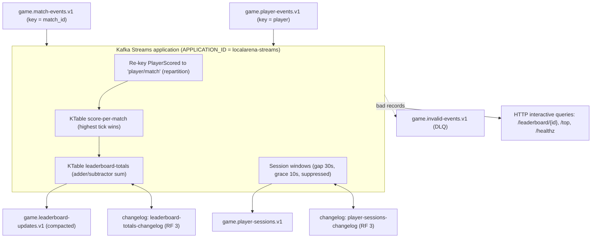
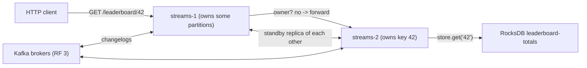
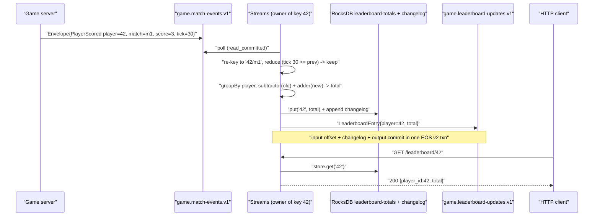
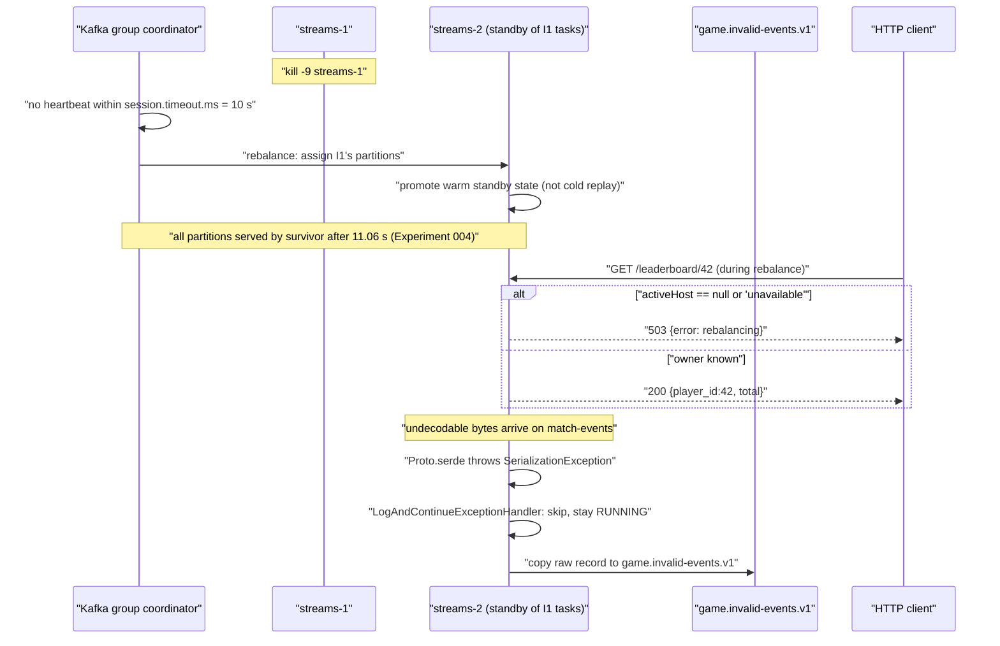

# ADR-0011 deep dive: Kafka Streams: stateful processing, exactly-once

> Source decision: [`../../adr/0011-kafka-streams-leaderboard.md`](../../adr/0011-kafka-streams-leaderboard.md)
> Code: [`../../streams/`](../../streams) · Evidence: [`../../experiments/004-week4-streaming/README.md`](../../experiments/004-week4-streaming/README.md)

## 1. TL;DR

- The **leaderboard** and **player sessions** are stateful, partitioned computations built as a single Java 21 Kafka Streams 4.4 application (`streams/`), run as 2 instances with 1 standby replica and `processing.guarantee=exactly_once_v2`.
- The leaderboard is **idempotent by construction**: `PlayerScored` carries the running per-match *total* (not a delta), re-keyed to `player/match` and reduced to the highest-tick record, then summed per player with an **adder/subtractor** reducer. Duplicates and out-of-order replays are no-ops, verified by `459 → 459` granted sagas and an identical leaderboard after a ~1.45 M duplicate replay (Experiment 004).
- **Sessions** use session windows with a 30 s inactivity gap and 10 s grace on *event time* (the game tick time in the Envelope), suppressed until the window closes.
- **Interactive queries** over HTTP serve `/leaderboard/{id}` (forwarded to the key owner) and `/top` (scatter-gather over all instances); `/healthz` reports `RUNNING` vs rebalancing/restoring.
- Measured resilience: Streams failover in **11.06 s**, a full RocksDB state wipe restored from changelogs in **10.86 s** with identical totals, and poison records skipped into `game.invalid-events.v1` without crashing either instance (Experiment 004). EOS v2 covers only Kafka→Kafka inside Streams; the Postgres reward grant is a separate idempotent consumer ([ADR-0012](ADR-0012-saga.md)).

## 2. Context and problem

LocalArena emits durable gameplay events to Kafka (see [ADR-0009](ADR-0009-kafka-contracts-producer.md) and [ADR-0010](ADR-0010-outbox-cdc.md)). Two of the downstream products are stateful:

1. **A live leaderboard** — a running season total per player, derived from per-match scores.
2. **Player sessions** — "a player was active from T0 to T1 across N events", derived from activity gaps.

Both are hard in a way that a stateless consumer is not:

- **State must survive instance loss.** If the process holding the aggregate dies, another instance must take over without losing the running totals.
- **State must be rebuildable.** If the on-disk state is corrupted or wiped, the system must reconstruct it from a durable log, not from a one-time snapshot.
- **Duplicate and out-of-order delivery must not corrupt the result.** Kafka delivery is at-least-once; the spool and CDC paths ([ADR-0010](ADR-0010-outbox-cdc.md)) replay events after an outage. A naive `SUM(PlayerScored.score)` would double-count every redelivered record. Experiment 004 accidentally replayed ~1.45 M duplicates — the design had to tolerate exactly that.
- **Windows must use domain time, not arrival time.** An event spooled during a Kafka outage and replayed minutes later still belongs to the session window it happened in, not the window it was replayed into.

The README runtime invariants also require that **gameplay never waits for Kafka** and that **every consumer is idempotent**. The leaderboard/sessions app is the stateful half of satisfying those invariants; [ADR-0009](ADR-0009-kafka-contracts-producer.md)'s non-blocking producer is the other half.

The decision: use **Kafka Streams** (not hand-rolled consumers plus a database) because it gives, out of the box, partitioned local state with changelog-backed durability, standby replicas for fast failover, event-time windowing with grace, suppression, exactly-once-v2 transactions across input offsets + state + output, and interactive queries over the live state.

## 3. HLD

The app reads two input topics, maintains two kinds of local state (a key-value store for leaderboard totals, a session store for sessions), and writes two output topics. All local state is backed by compacted **changelog** topics in Kafka, which is what makes failover and restoration possible. An embedded HTTP server exposes the leaderboard store for reads.

Two instances of the same `APPLICATION_ID` form a consumer group; Kafka assigns each a subset of partitions (tasks). Each instance keeps a **standby replica** of the other's state so a failure is recovered from a warm copy, not a cold changelog replay. Reads that land on an instance that does not own a key are **forwarded** to the owner; a global top-N is a **scatter-gather** across both instances.

## 4. LLD

### 4.1 Components and responsibilities

| Component | File | Responsibility |
|---|---|---|
| Topology builder | [`streams/src/main/java/io/localarena/streams/Topologies.java`](../../streams/src/main/java/io/localarena/streams/Topologies.java) `build()` | Defines the leaderboard and session dataflow: re-key, reduce, group, suppress, write. |
| Runtime + IQ server | [`streams/src/main/java/io/localarena/streams/Main.java`](../../streams/src/main/java/io/localarena/streams/Main.java) `config()`, `main()`, `serve()` | Streams config (EOS v2, standby, timeouts), lifecycle, and the `/leaderboard`, `/top`, `/healthz` HTTP API. |
| Protobuf serdes + event time | [`streams/src/main/java/io/localarena/streams/Proto.java`](../../streams/src/main/java/io/localarena/streams/Proto.java) `serde()`, `EventTime` | Protobuf (de)serialization that raises `SerializationException` on bad bytes (routed to DLQ), and the `TimestampExtractor` that reads `Envelope.event_time`. |
| Event contracts | [`schemas/localarena/events/v1/events.proto`](../../schemas/localarena/events/v1/events.proto) | `Envelope`, `PlayerScored`, `PlayerJoined/Left`, output `LeaderboardEntry`, `PlayerSession`. |
| Compose topology | [`compose.yaml`](../../compose.yaml) `streams-1`, `streams-2` | 2 instances, 512M memory limit, `STANDBY_REPLICAS` env, per-instance state volume. |

### 4.2 Streams configuration (exact values)

From [`Main.config()`](../../streams/src/main/java/io/localarena/streams/Main.java):

| Config key | Value | Why |
|---|---|---|
| `APPLICATION_ID_CONFIG` | `localarena-streams` (env `APPLICATION_ID`) | Consumer-group id and changelog/repartition topic prefix. |
| `BOOTSTRAP_SERVERS_CONFIG` | env `KAFKA_BROKERS`, default `localhost:29092`; compose uses `kafka-1:19092,kafka-2:19092,kafka-3:19092` | Broker list. |
| `PROCESSING_GUARANTEE_CONFIG` | `exactly_once_v2` | Input offsets + state changelog + output records commit in one transaction. |
| `REPLICATION_FACTOR_CONFIG` | `3` | Internal (changelog/repartition) topic RF, so state survives a broker loss. |
| `NUM_STANDBY_REPLICAS_CONFIG` | `1` (env `STANDBY_REPLICAS`, compose `STREAMS_STANDBY:-1`) | Warm copy of each task's state on another instance for fast failover. |
| `STATE_DIR_CONFIG` | `/tmp/localarena-streams` (env `STATE_DIR`) | RocksDB on-disk location. |
| `APPLICATION_SERVER_CONFIG` | `${ADVERTISED_HOST}:${PORT}` (e.g. `streams-1:7070`) | Advertised host:port for interactive-query routing. |
| `COMMIT_INTERVAL_MS_CONFIG` | `1000` | Transaction commit cadence under EOS v2. |
| `STATESTORE_CACHE_MAX_BYTES_CONFIG` | `1 << 20` (1 MiB) | Record cache; also controls KTable update deduplication. |
| `DESERIALIZATION_EXCEPTION_HANDLER_CLASS_CONFIG` | `LogAndContinueExceptionHandler` | Skip (not crash on) undecodable records. |
| `ERRORS_DEAD_LETTER_QUEUE_TOPIC_NAME_CONFIG` | `game.invalid-events.v1` | Copy skipped records to the DLQ. |
| consumer `AUTO_OFFSET_RESET_CONFIG` | `earliest` | A new app or wiped state reads the whole topic to rebuild. |
| consumer `SESSION_TIMEOUT_MS_CONFIG` | `10_000` | How fast a dead instance is noticed (default 45 s made failover 46 s). |
| consumer `HEARTBEAT_INTERVAL_MS_CONFIG` | `1_000` | Heartbeat cadence (≤ 1/3 of session timeout). |
| `DEFAULT_KEY_SERDE_CLASS_CONFIG` | `Serdes.StringSerde` | Keys are strings throughout. |

Topology constants from [`Topologies.java`](../../streams/src/main/java/io/localarena/streams/Topologies.java):

- Input topics: `game.match-events.v1`, `game.player-events.v1`.
- Output topics: `game.leaderboard-updates.v1`, `game.player-sessions.v1`.
- Key-value store name: `leaderboard-totals`.
- `SESSION_GAP = Duration.ofSeconds(30)`, `SESSION_GRACE = Duration.ofSeconds(10)`.

Compose runtime (from [`compose.yaml`](../../compose.yaml)): two services `streams-1`/`streams-2` sharing a YAML anchor, each `deploy.resources.limits.memory: 512M`, each with its own named volume (`streams-1`, `streams-2`) mounted for RocksDB.

### 4.3 Data structures and schemas

Inputs are `Envelope` protobufs ([`events.proto`](../../schemas/localarena/events/v1/events.proto)):

- `PlayerScored { match_id, player_id, score, tick }` — `score` is **the new total for this match, not a delta**, so applying it twice is harmless (comment in the proto).
- `PlayerJoined { match_id, player_id }`, `PlayerLeft { match_id, player_id, reason }`.

Outputs are derived messages (not wrapped in Envelope):

- `LeaderboardEntry { player_id, total_score, updated_at }` → `game.leaderboard-updates.v1`, keyed by player, **compacted** (latest total wins).
- `PlayerSession { player_id, start, end, events }` → `game.player-sessions.v1`, one record per closed window.

Internal (auto-created) Streams topics observed in the restore log ([`results/state-wipe.txt`](../../experiments/004-week4-streaming/results/state-wipe.txt)):

- `localarena-streams-leaderboard-totals-changelog` (partitions `1/3/5` restored `155/175/99` records).
- `localarena-streams-final-sessions-store-changelog` (partitions restored `535/587/358` records).
- Repartition topics for the `by-player-match` and `by-player` re-keys.

### 4.4 Algorithms, step by step

**Leaderboard (idempotent sum of per-match final scores).**

1. `b.stream(MATCH_EVENTS, Consumed.with(String, Envelope).withTimestampExtractor(EventTime))` — read match events, using `Envelope.event_time` as the record's stream time.
2. `.filter(hasPlayerScored).mapValues(getPlayerScored)` — keep only scoring events, unwrap the payload.
3. `.selectKey((k,s) -> playerId + "/" + matchId)` — **re-key** so all scores for one (player, match) land on one partition. This triggers a **repartition** through an internal topic.
4. `.groupByKey(...).reduce((cur,next) -> next.tick >= cur.tick ? next : cur, Materialized.as("score-per-match"))` — reduce to the **highest-tick** record per (player, match). Because `score` is a running total, the highest tick holds the final per-match score. A duplicate (same tick) or an older replay (smaller tick) is a **no-op**.
5. `.groupBy((k,s) -> pair(playerId, (long) s.score), Grouped.with(String, Long))` — re-key the per-match table to `player → score`. This is a **KTable groupBy**, so each change emits a retraction of the old value plus the new value.
6. `.reduce(Long::sum, (agg,old) -> agg - old, Materialized.as("leaderboard-totals"))` — the **adder** (`Long::sum`) adds the new value, the **subtractor** (`agg - old`) removes the previous value of that (player, match) row before re-adding it. This is what makes updates correct: when a player's per-match score changes, the old contribution is subtracted and the new one added, so the season total is never inflated.
7. `.toStream().mapValues(-> LeaderboardEntry).to(LEADERBOARD)` — publish the current total per player.

Worked example (from [`TopologiesTest.leaderboardSumsPerMatchFinalScores`](../../streams/src/test/java/io/localarena/streams/TopologiesTest.java)): player 1 scores `1,2,3` (ticks 10/20/30) in `m1` and `5` in `m2`; the per-match table keeps `3` for `m1` and `5` for `m2`; the season total is `3 + 5 = 8`. The idempotency test feeds `3` (dup), `3` (dup), an older `2`, and `3` again, and the total stays `3` — "a naive sum of every PlayerScored would give 11".

**Sessions (event-time session windows, suppressed to final).**

1. Read `PLAYER_EVENTS`, keep `PlayerJoined`/`PlayerLeft` (`only-presence`).
2. `merge` with `PlayerScored` re-keyed by player and re-wrapped in an Envelope, so scoring also counts as activity.
3. `.groupByKey().windowedBy(SessionWindows.ofInactivityGapAndGrace(30s, 10s))` — a session window closes after a 30 s gap with no activity; a 10 s grace period admits late events after the gap.
4. `.count(Materialized.as("player-sessions"))` on a `SessionStore` — the number of events in the window.
5. `.suppress(Suppressed.untilWindowCloses(unbounded()))` — **emit nothing until the window is final**, so one `PlayerSession` is written per closed session, not an update per event.
6. `.toStream().filter(n != null).map(-> PlayerSession).to(SESSIONS)` — session windows merge by emitting a tombstone for the old window and a value for the merged one; the `null` filter drops the tombstone.

Worked example (from [`sessionsUseEventTimeGapAndGrace`](../../streams/src/test/java/io/localarena/streams/TopologiesTest.java)): player 1 has events at event-time 0 s, 10 s, and a late 5 s (within grace) → one session `[0 s, 10 s)` with `events = 3`; a far-too-late event at 8 s after the window closed is dropped and does **not** reopen the session.

**Interactive-query routing** (from [`Main.serve()`](../../streams/src/main/java/io/localarena/streams/Main.java)):

- `/leaderboard/{player}`: `queryMetadataForKey` finds the owning host. If it is `self`, read the local store; otherwise **forward** the HTTP request to the owner. If no active host (rebalancing), return `503`.
- `/top?n=N`: for `scope=local`, iterate the local store; otherwise **scatter-gather** by calling `/top?scope=local` on every instance via `streamsMetadataForStore`, merge, sort descending by total then ascending by id, and take the top N (capped at 100).
- `/healthz`: `200` only when `streams.state() == RUNNING`, else `503` — used as the readiness signal so traffic is not routed to a restoring instance.

## 5. Sequence diagrams

### 5.1 Happy path: a score updates the leaderboard and is read back

### 5.2 Failure/edge path: instance killed, poison record, and a read during rebalance

## 6. Concepts explained

### Stream processing

- **What it is.** Treating an unbounded log of events as a continuously running computation: read record, update state, emit result, repeat — rather than running a batch query over a static table. Kafka Streams is a *library* (not a cluster) that turns a topology of operators into consumer/producer threads.
- **Why LocalArena uses it.** The leaderboard and sessions must update continuously as matches play out, with local state, failover, and exactly-once — all of which Streams provides without a separate processing cluster.
- **What was measured.** The whole app runs in 2 containers limited to 512M each ([`compose.yaml`](../../compose.yaml)); it handled 100-bot play and a ~1.45 M duplicate replay without corrupting results (Experiment 004).
- **Where else it is used.** Fraud scoring on card-swipe streams (payments); real-time inventory/price updates (e-commerce); ETA and surge computation from location pings (ride-hailing); sensor aggregation and anomaly detection (IoT).

### KStream vs KTable

- **What it is.** A `KStream` is a log of independent *facts* (every record matters); a `KTable` is a changelog *view* where each key has a current value and a new record for a key overwrites the old one. `groupBy` + `reduce`/`aggregate` turn a stream into a table; `toStream` turns a table's changes back into a stream.
- **Why LocalArena uses it.** The per-match "latest score" and the season totals are **tables** (a key's value replaces the old one), while the incoming scores and the output updates are **streams**. Modeling the per-match score as a table is exactly what suppresses duplicates.
- **What was measured.** The table semantics produced `total("1") == 3` after replaying the same `PlayerScored` four times, where a stream sum would give 11 ([`duplicatesAndReplaysAreIdempotent`](../../streams/src/test/java/io/localarena/streams/TopologiesTest.java)).
- **Where else it is used.** Current account balance vs the ledger of transactions (banking); the current state of a shopping cart vs the add/remove events (e-commerce); the latest known device shadow vs the telemetry stream (IoT).

### Repartitioning

- **What it is.** Kafka only guarantees order within a partition, and co-locates records with the same key. When you change the key (`selectKey`/`groupBy`), Streams must write to an internal **repartition topic** so records that now share a key land on the same partition/task.
- **Why LocalArena uses it.** Match events are keyed by `match_id` (for per-match order), but the leaderboard needs them grouped by `player/match` and then by `player`. Each re-key (`by-player-match`, `by-player`) triggers a repartition so the aggregate is correct and ordered.
- **What was measured.** Not measured directly as a number, but the restore log shows the resulting partitioned stores (`leaderboard-totals-changelog` partitions `1/3/5`) ([`results/state-wipe.txt`](../../experiments/004-week4-streaming/results/state-wipe.txt)).
- **Where else it is used.** Grouping clickstream events by user when they arrive keyed by page (analytics); re-keying orders by customer for lifetime-value aggregation (e-commerce); re-keying trades by instrument for per-symbol risk (banking).

### Aggregations with an adder/subtractor

- **What it is.** When you aggregate a **KTable** (not a stream), each source change comes as "old value out, new value in". The aggregate therefore takes two functions: an **adder** applied to the new value and a **subtractor** applied to the old value, so the running aggregate stays correct when a row changes, not just when rows are added.
- **Why LocalArena uses it.** `reduce(Long::sum, (agg,old) -> agg - old, ...)`: when a player's per-match final score changes from X to Y, the subtractor removes X and the adder adds Y, so the season total reflects Y and is never inflated by double-counting.
- **What was measured.** `leaderboardSumsPerMatchFinalScores` asserts `total("1") == 8` (`3` from m1 + `5` from m2) after several intermediate scores, which only holds because intermediate values are subtracted.
- **Where else it is used.** Maintaining a running revenue total as individual order amounts are corrected (e-commerce/finance); a leaderboard of likes where a post's like count can go down (social feeds); aggregate power draw as per-device readings are revised (IoT/energy).

### Idempotent aggregation

- **What it is.** Designing the aggregate so that re-applying the same input leaves the result unchanged — rather than relying on the messaging layer to deliver each record exactly once.
- **Why LocalArena uses it.** Delivery is at-least-once (spool replay, CDC redelivery). The leaderboard is idempotent because `PlayerScored.score` is a *total* and the per-match table keeps the highest tick, so duplicates and older replays do nothing.
- **What was measured.** `credits sum 999912490 → 999912490; granted sagas 459 → 459; leaderboard identical: yes` after replaying 46 records byte-for-byte, and unchanged after an accidental ~1.45 M duplicate run ([`results/duplicates.txt`](../../experiments/004-week4-streaming/results/duplicates.txt), Experiment 004).
- **Where else it is used.** Posting a payment keyed by an idempotency key so retries do not double-charge (payments); applying "set quantity to N" rather than "add one" for cart updates (e-commerce); upserting the latest device state (IoT).

### State stores, RocksDB, and changelogs

- **What it is.** A **state store** is the local key-value (or window/session) store an operator reads and writes; by default it is a **RocksDB** embedded store on local disk. Every write is also appended to a **changelog topic** in Kafka (compacted, RF 3), which is the durable source of truth for the state.
- **Why LocalArena uses it.** Local RocksDB makes reads and aggregates fast; the changelog makes the state recoverable after process or disk loss without re-deriving from the whole input topic.
- **What was measured.** After deleting both instances' RocksDB volumes, the app was `RUNNING` again in **10.86 s** rebuilt purely from changelogs, with identical totals ([`results/state-wipe.txt`](../../experiments/004-week4-streaming/results/state-wipe.txt)).
- **Where else it is used.** Local caches of account balances rebuilt from a Kafka ledger (banking); session stores for ad-frequency capping (ad-tech); device-shadow stores (IoT).

### Standby replicas

- **What it is.** `num.standby.replicas` keeps a *warm* copy of a task's state on another instance by continuously replaying the changelog there, so failover promotes a ready copy instead of restoring from scratch.
- **Why LocalArena uses it.** With 2 instances and 1 standby each, the survivor already holds the failed instance's state, so takeover is fast.
- **What was measured.** `kill -9` one of 2 instances → all partitions served by the survivor after **11.06 s**, totals identical ([`results/streams-failover.txt`](../../experiments/004-week4-streaming/results/streams-failover.txt)). The 11 s floor is dominated by the 10 s `session.timeout.ms`, not by state restore, precisely because the standby is warm.
- **Where else it is used.** Hot-standby replicas for low-RTO failover in databases and search clusters; standby stream processors for real-time risk and matching engines (finance).

### Restoration

- **What it is.** Rebuilding a state store by replaying its compacted changelog from the start (or from a checkpoint) before the task starts processing new records.
- **Why LocalArena uses it.** It is the recovery path when no warm standby exists (e.g. both instances lost their disks). The `auto.offset.reset=earliest` setting lets a fresh app read the whole changelog.
- **What was measured.** `Finished restoring changelog ... leaderboard-totals-changelog-1 ... 155 records` (and 175, 99; sessions 535/587/358), RUNNING in **10.86 s** ([`results/state-wipe.txt`](../../experiments/004-week4-streaming/results/state-wipe.txt)).
- **Where else it is used.** Rebuilding a read model/materialized view after a schema change (CQRS systems); warming a cache from a log after a cold start (any event-sourced service).

### Exactly-once v2 and its boundary

- **What it is.** `processing.guarantee=exactly_once_v2` wraps, in a single Kafka transaction, the consumer's input-offset commit, the writes to state-store changelogs, and the output records. Either all are committed or none are, so a crash cannot leave the output ahead of the committed offset (no duplicates) or behind (no loss) *within Kafka*. V2 reduces the number of producers/transactions versus the original EOS.
- **Why LocalArena uses it.** It removes a class of leaderboard/session corruption on crash without hand-written offset management. Crucially, it is **scoped to Kafka→Kafka**: it does not make the Postgres reward grant or any HTTP call exactly-once. That side effect is handled by idempotent consumers in [ADR-0012](ADR-0012-saga.md).
- **What was measured.** Not measured as a latency number; the design note in [`Main.config()`](../../streams/src/main/java/io/localarena/streams/Main.java) and the experiment's root explanation state EOS v2 "covers only Kafka → Kafka inside Streams" and that no-double-effects actually come from idempotent consumers (Experiment 004 root explanation).
- **Where else it is used.** Exactly-once stream-to-stream enrichment pipelines (any Kafka Streams/Flink job); transactional outbox-to-stream relays where the external effect is still made idempotent separately.

### Event time vs processing time

- **What it is.** **Event time** is when something happened in the domain; **processing time** is when the processor saw it. Windowing on event time keeps results correct when records are delayed or replayed; processing time is simpler but wrong under delay.
- **Why LocalArena uses it.** A gameplay event spooled during a Kafka outage and replayed minutes later must land in the session window it happened in, so sessions use `Envelope.event_time`.
- **What was measured.** `sessionsUseEventTimeGapAndGrace` builds a session `[0 s, 10 s)` purely from event times regardless of input order; the design comment in [`Proto.EventTime`](../../streams/src/main/java/io/localarena/streams/Proto.java) explains "a spooled event replayed minutes later still lands in the right window".
- **Where else it is used.** Billing windows that must reflect when usage occurred, not when the meter reported (telecom/cloud billing); fraud windows over transaction time (payments); IoT aggregation over sensor timestamps despite buffered uploads.

### Timestamp extractors

- **What it is.** The pluggable component that tells Streams which timestamp to treat as a record's stream time. The default uses the Kafka record timestamp; a custom extractor can read a field from the payload.
- **Why LocalArena uses it.** `Proto.EventTime` reads `Envelope.event_time` when the value is an Envelope, and falls back to the record timestamp (or partition time) otherwise. This cleanly separates "when it happened" (payload) from "when it was produced/replayed" (record timestamp) — which also fixed the spool-replay bug (see §9).
- **What was measured.** Indirectly via the session test; and the bug fix note "record timestamp = produce time ... event time stays in the Envelope, where Streams' timestamp extractor reads it" (Experiment 004, Bugs #1).
- **Where else it is used.** Any pipeline that must window on an embedded business timestamp: order placement time, sensor capture time, log emit time.

### Session windows

- **What it is.** A dynamic window defined by a **gap**: events within `gap` of each other belong to the same session; a larger gap starts a new session. Sessions grow and merge as events arrive.
- **Why LocalArena uses it.** "A player was active from T0 to T1" is naturally a session, not a fixed clock window. Gap = 30 s.
- **What was measured.** `sessionsUseEventTimeGapAndGrace` asserts one session with `events = 3` spanning `[0 s, 10 s)` for a 30 s gap.
- **Where else it is used.** Web analytics "visit" sessionization; grouping a user's app-usage burst (mobile); grouping a vehicle's trip from ignition to stop (ride-hailing/fleet).

### Grace periods

- **What it is.** After a window's end, a **grace** period keeps the window open to admit late-arriving events (by event time) before it is finalized. Events later than the grace are dropped.
- **Why LocalArena uses it.** 10 s grace admits events that arrive slightly out of order (e.g. a late presence event) into the correct session; a far-too-late event is dropped and must not reopen the session.
- **What was measured.** The test feeds a late event "within grace: merged" (counted) and a later one "far too late: dropped, no new session".
- **Where else it is used.** Late-arriving mobile analytics events; out-of-order IoT uploads; delayed payment settlement events.

### Suppression

- **What it is.** `suppress(untilWindowCloses(...))` buffers a windowed aggregate and emits **only the final result** when the window closes, instead of an update per input record.
- **Why LocalArena uses it.** A session should produce exactly one `PlayerSession` record, not an incremental update for every event in it.
- **What was measured.** `assertTrue(sessions.isEmpty(), "suppress: nothing until the window closes")` before the closing event, then exactly one session appears.
- **Where else it is used.** Emitting one final daily total per customer rather than a stream of partial sums; one finalized billing record per period; one alert per completed anomaly window.

### Interactive queries

- **What it is.** Reading a Streams state store directly over an API while the app runs, instead of consuming the output topic. Streams exposes which host owns each key (`queryMetadataForKey`) and metadata for all instances (`streamsMetadataForStore`), so a request can be **forwarded** to the owner or **scatter-gathered**.
- **Why LocalArena uses it.** Serving `/leaderboard/{id}` and `/top` directly from the live totals store avoids a separate database for the read path.
- **What was measured.** Not benchmarked; routing is exercised by the forwarding and scatter-gather code in [`Main.serve()`](../../streams/src/main/java/io/localarena/streams/Main.java). Note the endpoints have no auth (week 5), so they bind to the cluster network only.
- **Where else it is used.** Serving low-latency "current state" reads from a materialized view (CQRS); querying per-key aggregates in real-time dashboards; feature-store lookups for online ML.

### Scatter-gather

- **What it is.** Fan a query out to every node that holds a shard of the data, then merge the partial results. Used here for a global top-N because no single instance has all partitions.
- **Why LocalArena uses it.** `/top` asks each instance for its local top-N, merges, sorts, and returns the global top-N.
- **What was measured.** Not benchmarked; implemented in `/top` (default scope) in [`Main.serve()`](../../streams/src/main/java/io/localarena/streams/Main.java).
- **Where else it is used.** Distributed search (query every shard, merge ranked hits); federated analytics across regions; fan-out reads across database shards.

### DLQs and poison records

- **What it is.** A **poison record** is one a consumer can never process (e.g. undecodable bytes). A **dead-letter queue (DLQ)** is a side topic where such records are copied so the main flow can continue and an operator can inspect them.
- **Why LocalArena uses it.** `LogAndContinueExceptionHandler` + `errors.dead-letter-queue.topic.name=game.invalid-events.v1` means a bad record is skipped and copied to the DLQ instead of crashing the stream thread.
- **What was measured.** Garbage bytes on `game.match-events.v1` → "Streams skipped it and wrote it to `game.invalid-events.v1`, both instances stayed RUNNING" ([`results/poison.txt`](../../experiments/004-week4-streaming/results/poison.txt)). Caveat: the poison record produced 2 DLQ copies, not 1 — likely an EOS task retry, noted as a remaining risk (Experiment 004).
- **Where else it is used.** Malformed messages in any queue-based system; unparseable webhook payloads (payments/integrations); bad sensor frames (IoT).

### Consumer groups, tasks, and rebalancing

- **What it is.** Instances sharing an `APPLICATION_ID` form a consumer group; partitions (and the Streams **tasks** that process them) are divided among them. When an instance joins or leaves, the group **rebalances** to reassign tasks.
- **Why LocalArena uses it.** It is how 2 instances share the work and how a failure triggers takeover.
- **What was measured.** Failover after 11.06 s (rebalance + standby promotion); `/healthz` returns `503` during `REBALANCING` so load balancers do not route to a not-ready instance.
- **Where else it is used.** Scaling any Kafka consumer tier horizontally; partitioned work queues; sharded job processors.

## 7. Code pointers

| Path (symbol / key) | What to look at |
|---|---|
| [`streams/src/main/java/io/localarena/streams/Topologies.java`](../../streams/src/main/java/io/localarena/streams/Topologies.java) `build()` | The whole dataflow: re-key, per-match reduce (highest tick), adder/subtractor sum, session window + suppress. |
| [`streams/src/main/java/io/localarena/streams/Topologies.java`](../../streams/src/main/java/io/localarena/streams/Topologies.java) `SESSION_GAP`, `SESSION_GRACE`, `TOTALS_STORE` | Window constants and the queryable store name. |
| [`streams/src/main/java/io/localarena/streams/Main.java`](../../streams/src/main/java/io/localarena/streams/Main.java) `config()` | EOS v2, RF 3, standby, 10 s session timeout, DLQ handler, commit interval. |
| [`streams/src/main/java/io/localarena/streams/Main.java`](../../streams/src/main/java/io/localarena/streams/Main.java) `serve()`, `forward()`, `parseInto()` | Interactive-query forwarding, scatter-gather, `/healthz`. |
| [`streams/src/main/java/io/localarena/streams/Main.java`](../../streams/src/main/java/io/localarena/streams/Main.java) `main()` uncaught handler | `REPLACE_THREAD` on a dead stream thread; `close(10s)` commits the open transaction on shutdown. |
| [`streams/src/main/java/io/localarena/streams/Proto.java`](../../streams/src/main/java/io/localarena/streams/Proto.java) `serde()`, `EventTime` | Protobuf serde that raises `SerializationException` (→ DLQ) and the event-time extractor. |
| [`streams/src/test/java/io/localarena/streams/TopologiesTest.java`](../../streams/src/test/java/io/localarena/streams/TopologiesTest.java) | Leaderboard sum, idempotency, poison-skip, and session gap/grace tests via `TopologyTestDriver`. |
| [`schemas/localarena/events/v1/events.proto`](../../schemas/localarena/events/v1/events.proto) `PlayerScored`, `LeaderboardEntry`, `PlayerSession` | Contracts; note `PlayerScored.score` is a total, not a delta. |
| [`compose.yaml`](../../compose.yaml) `streams-1`, `streams-2` | 2 instances, `STANDBY_REPLICAS`, 512M limits, per-instance state volumes. |

## 8. Trade-offs and alternatives

| Option | Pros | Cons | Why (not) chosen |
|---|---|---|---|
| **Kafka Streams** (chosen) | Local state + changelog durability, standby failover, event-time windows, suppression, EOS v2, interactive queries — all built in | JVM + RocksDB (needs glibc image); operational concepts (rebalance, standby, changelog) to learn | Matches the exact requirements (stateful, partitioned, recoverable, idempotent) with the least custom code. |
| Hand-rolled consumers + Postgres | Familiar; one datastore | Must build offsets+state atomicity, windowing, late-event handling, and recovery by hand; easy to get duplicate counting wrong | Rejected: re-implements Streams' hard parts. |
| ksqlDB / Flink SQL | Declarative, less code | Another runtime to operate; less control over the idempotent per-match-table trick | Not chosen for a single-host learning lab; Streams keeps it in-process. |
| Naive `SUM(PlayerScored.score)` as a KStream aggregate | Trivial | Double-counts every duplicate/replay (would give 11 instead of 3 in the test) | Rejected: violates the idempotency invariant. |
| `num.standby.replicas = 0` | Less memory/disk | Failover must cold-restore from changelog (slower) | Rejected: 1 standby gives ~11 s failover vs a longer cold restore. |

## 9. Failure modes and how they were found

All found in [Experiment 004](../../experiments/004-week4-streaming/README.md):

- **Streams failover took 46 s** → root cause the default `session.timeout.ms=45 s`; fixed to 10 s with 1 s heartbeats, failover now 11.06 s ([`results/streams-failover.txt`](../../experiments/004-week4-streaming/results/streams-failover.txt)).
- **Full state wipe** (both RocksDB volumes deleted) → restored from changelogs in 10.86 s, totals identical ([`results/state-wipe.txt`](../../experiments/004-week4-streaming/results/state-wipe.txt)).
- **Poison record** → skipped and copied to `game.invalid-events.v1`, both instances stayed RUNNING; observed 2 DLQ copies instead of 1 (remaining risk) ([`results/poison.txt`](../../experiments/004-week4-streaming/results/poison.txt)).
- **Duplicate/replay delivery** → leaderboard and credits unchanged after 46 verbatim records and ~1.45 M accidental duplicates ([`results/duplicates.txt`](../../experiments/004-week4-streaming/results/duplicates.txt)).
- **RocksDB crashed on Alpine** → needs glibc `libstdc++`; runtime image switched to `eclipse-temurin:21-jre` (Experiment 004, Bugs #3).
- **Spool never replayed** → franz-go delivery timeout measured from `Record.Timestamp` (stamped with event time); fixed by stamping record timestamp = produce time and keeping event time in the Envelope for the extractor (Experiment 004, Bugs #1). This directly motivated the `EventTime` extractor design.

## 10. Interview questions

1. **What is the difference between a KStream and a KTable?**
   A `KStream` is an append-only log of independent facts; every record is processed. A `KTable` is a changelog view: each key has one current value, and a new record for a key replaces the old one (a `null` value is a delete/tombstone). You convert with `groupBy`+`reduce`/`aggregate` (stream→table) and `toStream` (table→stream).

2. **Why is the LocalArena leaderboard idempotent even under duplicate delivery?**
   Because `PlayerScored.score` is the *running total for that match*, the per-(player,match) store keeps the record with the highest tick via `reduce((cur,next) -> next.tick >= cur.tick ? next : cur)`. A duplicate (same tick) or an older replay (smaller tick) does not change the stored value, so the downstream sum is unaffected. A naive sum of every event would double-count (11 instead of 3 in the test).

3. **What does the subtractor in `reduce(Long::sum, (agg,old) -> agg - old, ...)` do, and why is it needed?**
   When aggregating a KTable, each change arrives as "remove old value, add new value". The subtractor removes the previous contribution of a (player,match) row and the adder adds the new one, so when a per-match score changes, the season total reflects only the new value and is never inflated.

4. **Explain repartitioning. Where does it happen in this topology, and what is the cost?**
   Changing the key (`selectKey`/`groupBy`) requires records that now share a key to be co-located, so Streams writes an internal repartition topic. Here it happens on `by-player-match` and `by-player`. The cost is extra Kafka writes/reads and an extra hop of latency, in exchange for correct, ordered per-key aggregation.

5. **What is a changelog topic and how does it enable recovery?**
   Every state-store write is also appended to a compacted changelog topic (RF 3). On state loss, Streams replays the changelog to rebuild the store exactly. Experiment 004 wiped both RocksDB volumes and the app rebuilt totals from changelogs in 10.86 s with identical results.

6. **What do standby replicas buy you, and what still bounds failover time here?**
   A standby keeps a warm copy of a task's state by continuously consuming the changelog, so failover promotes a ready copy instead of cold-restoring. With 1 standby, failover was 11.06 s — bounded mainly by the 10 s consumer `session.timeout.ms` (how fast the dead instance is detected), not by state restore.

7. **What exactly does `exactly_once_v2` guarantee, and what does it NOT cover?**
   It commits input offsets, changelog writes, and output records in one Kafka transaction, so a crash cannot produce duplicate or lost records *within Kafka*. It does **not** make external side effects (Postgres writes, HTTP calls, notifications) exactly-once. In LocalArena the Postgres reward grant is a separate idempotent consumer ([ADR-0012](ADR-0012-saga.md)); no-double-effects there comes from idempotency, not EOS.

8. **Event time vs processing time — which does this app use, and why does it matter?**
   It uses event time via a custom `TimestampExtractor` that reads `Envelope.event_time`. This matters because events can be spooled during a Kafka outage and replayed later; windowing on event time puts them in the window where they happened, not where they arrived. It also fixed the spool-replay bug once record timestamp and event time were separated.

9. **Explain session windows with gap and grace, using the parameters here.**
   A session window groups events separated by less than the inactivity gap (30 s); a larger gap starts a new session, and sessions merge if a later event bridges them. Grace (10 s) keeps a closed window open to admit slightly-late events by event time; events later than the grace are dropped. Suppression emits one final `PlayerSession` per closed window.

10. **Why `suppress(untilWindowCloses(...))`? What breaks without it?**
    Without suppression, every event in a session would emit an interim windowed update, flooding `game.player-sessions.v1` with partial sessions. Suppression buffers until the window is final so exactly one `PlayerSession` is written per session.

11. **How does `/leaderboard/{id}` return the right value when the key lives on another instance?**
    `queryMetadataForKey` returns the owning host. If it is self, it reads the local RocksDB store; otherwise it forwards the HTTP request to the owner. If no active host exists (mid-rebalance), it returns `503 {error: rebalancing}`.

12. **How does the app avoid crashing on a poison record, and what is the residual risk?**
    `LogAndContinueExceptionHandler` plus a DLQ topic name: the bad record is skipped (processing continues) and copied to `game.invalid-events.v1`. Residual risk: Experiment 004 saw 2 DLQ copies for one poison record, likely an EOS task retry — not yet investigated.

13. **Design question: the leaderboard output is compacted and keyed by player. Why compaction, and what would you lose with a non-compacted topic?**
    Compaction keeps only the latest total per player, which is exactly what a leaderboard read needs and bounds the topic size. A non-compacted topic would retain the full history of every total change, growing without bound and forcing readers to fold the history themselves. The trade-off is you lose the per-change history (use a separate audit stream if you need it).

14. **Design question: a single match becomes huge (thousands of players). The match-keyed partition becomes a hot partition. What would you change at 100x scale?**
    Keying by `match_id` guarantees per-match order but puts all of one match on one partition (Experiment 004: 24 records in a single partition for one match). At scale, sub-key to `match/shard` and keep per-shard ordering, accepting that cross-shard ordering is lost; or move per-match ordering responsibility to the producer and shard the stream by `player`. You would also raise partition count, add stream threads, and possibly increase standby replicas to keep failover fast as state grows.

15. **How would you serve a global top-10 across instances, and what are the failure modes of that approach?**
    Scatter-gather: ask every instance for its local top-N via `streamsMetadataForStore`, merge, sort, take N. Failure modes: an instance that is rebalancing/unavailable makes the result partial (handled here by returning `503` on forward failure); and the merge is only correct if each instance returns at least N candidates (so `/top?scope=local&n=N` must use the same N). At large N or many instances, the fan-out cost and tail latency grow, so you may cache the global top-N or precompute it in a separate single-partition aggregate.
