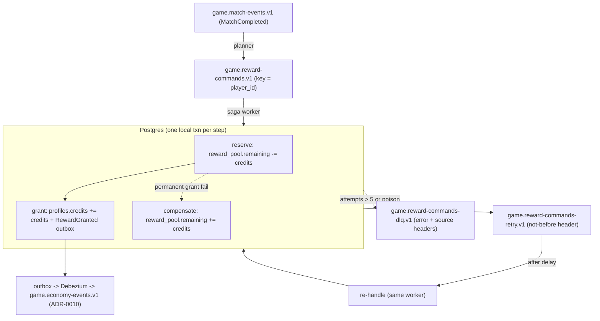
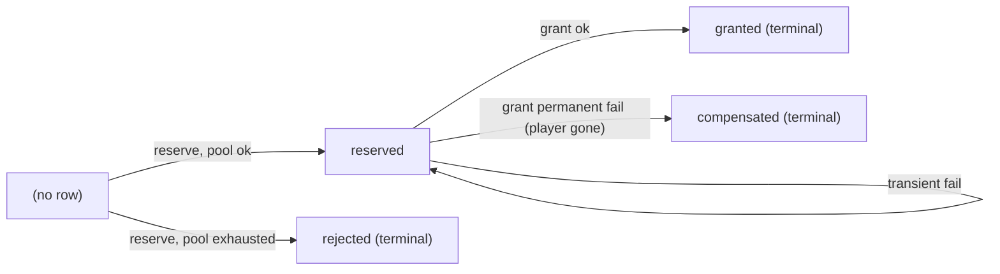
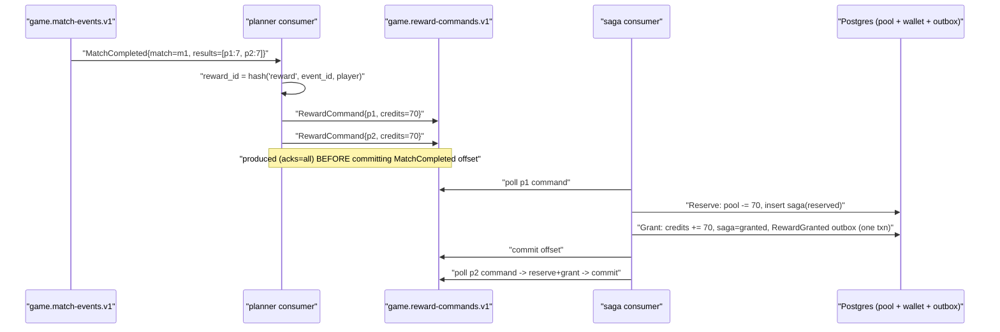
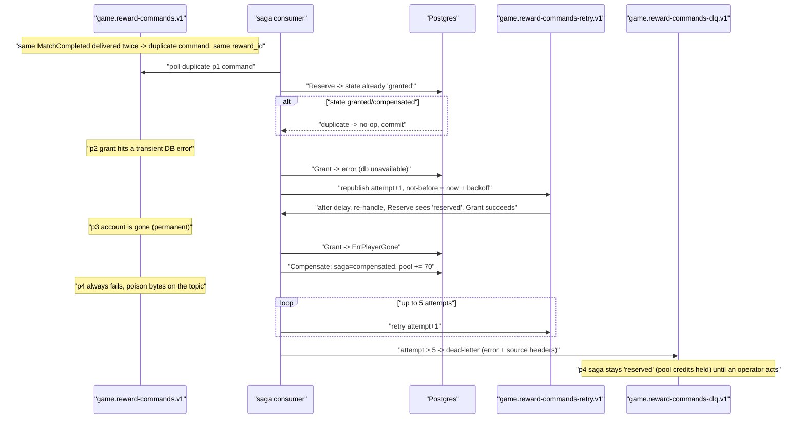

# ADR-0012 deep dive: Saga, retry topics, DLQ

> Source decision: [`../../adr/0012-reward-saga.md`](../../adr/0012-reward-saga.md)
> Code: [`../../backend/internal/rewards/`](../../backend/internal/rewards), [`../../backend/internal/store/rewards.go`](../../backend/internal/store/rewards.go), [`../../backend/cmd/rewards/`](../../backend/cmd/rewards), [`../../backend/migrations/00009_reward_saga.sql`](../../backend/migrations/00009_reward_saga.sql) · Evidence: [`../../experiments/004-week4-streaming/README.md`](../../experiments/004-week4-streaming/README.md)

## 1. TL;DR

- Granting match rewards spans two "services" — a season **pool** and a player **wallet** — with no single transaction, so LocalArena uses an **orchestrated saga** in Go (`internal/rewards`, `cmd/rewards`): **reserve** (pool decrement) then **grant** (wallet credit + `RewardGranted` outbox), with **compensate** (return credits to the pool) on a permanent grant failure.
- Correctness under at-least-once delivery comes from a **deterministic `reward_id = hash(event_id, player)`** and **state-guarded steps**: the `reward_sagas` row (`reserved/granted/compensated/rejected`) makes every redelivered command a no-op. Measured: `459 → 459` granted sagas after replaying `MatchCompleted`, and `credits[1] == 70` (not 140) after a duplicate `MatchCompleted` in the unit test.
- **Transient failures** are republished to `game.reward-commands-retry.v1` with `attempt+1` and a `not-before` header (exponential backoff `1s · 2^attempt`, capped 60 s). After **5 attempts**, or for an undecodable/invalid command, the record goes to `game.reward-commands-dlq.v1` with error + source headers.
- Offsets are committed **only after** the record's work and any produced follow-ups are durable (`acks=all`, `read_committed`), so a crashing consumer restarts from committed offsets and re-does nothing it already finished.
- A dead-lettered reward **stays `reserved`** (pool credits held) until an operator replays or compensates it; a reconciliation job is deferred to week 6. Chosen over choreography (harder to see/compensate) and 2PC (blocking and unavailable here).

## 2. Context and problem

When a match completes, each account player earns credits from a **limited season pool**. Two pieces of state are involved:

- `reward_pool.remaining` — the shared, bounded pool for the season.
- `profiles.credits` — the individual player's wallet.

In LocalArena's "split system" framing these live in different services, so **there is no single ACID transaction** that can decrement the pool and credit the wallet together. That creates the classic distributed-transaction problem:

- If the pool is decremented but the wallet credit fails permanently (e.g. the player's account is gone), the pool has lost credits that were never granted — you need **compensation**.
- Kafka delivers at-least-once; a producer retry or a replay can deliver the same `MatchCompleted` twice, and the planner will emit the same commands twice. Nothing may **double-grant**.
- A command can fail transiently (DB briefly unavailable) — that must be **retried with backoff**, not dropped and not busy-looped.
- A command can be permanently un-processable (undecodable bytes, invalid fields) — that must be **dead-lettered**, not retried forever and not allowed to block the partition.

The decision: an **orchestrated saga** with a single worker that owns the step sequence and the saga state, a **retry topic** for backoff, and a **DLQ** for poison/exhausted commands — all made safe by deterministic IDs and state-guarded, individually-idempotent steps.

Note this is the external-side-effect half of the Week 4 story: Kafka Streams' `exactly_once_v2` ([ADR-0011](ADR-0011-kafka-streams.md)) does **not** cover the Postgres grant, so the grant must be made idempotent here instead.

## 3. HLD

A planner consumer turns `MatchCompleted` into one `RewardCommand` per eligible player. A saga consumer runs the steps against Postgres. Transient failures loop through a delay (retry) topic; permanent or exhausted ones land in the DLQ.



State machine of one saga, keyed by `reward_id`:



## 4. LLD

### 4.1 Components and responsibilities

| Component | File (symbol) | Responsibility |
|---|---|---|
| Worker/orchestrator | [`internal/rewards/rewards.go`](../../backend/internal/rewards/rewards.go) `Worker.Run`, `consume` | Runs three supervised consumers (planner, saga, retry); produces follow-ups before committing offsets. |
| Planner | [`rewards.go`](../../backend/internal/rewards/rewards.go) `Worker.plan` | `MatchCompleted` → one `RewardCommand` per eligible player, `reward_id = hash(event_id, player)`. |
| Saga handler | [`rewards.go`](../../backend/internal/rewards/rewards.go) `Worker.handle` | Runs reserve → grant → (compensate); routes outcomes to retry/DLQ. |
| Retry handler | [`rewards.go`](../../backend/internal/rewards/rewards.go) `Worker.handleRetry`, `retry` | Honors the `not-before` header (delay), re-handles, or dead-letters once exhausted. |
| DLQ | [`rewards.go`](../../backend/internal/rewards/rewards.go) `Worker.dlq` | Copies the record to `game.reward-commands-dlq.v1` with `error` and `source-topic` headers. |
| Saga steps (DB) | [`store/rewards.go`](../../backend/internal/store/rewards.go) `Reserve`, `Grant`, `Compensate`, `SagaStatus`, `PoolRemaining` | Each step is one local transaction, guarded by the saga's current state. |
| Schema | [`migrations/00009_reward_saga.sql`](../../backend/migrations/00009_reward_saga.sql) | `reward_pool`, `reward_sagas`, partial index on `reserved`. |
| Entry point | [`cmd/rewards/main.go`](../../backend/cmd/rewards/main.go) | Wires brokers + Postgres pool + Prometheus; runs the worker until SIGTERM. |
| Deterministic IDs | [`internal/eventid/eventid.go`](../../backend/internal/eventid/eventid.go) `New` | `sha256(parts joined by 0x1f)[:16]` → 32 hex chars. |

### 4.2 Schema (exact values)

From [`migrations/00009_reward_saga.sql`](../../backend/migrations/00009_reward_saga.sql):

```sql
CREATE TABLE reward_pool (
    season    text   PRIMARY KEY,
    remaining bigint NOT NULL CHECK (remaining >= 0)
);
INSERT INTO reward_pool VALUES ('s1', 10000000);

CREATE TABLE reward_sagas (
    reward_id  text        PRIMARY KEY,
    season     text        NOT NULL REFERENCES reward_pool (season),
    player_id  bigint      NOT NULL, -- no FK: player may be gone (a saga failure, not a constraint error)
    match_id   text        NOT NULL,
    credits    bigint      NOT NULL CHECK (credits > 0),
    state      text        NOT NULL CHECK (state IN ('reserved','granted','compensated','rejected')),
    reason     text,
    created_at timestamptz NOT NULL DEFAULT now(),
    updated_at timestamptz NOT NULL DEFAULT now()
);
CREATE INDEX reward_sagas_state_idx ON reward_sagas (state) WHERE state = 'reserved';
```

Key design choices encoded in the schema:

- `reward_pool.remaining CHECK (remaining >= 0)` — the database itself refuses to overspend the pool; combined with the conditional `UPDATE ... WHERE remaining >= $credits`, the pool can never go negative.
- `reward_sagas.reward_id` is the **primary key** and is the deterministic idempotency key.
- **No foreign key** on `player_id` — a missing player is a saga outcome (compensation), not a constraint error.
- `CHECK (credits > 0)` — rejects zero/negative grants defensively (the handler also rejects `Credits <= 0`).
- Partial index `WHERE state = 'reserved'` — a cheap way to list the stuck/in-flight sagas an operator must reconcile.
- Seed pool `remaining = 10_000_000` for season `s1`.

### 4.3 Config values (exact)

From [`internal/rewards/rewards.go`](../../backend/internal/rewards/rewards.go) and [`cmd/rewards/main.go`](../../backend/cmd/rewards/main.go):

| Value | Setting | Where |
|---|---|---|
| Topics | `game.match-events.v1`, `game.reward-commands.v1`, `game.reward-commands-retry.v1`, `game.reward-commands-dlq.v1` | `rewards.go` constants |
| Season | `s1` | `rewards.go` `Season` |
| Guest cutoff | `player_id >= 1_000_000_000` earns nothing | `GuestIDBase` |
| Conversion | `CreditsPerPoint = 10` → `credits = score * 10` | `rewards.go` |
| Max attempts | `5` (default) | `Worker.defaults` |
| Backoff | `min(1s << min(attempt,6), 60s)` → 2s, 4s, 8s, 16s, 32s, cap 60s | `Worker.defaults` |
| Consumer group prefix | `localarena-rewards` (+ `-planner`/`-saga`/`-retry`) | `Worker.defaults`, `Run` |
| Client acks / isolation | `RequiredAcks(AllISRAcks)`, `FetchIsolationLevel(ReadCommitted)`, `DisableAutoCommit`, `BlockRebalanceOnPoll`, offset reset `AtStart` | `consume` |
| Postgres pool | `store.NewPool(ctx, dsn, 5)` (5 conns) | `cmd/rewards/main.go` |
| Metrics addr | `:9102` default | `cmd/rewards/main.go` |
| Headers | `not-before` (RFC3339Nano), `error`, `source-topic` | `rewards.go` |

Prometheus metric `localarena_rewards_outcomes_total{outcome=...}` with labels: `planned, granted, rejected, compensated, duplicate, retried, dead_lettered`.

### 4.4 Algorithms, step by step

**Planner (`plan`).** For a `MatchCompleted`, for each `PlayerResult`:

1. Skip if `score == 0`, `player_id >= GuestIDBase` (guest), or `player_id <= 0`.
2. `id = eventid.New("reward", env.EventId, player)` — deterministic, so a redelivered `MatchCompleted` plans **identical** commands.
3. Build a `RewardCommand` envelope with `credits = score * 10`, `causation_id = env.EventId`, keyed by `player_id`, into `game.reward-commands.v1`.
4. Count `planned`. If the input is not a `MatchCompleted` or is undecodable, return `nil` (Streams routes truly invalid bytes to `game.invalid-events.v1`).

**Saga handler (`handle`).**

1. Unmarshal. If not a decodable `RewardCommand` → DLQ (`undecodable reward command`). If `RewardId == ""` or `Credits <= 0` → DLQ (`invalid reward command`).
2. `state = Steps.Reserve(ctx, rw)`.
   - On error → `retry` (transient).
   - `rejected` → count `rejected`, done (terminal, pool couldn't cover it).
   - `granted`/`compensated` → count `duplicate`, done (already finished — redelivery no-op).
   - otherwise (`reserved`) → continue.
3. `Steps.Grant(ctx, rw)`:
   - `nil` → count `granted`, done.
   - `ErrPlayerGone` (permanent) → `Steps.Compensate`; if that errors, `retry` (compensation must eventually happen); else count `compensated`, done.
   - any other error → `retry` (transient).
4. The handler returns an error (causing redelivery) only if it could not even decide.

**Reserve (`store.Reserve`)** — one transaction:

1. `SELECT state FROM reward_sagas WHERE reward_id=$1`; if a row exists, return it (already past this step — idempotent).
2. `UPDATE reward_pool SET remaining = remaining - credits WHERE season=$1 AND remaining >= credits`. If `RowsAffected == 0`, the pool can't cover it → `state = rejected`, reason "reward pool exhausted"; else `state = reserved`.
3. `INSERT INTO reward_sagas(... state, reason)` — records the outcome atomically with the pool change.

**Grant (`store.Grant`)** — one transaction:

1. `SELECT state ... FOR UPDATE` (row lock on the saga). If `state != reserved`, return `nil` (already granted/compensated/rejected — no-op).
2. `UPDATE profiles SET credits = credits + $, version = version + 1, updated_at = now() WHERE player_id = $`. If `RowsAffected == 0` → `ErrPlayerGone`.
3. `UPDATE reward_sagas SET state = 'granted'`.
4. `insertOutbox("RewardGranted", ...)` — the credit and the `RewardGranted` event are written in the **same transaction** (the outbox pattern from [ADR-0010](ADR-0010-outbox-cdc.md)).

**Compensate (`store.Compensate`)** — one transaction:

1. `UPDATE reward_sagas SET state = 'compensated', reason = $ WHERE reward_id = $ AND state = 'reserved' RETURNING season, credits`. The `AND state = 'reserved'` guard means it runs at most once and never after a successful grant; `ErrNoRows` → no-op.
2. `UPDATE reward_pool SET remaining = remaining + credits` — return the reserved credits.

**Retry (`retry`).** Clone the envelope, `attempt++`, set `last_error`. If `attempt > MaxAttempts` → DLQ (`retries exhausted`). Else produce to `game.reward-commands-retry.v1` with a `not-before = now + backoff(attempt)` header.

**Retry consumer (`handleRetry`).** Read the `not-before` header; `time.After(time.Until(nb))` to wait (or exit on ctx cancel); then call `handle`. All retries share one backoff schedule per attempt, so blocking on the partition head is acceptable.

**Offset/commit discipline (`consume`).** `DisableAutoCommit` + `BlockRebalanceOnPoll`. For each fetched record: run the handler, then `ProduceSync(acks=all)` any follow-ups; on success append to `done`. On any error, stop, commit whatever finished, `AllowRebalance`, and return the error so the failed record (and everything after it) is redelivered from the last committed offset.

## 5. Sequence diagrams

### 5.1 Happy path: match completes, two players granted once



### 5.2 Failure/edge path: duplicate delivery, transient retry, permanent compensation, and DLQ



## 6. Concepts explained

### Saga (orchestration vs choreography)

- **What it is.** A saga is a sequence of local transactions across services, where each step has a **compensating** action, used instead of a single distributed transaction. **Orchestration** has one coordinator that drives the steps; **choreography** has each service react to the previous step's event with no central coordinator.
- **Why LocalArena uses it.** The pool and wallet are different "services" with no shared transaction, so a saga with compensation replaces 2PC. It chose **orchestration** (one Go worker owns the flow) because "the flow is easier to see and compensate" than choreography.
- **What was measured.** The full flow — reserve, grant, compensate, retry, DLQ — is exercised end-to-end by [`TestSagaOverKafka`](../../backend/internal/rewards/rewards_test.go) over an in-memory Kafka (`kfake`), asserting granted credits, one compensation, and exactly two distinct DLQ keys.
- **Where else it is used.** Order fulfillment (reserve stock → charge card → ship, compensate by refund/restock) in e-commerce; trip booking (flight + hotel + car, cancel on partial failure) in travel; fund transfer across ledgers in banking; ride payout (fare → driver payout → platform fee) in ride-hailing.

### Compensation

- **What it is.** A business-level "undo" for a committed step, since you cannot roll back a committed local transaction in another service.
- **Why LocalArena uses it.** If `reserve` decremented the pool but `grant` permanently fails (player gone), `compensate` returns the credits to the pool so they are not lost.
- **What was measured.** In the test, player 3 is `gone`, so its saga ends `compensated` and the pool ends at `1_000_000 - 70*3` (only 1, 2, 3 reserved; 3's credits returned, net 3 reservations): `countState(st, SagaCompensated) == 1` and the pool assertion both hold.
- **Where else it is used.** Refund after a failed shipment (e-commerce); release a hotel hold after a flight fails (travel); reverse a ledger debit when the credit leg fails (banking).

### State machine (idempotency via state guards)

- **What it is.** Modeling the saga as explicit states (`reserved → granted | compensated | rejected`) and guarding every step by the current state, so re-running a step is a no-op once it has already run.
- **Why LocalArena uses it.** Redelivery is inevitable (at-least-once). `Reserve` returns early if a row exists; `Grant` returns early if `state != reserved`; `Compensate` only acts `WHERE state = 'reserved'`. So a redelivered command does nothing.
- **What was measured.** `credits[1] == 70` not 140 after the same `MatchCompleted` is delivered twice; and `459 → 459` granted sagas after replaying `MatchCompleted` in Experiment 004.
- **Where else it is used.** Order state machines (`created → paid → shipped`); payment intent states (`requires_action → succeeded`); workflow engines generally.

### Idempotency key (deterministic `reward_id`)

- **What it is.** A stable key derived from the causing fact, used to recognize retries. Here `reward_id = sha256("reward" + event_id + player)[:16]` ([`eventid.New`](../../backend/internal/eventid/eventid.go)), so the same match+player always yields the same id.
- **Why LocalArena uses it.** It is the `reward_sagas` primary key, so two copies of the same reward collide on the same row and the second is a no-op. It decouples correctness from exactly-once delivery.
- **What was measured.** Duplicate `MatchCompleted` plans the same commands; the saga treats the second as a duplicate (test: `credits[1] == 70`).
- **Where else it is used.** `Idempotency-Key` headers on payment and order-create APIs (payments/e-commerce — see also [ADR-0008](ADR-0008-caching-ratelimit-breaker.md)); dedup keys on webhook deliveries; message dedup in IoT command pipelines.

### Retry topics with delay

- **What it is.** Instead of retrying in-process (which blocks the consumer) or relying on broker redelivery (immediate), transient failures are **republished** to a dedicated retry topic carrying a `not-before` timestamp; a retry consumer waits until that time before re-processing. This is a simple delay-queue pattern.
- **Why LocalArena uses it.** It gives exponential backoff (`2s,4s,8s,16s,32s`, cap 60s) without busy-looping and keeps the main `reward-commands` consumer moving.
- **What was measured.** The test uses a 50 ms backoff and player 2 fails transiently twice then succeeds (`transient: {2: 2}`), ending at `credits[2] == 70` — i.e. retried then granted once.
- **Where else it is used.** Payment-retry pipelines (retry a declined charge later); email/SMS send retries; webhook redelivery with backoff; order-processing retries after a downstream blip.

### At-least-once delivery with idempotent consumers

- **What it is.** The messaging layer may deliver a record more than once; correctness is guaranteed by making the consumer's effect idempotent rather than by exactly-once delivery.
- **Why LocalArena uses it.** The package comment states delivery is "at-least-once everywhere: offsets are committed only after the record's work ... is durable. Correctness under redelivery comes from the deterministic reward_id and state-guarded steps." This is the explicit alternative to Kafka Streams' EOS, which does **not** cover the Postgres grant ([ADR-0011](ADR-0011-kafka-streams.md)).
- **What was measured.** Experiment 004: "No double effects come from idempotent consumers, not from exactly-once delivery" — `459 → 459` granted after replay.
- **Where else it is used.** Virtually every production Kafka/SQS/PubSub consumer that touches a database; payment settlement consumers; inventory decrement consumers.

### Offset commit discipline (effects-before-commit)

- **What it is.** Committing the consumer offset only *after* the side effect (and any produced follow-up) is durable, so a crash before the commit causes a safe redelivery rather than a lost record.
- **Why LocalArena uses it.** `consume` disables auto-commit, produces follow-ups with `acks=all`, and commits only the records whose work completed; on error it returns so the failed record is re-fetched from the committed offset.
- **What was measured.** Robustness is asserted structurally (the test restarts consumers on error) rather than as a number; the comment on `Run` explains the supervisor "resumes from its last committed offset".
- **Where else it is used.** Any "process then ack" consumer; outbox relays; job runners that must not lose or double-run work.

### Dead-letter queue (DLQ) and poison records

- **What it is.** A side topic for records that cannot be processed — undecodable, invalid, or having exhausted retries — so the main flow is not blocked and an operator can inspect/replay them.
- **Why LocalArena uses it.** `handle` dead-letters undecodable/invalid commands immediately; `retry` dead-letters after 5 attempts. `dlq` attaches `error` and `source-topic` (`topic/partition/offset`) headers.
- **What was measured.** `TestSagaOverKafka` injects poison bytes and a permanently-failing player and asserts exactly 2 distinct DLQ keys (`dlqDistinct == 2`: poison + exhausted); Experiment 004 confirmed the saga dead-lettered its poison command (+1 DLQ) on the real cluster.
- **Where else it is used.** Malformed payment/webhook messages; unprocessable orders; bad IoT frames — the DLQ is a universal pattern in queue/stream systems.

### Reservation pattern (pool + conditional decrement)

- **What it is.** Reserving a scarce resource up front with a conditional update (`UPDATE ... WHERE remaining >= n`) plus a DB `CHECK (remaining >= 0)`, so concurrent reservations cannot oversell.
- **Why LocalArena uses it.** The season pool is bounded; `Reserve` decrements it conditionally and the DB constraint guarantees it never goes negative.
- **What was measured.** `rejected` outcome path (pool exhausted) is covered by `fakeSteps` returning `SagaRejected` when `pool < credits`; pool arithmetic is asserted (`pool == 1_000_000 - 70*3`).
- **Where else it is used.** Ticketing/seat inventory (events); limited-stock flash sales (e-commerce); allocating a fixed budget or rate quota; reserving driver/vehicle capacity (ride-hailing).

### Transactional outbox (grant + event in one transaction)

- **What it is.** Writing the business change and the event-to-publish in the same database transaction, then letting CDC (Debezium) publish the event — so you never have a committed change with a lost event, or a published event with no change.
- **Why LocalArena uses it.** `Grant` writes `profiles.credits += n` and the `RewardGranted` outbox row atomically; publication is [ADR-0010](ADR-0010-outbox-cdc.md)'s job.
- **What was measured.** CDC outage + crash in Experiment 004: `200/200 published, 0 lost, 0 duplicates` — the outbox path's guarantee.
- **Where else it is used.** Order-placed events (e-commerce); payment-completed events (payments); any event-driven system that must keep its database and event log consistent.

### Two-phase commit (2PC) — the rejected alternative

- **What it is.** A blocking protocol where a coordinator asks all participants to *prepare*, then *commit* or *abort* atomically. It gives atomicity across services but holds locks/resources until the coordinator decides, and stalls if the coordinator fails.
- **Why LocalArena did NOT use it.** The ADR calls it "blocking and unavailable here": a prepared participant holds resources and the whole transaction is stuck if any party or the coordinator is slow/down — unacceptable for a service that must stay available while a dependency wobbles.
- **What was measured.** Not measured (not implemented); contrasted against the saga, which stays available and merely holds pool credits in `reserved` for a stuck reward.
- **Where else it is used.** Classic distributed databases and XA transaction managers; some tightly-coupled enterprise systems — increasingly avoided in microservices in favor of sagas.

### Guest filtering and conversion (domain rules)

- **What it is.** Business rules applied in the planner: guests (`player_id >= 1e9`) earn nothing; credits = `score * 10`.
- **Why LocalArena uses it.** Only real accounts have wallets; guests cannot be credited.
- **What was measured.** Test: a guest result (`GuestIDBase + 5`) yields `credits[GuestIDBase+5] == 0` and only 4 sagas exist.
- **Where else it is used.** Loyalty-point accrual rules (only members earn); fee tiers by account type; eligibility gating in any rewards/promotions system.

## 7. Code pointers

| Path (symbol / key) | What to look at |
|---|---|
| [`backend/internal/rewards/rewards.go`](../../backend/internal/rewards/rewards.go) `Worker.plan` | Deterministic `reward_id`, guest/score filtering, `credits = score*10`. |
| [`rewards.go`](../../backend/internal/rewards/rewards.go) `Worker.handle` | The orchestration: reserve → grant → compensate, duplicate/rejected handling, DLQ for invalid. |
| [`rewards.go`](../../backend/internal/rewards/rewards.go) `Worker.retry`, `handleRetry`, `dlq` | Backoff + `not-before` header, retry consumer wait, DLQ headers. |
| [`rewards.go`](../../backend/internal/rewards/rewards.go) `Worker.consume` | `acks=all`, `read_committed`, commit-after-work, restart-from-committed-offset. |
| [`rewards.go`](../../backend/internal/rewards/rewards.go) `Worker.defaults` | `MaxAttempts=5`, backoff `1s<<min(a,6)` cap 60s, group prefix. |
| [`backend/internal/store/rewards.go`](../../backend/internal/store/rewards.go) `Reserve` | Conditional pool decrement + saga insert, reserved/rejected. |
| [`store/rewards.go`](../../backend/internal/store/rewards.go) `Grant` | `FOR UPDATE` state guard, wallet credit, `ErrPlayerGone`, `RewardGranted` outbox in one txn. |
| [`store/rewards.go`](../../backend/internal/store/rewards.go) `Compensate` | `WHERE state='reserved'` guarded refund to the pool. |
| [`store/rewards.go`](../../backend/internal/store/rewards.go) `SagaStatus`, `PoolRemaining` | State/pool inspection for ops and tests. |
| [`backend/migrations/00009_reward_saga.sql`](../../backend/migrations/00009_reward_saga.sql) | `reward_pool`/`reward_sagas` DDL, checks, partial `reserved` index, seed pool. |
| [`backend/cmd/rewards/main.go`](../../backend/cmd/rewards/main.go) | Required env, Postgres pool size 5, metrics `:9102`, SIGTERM shutdown. |
| [`backend/internal/rewards/rewards_test.go`](../../backend/internal/rewards/rewards_test.go) `TestSagaOverKafka` | End-to-end over `kfake`: duplicate, transient retry, compensation, poison+exhausted DLQ. |
| [`backend/internal/eventid/eventid.go`](../../backend/internal/eventid/eventid.go) `New` | Deterministic id derivation. |
| [`schemas/localarena/events/v1/events.proto`](../../schemas/localarena/events/v1/events.proto) `RewardCommand`, `RewardGranted` | Command carries `attempt`/`last_error`; `reward_id` is the idempotency key. |

## 8. Trade-offs and alternatives

| Option | Pros | Cons | Why (not) chosen |
|---|---|---|---|
| **Orchestrated saga** (chosen) | Flow is visible in one place; easy to compensate; retry/DLQ centralized | A central worker to run and supervise; stuck rewards need operator action | Chosen: clearest and most compensable for a two-step money flow. |
| Choreographed saga | Fewer central components; services loosely coupled | Flow is spread across event handlers; "harder to see and compensate" | Rejected per ADR. |
| Two-phase commit (2PC/XA) | True cross-service atomicity | Blocking; holds resources; stalls if coordinator/participant fails; "unavailable here" | Rejected per ADR. |
| In-process retry (sleep in handler) | Simple | Blocks the consumer/partition; lost on crash; no visibility | Rejected in favor of a retry topic. |
| Rely on Kafka Streams EOS for the grant | No extra idempotency code | EOS does not cover Postgres/HTTP side effects | Impossible — EOS is Kafka→Kafka only ([ADR-0011](ADR-0011-kafka-streams.md)). |
| Auto-compensate a dead-lettered reward | No stuck pool credits | Risky auto-refunds; may hide real bugs | Deferred: DLQ reward stays `reserved`; a reconciliation job is week 6 work. |

## 9. Failure modes and how they were found

From [Experiment 004](../../experiments/004-week4-streaming/README.md) and [`TestSagaOverKafka`](../../backend/internal/rewards/rewards_test.go):

- **Duplicate delivery double-granting** → prevented by deterministic `reward_id` + state guards; `459 → 459` granted after replay, and the unit test's `credits[1] == 70` (not 140). Even an accidental ~1.45 M duplicate replay left credits unchanged.
- **Transient DB failure** → retry topic with backoff; player 2 (`transient:{2:2}`) ends granted exactly once.
- **Permanent grant failure (player gone)** → compensation returns credits to the pool; player 3 (`gone`) ends `compensated`, pool restored.
- **Poison / exhausted command** → DLQ with `error` + `source-topic` headers; the test asserts exactly 2 distinct DLQ keys, and Experiment 004 saw the saga dead-letter its poison command (+1 DLQ).
- **Stuck reward after DLQ** → documented limitation: a dead-lettered reward stays `reserved` (pool credits held) until an operator replays/compensates; a reconciliation job is deferred to week 6 (Experiment 004, remaining risks).
- **Outbox durability under CDC outage + crash** → `200/200 published, 0 lost, 0 duplicates` ([`results/cdc-outage.txt`](../../experiments/004-week4-streaming/results/cdc-outage.txt)), which the `Grant` step relies on for `RewardGranted`.

## 10. Interview questions

1. **What is a saga and why use one here instead of a transaction?**
   A saga is a sequence of local transactions, each with a compensating action, used when no single ACID transaction spans the participants. LocalArena's pool and wallet are different services, so it reserves from the pool, grants to the wallet, and compensates (refunds the pool) if the grant permanently fails.

2. **Orchestration vs choreography — which did LocalArena pick and why?**
   Orchestration: one Go worker owns the step order and the saga state. The ADR chose it because the flow is easier to see and to compensate than choreography, where the logic is scattered across independent event reactions.

3. **How does the system avoid double-granting under duplicate delivery?**
   `reward_id = hash(event_id, player)` is deterministic, so a duplicate `MatchCompleted` plans the identical command, which collides on the `reward_sagas` primary key. Each step is guarded by state (`Reserve` returns early if a row exists, `Grant` only acts on `reserved`), so the second copy is a no-op. Measured: `459 → 459` granted; `credits[1] == 70` not 140.

4. **Why is correctness "at-least-once with idempotent consumers" instead of exactly-once?**
   Kafka Streams' EOS v2 only covers Kafka→Kafka; it cannot make the Postgres grant exactly-once. So the saga assumes redelivery and makes each effect idempotent via deterministic IDs and state guards. Offsets are committed only after the effect is durable.

5. **Walk through what happens when `Grant` returns a transient error.**
   `handle` calls `retry`, which clones the command, increments `attempt`, sets `last_error`, and republishes to `game.reward-commands-retry.v1` with a `not-before` header = now + backoff. The saga row stays `reserved`. The retry consumer waits until `not-before`, then re-runs `handle`; `Reserve` sees `reserved` and skips, `Grant` runs again.

6. **What happens on a permanent grant failure, and how is the pool kept consistent?**
   `Grant` returns `ErrPlayerGone` (wallet row not found). `handle` calls `Compensate`, which — guarded by `WHERE state = 'reserved'` — sets the saga to `compensated` and adds the credits back to `reward_pool.remaining`, so no credits are lost.

7. **What is the retry/DLQ policy exactly?**
   Transient errors retry via the retry topic with backoff `2s,4s,8s,16s,32s` (cap 60s). After `attempt > 5`, or for an undecodable/invalid command, the record is dead-lettered to `game.reward-commands-dlq.v1` with `error` and `source-topic` (`topic/partition/offset`) headers.

8. **Why does `Grant` use `SELECT ... FOR UPDATE` and write the credit plus `RewardGranted` in one transaction?**
   `FOR UPDATE` locks the saga row so two concurrent grants of the same reward can't both proceed. Writing the wallet credit and the `RewardGranted` outbox row in one transaction (the outbox pattern) guarantees the event is published if and only if the credit committed — Debezium publishes it later with no loss or duplication.

9. **Why is there no foreign key from `reward_sagas.player_id` to the player, and why `CHECK (remaining >= 0)` on the pool?**
   No FK because a missing player is a legitimate saga outcome (triggering compensation), not a data-integrity error to reject. The `CHECK (remaining >= 0)` plus the conditional `UPDATE ... WHERE remaining >= credits` guarantees the bounded pool can never be oversold even under concurrency.

10. **What is the consequence of a dead-lettered reward, and how would you fix it operationally?**
    The saga stays `reserved`, so pool credits are held but never granted. An operator must replay the DLQ record (if the failure was transient-but-exhausted) or compensate it (if permanent). The partial index `WHERE state = 'reserved'` lists stuck sagas; a reconciliation job is planned for week 6.

11. **Why a retry topic with a `not-before` header instead of just retrying in the handler?**
    In-process retry blocks the consumer (and its partition) and is lost on crash. The retry topic moves the waiting off the main flow, survives restarts, carries the backoff schedule in the record, and keeps `reward-commands` moving. The trade-off: the retry consumer waits on its partition head, acceptable because all retries share one schedule per attempt.

12. **How does the worker guarantee it never loses or double-commits a command across a crash?**
    `DisableAutoCommit` + produce follow-ups with `acks=all` first, then commit only the records whose work finished; on any error it stops and returns so the failed record is redelivered from the last committed offset. Combined with idempotent steps, redelivery is harmless.

13. **Compare the saga here to two-phase commit. When would 2PC actually be preferable?**
    2PC gives real cross-service atomicity but blocks: participants hold resources from prepare until the coordinator decides, and the whole transaction stalls if the coordinator fails. The saga trades strict isolation for availability (a stuck reward just holds pool credits). 2PC is preferable only when you need strong isolation, the participants support it (XA), latency is low, and availability during a coordinator outage is not critical.

14. **Design question: redesign the reward flow for 100x volume (millions of rewards per season). What changes?**
    Keep deterministic IDs and idempotent steps. Changes: partition `reward-commands` by `player_id` with many partitions and run multiple saga workers (stateless, so they scale horizontally); shard `reward_pool` per season-bucket to avoid a single hot pool row (the pool row is a contention point under high write rate); batch pool decrements or use a sharded-counter pattern; add a reconciliation/sweeper job over the `reserved` partial index with alerting on age; and consider per-partition retry topics so one slow backoff doesn't head-of-line-block a hot partition. Keep the DLQ but add automated, bounded replay with audit.

15. **Design question: the single `reward_pool` row is a write hotspot under concurrency. How would you remove the contention without oversell?**
    Replace the single counter with N sub-pool rows (sharded counters) summing to the season budget; `Reserve` picks a shard (e.g. by hashing `reward_id`) and decrements that shard conditionally, falling back to another shard if it's empty. Oversell is still prevented by per-row `CHECK (remaining >= 0)`. The trade-off is that "how many credits remain" becomes a sum over shards (eventually/periodically consistent), and a shard can be locally exhausted while others have budget, needing occasional rebalancing.
