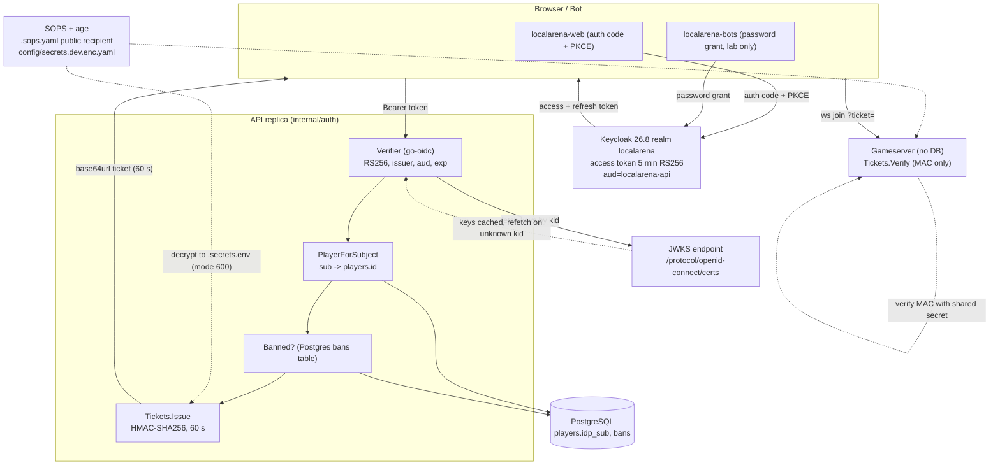
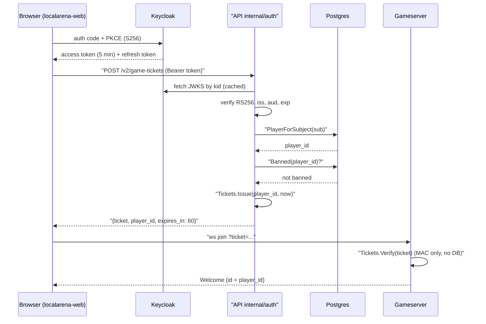
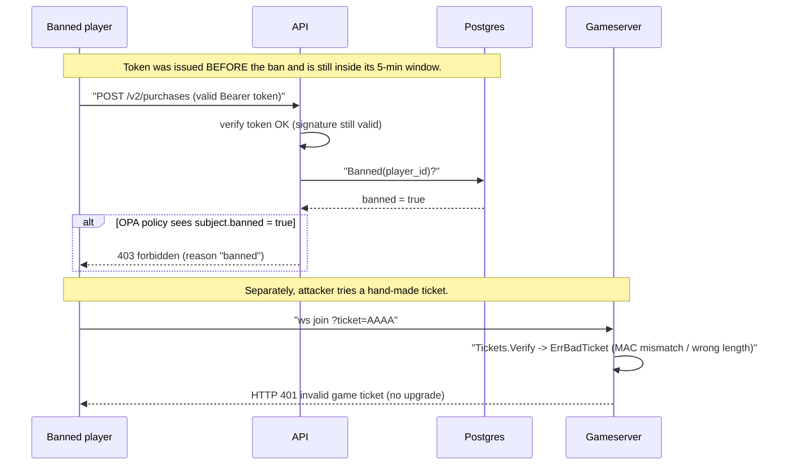

# ADR-0013 deep dive: OIDC/JWT identity, game tickets, secrets

> Source decision: [`../../adr/0013-identity-tokens-secrets.md`](../../adr/0013-identity-tokens-secrets.md)
> Evidence: [`../../experiments/005-week5-security/README.md`](../../experiments/005-week5-security/README.md), [`../../experiments/005-week5-security/threat-model.md`](../../experiments/005-week5-security/threat-model.md)

## 1. TL;DR

- Until week 4 the API trusted a `player_id` in the request body and the gameserver trusted `?player=`: **anyone could act as anyone**. ADR-0013 introduces a real identity: Keycloak issues short-lived (5 min) RS256 JWTs, and the API derives the acting player from the token's `sub`, never from the body.
- **Authentication is separated from the rest of the system.** Keycloak proves *who you are*; the API maps the stable `sub` claim to a `players` row (just-in-time provisioning) and checks bans in Postgres on *every* request so a ban takes effect before the token expires.
- The gameserver has **no database**. Instead of verifying JWTs and loading ban state on the gameplay hot path, it trusts a 60-second **HMAC-SHA256 game ticket** that the API mints only after authenticating and authorizing the player.
- **Signing-key rotation needs no restart**: `go-oidc`'s `RemoteKeySet` caches JWKS keys and refetches when a token presents an unknown `kid`.
- **Secrets are encrypted in Git with SOPS + age.** Only the public age recipient is committed; the private key never leaves `~/.config/sops/age/keys.txt`. `scripts/secrets-env.sh` decrypts to a gitignored, mode-600 `.secrets.env` used as a Compose `env_file`.

## 2. Context and problem

LocalArena is server-authoritative for gameplay (ADR-0001), but through week 4 it had no notion of *account identity*. The HTTP API's v1 handlers read the actor from the request:

- `POST /v1/purchases` took `player_id` in the body — you could buy cosmetics (fictional credits) as any player.
- The WebSocket gameserver accepted `?player=<id>` — you could join a match *as* another account and earn their rewards.

Secrets were plain environment defaults checked into Compose. That is acceptable for a week-1 toy, but week 5's whole point is to make the lab behave like a system where impersonation is the root of every other attack (see the STRIDE table in [`threat-model.md`](../../experiments/005-week5-security/threat-model.md), threats #1–#4).

The design needs to answer four questions:

1. **Who is calling?** A verifiable, tamper-proof credential, not a self-asserted id.
2. **How fast does a ban take effect?** If identity lived only in a long-lived token, a banned cheat could keep playing until it expired.
3. **How does the database-free gameserver authenticate a player without a round-trip to Keycloak or Postgres per connection?** The tick loop must not block on identity.
4. **How are the signing/HMAC secrets stored so the repo stays Git-native and offline, yet secrets are never committed in clear?**

ADR-0013 answers all four: Keycloak OIDC for (1), a per-request Postgres ban check for (2), HMAC game tickets for (3), and SOPS + age for (4).

## 3. HLD

Keycloak is the OpenID Provider (OP). The browser client (`localarena-web`) uses the **authorization code + PKCE** flow; load bots (`localarena-bots`) use the **password grant** (lab only). Both receive a 5-minute access token whose audience is `localarena-api`. The API verifies every bearer token against the realm JWKS, maps the token `sub` to a player, and checks the `bans` table. To let the player into a match, the API mints an HMAC ticket that the gameserver can verify with nothing but the shared secret.



Key separation of concerns:

| Component | Owns | Does NOT do |
|---|---|---|
| Keycloak | issuing/refreshing tokens, password storage, brute-force lockout | authorization decisions, ban state |
| API `internal/auth` | token verification, `sub`→player mapping, ticket minting | storing passwords, deciding business rules (that is OPA, ADR-0014) |
| Postgres `bans` | immediate, authoritative ban facts | authentication |
| Gameserver | verifying the HMAC ticket MAC | any DB access, JWT verification |
| SOPS + age | encrypting secrets at rest in Git | runtime secret distribution (that is the decrypted `.secrets.env`) |

## 4. LLD

### 4.1 Components and responsibilities

- **`backend/internal/auth/auth.go`** — two things in one package:
  - `Verifier`: wraps `go-oidc`'s `IDTokenVerifier`, enforcing `RS256` only, issuer, audience, and expiry. `Middleware` rejects requests with no valid token (401 + `WWW-Authenticate`).
  - `Tickets`: HMAC-SHA256 signer/verifier for game tickets.
- **`backend/internal/store/identity.go`** — `PlayerForSubject` (JIT provisioning keyed on `idp_sub`), `Banned`, `Ban`.
- **`backend/cmd/api/main.go`** — reads `OIDC_ISSUER`, `OIDC_JWKS_URL`, `OPA_URL`, builds the `Verifier` and `Tickets`.
- **`backend/cmd/gameserver/main.go` + `internal/server/ws.go`** — verifies the ticket before the WebSocket upgrade.
- **`infra/compose/keycloak/localarena-realm.json`** — realm, clients, roles, lab users imported at startup.
- **`.sops.yaml`, `scripts/secrets-env.sh`, `scripts/tls-certs.sh`** — secret and TLS material.

### 4.2 Keycloak realm configuration (exact values)

From [`infra/compose/keycloak/localarena-realm.json`](../../infra/compose/keycloak/localarena-realm.json):

| Setting | Value | Meaning |
|---|---|---|
| `realm` | `localarena` | realm name |
| `accessTokenLifespan` | `300` (seconds) | access tokens live **5 minutes** |
| `ssoSessionIdleTimeout` | `1800` | SSO session idles out after 30 min |
| `revokeRefreshToken` | `true` | refresh tokens are one-time; using one invalidates it |
| `refreshTokenMaxReuse` | `0` | **zero reuse** — refresh-token rotation; replay of an old refresh token is rejected |
| `bruteForceProtected` | `true`, `failureFactor: 5` | account locks after 5 failed logins |
| `sslRequired` | `external` | TLS required for non-local traffic (dev mode serves HTTP on loopback) |
| realm roles | `player`, `admin` | `defaultRoles: ["player"]` so every new user is a player |

Clients:

| clientId | Type | Flow | Notes |
|---|---|---|---|
| `localarena-web` | public | `standardFlowEnabled: true`, `directAccessGrantsEnabled: false` | authorization code; `pkce.code.challenge.method: S256`; redirect/web-origin allow-lists for `:8080` and `:8443` |
| `localarena-bots` | public | `standardFlowEnabled: false`, `directAccessGrantsEnabled: true` | **password grant, lab only**; load bots cannot do an interactive flow |
| `localarena-api` | `bearerOnly: true` | none | the resource server; tokens carry `aud=localarena-api` via an audience protocol mapper |

Lab users (realm file): `alice`, `bob` (role `player`); `admin1` (roles `player`, `admin`). Passwords are `<username>-dev-password`.

### 4.3 JWT structure and validation

A Keycloak access token is a JWS with three base64url parts `header.payload.signature`:

```
header   { "alg": "RS256", "kid": "<key id>", "typ": "JWT" }
payload  { "iss": "http://localhost:8180/realms/localarena",
           "aud": "localarena-api",
           "sub": "f1e2...-stable-uuid",
           "exp": 1792281600, "iat": ..., "preferred_username": "alice",
           "realm_access": { "roles": ["player"] } }
signature RSASSA-PKCS1-v1_5 over header.payload with the realm private key
```

`Verifier.Verify` (in `auth.go`) enforces, in order:

1. **Algorithm**: `SupportedSigningAlgs: []string{oidc.RS256}` — an `alg: none` or `HS256` token is rejected (the classic JWT confusion attack).
2. **Signature**: validated against the JWKS public key whose `kid` matches the header.
3. **Issuer**: must equal the configured `issuer`.
4. **Audience**: `oidc.Config{ClientID: "localarena-api"}` — a token minted for a different audience is rejected.
5. **Expiry**: `exp` in the past → rejected.

Only then does it read `preferred_username` and `realm_access.roles` into a `Principal{Subject, Username, Roles}`.

Note the **split host** in `main.go`: the *issuer* is the browser-facing URL (`http://localhost:8180/realms/localarena`, so the `iss` claim in browser-obtained tokens matches), while the *JWKS URL* is the internal container URL (`http://keycloak:8180/.../certs`). `go-oidc` allows this via `NewVerifier`/`NewRemoteKeySet` taking the JWKS URL explicitly.

### 4.4 Game ticket wire format

`Tickets.Issue` produces `base64url( player_id(8 bytes, big-endian) | expiry_unix(8 bytes) | HMAC-SHA256(key, first 16 bytes)(32 bytes) )` — a fixed **48-byte** payload before base64:

```
┌───────────────┬───────────────┬──────────────────────────┐
│ player_id u64 │ expiry   u64  │ HMAC-SHA256 (32 bytes)     │
│  8 bytes      │  8 bytes      │  MAC over the first 16 B   │
└───────────────┴───────────────┴──────────────────────────┘
```

- `TicketTTL = 60 * time.Second`.
- `NewTickets` rejects a secret shorter than **32 bytes**.
- `Verify` decodes, requires exactly 48 bytes, recomputes the MAC over bytes `[:16]`, compares with **`hmac.Equal` (constant-time)**, then checks `now.Unix() <= expiry`. It returns the `player_id` only if both pass.

The gameserver (`ws.go`) additionally rejects `id <= 0 || id >= GuestIDBase`, so a ticket cannot collide with the guest id range.

### 4.5 Database schema (migration `00010_identity.sql`)

```sql
ALTER TABLE players ADD COLUMN idp_sub text UNIQUE;        -- link to the IdP subject

CREATE TABLE bans (
    player_id  bigint PRIMARY KEY REFERENCES players (id) ON DELETE CASCADE,
    reason     text        NOT NULL CHECK (length(reason) BETWEEN 1 AND 200),
    banned_by  text        NOT NULL,              -- admin's idp sub (audit)
    expires_at timestamptz,                       -- NULL = permanent
    created_at timestamptz NOT NULL DEFAULT now()
);
```

- `players.idp_sub` is `UNIQUE`: two concurrent first-logins for the same subject converge on one row via `INSERT ... ON CONFLICT (idp_sub) DO NOTHING RETURNING id`, falling back to a `SELECT` on the loser of the race (`PlayerForSubject`).
- `bans` has `player_id` as PK, so `Ban` is idempotent per player (`ON CONFLICT (player_id) DO UPDATE`). `Banned` treats a row with `expires_at IS NULL OR expires_at > now()` as active, so time-boxed bans self-expire with no cron job.

### 4.6 Secrets: SOPS + age layout

`.sops.yaml` holds only the **public** recipient and a path rule:

```yaml
creation_rules:
  - path_regex: config/.*\.enc\.ya?ml$
    age: age1334cfhxgsv2gcu5v6e30ef36g20t6s2d9uj0cx9ky3tx50mmqe8sgjjvcp
```

`scripts/secrets-env.sh`:

```bash
umask 077
export SOPS_AGE_KEY_FILE=${SOPS_AGE_KEY_FILE:-$HOME/.config/sops/age/keys.txt}
sops --decrypt --output-type dotenv config/secrets.dev.enc.yaml > .secrets.env
```

`.secrets.env` is mode-600 (via `umask 077`), gitignored, and used by Compose as `env_file`. The encrypted file `config/secrets.dev.enc.yaml` holds the ticket HMAC secret and the webhook HMAC secret(s); the private age key stays in `~/.config/sops/age/keys.txt`.

### 4.7 Algorithms, step by step

**Login → acting on the API (happy path)**

1. Browser runs auth code + PKCE against Keycloak, stores the 5-min access token.
2. Browser calls `GET /v2/me` with `Authorization: Bearer <token>`.
3. `Verifier.Middleware` calls `Verify`: alg/sig/iss/aud/exp. On success it puts a `Principal` in the request context.
4. `Server.caller` calls `PlayerForSubject(ctx, sub, username, startingCredits)`:
   - `SELECT id FROM players WHERE idp_sub = $1` — hit returns immediately.
   - miss → in one tx: `INSERT ... ON CONFLICT (idp_sub) DO NOTHING RETURNING id`, else re-select; then `INSERT INTO profiles (...)` with starting credits.
5. `caller` calls `Banned(ctx, id)`; the resulting `authz.Subject{PlayerID, Roles, Banned}` carries the ban flag.
6. The handler proceeds (and consults OPA for writes — ADR-0014).

**Joining a match (ticket)**

1. Authenticated, unbanned player calls `POST /v2/game-tickets`.
2. API authorizes `game.ticket` via OPA, then `Tickets.Issue(playerID, now)` → 60-s ticket.
3. Browser opens `ws://.../ws?ticket=<ticket>`.
4. Gameserver `serveWS`: `Tickets.Verify(ticket, now)` returns the player id; range-check; upgrade; join.

## 5. Sequence diagrams

### 5.1 Happy path: login, map subject, mint ticket, join match



### 5.2 Failure/edge path: banned player with a still-valid token; forged ticket



Both branches are proven by the e2e run ([`results/e2e.txt`](../../experiments/005-week5-security/results/e2e.txt)): `banned bob, still-valid token: purchase -> 403 (403)`, `banned bob: game ticket -> 403 (403)`, and `forged ticket -> 401 (status=401)`.

## 6. Concepts explained

### Authentication vs authorization

- **What it is.** Authentication (AuthN) answers "who are you?" — it verifies a credential. Authorization (AuthZ) answers "are you allowed to do this?" — it evaluates a rule against the verified identity. They are different questions and belong in different components.
- **Why LocalArena uses it.** Keycloak does AuthN (issues/verifies identity). The API extracts facts (player id, roles, ban state). OPA (ADR-0014) does AuthZ. Mixing them is how rules get scattered through handlers and become un-auditable.
- **What was measured.** The e2e suite proves the split: a valid token reaches `/v2/me` (AuthN pass) yet a player still gets 403 when banning someone (AuthZ fail) — `player cannot ban (403)`, `valid token -> /v2/me (player)`.
- **Where else.** Any corporate SSO (Okta/Azure AD authenticate; an entitlement service authorizes); a bank (card PIN authenticates; daily limit/fraud rules authorize); Kubernetes (`authentication` webhook + `authorization` RBAC/webhook are explicitly separate stages); AWS (IAM authenticates the principal, then evaluates policy).

### OAuth2 / OIDC flows: authorization code + PKCE vs password grant

- **What it is.** OAuth2 defines *grant* flows for obtaining tokens. **Authorization code + PKCE** (Proof Key for Code Exchange, `S256`): the client generates a random `code_verifier`, sends its SHA-256 hash (`code_challenge`) when redirecting to the IdP, then exchanges the returned authorization code *plus* the verifier for tokens. An intercepted code is useless without the verifier. **Password grant** (Resource Owner Password Credentials): the client sends username+password directly to the token endpoint. It is discouraged for real clients because it hands the password to the app, but it is convenient for non-interactive scripts.
- **Why LocalArena uses it.** The browser client (`localarena-web`) uses auth code + PKCE (`pkce.code.challenge.method: S256`, `directAccessGrantsEnabled: false`) — the safe modern flow for public SPAs. Load bots (`localarena-bots`, `directAccessGrantsEnabled: true`) use the password grant because they cannot drive a browser redirect; the realm comment and threat model both flag it as **lab only**.
- **What was measured.** `e2e.sh` obtains bot tokens with the password grant (`grant_type=password`) and the suite confirms the token carries `aud=localarena-api` and role `player`. A wrong password returns **400 `invalid_grant`** (an OAuth2 quirk the experiment calls out as a surprise — it is not 401).
- **Where else.** Auth code + PKCE: every mobile banking app, GitHub/Google "sign in" SPAs, any public OAuth client. Password grant: legacy CLI tools, server-to-server scripts in trusted environments, migration tooling — increasingly replaced by client-credentials or device-code flows.

### JWT structure, claims, and validation

- **What it is.** A JSON Web Token is `header.payload.signature`, base64url-encoded. The payload carries *claims* (`iss`, `aud`, `sub`, `exp`, custom claims like `realm_access.roles`). Validation means checking the signature with the issuer's public key **and** the registered claims (issuer, audience, expiry, algorithm).
- **Why LocalArena uses it.** A signed JWT is a self-contained, tamper-evident credential: the API can authenticate a request with no call back to Keycloak, which keeps the request path fast and Keycloak off the hot path. The acting player comes from `sub`, so the body can no longer lie about who it is.
- **What was measured.** `TestVerifyClaimsAndRejections` rejects expired, wrong-issuer, wrong-audience, `alg=none`, and foreign-key-same-`kid` tokens. The e2e "forged token (edited claims) → 401" proves a payload edited to `sub=attacker` with the original signature fails.
- **Where else.** API gateways (AWS API Gateway JWT authorizers), service meshes (Istio request authentication), B2B APIs (Stripe-style bearer validation), any stateless microservice that wants to avoid a session store.

### JWKS and key rotation

- **What it is.** JWKS (JSON Web Key Set) is the IdP's published set of *public* signing keys, each with a `kid`. A verifier picks the key matching the token header's `kid`. Rotation means the IdP starts signing with a new key (new `kid`) while briefly keeping the old one in the set.
- **Why LocalArena uses it.** `go-oidc`'s `RemoteKeySet` caches keys and refetches the JWKS when it sees an unknown `kid`, so a key rotation in Keycloak is picked up automatically — **no API restart**. The JWKS URL is the internal container host while the issuer stays the browser host.
- **What was measured.** `TestKeyRotation`: a token signed by a newly added key is accepted without restart, and a token signed by a *retired* key is rejected after the JWKS refresh.
- **Where else.** Google/Apple sign-in verification, Auth0/Okta token validation, Kubernetes service-account token projection, any OIDC federation.

### Short-lived tokens and refresh-token rotation

- **What it is.** Access tokens are deliberately short-lived to bound the damage of a leak; a longer-lived *refresh* token is exchanged for new access tokens. **Refresh rotation** issues a new refresh token each time and invalidates the old one, so a stolen-and-reused refresh token is detected.
- **Why LocalArena uses it.** `accessTokenLifespan: 300` (5 min) bounds exposure; `revokeRefreshToken: true` + `refreshTokenMaxReuse: 0` means any refresh token can be used exactly once. Combined with the per-request ban check, a compromised credential's window is small.
- **What was measured.** Lifespan/rotation are configuration (realm file); the *effect* measured is the ban test: a ban takes effect within the token's 5-min life because bans are checked per request, not baked into the token. Refresh replay itself is **not measured** by an experiment.
- **Where else.** Banking apps (minutes-long access tokens), OAuth-protected APIs with sliding sessions, single-page apps using the BFF pattern, mobile apps that keep a rotating refresh token in secure storage.

### HMAC-signed tickets

- **What it is.** An HMAC (hash-based message authentication code) proves a message was produced by someone holding a shared secret and was not altered. A "ticket" is a short self-describing token (here: player id + expiry) with an HMAC appended. The verifier recomputes the MAC and compares in constant time.
- **Why LocalArena uses it.** The gameserver has no database and must not call Keycloak or Postgres per connection. A 60-s HMAC ticket lets it authenticate a player with only the shared secret: it recomputes `HMAC-SHA256(key, player|expiry)` and checks it. The API does the expensive work (token verify + ban check) once, up front.
- **What was measured.** `TestTickets` proves expiry, tampering, and wrong-secret rejection. e2e: a real ticket yields `ws welcome as alice (id=11003)`; a forged `AAAA` ticket → 401. The ticket is verified in constant time (`hmac.Equal`).
- **Where else.** Signed URLs for object storage (S3/GCS presigned links), CDN tokenized access (Akamai/CloudFront signed cookies), unsubscribe links in email, password-reset tokens, Stripe/GitHub webhook signatures (next ADR).

### Bans (immediate revocation of a valid credential)

- **What it is.** Even a cryptographically valid token should stop working the instant an account is banned. That requires a *revocation* check against authoritative state on each request, because you cannot un-issue a stateless JWT.
- **Why LocalArena uses it.** Bans live in Postgres (`bans` table) and are checked on every v2 request. A cheat's still-valid 5-min token is useless the moment the ban row exists. Time-boxed bans self-expire via `expires_at`.
- **What was measured.** e2e: after `admin bans bob (1h)`, bob's **still-valid** token gets `purchase -> 403` and `game ticket -> 403`. The README calls this out: "ban checked per request, not baked into tokens".
- **Where else.** Payment-card hotlisting (a valid card number is declined once reported), streaming-service account suspension, API-key revocation lists, OAuth token-revocation + introspection in high-security APIs.

### Just-in-time (JIT) user provisioning

- **What it is.** Rather than pre-creating local accounts, the app creates its own record the first time a federated identity appears, keyed on a stable identifier.
- **Why LocalArena uses it.** `PlayerForSubject` creates the `players`+`profiles` rows on first login, keyed on `idp_sub` (stable) not username (mutable). The unique constraint makes concurrent first-logins converge on one row.
- **What was measured.** `TestV2AuthFlow` proves "sub→player mapping is stable". The race-convergence path (`ON CONFLICT ... DO NOTHING RETURNING` then re-select) is exercised by the mapping test; a dedicated concurrency benchmark is **not measured** for this specific path.
- **Where else.** SAML/OIDC SSO into SaaS apps (Slack, Notion create the workspace user on first federated login), enterprise apps federating with Azure AD, any "sign in with Google" that creates a local profile.

### Secrets management with SOPS and age

- **What it is.** SOPS encrypts the *values* of a YAML/JSON file (keeping keys readable) with a recipient's public key; **age** is a modern, simple file-encryption tool providing the key pair. Only holders of the private key can decrypt. This lets secrets live in Git, encrypted.
- **Why LocalArena uses it.** The lab must stay offline and Git-native, so a cloud secret manager (Vault, AWS Secrets Manager) is overkill. `.sops.yaml` commits only the public recipient; `config/secrets.dev.enc.yaml` is committed encrypted; `scripts/secrets-env.sh` decrypts to a mode-600, gitignored `.secrets.env`. The private key never leaves `~/.config/sops/age/keys.txt`.
- **What was measured.** Trivy's secret scan found "2 private keys" but both are the **gitignored dev TLS keys** (`infra/compose/tls/*.key`), not committed — i.e. no plaintext secrets in the repo. No encrypted secret was decryptable from Git alone.
- **Where else.** GitOps repos (sealed secrets / SOPS in Flux/Argo CD), infra-as-code that must store DB passwords in a repo, small teams without a managed vault, CI pipelines that decrypt at deploy time.

### TLS at the edge (preview — detailed in ADR-0015)

- **What it is.** Transport Layer Security encrypts and authenticates the connection. Keycloak's `sslRequired: external` means non-local traffic must use TLS; the Envoy edge terminates TLS 1.2+ on `:8443` (ADR-0015).
- **Why LocalArena uses it.** Tokens and tickets are bearer credentials — sniffable in clear. TLS at the edge protects them in transit.
- **What was measured.** e2e: TLS 1.2+ accepted with the dev CA, TLS 1.1 refused, HSTS present.
- **Where else.** Every public HTTPS endpoint; mTLS between internal services; VPN tunnels.

## 7. Code pointers

| Path (symbol / key) | What to look at |
|---|---|
| [`backend/internal/auth/auth.go`](../../backend/internal/auth/auth.go) `Verifier.Verify` | RS256-only, issuer/aud/exp enforcement; claim extraction |
| `backend/internal/auth/auth.go` `NewVerifier` | split issuer vs JWKS URL; `RemoteKeySet` for rotation |
| `backend/internal/auth/auth.go` `Verifier.Middleware` | 401 + `WWW-Authenticate` on failure; principal in context |
| `backend/internal/auth/auth.go` `Tickets.Issue` / `Tickets.Verify` / `TicketTTL` | 48-byte HMAC ticket format, 60 s, 32-byte secret floor, `hmac.Equal` |
| [`backend/internal/store/identity.go`](../../backend/internal/store/identity.go) `PlayerForSubject` | JIT provisioning, `ON CONFLICT (idp_sub)` race convergence |
| `backend/internal/store/identity.go` `Banned` / `Ban` | per-request ban check; self-expiry via `expires_at` |
| [`backend/internal/api/v2.go`](../../backend/internal/api/v2.go) `Server.caller` | maps token `sub`→player, loads ban state into `authz.Subject` |
| `backend/internal/api/v2.go` `Server.gameTicket` | authorize `game.ticket`, mint ticket, return `expires_in` |
| [`backend/internal/server/ws.go`](../../backend/internal/server/ws.go) `serveWS` | ticket verify before upgrade; `?player=` ignored when tickets on |
| [`backend/migrations/00010_identity.sql`](../../backend/migrations/00010_identity.sql) | `players.idp_sub UNIQUE`, `bans` table |
| [`infra/compose/keycloak/localarena-realm.json`](../../infra/compose/keycloak/localarena-realm.json) | realm, token lifespans, refresh rotation, clients, roles, users |
| [`.sops.yaml`](../../.sops.yaml) | SOPS creation rule + public age recipient |
| [`scripts/secrets-env.sh`](../../scripts/secrets-env.sh) | decrypt to mode-600 `.secrets.env` |
| [`scripts/tls-certs.sh`](../../scripts/tls-certs.sh) | dev CA + server cert for the Envoy edge |
| [`compose.yaml`](../../compose.yaml) (`OIDC_ISSUER`, `OIDC_JWKS_URL`, `OPA_URL`, `FLAGD_URL`) | split issuer/JWKS hosts |

## 8. Trade-offs and alternatives

| Option | Pros | Cons | Why (not) chosen |
|---|---|---|---|
| **Keycloak OIDC + short JWTs (chosen)** | standard flows, stateless verification, key rotation, free | runs a heavyweight IdP; dev mode is H2/HTTP | correct model for learning real identity; dev mode acceptable for the lab |
| Trust `player_id` in the body (v1) | trivially simple | total impersonation | the hole week 5 exists to close |
| Verify JWTs in the gameserver | one credential everywhere | puts ban lookups (DB/cache) on the gameplay hot path | tickets keep the gameserver DB-free and off Keycloak |
| Opaque tokens + introspection | instant revocation, no client-side claims | a network call to Keycloak per request; hard dependency on its availability | stateless JWT + per-request DB ban check gives near-instant revocation without the per-request IdP call |
| **HMAC game tickets (chosen)** | DB-free gameserver, constant-time verify, 60 s blast radius | a leaked ticket secret mints any player for 60 s until rotated | best fit for a stateless gameserver |
| **SOPS + age (chosen)** | Git-native, offline, encrypted at rest | manual key custody; losing the age key loses the secrets | right for an offline lab; production would use Vault/KMS |
| HashiCorp Vault / cloud secret manager | dynamic secrets, audit, rotation | needs a running service, online, more ops | overkill for a single-host lab |

## 9. Failure modes and how they were found

- **Impersonation via body `player_id`** — closed by taking the actor from the token; proven in [`TestV2AuthFlow`] and the threat model (threat #1). See [`experiments/005-week5-security/README.md`](../../experiments/005-week5-security/README.md).
- **Banned-but-still-valid token** — the per-request ban check closes the window; e2e `banned bob → 403`.
- **Forged / expired / `alg=none` / foreign-key tokens** — rejected by `TestVerifyClaimsAndRejections`; threat #2.
- **Old signing key after rotation** — `TestKeyRotation`; threat #3.
- **Forged ticket, join as someone else** — `TestWebSocketTickets`; e2e forged ticket → 401; threat #4.
- **Secrets in Git** — Trivy secret scan shows only the gitignored dev TLS keys; threat #12.
- **Surprise (forged-token test false pass)** — the first e2e version flipped the last base64url character, whose low bits can be signature padding, so it decoded to the *same* signature and was not a forgery. Fixed by editing the **claims** instead (README "Surprises" #1).
- **Accepted risks** — Keycloak dev mode (H2/HTTP), the bot password grant, and `LEGACY_V1=1` in the lab are documented accepted risks in `threat-model.md`.

## 10. Interview questions

**1. What is the difference between authentication and authorization, and where does each live in LocalArena?**
Authentication verifies identity (Keycloak issues and the API verifies a JWT → a `Principal`). Authorization decides whether that identity may perform an action (OPA, ADR-0014). Keeping them separate means rules are centralized and auditable rather than scattered through handlers.

**2. Walk through how the API validates an incoming access token.**
`Verifier.Verify` checks the signing algorithm is RS256 (rejecting `alg=none`/HS256 confusion), validates the signature against the JWKS public key matching the header `kid`, then checks issuer, audience (`localarena-api`), and expiry. Only then are `preferred_username` and `realm_access.roles` read.

**3. Why are the tokens only 5 minutes long, and doesn't that make banning useless for 5 minutes?**
Short tokens bound the damage of a leak. Banning is *not* delayed because the API checks the `bans` table on every request; a banned player's still-valid token is refused immediately (e2e proves purchase and ticket → 403). You cannot revoke a stateless JWT, so you check authoritative state per request instead.

**4. Why does the gameserver use an HMAC ticket instead of verifying the JWT itself?**
The gameserver has no database and must not add a Keycloak/Postgres round-trip to the connection path. The API does the heavy work once (verify token + check ban) and mints a 60-s HMAC ticket; the gameserver verifies only the MAC with the shared secret. This keeps it stateless and off the gameplay hot path.

**5. What exactly is in a game ticket, and how is it verified safely?**
`base64url(player_id:8 | expiry_unix:8 | HMAC-SHA256:32)`. Verification decodes to exactly 48 bytes, recomputes the MAC over the first 16 bytes with the shared secret, compares using `hmac.Equal` (constant-time, to avoid timing attacks), then checks the expiry. The gameserver also range-checks the id against the guest-id base.

**6. How does signing-key rotation work without restarting the API?**
`go-oidc`'s `RemoteKeySet` caches JWKS keys and refetches the key set when a token presents an unknown `kid`. Keycloak adds the new key (new `kid`) to JWKS before signing with it, so verification picks it up automatically. `TestKeyRotation` proves a new key is accepted and a retired key is rejected after refresh.

**7. Why map players by `sub` and not by username?**
`sub` is a stable, never-reused subject identifier; usernames are mutable and can be reassigned. Mapping on `sub` (unique column `idp_sub`) means a username change or collision never re-points a player row to the wrong account.

**8. What is PKCE and why does the browser client use it but the bot client does not?**
PKCE binds the authorization code to a per-request secret (`code_verifier`) so an intercepted code is useless to an attacker. The browser SPA (`localarena-web`) uses auth code + PKCE `S256`. Bots can't do a browser redirect, so they use the password grant — explicitly lab-only, because it hands the password to the client.

**9. How are secrets kept out of Git while staying in Git?**
SOPS encrypts the values with an age public key; only the public recipient is committed in `.sops.yaml`, and `config/secrets.dev.enc.yaml` is committed encrypted. `scripts/secrets-env.sh` decrypts to a gitignored, mode-600 `.secrets.env` at runtime. The private age key lives only in `~/.config/sops/age/keys.txt`.

**10. What happens if you lose the age private key?**
The encrypted secrets become unrecoverable and must be regenerated and re-encrypted to a new recipient (and the dependent services restarted with the new values). The ADR explicitly says to back up `keys.txt`.

**11. A tester "forged" a token by changing one character of the signature and it was accepted. What went wrong?**
Flipping the last base64url character can land in padding bits, decoding to the *same* signature bytes — so it was not actually a different signature. The fix (README surprise #1) is to tamper with the *claims* (e.g. set `sub=attacker`) and keep the original signature, which then fails verification → 401.

**12. (Design) You now have 10 million users and the per-request Postgres ban check is a bottleneck. What do you change at 100x scale?**
Move the ban check off the primary: cache ban state in a fast store (Valkey/Redis) with short TTL and publish ban events to invalidate; or push a short-lived "not banned" assertion into the token refresh and shorten token lifetime further; shard `bans` by player id; use a bloom filter for the common "not banned" case to avoid a lookup entirely. Keep the authoritative source in Postgres but front it with a cache that is invalidated on ban. This trades a little revocation latency for throughput — acceptable if bounded to seconds.

**13. (Design) Design identity for a multi-region deployment where players can connect to either region.**
Keep one OIDC issuer (or federate two with a shared signing authority) so tokens verify anywhere via JWKS. Replicate the `bans` table or publish ban events on Kafka to every region (ADR-0021 addresses data ownership); accept brief cross-region ban-propagation delay, or check bans against a region-local replica with a fallback to the owning region. Game tickets stay region-scoped and short (60 s) so a ticket minted in one region isn't meaningfully reusable elsewhere; the HMAC secret must be shared across regions that can honor the same tickets.

**14. Why is `refreshTokenMaxReuse: 0` important?**
It enforces refresh-token rotation: each refresh issues a new refresh token and invalidates the old one. If a refresh token is stolen and the legitimate client later refreshes, the attacker's copy (or the client's, whichever is second) is rejected and the anomaly is detectable. Zero reuse closes the replay window entirely.

**15. Keycloak returns 400, not 401, for a wrong password. Why, and does it matter?**
The password grant is an OAuth2 token request; a wrong password is `invalid_grant`, which OAuth2 specifies as HTTP 400. It matters for test assertions and client error handling — the e2e suite was adjusted to expect 400 (README surprise #3). Semantically the request was well-formed but the grant was invalid, hence 400 rather than 401.
