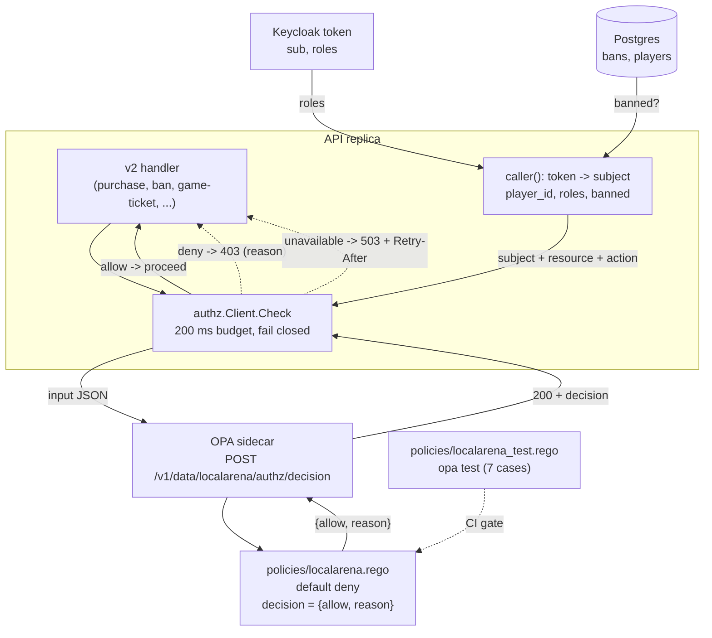
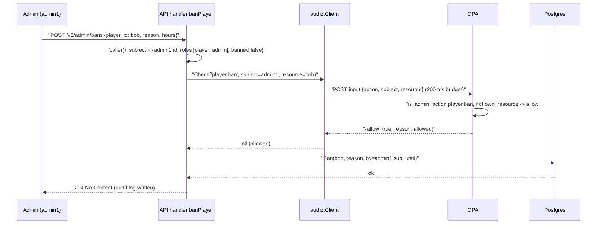
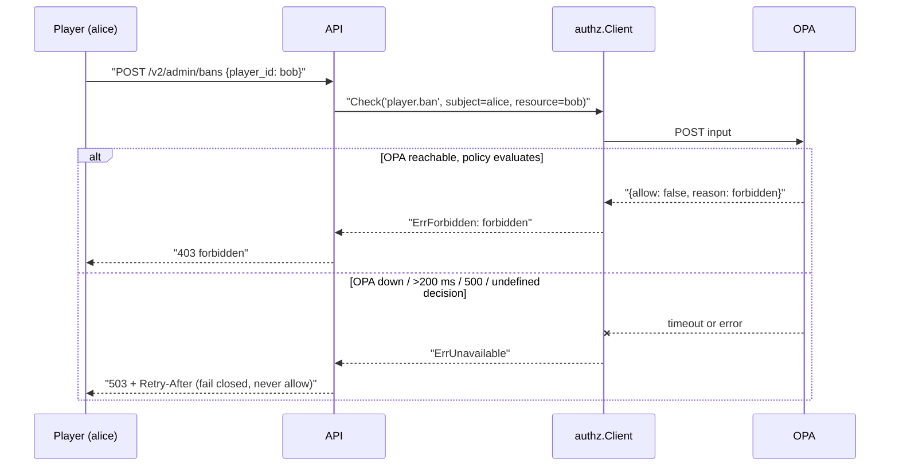

# ADR-0014 deep dive: Policy-based authorization with OPA

> Source decision: [`../../adr/0014-authorization-opa.md`](../../adr/0014-authorization-opa.md)
> Evidence: [`../../experiments/005-week5-security/README.md`](../../experiments/005-week5-security/README.md), [`../../experiments/005-week5-security/threat-model.md`](../../experiments/005-week5-security/threat-model.md)

## 1. TL;DR

- Authorization rules ("players act only on their own account", "only admins ban, and not themselves", "banned users can do nothing") were about to spread through Go handlers. ADR-0014 moves them into **one Rego policy** evaluated by **Open Policy Agent (OPA)**, versioned and unit-tested with `opa test`.
- The API supplies **facts** (identity from the verified token, ban state from Postgres) as an `input` document; OPA supplies the **rule** and returns a decision object `{allow, reason}`. The default is **deny**.
- The authorization client **fails closed**: an unreachable OPA, a non-200 response, an undefined/malformed decision, or any call slower than **200 ms** is treated as "unavailable", and writes get **HTTP 503 + `Retry-After`** — never an accidental allow.
- Public reads (viewing a profile, listing cosmetics) do **not** consult OPA, so an OPA outage never stops people reading or playing existing matches.
- Policy changes ship without a Go deploy, but they carry the same review and test discipline as code.

## 2. Context and problem

By week 5 LocalArena has real identity (ADR-0013): every v2 request carries a verified `Principal` (subject, username, roles) and the API knows whether the player is banned. The next question is *authorization*: given who you are, may you do this action on this resource?

The rules themselves are small but easy to get subtly wrong and easy to scatter:

1. A player may purchase, manage lobbies, write presence, and request a game ticket **only for their own account** (`resource.player_id == subject.player_id`).
2. Only an **admin** may ban a player — and **not themselves** (no self-lockout).
3. A **banned** account can do nothing, regardless of roles.
4. Any **unknown action** is denied by default.

If these checks live as `if` statements inside each handler, they drift: one handler forgets the self-resource check, another forgets the ban check, and there is no single place to review or test the complete rule set. ADR-0014's decision is **policy-as-code**: externalize the rules into Rego, test them independently, and have the Go code only *supply facts and enforce the decision*.

A second, subtler requirement is **fail-safe direction**. Authorization is a security control, so its failure must *deny*, not allow — but only for the surface that needs a decision (writes). Reads and gameplay must keep working even if OPA is down, because an authorization outage should degrade security-sensitive writes, not take the whole product offline.

## 3. HLD

OPA runs as a sidecar (or near the API in Kubernetes). The API's `internal/authz.Client` POSTs an `input` document to OPA's Data API and reads back a decision. The policy `policies/localarena.rego` is the only place rules are written; `policies/localarena_test.rego` tests it with `opa test`.



The division of labour is the point:

| Who | Provides | Trust basis |
|---|---|---|
| Keycloak token | `subject.roles`, subject identity | signed JWT (ADR-0013) |
| Postgres | `subject.banned` | authoritative ban table |
| API handler | `action`, `resource.player_id` | server-controlled (never from the body for the actor) |
| OPA + Rego | the decision `{allow, reason}` | reviewed, tested policy |

## 4. LLD

### 4.1 Components and responsibilities

- **`policies/localarena.rego`** — the policy (`package localarena.authz`, `import rego.v1`). Default deny; exposes `decision = {allow, reason}`.
- **`policies/localarena_test.rego`** — seven `opa test` cases covering every branch.
- **`backend/internal/authz/authz.go`** — the `Client`: builds the `input`, POSTs it, parses the decision, and maps outcomes to `nil` (allow), `ErrForbidden` (deny, with reason), or `ErrUnavailable` (fail closed).
- **`backend/internal/api/v2.go`** — `Server.check` calls the client; `Server.fail` maps `ErrForbidden`→403 and `ErrUnavailable`→503.
- **`compose.yaml`** — `OPA_URL: http://opa:8181`.

### 4.2 The Rego policy (exact)

```rego
package localarena.authz
import rego.v1

default allow := false

banned if input.subject.banned
is_admin if "admin" in input.subject.roles
own_resource if input.resource.player_id == input.subject.player_id

# Players act on their own account only.
allow if {
    not banned
    "player" in input.subject.roles
    input.action in {"purchase", "lobby.create", "lobby.join", "lobby.leave", "presence.write", "game.ticket"}
    own_resource
}

# Admins may ban anyone except themselves (no self-lockout).
allow if {
    not banned
    is_admin
    input.action == "player.ban"
    not own_resource
}

reason := "banned" if banned
else := "allowed" if allow
else := "forbidden"

decision := {"allow": allow, "reason": reason}
```

Reading it:

- **`default allow := false`** — unless a rule explicitly sets `allow`, the answer is deny. An unknown action (e.g. `drop.tables`) therefore denies.
- `banned` short-circuits: both `allow` rules require `not banned`, so a banned subject can never be allowed, whatever the roles.
- The player rule requires role `player`, an action in the allow-set, and `own_resource` (`resource.player_id == subject.player_id`).
- The admin rule requires `admin`, the `player.ban` action, and **`not own_resource`** — the self-ban guard.
- `reason` is a human-readable label returned to the caller for 403 bodies and metrics.

### 4.3 The input / decision contract

The API sends:

```json
{ "input": {
  "action": "purchase",
  "subject": { "player_id": 11003, "roles": ["player"], "banned": false },
  "resource": { "player_id": 11003 }
}}
```

OPA returns (from the Data API at `/v1/data/localarena/authz/decision`):

```json
{ "result": { "allow": true, "reason": "allowed" } }
```

`authz.Subject` and `authz.Resource` are the Go structs serialized into `input`; note the JSON tags match the Rego field names exactly (`player_id`, `roles`, `banned`).

### 4.4 The fail-closed client

`authz.New(base)` builds a client with **`Timeout: 200 * time.Millisecond`** and URL `base + "/v1/data/localarena/authz/decision"`. `Check` enforces fail-closed at every step:

| Condition | Result | Reason |
|---|---|---|
| request build error | `ErrUnavailable` | can't even form the call |
| HTTP error (connection refused, DNS, timeout >200 ms) | `ErrUnavailable` | OPA unreachable or too slow |
| status != 200 | `ErrUnavailable` | e.g. OPA 500 |
| body decode error, or `result == nil`, or `result.allow == nil` | `ErrUnavailable` | malformed or **undefined** decision (policy not loaded) |
| `allow == true` | `nil` | allowed; metric `decisions_total{result="allow"}` |
| `allow == false` | `ErrForbidden` (+ reason) | denied; metric `result="deny"` |

Every unavailable path increments `decisions_total{result="error"}`. The response body is bounded with `http.MaxBytesReader(nil, resp.Body, 4096)` so a misbehaving OPA cannot flood the API.

### 4.5 Enforcement in handlers

`Server.check` refuses to proceed if there is no policy engine at all:

```go
func (s *Server) check(r *http.Request, action string, sub authz.Subject, target int64) error {
    if s.opts.Authz == nil {
        return authz.ErrUnavailable // fail closed: v2 never runs without a policy engine
    }
    return s.opts.Authz.Check(r.Context(), action, sub, authz.Resource{PlayerID: target})
}
```

`Server.fail` maps the two error classes: `ErrForbidden` → **403** with the reason, `ErrUnavailable` → **503** with a `Retry-After`. The `purchaseV2`, `gameTicket`, and `banPlayer` handlers all call `check` *before* touching the database. For the ban handler the `target` is the body's `player_id` (the resource), while the `subject` is always the token holder — so a player banning someone else fails `not own_resource` and an admin self-ban fails the same guard.

Reads (`getProfile`, `listCosmetics`) never call `check`, matching "public reads do not consult OPA".

### 4.6 Algorithm, step by step (write path)

1. Handler builds `authz.Subject` from the token (`caller`) and names the `action` and `target` resource id.
2. `check` returns `ErrUnavailable` immediately if no policy engine is configured.
3. `Client.Check` marshals `{input:{action, subject, resource}}` and POSTs to OPA with a 200 ms deadline.
4. OPA evaluates the policy and returns `{result:{allow, reason}}`.
5. Non-200/slow/garbage/undefined → `ErrUnavailable` → the handler returns 503.
6. `allow=false` → `ErrForbidden` → 403 with the reason.
7. `allow=true` → handler proceeds to the business logic (purchase, ban, ticket).

## 5. Sequence diagrams

### 5.1 Happy path: admin bans another player



### 5.2 Failure/edge paths: player tries to ban; OPA unavailable



Both outcomes are proven: `TestFailClosed` covers "OPA 500 / undefined decision / garbage / >200 ms / unreachable → deny (`ErrUnavailable` → HTTP 503)", and the OPA `opa test` suite + e2e cover the 403 branch (`player cannot ban (403)`).

## 6. Concepts explained

### Policy-as-code (and why not hard-coded `if` statements)

- **What it is.** Expressing authorization rules in a declarative, version-controlled, independently testable language (here Rego) evaluated by a dedicated engine (OPA), rather than as imperative branches inside application code.
- **Why LocalArena uses it.** The rules were "about to spread through handlers". Centralizing them in one `.rego` file makes the complete rule set reviewable in one place and testable with `opa test`, and lets policy change without redeploying Go. The API becomes a thin fact-supplier + decision-enforcer.
- **What was measured.** Seven `opa test` cases pass (self-only player actions, admin-only bans, no self-ban, banned denied, unknown action denied). `TestV2AuthFlow` and e2e prove the Go side enforces the decisions.
- **Where else.** Kubernetes admission control (Gatekeeper/OPA), API gateway authz, cloud entitlement checks, microservice mesh authorization (Istio + OPA), CI/CD guardrails (deny infra changes that violate policy).

### RBAC vs ABAC vs policy-as-code

- **What it is.** **RBAC** (role-based): permissions attach to roles (`admin` can ban). **ABAC** (attribute-based): decisions use attributes of subject, resource, action, and context (`subject.id == resource.owner`). Policy-as-code is the *implementation technique* that can express either, in code.
- **Why LocalArena uses it.** The policy is a blend: roles gate *which* actions (`player`, `admin` — RBAC), while attributes decide *which resource* (`own_resource`, `not own_resource` — ABAC). Rego expresses both cleanly in one place.
- **What was measured.** The admin-ban-other (RBAC) and player-self-only / no-self-ban (ABAC) branches are covered by the 7 `opa test` cases and the e2e ban drill.
- **Where else.** AWS IAM (ABAC via condition keys + RBAC via managed policies), Google Cloud IAM, enterprise document systems ("owner can edit"), healthcare record access ("treating physician + same facility").

### Default deny

- **What it is.** The policy's baseline answer is "no"; access is granted only by an explicit allow rule. Anything not anticipated is denied.
- **Why LocalArena uses it.** `default allow := false` means a typo'd action, a new endpoint that forgot its rule, or an injection attempt (`drop.tables`) all deny automatically. Safety is the default, not an afterthought.
- **What was measured.** `test_unknown_action_denied` proves `drop.tables` is denied.
- **Where else.** Firewall rules (default-deny inbound), security groups, OAuth scopes (absence of a scope denies), zero-trust networks.

### Fail-closed vs fail-open

- **What it is.** When the control itself is unavailable, **fail-closed** denies (secure but less available); **fail-open** allows (available but insecure). The right direction depends on what the control protects.
- **Why LocalArena uses it.** Authorization fails **closed**: OPA down/slow/garbled → 503, never allow. But the choice is *per dependency*: OPA (security) fails closed, flagd (product flags, ADR-0015) fails to its default variant, and Valkey (cache, week 3) degrades. Reads/gameplay don't consult OPA so they stay up.
- **What was measured.** `TestFailClosed`: OPA 500 / undefined / garbage / >200 ms / unreachable all → `ErrUnavailable` → 503. The README's "fail-safe direction" table states the per-dependency choices explicitly.
- **Where else.** Door locks (fail-secure vs fail-safe for fire egress), payment fraud checks (decline on failure), feature flags (default on failure), brakes (fail to safe).

### The 200 ms decision budget

- **What it is.** A hard timeout on the authorization call; exceeding it is treated as "unavailable" and denied.
- **Why LocalArena uses it.** A slow OPA must not stall a write indefinitely or let it through by default. 200 ms is generous for a local sidecar (the ADR notes decisions are sub-millisecond in the lab) while still bounding the worst case; a cache was judged unnecessary at this scale.
- **What was measured.** `TestFailClosed` includes the ">200 ms" case → deny. The ADR states each decision is "sub-ms in the lab"; no separate latency histogram number is cited, so the sub-ms figure is the only measured datum.
- **Where else.** Any synchronous external check on a request path: fraud scoring timeouts, entitlement-service SLAs, sidecar authz budgets in service meshes.

### Externalized decision point (PEP/PDP separation)

- **What it is.** The **Policy Enforcement Point** (the API handler) asks the **Policy Decision Point** (OPA) and enforces the answer; the API never contains the rule logic.
- **Why LocalArena uses it.** The API supplies facts and enforces; OPA decides. This is exactly the XACML PEP/PDP model and is what makes the rules auditable and independently testable.
- **What was measured.** The `decisions_total{action,result}` Prometheus counter records allow/deny/error per action, giving observability into the PDP's answers.
- **Where else.** XACML systems, Istio + OPA, API gateways delegating to an authz service, Netflix-style "PACS" entitlement services.

### Decision object with a reason

- **What it is.** Returning not just a boolean but `{allow, reason}`, so denials are explainable and loggable.
- **Why LocalArena uses it.** A banned subject gets reason `"banned"`; a disallowed action gets `"forbidden"`. The reason is surfaced in the 403 body and (as a metric label would risk cardinality, so it's in the response) aids debugging and audit.
- **What was measured.** `test_banned_player_denied` asserts `d.reason == "banned"`.
- **Where else.** AWS IAM policy simulator (explains allow/deny), OPA decision logs, any authz service that must tell the user *why* they were refused.

### Immediate ban propagation into authorization

- **What it is.** The ban *fact* is loaded fresh from Postgres per request (ADR-0013) and fed into the policy, so the policy denies a banned subject without the token itself knowing about the ban.
- **Why LocalArena uses it.** Keeps revocation instant while keeping the token stateless; the policy's `banned if input.subject.banned` rule does the rest.
- **What was measured.** e2e: banned bob's still-valid token → purchase 403, game-ticket 403.
- **Where else.** Account suspension in SaaS, card hotlisting, revoked-credential lists fed into an authz decision.

## 7. Code pointers

| Path (symbol / key) | What to look at |
|---|---|
| [`policies/localarena.rego`](../../policies/localarena.rego) | the whole policy: default deny, player/admin rules, self-ban guard, `decision` |
| [`policies/localarena_test.rego`](../../policies/localarena_test.rego) | 7 `opa test` cases: self-only, admin ban, no self-ban, banned, unknown action |
| [`backend/internal/authz/authz.go`](../../backend/internal/authz/authz.go) `Client.Check` | build input, POST, parse, map allow/deny/unavailable |
| `backend/internal/authz/authz.go` `New` | 200 ms timeout, Data API URL |
| `backend/internal/authz/authz.go` `fail` + `decisions` counter | fail-closed helper, Prometheus metric |
| [`backend/internal/authz/authz_test.go`](../../backend/internal/authz/authz_test.go) `TestFailClosed` | 500/undefined/garbage/slow/unreachable → deny |
| [`backend/internal/api/v2.go`](../../backend/internal/api/v2.go) `Server.check` | refuses to run without a policy engine |
| `backend/internal/api/v2.go` `Server.banPlayer` / `purchaseV2` / `gameTicket` | check *before* DB work; resource = target vs subject |
| [`compose.yaml`](../../compose.yaml) (`OPA_URL`) | `http://opa:8181` sidecar URL |

## 8. Trade-offs and alternatives

| Option | Pros | Cons | Why (not) chosen |
|---|---|---|---|
| **OPA + Rego policy-as-code (chosen)** | one auditable rule set; `opa test`; change without Go deploy; PEP/PDP split | a network hop per decision; a new runtime to operate | correct, testable, and the week's learning goal |
| Hard-coded Go `if` checks | fastest; no extra service | rules scatter across handlers; hard to audit/test as a whole; easy to forget a check | the exact anti-pattern the ADR avoids |
| Keycloak Authorization Services | integrated with the IdP | couples policy to the IdP and its UI; harder to version/test as code | keeps policy independent of the IdP |
| Casbin / in-process policy lib | no network hop; code-tested | still in-process (deploy to change); less portable than OPA's ecosystem | OPA's decision-log/observability and Rego tests fit better |
| Fail-open authorization | maximum availability | an OPA outage would silently allow everything | unacceptable for a security control |

## 9. Failure modes and how they were found

- **Rules drifting across handlers** — prevented by centralizing in `localarena.rego`; the threat model (threat #17) lists OPA policy + 7 tests as the control.
- **OPA outage silently allowing writes** — prevented by fail-closed; `TestFailClosed` and threat #16 ("OPA fails closed (503) only for v2 writes").
- **Self-lockout (admin bans themselves)** — prevented by `not own_resource`; `test_admin_cannot_self_ban`.
- **Privilege escalation (player bans / acts on others)** — prevented by the role + `own_resource` checks; `test_player_cannot_ban`, `test_player_cannot_buy_for_others`, e2e `player cannot ban (403)`.
- **Unknown/injected action** — denied by default; `test_unknown_action_denied`.
- **Undefined decision (policy not loaded)** — the client treats a missing `allow` as unavailable, not as allow; `TestFailClosed`.

See [`experiments/005-week5-security/README.md`](../../experiments/005-week5-security/README.md) and [`threat-model.md`](../../experiments/005-week5-security/threat-model.md).

## 10. Interview questions

**1. What problem does OPA solve here that `if` statements in handlers don't?**
It centralizes every authorization rule into one declarative, independently testable policy. With scattered `if`s, a single handler can forget the ban check or the own-resource check and nobody notices; with OPA the full rule set is reviewable in one file and covered by `opa test`, and policy changes don't need a Go deploy.

**2. Describe the input/output contract between the API and OPA.**
The API POSTs `{input:{action, subject:{player_id, roles, banned}, resource:{player_id}}}` to `/v1/data/localarena/authz/decision`. OPA returns `{result:{allow, reason}}`. The API supplies only facts (identity from the token, ban from the DB); OPA supplies the rule.

**3. Why does authorization fail closed but feature flags fail open?**
Fail direction depends on what the control protects. Authorization is security: failing open would silently allow forbidden writes, so it fails closed (503). Feature flags are product behaviour: failing to a safe default keeps the game playable, so they fail open to the default variant. The README states this per-dependency choice explicitly.

**4. What exactly counts as "OPA unavailable", and what does the client do?**
Connection error, non-200 status, a response slower than the 200 ms budget, malformed JSON, or an *undefined* decision (policy not loaded, so `allow` is absent). All map to `ErrUnavailable`, which the handler returns as 503 + `Retry-After` — never an allow.

**5. How does the policy prevent an admin from locking themselves out?**
The admin ban rule requires `not own_resource`, i.e. `resource.player_id != subject.player_id`. `test_admin_cannot_self_ban` proves an admin banning their own id is denied.

**6. Is this RBAC or ABAC?**
Both. Roles (`player`, `admin`) gate which actions are even eligible (RBAC); attribute comparisons (`own_resource`, `not own_resource`) decide which resource the subject may act on (ABAC). Rego expresses the combination naturally.

**7. Why don't public reads consult OPA?**
Reading a profile or listing cosmetics isn't a security-sensitive mutation, and routing them through OPA would make an OPA outage stop reads and gameplay. Keeping reads OPA-free means an authorization outage degrades only writes, matching the fail-safe design.

**8. How is the policy tested, and why does that matter?**
With `opa test` against `localarena_test.rego`: seven cases covering self-only player actions, admin-only bans, no self-ban, banned-denied, and unknown-action-denied. Because the policy is the single source of authorization truth, testing it directly (independent of Go) is the strongest guarantee the rules are correct.

**9. What's the risk of OPA adding latency on every write, and how is it bounded?**
A slow sidecar could stall writes. It's bounded by the 200 ms client timeout; exceeding it denies (fail closed) rather than hanging. In the lab decisions are sub-millisecond, so no cache was added — but the budget is the safety net.

**10. The decision returns a `reason`. Why not just a boolean?**
A reason makes denials explainable and auditable: a banned subject gets `"banned"`, a disallowed action gets `"forbidden"`. It drives the 403 body and debugging. `test_banned_player_denied` asserts the reason.

**11. (Design) At 100x scale, OPA calls per write become a hotspot. What do you change?**
Run OPA as a co-located sidecar per API pod (already the model) to keep calls local; enable OPA's decision caching / partial evaluation; push static facts (roles) into the token so fewer inputs change; batch-evaluate where possible; and consider compiling the policy to WASM and evaluating in-process for the hottest paths while keeping Rego as the source of truth. Keep fail-closed and the latency budget; add a decision-latency histogram and alert on budget breaches.

**12. (Design) How would you evolve this policy if resources became more complex (lobbies owned by multiple players, team admins)?**
Extend the `input` with richer resource attributes (owners list, team membership, ownership role) and add ABAC rules (`subject.player_id in resource.owners`, team-scoped admin). Keep default-deny, add targeted `opa test` cases for each new branch, and version the policy (with the same review as code) so a mistaken broadening is caught in CI. Avoid encoding membership in the token where it can go stale; pass it as facts from the authoritative store, as bans are today.

**13. Where would you put OPA in a Kubernetes deployment and why?**
As a sidecar in the API pod (or a DaemonSet with a local socket), so the decision call never leaves the node and shares the pod lifecycle. The ADR explicitly notes "runs as a sidecar or near the API in k8s". This minimizes latency and avoids a cross-service network dependency for every decision.

**14. How do you observe authorization behaviour in production?**
The `localarena_authz_decisions_total{action,result}` counter tracks allow/deny/error per action; a spike in `error` means OPA is unhealthy (and writes are 503-ing), a spike in `deny` may mean an attack or a buggy client. OPA's own decision logs give per-request detail. Alerting on the `error` rate catches a failing PDP.

**15. What stops a malicious client from choosing the `resource.player_id`?**
The handler sets the subject's `player_id` from the verified token, not the body, and passes the appropriate resource id (for self-acting actions it's the subject's own id; for bans it's the target). The policy's `own_resource` / `not own_resource` checks then enforce the relationship. `TestV2AuthFlow` proves a body `player_id` is rejected (400) so it can't be smuggled in.
