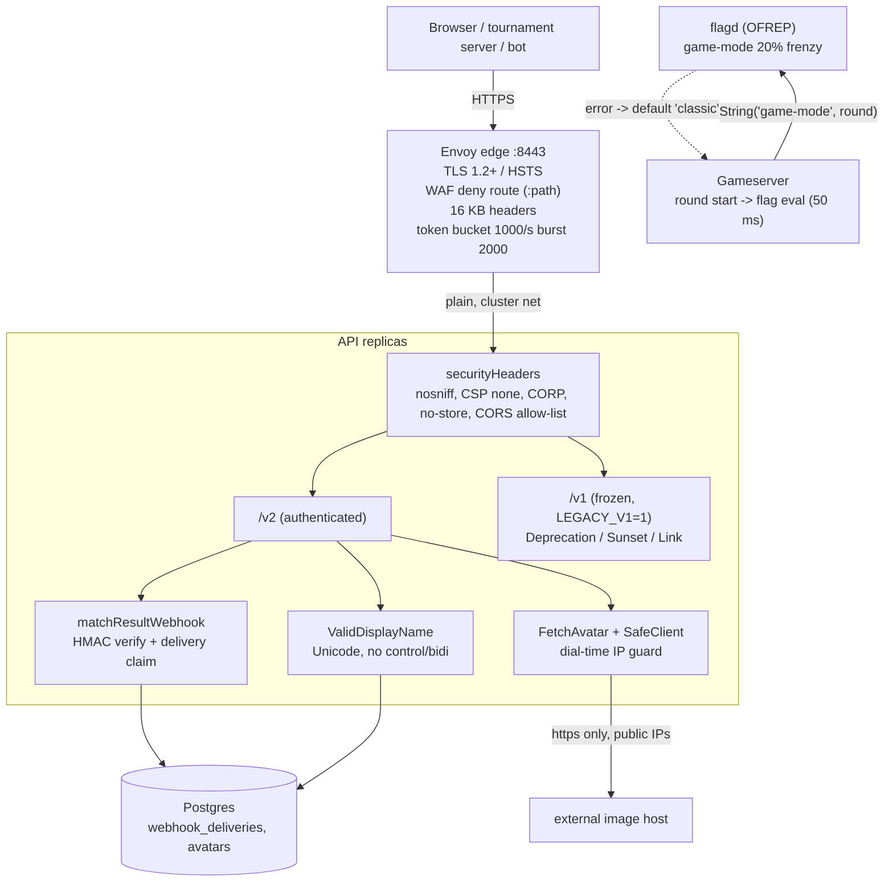
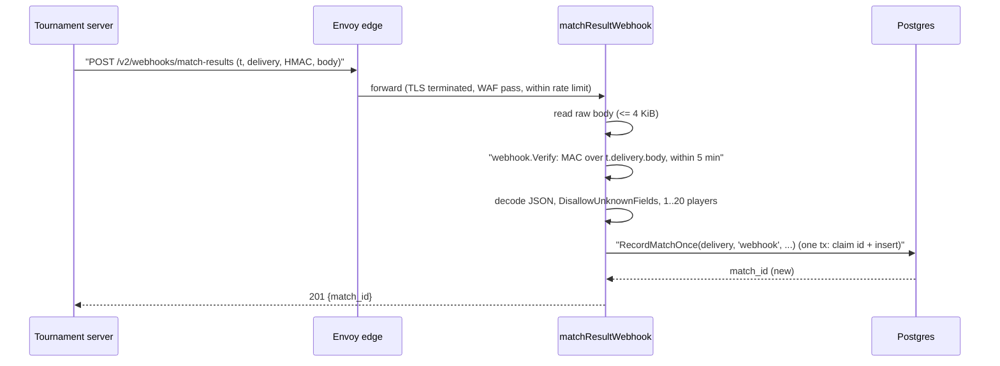
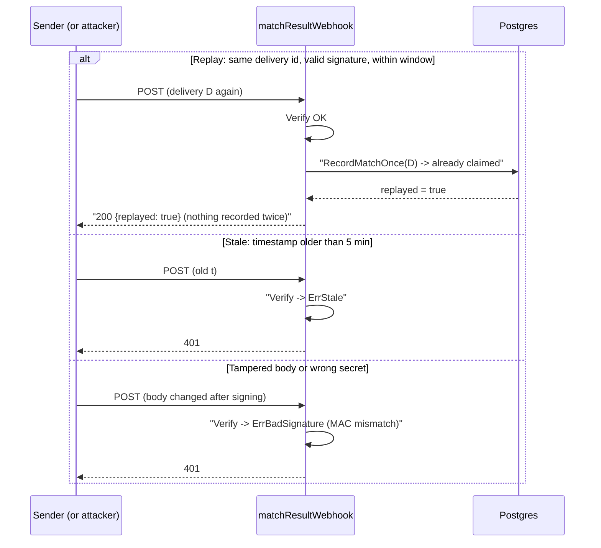
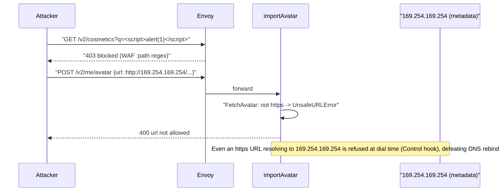

# ADR-0015 deep dive: API versioning, webhooks, input and edge security, feature flags

> Source decision: [`../../adr/0015-api-evolution-edge-security-flags.md`](../../adr/0015-api-evolution-edge-security-flags.md)
> Evidence: [`../../experiments/005-week5-security/README.md`](../../experiments/005-week5-security/README.md), [`../../experiments/005-week5-security/threat-model.md`](../../experiments/005-week5-security/threat-model.md), [`../../experiments/005-week5-security/e2e.sh`](../../experiments/005-week5-security/e2e.sh)

## 1. TL;DR

- **API versioning:** `/v2` is the authenticated API (actor from the token); `/v1` is frozen and served only when `LEGACY_V1=1`, carrying RFC-9745/8594 `Deprecation`, `Sunset: 2027-01-31`, and `Link: </v2/>; rel="successor-version"` headers. Changes *within* a version are additive only.
- **Signed webhooks:** `POST /v2/webhooks/match-results` authenticates with an HMAC-SHA256 signature over `t.delivery.body`, a ±5-minute replay window, and a once-only delivery-id claim recorded in the **same transaction** that records the match. Two secrets are accepted during rotation.
- **Input security:** parameterised SQL everywhere; display names treated as *data* (Unicode-validated, JSON-encoded, rendered with `textContent`); avatar import guarded against SSRF at dial time with content sniffing and size caps; `nosniff`, CSP `default-src 'none'`, CORP, `no-store`; no CSRF risk (bearer header, no cookies); CORS is an allow-list.
- **Edge (Envoy):** TLS 1.2+ with HSTS on `:8443`; a WAF-style deny route on `:path` (traversal, `<script>`, `UNION SELECT`, JNDI); a 16 KB header cap; a global token bucket of 1000/s with burst 2000. Per-identity limits stay in the API (Valkey, week 3).
- **Feature flags:** flagd via OFREP (100 ms budget, default on any error). `game-mode` is a 20% fractional rollout of `frenzy`, keyed by round id and evaluated at round start on the match goroutine so a round never changes mode mid-way.

## 2. Context and problem

Week 5 adds authentication (ADR-0013) and authorization (ADR-0014). That creates several follow-on problems the ADR groups together because they share one theme — *evolving and hardening the external surface without breaking existing clients*:

1. **Versioning.** The unauthenticated v1 API (which trusts a body `player_id`) must keep working for weeks 1–4 experiments and bots, yet new clients must use the authenticated `/v2`. How do old clients learn the deadline?
2. **Webhooks.** A trusted tournament server posts match results. How does the receiver know the request is genuine and not a replay, given it carries no bearer token?
3. **Input handling.** Display names, avatar URLs, and query strings are attacker-controlled. How are SQL injection, stored XSS, SSRF, and oversized payloads prevented?
4. **Edge controls.** What belongs at the gateway (TLS, coarse WAF, a global flood limiter) vs in the application (per-identity limits, correctness)?
5. **Feature flags.** How is a risky new game mode rolled out to a fraction of rounds without a deploy, and what happens when the flag service is down?

## 3. HLD



The guiding principle is **defence in depth with correctness in the application**: the WAF is a noise filter, not the control; the real protections (parameterised SQL, output encoding, SSRF dial-time checks, HMAC verification) live in the API where they can be tested.

## 4. LLD

### 4.1 API versioning and deprecation headers

`registerV2` (in `v2.go`) wires the authenticated routes; the acting player always comes from the token (`caller`), closing the v1 "act as any `player_id`" hole. `registerV1` (in `api.go`) is mounted only when `LEGACY_V1=1`. When auth is enabled, every v1 response is wrapped to add:

```go
w.Header().Set("Deprecation", "@1792281600")                 // RFC 9745, 2026-10-18 (unix @-timestamp)
w.Header().Set("Sunset", "Sun, 31 Jan 2027 00:00:00 GMT")    // RFC 8594
w.Header().Set("Link", `</v2/>; rel="successor-version"`)
```

**Additive-only within a version:** new fields are optional (`Welcome.mode`, `Input.st`); a breaking change gets a *new* version. Event schemas follow the same rule, enforced by Apicurio `BACKWARD_TRANSITIVE` (week 4). `TestV1DeprecationHeaders` asserts all three headers are present and `Link` contains `successor-version`.

### 4.2 Signed webhooks

Scheme (`webhook.go`), modelled on Stripe/GitHub signatures:

```
X-LocalArena-Delivery:  <unique delivery id, 1..64 chars>
X-LocalArena-Signature: t=<unix seconds>,v1=<hex HMAC-SHA256(secret, "<t>.<delivery>.<body>")>
```

`Verify` steps:

1. Parse `t` and all `v1=` values (several may be present during rotation).
2. Reject if `ts < 0`, no signatures, empty delivery, or delivery > 64 chars.
3. Reject if `|now - t| > Tolerance` (`Tolerance = 5 * time.Minute`) → `ErrStale`.
4. For each secret (current and, during rotation, previous) recompute the MAC and compare with `hmac.Equal` (constant time); any match passes.

The receiver handler `matchResultWebhook` then:

1. Reads the **raw body** (capped at 4 KiB by `MaxBytesReader`).
2. Verifies the signature over the exact bytes (before JSON parsing — parsing then re-serializing would change the bytes and break the MAC).
3. Decodes with `DisallowUnknownFields`; validates `1..20` players and `EndedAt > StartedAt`.
4. Calls `RecordMatchOnce(delivery, "webhook", ...)` which **claims the delivery id and records the match in one transaction**. A replay of the same delivery id returns 200 `{replayed:true}` and records nothing new.

Schema (`00012_webhooks.sql`):

```sql
CREATE TABLE webhook_deliveries (
    delivery_id text PRIMARY KEY CHECK (length(delivery_id) BETWEEN 1 AND 64),
    source      text NOT NULL,
    received_at timestamptz NOT NULL DEFAULT now()
);
```

Because rows older than the 5-minute tolerance can never be replayed successfully (the timestamp check fails first), old rows are safe to purge.

### 4.3 Input security

- **SQL injection:** every query in `store` is parameterised with pgx placeholders (`$1`, `$2`); ids are parsed as integers before use. `SetDisplayName` is the canonical example: `UPDATE profiles SET display_name = $2 ... WHERE player_id = $1`. e2e sends `1 OR 1=1` as an id and gets **400** (it never becomes SQL text).
- **Display names as data:** `ValidDisplayName` accepts 1–32 printable runes, rejects non-UTF-8, control characters, and Unicode **bidi-control** characters (which can spoof other players' UIs). The name is stored as typed, JSON-encoded on output, and the client renders it with `textContent` — no HTML parsing, so a `<script>` name is inert.
- **Avatar import (SSRF):** see 4.4.
- **Response headers** (`securityHeaders`): `X-Content-Type-Options: nosniff`, `Content-Security-Policy: default-src 'none'; frame-ancestors 'none'`, `Referrer-Policy: no-referrer`, `Cross-Origin-Resource-Policy: same-site` (fixes ZAP 90004 Spectre isolation), `Cache-Control: no-store`.
- **CSRF / CORS:** v2 authenticates with an `Authorization` header, which browsers never attach automatically, and there are no auth cookies — so cross-site requests carry no credentials and CSRF is not applicable. CORS is an allow-list (`AllowedOrigins = {http://localhost:8080, https://localhost:8443}`); the `OPTIONS /v2/` preflight returns 204.

### 4.4 SSRF guard (`ssrf.go`)

`FetchAvatar` + `SafeClient` defend against Server-Side Request Forgery and DNS rebinding:

- `FetchAvatar` pre-checks the URL: **https only**, non-empty host, **no userinfo** (`u.User == nil`), length ≤ 2048.
- `SafeClient` installs a dialer **`Control`** hook that runs on the *resolved* address at connect time (not the hostname), so DNS rebinding can't resolve to a public IP during the check and a private IP at connect. `blockedAddr` refuses loopback, private, link-local (incl. cloud metadata `169.254.169.254`), CGNAT (`100.64.0.0/10`), multicast, unspecified, benchmark/test ranges (`192.0.0.0/24`, `198.18.0.0/15`), `240.0.0.0/4`, and IPv4-mapped IPv6 (`64:ff9b::/96`, `::ffff:...` via `Unmap`). Only ports **443 or 80** are allowed.
- Redirects: at most 3, https only.
- Response: `io.LimitReader` at `MaxAvatarBytes = 512 << 10` (512 KiB); the **declared** `Content-Type` is ignored — `http.DetectContentType` sniffs the bytes and only `image/png`, `image/jpeg`, `image/webp` are accepted.
- On serve (`serveAvatar`), the type is re-checked against the sniffed bytes, so a bad DB row can never be served as HTML (defence in depth; closes the gosec G705 finding).

### 4.5 Edge controls (Envoy, `envoy.yaml`)

| Control | Value | Where |
|---|---|---|
| TLS | `tls_minimum_protocol_version: TLSv1_2`, ALPN `h2`, `http/1.1`, dev cert | `:8443` DownstreamTlsContext |
| HSTS | `Strict-Transport-Security: max-age=31536000` | `:8443` route `response_headers_to_add` |
| WAF deny | `direct_response 403` when `:path` matches `(?i).*(\.\./|%2e%2e|<script|%3cscript|union(\s|%20|\+)+select|/etc/passwd|\$\{jndi:|%24%7bjndi).*` | first route on every listener |
| Header cap | `max_request_headers_kb: 16` | each HCM |
| Global token bucket | `max_tokens: 2000`, `tokens_per_fill: 1000`, `fill_interval: 1s`, `stat_prefix: edge_rl` | `local_ratelimit` http filter |

Per-identity rate limits stay in the API (Valkey token bucket, week 3) — `purchase:player:<id>` etc. The WAF matches the **`:path` header** (including the query), after an earlier surprise where it matched only the path and missed `?q=<script>`.

### 4.6 Feature flags (flagd + OFREP)

`flags.Client.String` POSTs to `<flagd>/ofrep/v1/evaluate/flags/<flag>` with `{"context":{"targetingKey":<key>}}`, a **100 ms** timeout, and a 4 KiB response cap. **Any** error (flagd down, missing flag, wrong type, slow, non-200) returns the caller's `def`. A `nil` client always returns the default.

`flags.json` defines `game-mode`: variants `classic`/`frenzy`, `defaultVariant: classic`, targeting `fractional [frenzy 20, classic 80]` keyed by `($flagd.flagKey, targetingKey)`. The gameserver (`cmd/gameserver/main.go`) evaluates it at **round start** with a 50 ms-bounded context, keyed by `"<matchID>/r<round>"`, so a given round gets one variant for its whole life and the evaluation can't stall gameplay beyond the round boundary. `ApplyMode` turns `frenzy` into `Items=30, Speed=14`; unknown modes fall back to classic.

## 5. Sequence diagrams

### 5.1 Happy path: signed match-result webhook, recorded once



### 5.2 Failure/edge paths: replayed delivery, stale timestamp, tampered body



Proven by `TestMatchResultWebhook`: valid → 201; same delivery → 200 `replayed`, recorded once; tampered body or stale timestamp → 401.

### 5.3 Edge + SSRF failure flow (bonus)



## 6. Concepts explained

### API versioning and deprecation (Deprecation / Sunset / Link headers)

- **What it is.** Running multiple API versions in parallel and signalling the retirement timeline in standard headers: `Deprecation` (RFC 9745), `Sunset` (RFC 8594, the date it stops working), and `Link; rel="successor-version"` (where to go).
- **Why LocalArena uses it.** v1 is unauthenticated and trusts the body — it must keep working for weeks 1–4 bots/experiments, but new clients must move to `/v2`. The headers make the deadline (2027-01-31) machine- and human-visible so old clients aren't surprised.
- **What was measured.** `TestV1DeprecationHeaders` asserts `Deprecation`, `Sunset`, and a `Link` containing `successor-version` are all present.
- **Where else.** Stripe's dated API versions, GitHub's `Sunset` headers, Twilio deprecation notices, any public API retiring an endpoint.

### Additive-only (backward/forward-compatible) changes

- **What it is.** Within one version you only *add* optional fields; you never remove or repurpose existing ones. Clients ignore unknown fields; servers tolerate missing new ones.
- **Why LocalArena uses it.** `Welcome.mode` and `Input.st` were added as optional fields without a version bump; a breaking change would get a new version. Event schemas enforce the same via Apicurio `BACKWARD_TRANSITIVE`.
- **What was measured.** The compatibility *rule* is enforced by Apicurio (week 4); within week 5 it's a design constraint. No separate number for protocol compatibility is cited here — "not measured" as a standalone experiment.
- **Where else.** Protobuf field-number discipline, Avro schema evolution, REST APIs adding optional JSON fields, event-sourced systems.

### Webhook signatures (HMAC over the raw body)

- **What it is.** The sender signs `HMAC-SHA256(secret, "<t>.<delivery>.<body>")` and sends `t`, `delivery`, and the signature; the receiver recomputes over the **exact raw bytes** and compares in constant time. It authenticates a request that carries no bearer token.
- **Why LocalArena uses it.** A tournament server posts match results; the API must know they're genuine. Signing binds the body, timestamp, and delivery id together; verifying before JSON parsing avoids byte-level mismatches.
- **What was measured.** `TestMatchResultWebhook`: valid → 201, tampered body → 401. The scheme explicitly uses `hmac.Equal` (constant-time).
- **Where else.** Stripe webhooks (`Stripe-Signature`), GitHub (`X-Hub-Signature-256`), Shopify, Slack request signing, PayPal IPN.

### Replay protection (timestamp window + once-only delivery id)

- **What it is.** Two layers: a **timestamp tolerance** (±5 min) bounds how old a captured request can be, and a **delivery-id claim** recorded once makes even an in-window replay a no-op.
- **Why LocalArena uses it.** A captured-but-valid webhook could otherwise be replayed to double-record a match. The delivery id is claimed in the *same transaction* as the match insert, so "recorded" and "claimed" are atomic — a retry (same id) returns `replayed:true` and changes nothing.
- **What was measured.** `TestMatchResultWebhook`: same delivery → 200 `replayed`, recorded once; stale timestamp → 401. e2e exercises the webhook path via tests.
- **Where else.** Payment IPNs (dedupe by event id), idempotent REST writes with `Idempotency-Key` (Stripe), message-queue consumers deduping on message id, at-least-once delivery anywhere.

### SQL injection and parameterised queries

- **What it is.** Injection happens when user input is concatenated into SQL. Parameterisation sends the query and the values separately so input is always *data*, never executable SQL.
- **Why LocalArena uses it.** Every `store` query uses pgx placeholders; ids are parsed to integers. The `1 OR 1=1` payload hits integer parsing and returns 400 before any query is built.
- **What was measured.** e2e/unit `1 OR 1=1 → 400`; threat #9 "all queries parameterised (pgx)".
- **Where else.** Every database-backed app; prepared statements in JDBC/ORMs; stored procedures with bound parameters.

### Stored XSS, output encoding, CSP, and `nosniff`

- **What it is.** Stored XSS injects script via persisted data (a display name). Defences: treat the value as data, encode on *output* (JSON, `textContent`), and add browser headers — `Content-Security-Policy: default-src 'none'` (no scripts/resources at all) and `X-Content-Type-Options: nosniff` (the browser won't reinterpret a JSON/image body as HTML).
- **Why LocalArena uses it.** A `<script>` display name must never execute in another player's UI. The name is JSON-encoded and rendered with `textContent`; the API returns only JSON/images, so CSP can forbid everything and nosniff blocks MIME confusion.
- **What was measured.** `TestV2AuthFlow`: "XSS payload never appears as raw HTML; bidi override rejected". `TestAvatarContentValidation`: HTML served as `image/png` refused. ZAP baseline: 0 FAIL after adding CORP.
- **Where else.** Comment systems, user profiles, chat apps, CMS content, any site rendering user-generated content.

### Unicode / bidi-control validation

- **What it is.** Bidirectional-override characters (e.g. U+202E) can visually reorder text to spoof names/URLs; control characters can break logs/UIs. Validation rejects them.
- **Why LocalArena uses it.** `ValidDisplayName` rejects control and `Bidi_Control` runes so a display name can't impersonate another or corrupt a UI.
- **What was measured.** `TestV2AuthFlow`: "bidi override rejected".
- **Where else.** Filename display (Trojan-source attacks in code review), messaging apps, username registration, anti-spoofing in email display names.

### SSRF and DNS rebinding

- **What it is.** SSRF tricks a server into making requests to internal targets (cloud metadata `169.254.169.254`, internal admin ports). **DNS rebinding** passes a hostname check by resolving to a public IP during validation, then to a private IP at connect time.
- **Why LocalArena uses it.** Avatar import fetches a user-supplied URL — the classic SSRF vector. The guard checks the **resolved IP at dial time** (dialer `Control` hook), not the hostname, which defeats rebinding; it blocks private/loopback/link-local/CGNAT/mapped-v6 ranges, allows only ports 80/443 and https, caps redirects/size, and sniffs the image type.
- **What was measured.** `TestSSRFGuard` refuses 11 bad URLs (http, file, gopher, userinfo, 127.0.0.1, localhost, 169.254.169.254, `[::1]`, `[::ffff:10.0.0.1]`, 10/8, port 6379). Threat #11.
- **Where else.** Image/link preview services, webhook senders, PDF/HTML-to-image renderers, import-from-URL features — SSRF is a top cloud-breach vector (metadata credential theft).

### CSRF and CORS

- **What it is.** CSRF abuses a browser's automatic credential attachment (cookies) to forge state-changing requests. CORS controls which origins a browser allows a page to call. Bearer-token APIs with no cookies are inherently CSRF-safe because the browser never auto-attaches the token.
- **Why LocalArena uses it.** v2 uses `Authorization: Bearer`, not cookies, so CSRF is "not applicable"; CORS is a strict allow-list of the known web origins, and the preflight returns 204.
- **What was measured.** `TestV2AuthFlow` includes "CORS allow-list"; the gameserver's `checkOrigin` also allow-lists WebSocket origins (never `*`).
- **Where else.** Any SPA + token API (CSRF-free by design); cookie-session apps need CSRF tokens; CORS governs every browser cross-origin call.

### WAF at the edge (as a noise filter)

- **What it is.** A Web Application Firewall blocks requests matching known attack patterns. It is a coarse filter, not a correctness guarantee.
- **Why LocalArena uses it.** Envoy's `safe_regex` on `:path` returns 403 for traversal, `<script>`, `UNION SELECT`, `/etc/passwd`, and JNDI patterns — reducing noise before the API. The ADR and threat model (open item) are explicit: WAF rules "reduce noise, they do not replace the input handling".
- **What was measured.** e2e: `WAF: script tag → 403`, `WAF: union select → 403`, path traversal → 400 (Envoy normalization, before the WAF).
- **Where else.** AWS WAF/Cloudflare in front of apps, ModSecurity, bot-mitigation layers.

### Rate limiting at the edge vs per-identity

- **What it is.** A **global** token bucket caps total ingress to protect the fleet from floods; **per-identity** limits (per player/IP) stop one actor hogging capacity and need application-level identity.
- **Why LocalArena uses it.** Envoy's `local_ratelimit` is a global bucket (1000/s, burst 2000) that sheds overload with 429 before it reaches the API. Per-player limits (`purchase:player:<id>`) stay in the API with Valkey because only the API knows the authenticated identity.
- **What was measured.** e2e: a ~3000-request burst (4000 req/s for 3 s via k6) against the 1000/s bucket drives `local_rate_limit.rate_limited > 0` (429s) — "edge token bucket sheds a 3000-request burst (limited)".
- **Where else.** API gateways (coarse global limit) + app-tier per-key quotas; CDNs shedding L7 floods; login endpoints with per-account throttles.

### TLS and HSTS

- **What it is.** TLS encrypts/authenticates the connection; HSTS (`Strict-Transport-Security`) tells browsers to only ever use HTTPS for the host, preventing downgrade/stripping.
- **Why LocalArena uses it.** Bearer tokens and tickets are sniffable in clear. Envoy terminates TLS 1.2+ on `:8443` and adds `max-age=31536000`. `scripts/tls-certs.sh` makes a P-256 dev CA + server cert.
- **What was measured.** e2e: TLS 1.2+ accepted, TLS 1.1 refused, HSTS present (1 header). Internal hops remain plaintext (accepted lab risk, threat #13).
- **Where else.** Every public HTTPS site; HSTS preload lists; mTLS between services.

### Feature flags and fractional (percentage) rollout

- **What it is.** A flag toggles behaviour without a deploy; a *fractional* rollout assigns a percentage of a keyed population to a variant deterministically (same key → same variant), so rollout is sticky and measurable.
- **Why LocalArena uses it.** `game-mode` rolls `frenzy` to 20% of rounds, keyed by round id and evaluated once at round start on the match goroutine, so a round never flips mode mid-way. flagd is queried over OFREP with a 100 ms budget; any failure returns the default (`classic`).
- **What was measured.** `TestFlagdRollout`: **105/500 rounds** got `frenzy` (~21%, within the 50–150 test band), sticky per key; `TestFallbacks`: every flagd failure → default. e2e: flagd stopped → gameserver healthy, rounds start as `classic`.
- **Where else.** LaunchDarkly/Unleash/Flagsmith rollouts, canary of a new checkout flow, gradual ML-model rollout, kill-switches for risky features.

### Defence in depth

- **What it is.** Layering independent controls so one failing doesn't breach the system.
- **Why LocalArena uses it.** Avatars are sniffed on import *and* re-checked on serve; XSS is blocked by data-handling *and* CSP *and* nosniff; floods are shed at the edge *and* per-identity; SQL is parameterised *and* ids integer-parsed.
- **What was measured.** gosec G705 (XSS taint on avatar bytes) went 1 → 0 after adding the serve-time re-check; ZAP 0 FAIL.
- **Where else.** Every serious security posture; cloud "security in layers"; PCI-DSS.

## 7. Code pointers

| Path (symbol / key) | What to look at |
|---|---|
| [`backend/internal/api/v2.go`](../../backend/internal/api/v2.go) `registerV2` | authenticated routes; actor from token |
| `backend/internal/api/v2.go` `securityHeaders` | nosniff, CSP none, CORP, no-store, CORS allow-list |
| `backend/internal/api/v2.go` `ValidDisplayName` | 1–32 printable runes; reject control + bidi |
| `backend/internal/api/v2.go` `matchResultWebhook` | raw body, verify, decode, `RecordMatchOnce` |
| `backend/internal/api/v2.go` `serveAvatar` | serve-time type re-check (closes G705) |
| [`backend/internal/api/api.go`](../../backend/internal/api/api.go) `registerV1` | Deprecation/Sunset/Link headers, `LEGACY_V1` mount |
| [`backend/internal/api/ssrf.go`](../../backend/internal/api/ssrf.go) `SafeClient` / `blockedAddr` / `FetchAvatar` | dial-time IP guard, blocked ranges, sniff + size cap |
| [`backend/internal/webhook/webhook.go`](../../backend/internal/webhook/webhook.go) `Verify` / `Sign` / `Tolerance` | HMAC scheme, 5-min window, rotation |
| [`backend/internal/flags/flags.go`](../../backend/internal/flags/flags.go) `Client.String` / `New` | OFREP call, 100 ms budget, default-on-error |
| [`backend/internal/match/match.go`](../../backend/internal/match/match.go) `ApplyMode` / `Mode` / `newRound` | frenzy = Items 30 / Speed 14; per-round eval |
| [`backend/cmd/gameserver/main.go`](../../backend/cmd/gameserver/main.go) `modeFor` | 50 ms-bounded flag eval at round start |
| [`backend/internal/server/server.go`](../../backend/internal/server/server.go) `checkOrigin` | WebSocket origin allow-list (never `*`) |
| [`backend/migrations/00012_webhooks.sql`](../../backend/migrations/00012_webhooks.sql) | `webhook_deliveries` once-only table |
| [`backend/migrations/00011_avatars.sql`](../../backend/migrations/00011_avatars.sql) | avatar CHECK (content type + ≤512 KiB) |
| [`infra/compose/envoy/envoy.yaml`](../../infra/compose/envoy/envoy.yaml) (`safe_regex`, `token_bucket`, `max_request_headers_kb`, `DownstreamTlsContext`, `Strict-Transport-Security`) | WAF, rate limit, header cap, TLS, HSTS |
| [`infra/compose/flagd/flags.json`](../../infra/compose/flagd/flags.json) | `game-mode` fractional `[frenzy 20, classic 80]` |
| [`scripts/tls-certs.sh`](../../scripts/tls-certs.sh) | dev CA + server cert |

## 8. Trade-offs and alternatives

| Area | Chosen | Alternative | Why |
|---|---|---|---|
| Versioning | URL path `/v1` `/v2` + sunset headers | header/media-type versioning | path versioning is visible, simple to route in Envoy, and the sunset headers add the deadline |
| v1 lifetime | frozen, additive-only, served under `LEGACY_V1=1` | delete v1 immediately | old bots/experiments must keep running until the sunset date |
| Webhook auth | HMAC over raw body + timestamp + delivery id | mTLS client certs; bearer token | HMAC is simple, stateless, and matches Stripe/GitHub conventions; mTLS is heavier for a single trusted sender |
| XSS defence | data + output encoding + CSP + nosniff | server-side HTML sanitisation | treating names as data avoids the endless sanitiser cat-and-mouse; CSP/nosniff are cheap belt-and-braces |
| SSRF check | dial-time resolved-IP guard | hostname/allow-list check only | only the dial-time check defeats DNS rebinding |
| Edge limits | global token bucket at Envoy | per-identity only | a global bucket sheds floods cheaply before the API; identity-aware limits still live in the API |
| WAF | coarse `:path` regex, "noise filter" | full ModSecurity ruleset | correctness is in the app; a heavy WAF adds ops cost and false positives |
| Flags | flagd + OFREP, fail-to-default | hard-coded config; SaaS flag vendor | flagd is OSS/offline and OFREP is standard; failing to default keeps gameplay safe |

## 9. Failure modes and how they were found

- **Old clients broken by v2 cutover** — avoided by freezing v1 under `LEGACY_V1=1` with sunset headers; `TestV1DeprecationHeaders`.
- **Forged / replayed / stale webhook** — HMAC + 5-min window + once-only delivery id; `TestMatchResultWebhook`, threat #6.
- **SQL injection** — parameterised queries + integer id parsing; e2e `1 OR 1=1 → 400`, threat #9.
- **Stored XSS via name/avatar** — data handling + CSP + nosniff + serve-time re-check; `TestV2AuthFlow`, `TestAvatarContentValidation`, gosec G705 1→0, threat #10.
- **SSRF / DNS rebinding via avatar import** — dial-time IP guard; `TestSSRFGuard` (11 URLs), threat #11.
- **Floods** — Envoy token bucket; e2e 3000-request burst → 429s, threat #15.
- **WAF missed query-string payload** (surprise #2) — fixed by matching the `:path` header (which includes the query), not just the path.
- **flagd outage freezing/breaking rounds** — fail-to-default; `TestFallbacks`, e2e flagd stopped → healthy, classic.
- **Image scan surprise** (surprise #4) — the Streams image's vulnerable Go stdlib came from a base-image utility (`pebble`), not app code; fixed by pinning lz4-java to 1.11.4 and removing the unused binary → 4 HIGH → 0.

See [`experiments/005-week5-security/README.md`](../../experiments/005-week5-security/README.md), [`results/e2e.txt`](../../experiments/005-week5-security/results/e2e.txt), and [`threat-model.md`](../../experiments/005-week5-security/threat-model.md).

## 10. Interview questions

**1. How does LocalArena run two API versions at once without breaking old clients?**
`/v1` (unauthenticated, trusts the body) stays frozen and is served only under `LEGACY_V1=1`; `/v2` is the authenticated API. v1 responses carry `Deprecation`, `Sunset: 2027-01-31`, and `Link; rel="successor-version"` so clients learn the deadline. Changes within a version are additive-only; a breaking change gets a new version.

**2. Why sign the webhook over the raw body, and why before JSON parsing?**
The MAC must cover the exact bytes the sender signed. If you parsed the JSON and re-serialized, whitespace/key-order changes would alter the bytes and break the signature. So the handler reads the raw (4 KiB-capped) body, verifies the HMAC, and only then decodes.

**3. A valid webhook is captured and replayed 10 seconds later. What happens?**
It passes the signature and the ±5-minute window, but `RecordMatchOnce` finds the delivery id already claimed and returns 200 `{replayed:true}` without recording anything new. The claim and the match insert are one transaction, so they can't diverge.

**4. Why does claiming the delivery id and recording the match have to be one transaction?**
Otherwise a crash between "insert match" and "claim id" could leave the match recorded but the id unclaimed, so a retry would double-record; or claim-then-crash would lose the match while blocking the retry. Atomicity makes "processed exactly once" true.

**5. Explain the SSRF guard and why checking the hostname isn't enough.**
`FetchAvatar` requires https/no-userinfo, and `SafeClient`'s dialer `Control` hook checks the *resolved IP at connect time* against a blocklist (private, loopback, link-local incl. `169.254.169.254`, CGNAT, mapped-v6) and allows only ports 80/443. A hostname check is bypassable by DNS rebinding — resolve public during the check, private at connect — which the dial-time check defeats.

**6. How is stored XSS prevented if a player sets their name to `<script>`?**
The name is validated as data (printable, no control/bidi), stored verbatim, JSON-encoded on output, and rendered by the client with `textContent` (no HTML parsing), so the script is inert. CSP `default-src 'none'` and `nosniff` are additional layers. `TestV2AuthFlow` proves the payload never appears as raw HTML.

**7. The API ignores the declared `Content-Type` on imported avatars. Why, and what does it do instead?**
A declared type is attacker-controlled and could claim `image/png` for an HTML/script payload. The server sniffs the bytes with `http.DetectContentType`, accepts only png/jpeg/webp, caps at 512 KiB, and re-checks on serve — so a crafted file can't be served back as executable HTML.

**8. Why is CSRF "not applicable" to v2 but origin checks still matter for WebSockets?**
v2 authenticates with an `Authorization` header (no cookies), which browsers never auto-attach cross-site, so forged cross-site requests carry no credentials. WebSockets, however, can be opened cross-site with ambient auth once tickets exist, so `checkOrigin` allow-lists origins and never allows `*` (cross-site WebSocket hijacking).

**9. What belongs at the Envoy edge vs in the API for rate limiting, and why?**
A global token bucket (1000/s, burst 2000) at the edge sheds floods cheaply before they reach the API and needs no identity. Per-player/IP limits need the authenticated identity, so they live in the API with Valkey. Edge = coarse fleet protection; app = fairness per actor.

**10. The WAF initially missed `?q=<script>`. What was the bug and the fix?**
Envoy's route `safe_regex` matched only the path component, not the query string. Matching the `:path` **header** (which includes the full path+query) fixed it, so `WAF: script tag → 403` now passes. The ADR stresses the WAF is a noise filter; the real XSS defence is in the app.

**11. How is the `frenzy` game mode rolled out to 20% of rounds safely?**
flagd's `game-mode` flag has a fractional target `[frenzy 20, classic 80]` keyed by `($flagKey, targetingKey)`. The gameserver evaluates it once at round start, keyed by `"<matchID>/r<round>"`, on the match goroutine with a 50 ms budget, so the assignment is deterministic and sticky and a round never changes mode mid-way. `TestFlagdRollout` saw 105/500 rounds pick frenzy (~21%).

**12. What happens to gameplay if flagd is down?**
Nothing bad: any error (down, slow >100 ms, missing flag, wrong type) returns the caller's default, and a `nil` flag client always returns the default. Rounds start as `classic`. e2e proves "flagd down → gameserver healthy, rounds start as classic". Flags fail open to the safe default by product choice.

**13. (Design) The tournament-webhook sender wants to rotate its secret with zero downtime. How does this design support it?**
`Verify` accepts multiple `v1=` signatures and multiple secrets simultaneously. During rotation the API is configured with both the new and old secret; the sender signs with the new one (and may send both). Once all senders have moved, the old secret is dropped. No request is rejected during the overlap. This is the same dual-secret pattern Stripe/GitHub use.

**14. (Design) At 100x traffic the global 1000/s edge bucket is too blunt. How do you evolve edge protection?**
Move from a single global bucket to a distributed/sharded rate limiter (Envoy global rate-limit service backed by Redis) with per-route and per-identity descriptors, add adaptive concurrency limits and outlier ejection, push coarse bot/flood mitigation to a CDN/edge layer, and keep per-player quotas in the app. Add priority-based shedding so gameplay traffic survives while best-effort endpoints are dropped first. Measure with the `edge_rl` stats and per-route 429 rates.

**15. How does the team know the security posture actually holds, not just in theory?**
Layered evidence: 20/20 e2e checks (`results/e2e.txt`), a dozen unit/integration tests (SSRF 11 URLs, webhook replay, XSS, key rotation, fail-closed), and scans — Trivy images 0 HIGH/CRITICAL after fixes, Trivy config 0 after adding `USER 65532`, gosec 0 (G705 fixed), ZAP baseline 0 FAIL. Every claim in the threat model maps to a test or scan result.

**16. Why 5 minutes for the webhook tolerance and 60 seconds for game tickets — different windows?**
Each bounds a different replay risk against the clock skew it must tolerate. Webhooks come from an external server over the internet where a few minutes of skew/retry latency is normal, so ±5 min balances replay exposure against false rejections. Game tickets are minted and consumed locally within seconds, so 60 s is ample and keeps the blast radius of a leaked ticket tiny.
