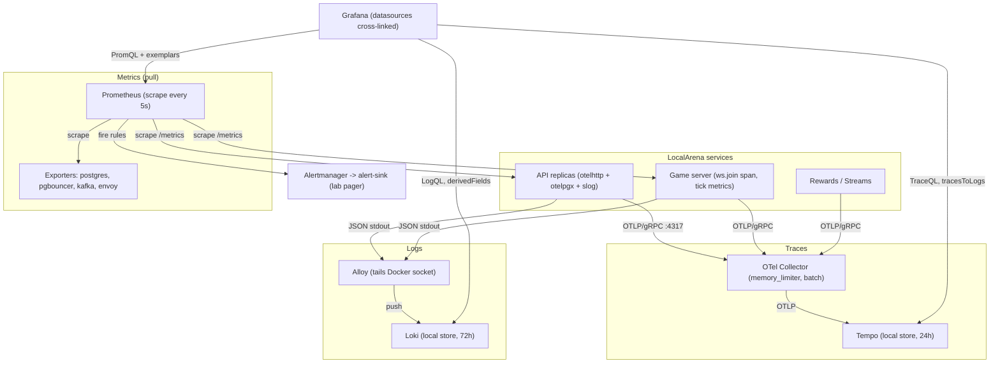
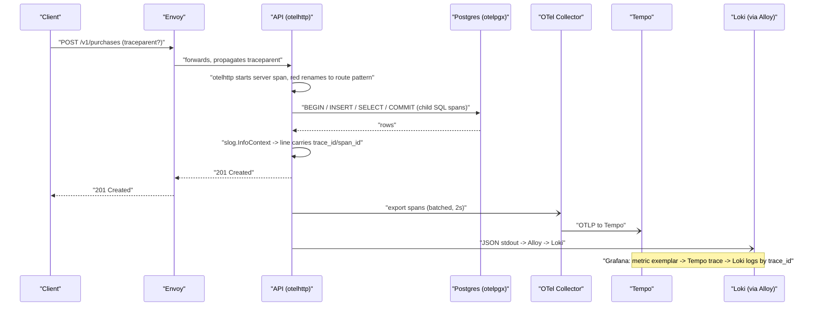
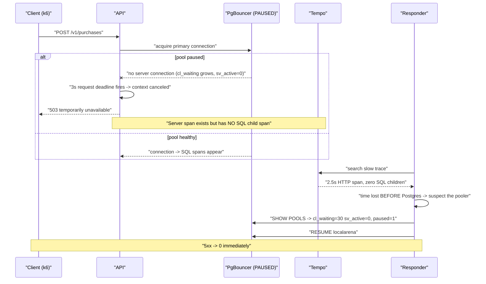

# ADR-0016 deep dive: Observability — traces, metrics, logs

## 1. TL;DR

- LocalArena ships all three observability pillars from one wiring: **OpenTelemetry traces** (OTLP/gRPC → Collector → Tempo), **Prometheus metrics** (pull/scrape, no collector hop), and **JSON `slog` logs** (Alloy → Loki).
- The design keeps **cardinality bounded**: metrics and Loki labels only carry low-cardinality values (route *pattern*, `service`, `level`, status `code` class); player IDs and raw paths go into span attributes and log lines, never labels.
- The three pillars are **cross-linked in Grafana**: a metric exemplar jumps to a Tempo trace, a trace jumps to its Loki logs (`tracesToLogsV2`), and a log line's `trace_id` jumps back to Tempo (derived field). This end-to-end correlation is what let the responder in [PM-001](../../postmortems/PM-001-pgbouncer-paused.md) rule out Postgres in under a minute.
- Tracing is **a no-op when `OTEL_EXPORTER_OTLP_ENDPOINT` is unset** — zero cost, so the same binary runs with or without a collector. Sampling is **parent-based** so a sampled request stays sampled across services.
- Everything is grounded by tests and a game-day experiment: `TestLogsCarryTraceIDs`, `TestREDRouteLabels`, and [Experiment 006](../../experiments/006-week6-observability/README.md).

## 2. Context and problem

By week 6 LocalArena had a stateless API behind Envoy, a PgBouncer-pooled
Postgres primary and replica, Valkey, a Kafka event backbone, Kafka Streams
processors, and a fixed-tick game server. When something broke, the only tools
were ad-hoc `docker compose logs` greps and a few bespoke counters. That is
*monitoring* a handful of known failure dashboards — it cannot answer the
"why is **this** request slow?" questions that appear during an incident.

The concrete pains the ADR had to solve:

1. **No request-level story.** A slow `POST /v1/purchases` touched the API,
   PgBouncer, Postgres (BEGIN/INSERT/SELECT/COMMIT), OPA and Valkey. There was
   no way to see where the time went.
2. **No log↔trace↔metric correlation.** Logs had no trace IDs, so a 5xx spike
   on a dashboard could not be tied to the exact failing request.
3. **Cardinality risk.** Naively labelling HTTP metrics by raw path
   (`/v1/players/8231742`) would explode Prometheus' time-series count — one
   series per player ID.
4. **Operability.** The lab runs on one machine; the observability stack must be
   cheap enough to run selectively, and must not become a new failure mode (a
   span burst must not OOM the collector).

The decision: adopt OpenTelemetry for traces, keep Prometheus pull-based for
metrics, use Loki for logs, and wire all three so one incident can be followed
metric → trace → SQL spans → logs.

## 3. HLD

Services emit traces over OTLP/gRPC to a Collector that batches and forwards to
Tempo. Prometheus scrapes each service's `/metrics` directly (pull), plus
exporters for Postgres, PgBouncer, Kafka and Envoy. Container stdout (JSON
`slog`) is tailed by Grafana Alloy off the Docker socket and pushed to Loki.
Grafana reads all three and provides the cross-links.

Key boundary decision: **metrics do not flow through the collector.** Prometheus
pulls directly so the `up` health signal and scrape timing stay native, and so a
collector outage never blinds metrics/alerting. Only traces take the collector
hop (where batching and the memory limiter are valuable).

## 4. LLD

### 4.1 Components and responsibilities

| Component | Responsibility | Where |
|---|---|---|
| `internal/obs.Setup` | Install global tracer provider + W3C propagator; no-op if no endpoint | `backend/internal/obs/obs.go` |
| `internal/obs.LogHandler` | Inject `trace_id`/`span_id` into every log record from the context span | `backend/internal/obs/obs.go` |
| `internal/obs.NewLogger` | JSON `slog` logger with a `service` field and trace correlation | `backend/internal/obs/obs.go` |
| `red` middleware | RED metrics labelled by matched route pattern; renames the otelhttp span | `backend/internal/api/api.go` |
| `patternRecorder` | Extracts the matched `ServeMux` pattern so nested muxes record the specific route | `backend/internal/api/api.go` |
| `telemetry` metrics | Game server histograms/counters (tick duration, lag, snapshots) | `backend/internal/telemetry/metrics.go` |
| OTel Collector | memory-limited, batched OTLP trace pipeline → Tempo | `infra/observability/otel-collector.yaml` |
| Tempo / Loki | Trace / log stores (local disk, lab retention) | `infra/observability/tempo.yaml`, `loki.yaml` |
| Alloy | Tail Docker logs, parse JSON, push to Loki with 2 labels | `infra/observability/alloy.alloy` |
| Prometheus | Pull metrics, evaluate rules | `infra/observability/prometheus.yml` |
| Grafana provisioning | Datasources + cross-links + the overview dashboard | `infra/observability/grafana/dashboards/localarena-overview.json` |

### 4.2 Data structures, config values (exact)

**Tracer provider** (`obs.go`):

- Propagator: `TraceContext` (W3C `traceparent`) + `Baggage`.
- Exporter: OTLP/gRPC, endpoint from `OTEL_EXPORTER_OTLP_ENDPOINT` (compose default `http://otel-collector:4317`).
- Batcher: `WithBatchTimeout(2s)`, `WithMaxQueueSize(4096)`.
- Sampler: `ParentBased(TraceIDRatioBased(ratio))`, `ratio` from `TRACE_SAMPLE_RATIO`, default **1.0** (lab).
- Resource attributes: `service.name` = service, `service.instance.id` = hostname.

**RED metrics** (`api.go`):

- `localarena_http_requests_total{route,method,code}` — counter. `code` is the status *class* (`strconv.Itoa(rec.code/100)+"xx"`), e.g. `2xx`, `5xx`.
- `localarena_http_request_duration_seconds{route,method}` — histogram.
  Buckets: `[.001, .0025, .005, .01, .025, .05, .1, .2, .3, .5, 1, 2.5, 5]`.
  Note `.3` is an explicit bucket — it is the latency SLO threshold (used by ADR-0017's `le="0.3"` rule).

**Game-server metrics** (`telemetry/metrics.go`):

- `localarena_tick_duration_seconds` histogram, buckets `[.00005 .. .05, .1]` — `.05` is the tick SLO budget.
- `localarena_tick_start_lag_seconds` histogram (scheduler starvation signal).
- Counters/gauges: `ticks_total`, `tick_overruns_total`, `ticks_missed_total`, `matches`, `players`, `ws_connections`, `ws_{sent,received}_bytes_total`, `inputs_total{result}`, `snapshots_total{result}`, `disconnects_total{reason}`.
- Pre-resolved label children (`InputApplied`, `SnapshotLagged`, …) keep the hot path allocation-free.

**OTel Collector** (`otel-collector.yaml`):

- `memory_limiter`: `check_interval: 1s`, `limit_mib: 200`, `spike_limit_mib: 50` — **first** processor so a span burst sheds load before OOM.
- `batch`: `timeout: 2s`, `send_batch_size: 1024`.
- Receivers: OTLP gRPC `:4317`, HTTP `:4318`. Exporter: `tempo:4317` (insecure). Own metrics exposed on `:8888`.

**Tempo** (`tempo.yaml`): local backend, WAL under `/var/tempo/wal`, `block_retention: 24h`.

**Loki** (`loki.yaml`): filesystem, `replication_factor: 1`, schema `v13`/`tsdb`, `retention_period: 72h`, `allow_structured_metadata: true`.

**Alloy** (`alloy.alloy`): `discovery.docker` filtered to `com.docker.compose.project=localarena`; `loki.process.json` extracts `level` and `service`; `stage.labels` promotes **only** those two to labels; push to `http://loki:3100/loki/api/v1/push`.

**Prometheus** (`prometheus.yml`): `scrape_interval: 5s`, `evaluation_interval: 5s`. Jobs: `gameserver:8080`, `api` via `dns_sd_configs` (one target per replica), `envoy:9901/stats/prometheus`, `rewards:9102`, `postgres-exporter:9187`, `kafka-exporter:9308`, `pgbouncer-exporter:9127`, `otel-collector:8888`.

**Grafana datasources** (`ds.yaml`):

- Prometheus `exemplarTraceIdDestinations: [{name: trace_id, datasourceUid: tempo}]` — metric exemplar → trace.
- Tempo `tracesToLogsV2: {datasourceUid: loki, filterByTraceID: true, spanStartTimeShift: -5m, spanEndTimeShift: 5m}` and `serviceMap: {datasourceUid: prometheus}` — trace → logs, and a service map.
- Loki `derivedFields: [{name: trace_id, matcherRegex: '"trace_id":"(\w+)"', datasourceUid: tempo}]` — log → trace.

### 4.3 Algorithms, step by step

**Route-pattern labelling (bounded cardinality).** Go's `http.ServeMux` can tell
you the matched pattern, but LocalArena nests an outer mux (`/v1/...`,
`/v2/...`, `/metrics`) around inner sub-muxes. A naive read matches the outer
`/v1/` catch-all. The fix:

1. `red` creates a `routeHolder{}` and stores a pointer to it in the request context.
2. `patternRecorder` wraps *each* mux; after `mux.Handler(r)` returns the pattern, it writes that pattern into the `routeHolder`. Because the inner mux runs last, it **overwrites** with the more specific pattern (e.g. `GET /v1/players/{id}`).
3. After `next.ServeHTTP`, `red` reads `rh.route` (or `"unmatched"`), uses it as the metric label **and** renames the otelhttp server span to it.
4. `TestREDRouteLabels` asserts the exposed series contain `route="GET /v1/players/{id}"` and `route="unmatched"` — never a raw path.

**Trace→log correlation.** `LogHandler.Handle` reads
`trace.SpanContextFromContext(ctx)`; if valid, it adds `trace_id` and `span_id`
string attributes to the record. So any `log.InfoContext(ctx, ...)` inside a
span is automatically correlated. `TestLogsCarryTraceIDs` verifies both the
positive (ID present under a span) and negative (no `trace_id` without a span)
cases.

**Sampling.** `ParentBased(TraceIDRatioBased(ratio))`: if an incoming request
carries a `traceparent` with a sampling decision, that decision is honoured
(so a trace is complete across services); only *new roots* are sampled at
`ratio`. In the lab `ratio=1.0`, so everything is captured.

## 5. Sequence diagrams

### 5.1 Happy path: a purchase traced end-to-end and correlated to logs

### 5.2 Failure/edge path: slow request with no SQL child span (PM-001)

## 6. Concepts explained

### Monitoring vs observability

- **What it is.** *Monitoring* answers predefined questions ("is error rate > X?") from dashboards and alerts you built in advance. *Observability* is the property that lets you ask **new** questions about internal state from external outputs — pivoting from a symptom to an arbitrary cause without shipping new code.
- **Why LocalArena uses it.** The known dashboards (RED, tick budget) are monitoring; the ability to pivot from a 5xx spike → a specific trace → "no SQL span" → the pooler is observability. PM-001 was diagnosed by asking a question nobody had pre-built an alert for.
- **Measured.** In PM-001 the responder went from "start of diagnosis" to "cause identified" in **1 m 6 s** using telemetry alone.
- **Where else.** Payments platforms pivoting from a settlement-failure alert to the exact gateway call; e-commerce tracing a checkout timeout to a recommendation sidecar; ride-hailing correlating a surge-pricing bug to one region's pricing service; SaaS debugging a tenant-specific slowdown.

### The three pillars (metrics, traces, logs)

- **What it is.** Metrics = cheap aggregated numbers over time (counters, histograms). Traces = the causal tree of one request across services. Logs = discrete timestamped events, often with rich context.
- **Why LocalArena uses it.** Each answers a different question: metrics say *how much/how often* and drive alerts; traces say *where the time went* in one request; logs say *exactly what happened* with the error text. The value is in correlating them.
- **Measured.** Experiment 006 captured all three: RED metrics per route, a purchase trace with `BEGIN→INSERT→SELECT→COMMIT→SELECT` SQL spans, and logs carrying `trace_id`.
- **Where else.** Any microservice platform (banking, social feeds, IoT ingest) uses the same triad; the labels and span names differ, the pattern does not.

### OpenTelemetry (OTel)

- **What it is.** A vendor-neutral standard + SDKs for generating and exporting telemetry (traces/metrics/logs) over OTLP. Instrumentation libraries (otelhttp, otelpgx) emit spans automatically.
- **Why LocalArena uses it.** One SDK produces spans for HTTP (otelhttp) and SQL (otelpgx) with no backend lock-in; swapping Tempo for Jaeger would not touch app code.
- **Measured.** otelpgx produced a span per SQL statement in the purchase trace (Experiment 006). Versions pinned: OTel Go 1.47, otelhttp 0.72, otelpgx 0.13.
- **Where else.** Widely adopted across fintech, e-commerce, and observability vendors precisely because it avoids proprietary agents.

### Spans and context propagation (W3C `traceparent`)

- **What it is.** A *span* is one timed operation with attributes and parent/child links. *Context propagation* carries the trace ID and sampling flag across process boundaries — the W3C `traceparent` HTTP header (`version-traceid-spanid-flags`).
- **Why LocalArena uses it.** Envoy and clients pass `traceparent`; the API extracts it (otelhttp) and the game server explicitly does `propagator.Extract` before starting the `ws.join` span, so a browser→Envoy→API→Postgres path is one trace.
- **Measured.** The `ws.join` span is created in `server/ws.go`; the purchase server span renamed to the route pattern in `api.go`. Not measured: cross-service propagation latency.
- **Where else.** Any distributed system passing `traceparent` through its gateway: payment orchestration, order pipelines, ad-serving, IoT command fan-out.

### Sampling (parent-based, ratio)

- **What it is.** Deciding which traces to keep. *Head* sampling decides at the root; *parent-based* honours the upstream decision so a trace is all-or-nothing across services; ratio sampling keeps a fraction of new roots.
- **Why LocalArena uses it.** `ParentBased(TraceIDRatioBased(ratio))` guarantees complete traces. The lab uses `ratio=1.0`; production would lower it to control cost.
- **Measured.** `TRACE_SAMPLE_RATIO` default 1.0 (`obs.go`). Not measured: trace volume at lower ratios.
- **Where else.** High-traffic APIs sample at 1–10%; payment flows often keep 100% of error traces (tail sampling) and sample successes.

### RED and USE metrics

- **What it is.** **RED** = Rate, Errors, Duration — the per-request view of a service. **USE** = Utilization, Saturation, Errors — the resource view (CPU, pool, disk).
- **Why LocalArena uses it.** RED (`localarena_http_requests_total`, `..._duration_seconds`) drives the API SLOs; USE-style signals (DB pool busy, spool bytes, replica lag) drive cause alerts and the overview dashboard.
- **Measured.** RED per route in Experiment 006; `localarena_db_pool_acquired_conns / _max_conns` powers `LocalArenaDBPoolSaturated` (fired at 18:28:53 in PM-001).
- **Where else.** RED for any request/response service (checkout, auth, search); USE for databases, queues, disks, thread pools in banking and IoT backends.

### Cardinality

- **What it is.** The number of distinct label combinations, i.e. the number of time series. It grows multiplicatively with label values; unbounded labels (user IDs, URLs) kill a TSDB.
- **Why LocalArena uses (bounds) it.** Metrics are labelled by route *pattern* not raw path, and by status *class* not exact code; Loki labels are only `service` and `level`. High-cardinality data lives in span attributes and log lines.
- **Measured.** `TestREDRouteLabels` proves raw paths never become labels. A finding in Experiment 006: route names first all read `/v1/` because the outer mux matched — fixed to the innermost pattern.
- **Where else.** Every large Prometheus/Datadog deployment fights cardinality: e-commerce (don't label by SKU), social (don't label by user), IoT (don't label by device ID).

### Histograms and quantiles

- **What it is.** A histogram buckets observations by threshold (`le`); `histogram_quantile()` estimates p50/p99 from bucket counts. Quantiles describe tail behaviour that averages hide.
- **Why LocalArena uses it.** Latency and tick-duration histograms let the SLO rules compute "fraction over the threshold" directly (count in `le=0.3` / total) and the dashboard compute p99 per route.
- **Measured.** `route:api_latency:p99_5m` recording rule uses `histogram_quantile(0.99, ...)`. The `.3` and `.05` buckets are chosen to match the SLO thresholds exactly.
- **Where else.** Latency SLOs everywhere (CDNs, payment APIs, databases). Quantile estimates are approximate — accuracy depends on bucket layout, which is why thresholds get explicit buckets.

### Structured logs and trace correlation

- **What it is.** Logs as machine-parseable JSON (key/value) rather than free text, carrying IDs that tie them to a trace.
- **Why LocalArena uses it.** `slog` JSON + `LogHandler` injecting `trace_id`/`span_id` means Grafana's Loki→Tempo derived field turns any error line into a one-click jump to the full trace.
- **Measured.** `TestLogsCarryTraceIDs` asserts the IDs appear under a span and are absent without one. In PM-001, Loki showed "200 `context canceled` errors, no SQL errors."
- **Where else.** Fraud investigation (pivot from a flagged log to the request trace), support tooling (find a customer's failed request), compliance audit trails.

### Pull vs push metrics; exporters

- **What it is.** *Pull* (Prometheus scrapes `/metrics`) gives a free liveness signal (`up`) and central scrape control; *push* sends metrics to a collector. *Exporters* translate a system's native stats into Prometheus format.
- **Why LocalArena uses pull.** Metrics bypass the collector so a collector outage never blinds alerting, and `up==0` powers `LocalArenaTargetDown`. Exporters cover Postgres, PgBouncer (added after PM-001), Kafka, Envoy.
- **Measured.** `scrape_interval: 5s`. The PgBouncer exporter was the key PM-001 action item (the missing cause signal).
- **Where else.** Prometheus-based stacks across industries; push (OTLP remote write, StatsD) is common for short-lived jobs and serverless.

### Memory limiter / backpressure in the collector

- **What it is.** A processor that sheds or refuses data when memory crosses a limit, so the telemetry pipeline fails safe instead of OOMing.
- **Why LocalArena uses it.** On one machine, a span burst from a load test could crash the collector and take down tracing. `memory_limiter` is the first processor so it protects the batcher.
- **Measured.** `limit_mib: 200`, `spike_limit_mib: 50`, `check_interval: 1s`. Not measured: a burst large enough to trip it.
- **Where else.** Any high-throughput ingestion pipeline (log shippers, metrics gateways, Kafka producers) needs backpressure to avoid cascading OOMs.

### Grafana cross-linking (exemplars, tracesToLogs, derived fields)

- **What it is.** Datasource glue that turns one signal into a jump to another: *exemplars* attach a trace ID to a histogram bucket sample; *tracesToLogs* opens the logs for a trace's time window; *derived fields* parse a trace ID out of a log line.
- **Why LocalArena uses it.** It makes the "metric → trace → logs → trace" loop a few clicks, which is the whole point of correlation.
- **Measured.** Provisioned in `ds.yaml`; used in PM-001's diagnosis path. Not measured numerically.
- **Where else.** Standard in modern SRE tooling across any domain running Grafana/Tempo/Loki.

## 7. Code pointers

| Path (symbol / key) | What to look at |
|---|---|
| `backend/internal/obs/obs.go` (`Setup`) | Tracer provider, W3C propagator, no-op without endpoint, parent-based sampler, batcher sizes |
| `backend/internal/obs/obs.go` (`LogHandler.Handle`) | Trace-ID injection into `slog` records |
| `backend/internal/obs/obs.go` (`NewLogger`) | JSON logger with `service` field |
| `backend/internal/obs/obs_test.go` (`TestLogsCarryTraceIDs`) | Positive/negative correlation test |
| `backend/internal/api/api.go` (`red`, `patternRecorder`, `routeHolder`) | RED metrics, bounded-cardinality route label, span rename |
| `backend/internal/api/api.go` (`httpRequests`, `httpDuration`) | Metric names, labels, latency buckets incl. `.3` |
| `backend/internal/api/v2_test.go` (`TestREDRouteLabels`) | Proves raw paths never become labels |
| `backend/internal/telemetry/metrics.go` (`TickDuration`, `TickLag`) | Game-server histograms incl. the `.05` tick bucket |
| `backend/internal/server/ws.go` (`serveWS`, `tracer`) | `ws.join` span + explicit propagator extract |
| `backend/cmd/api/main.go` (`otelhttp.NewHandler`) | Server span per request, renamed in `red` |
| `infra/observability/otel-collector.yaml` | memory_limiter + batch + Tempo exporter |
| `infra/observability/tempo.yaml` / `loki.yaml` | Local stores, retention 24h / 72h |
| `infra/observability/alloy.alloy` | Docker tail, JSON parse, 2-label push |
| `infra/observability/prometheus.yml` | Scrape jobs, 5s interval, DNS SD for API replicas |
| `infra/observability/grafana/provisioning/datasources/ds.yaml` | Exemplars, tracesToLogsV2, derived fields |
| `infra/observability/grafana/dashboards/localarena-overview.json` | SLO/RED/game/events/DB panels |
| `compose.yaml` (lines ~458–526) | `observability` profile services and ports |

## 8. Trade-offs and alternatives

| Option | Pros | Cons | Why (not) chosen |
|---|---|---|---|
| Metrics via collector (OTLP → Prometheus remote write) | One pipeline for all signals | Loses native pull `up` health; extra hop; collector outage blinds metrics | **Rejected** — kept Prometheus pull for health + alert independence |
| ELK/Elasticsearch for logs | Powerful full-text search, mature | Heavy (JVM, indexing cost); different mental model from Prometheus labels | **Rejected** — Loki's label model fits Prometheus habits and is lighter on one host |
| Jaeger instead of Tempo | Mature trace UI, rich search | Separate storage; Grafana integration less seamless | **Not chosen** — Tempo integrates natively with Grafana/exemplars |
| No sampling (keep everything) | Complete traces always | Unbounded cost at scale | **Chosen for lab** (`ratio=1.0`), with `TRACE_SAMPLE_RATIO` knob for production |
| Label metrics by raw path/user ID | Richer breakdowns | Cardinality explosion, TSDB meltdown | **Rejected** — pattern/class labels only; detail goes to spans/logs |
| Push collector for metrics from short jobs | Works for serverless | Not needed; services are long-lived | Deferred (week 8 Knative is the only short-job case) |

## 9. Failure modes and how they were found

- **No request-level visibility / no correlation** → solved and then *proven* under fire in [PM-001](../../postmortems/PM-001-pgbouncer-paused.md): the "slow trace with no SQL child span" signal is only possible because otelpgx emits SQL spans and the server span exists even on failure.
- **Route labels all read `/v1/`** (outer mux matched the versioned sub-mux) → found in [Experiment 006](../../experiments/006-week6-observability/README.md) "Findings fixed"; fixed by `patternRecorder` taking the innermost pattern; regression-guarded by `TestREDRouteLabels`.
- **Error-ratio recording rules returned no data (not 0) with zero errors** → found in Experiment 006; fixed with `or vector(0)` (this is really an ADR-0017 alerting bug but surfaced through the observability pipeline).
- **Config drift with current versions** (Tempo 3 moved retention to `backend_worker`; postgres-exporter renamed `replication_slot(s)`; collector needs an explicit Prometheus reader) → found while bringing the stack up in Experiment 006.
- **Missing PgBouncer metrics** → the decisive cause signal in PM-001 came from an interactive `SHOW POOLS`; action item added `pgbouncer-exporter`.

## 10. Interview questions

**Q1 (beginner). What are the three pillars of observability and what question does each answer?**
Metrics (aggregated numbers over time) answer "how much / how often" and drive alerts; traces (causal tree of one request) answer "where did the time go"; logs (discrete events) answer "exactly what happened". Their power is correlation — pivoting between them.

**Q2 (beginner). Why is labelling an HTTP metric by the raw URL path dangerous?**
Each distinct path becomes a new time series (cardinality). `/v1/players/8231742` for every player ID would create millions of series and overwhelm Prometheus' memory and query engine. LocalArena labels by the matched *route pattern* (`GET /v1/players/{id}`) instead.

**Q3 (beginner). What is a `traceparent` header and why does it matter?**
It is the W3C header carrying `version-traceid-spanid-flags`. Propagating it across service calls is what stitches independent spans into one trace, so you can follow a request from Envoy through the API into Postgres.

**Q4 (intermediate). Why does LocalArena scrape metrics with Prometheus instead of routing them through the OTel Collector?**
Pull keeps the native `up` health signal (powering `TargetDown`), gives Prometheus central scrape control, and — crucially — decouples metrics/alerting from the collector so a collector outage cannot blind alerts. Only traces, where batching and the memory limiter add value, take the collector hop.

**Q5 (intermediate). How are logs correlated with traces here, in both directions?**
`obs.LogHandler` reads the span context from `ctx` and adds `trace_id`/`span_id` to every JSON log line. Grafana's Loki datasource has a derived field that parses `trace_id` and links to Tempo (log→trace); Tempo's `tracesToLogsV2` opens the logs for a trace's window (trace→log); Prometheus exemplars link a histogram sample to its trace (metric→trace).

**Q6 (intermediate). What is parent-based sampling and why use it?**
The sampling decision is taken once at the trace root and propagated; downstream services honour it. This guarantees a trace is captured all-or-nothing across services (no half-traces). Ratio sampling only applies to new roots. LocalArena uses `ratio=1.0` in the lab.

**Q7 (intermediate). Why is `memory_limiter` the first processor in the collector pipeline?**
So it can shed/refuse incoming spans *before* they reach the batcher and accumulate in memory. On a single host a load-test span burst could OOM the collector and take down tracing; the limiter (200 MiB, 50 MiB spike) fails safe instead.

**Q8 (intermediate). The collector adds a 2s batch timeout. What's the trade-off?**
Batching reduces network overhead and export calls, but adds up to ~2s of latency before spans are queryable in Tempo. Acceptable for post-hoc debugging; not acceptable if you needed sub-second trace availability (you'd lower the timeout at a throughput cost).

**Q9 (senior). In PM-001 the decisive clue was a slow trace with no SQL child span. Explain why that uniquely pointed at the pooler.**
otelpgx emits a span per SQL statement, so a request that reaches Postgres always has SQL children. A 2.5s server span with zero SQL children means the time was spent *before* any query — the request was blocked acquiring a connection from PgBouncer (paused, `cl_waiting=30, sv_active=0`). The absence of a signal was the signal.

**Q10 (senior). How do histogram buckets interact with SLOs here?**
SLOs are defined as "fraction over threshold". LocalArena puts explicit buckets at the SLO thresholds (`.3`s for latency, `.05`s for ticks) so the rule can compute `1 - count(le=0.3)/count` exactly at the boundary. If the bucket didn't align with the threshold, `histogram_quantile` interpolation would make the SLI approximate.

**Q11 (senior). Why keep high-cardinality data (player IDs, raw paths) out of metrics and Loki labels but allow it in span attributes and log lines?**
Metric labels and Loki stream labels are indexed and multiply into series/streams — high cardinality destroys them. Span attributes and log *content* are not indexed as dimensions; they're stored per-event and searched on demand. So you get the detail where it's cheap and keep the aggregates bounded.

**Q12 (senior). The same binary runs with tracing on or off. How, and why is that valuable?**
`obs.Setup` returns a no-op flush and installs nothing but the propagator when `OTEL_EXPORTER_OTLP_ENDPOINT` is unset, so there is zero runtime cost and no dependency on a collector. Value: identical artifacts across environments, graceful operation when the collector is down, and cheap local dev.

**Q13 (senior, design). Design observability for 100x this traffic. What changes?**
Lower `TRACE_SAMPLE_RATIO` (e.g. 1–5%) and add *tail* sampling to keep all error/slow traces; move Tempo/Loki to object storage (S3) with horizontal query frontends; shard Prometheus or move to a remote-write backend (Mimir/Thanos/Cortex) with downsampling; add recording rules to pre-aggregate hot dashboards; aggressively audit label cardinality; run the collector as a horizontally-scaled gateway with the memory limiter tuned. Keep pull-based `up` locally per shard.

**Q14 (senior, design). You must debug a problem that only happens for 0.1% of requests, and you sample traces at 1%. How?**
Head sampling at 1% will usually miss the rare case. Switch to tail-based sampling (decide after seeing the whole trace) keyed on error status, high latency, or a specific attribute; or add targeted 100% sampling for the suspect route/tenant via a sampler rule; or rely on exemplars from the histogram bucket that captures the slow tail to find a real example. Always keep 100% of error traces.

**Q15 (intermediate). What's the difference between monitoring and observability, concretely in this repo?**
The RED/tick dashboards and burn-rate alerts are monitoring — pre-built answers to known questions. Observability is the capacity, demonstrated in PM-001, to answer an unplanned question ("why is this request slow with no DB involvement?") by pivoting metric→trace→logs without deploying new instrumentation.
