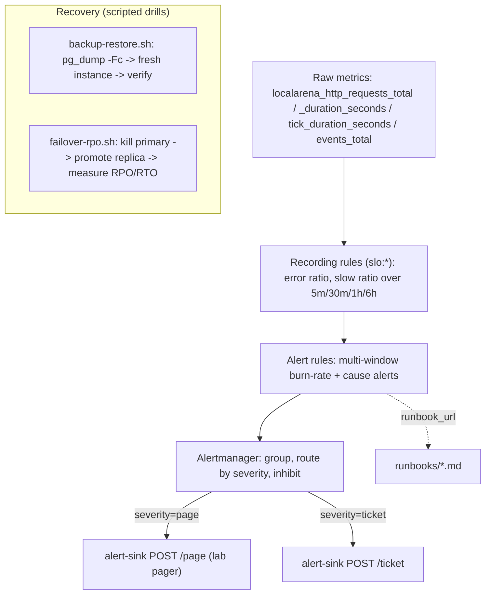
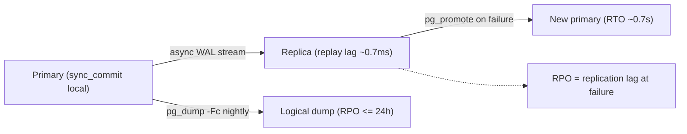
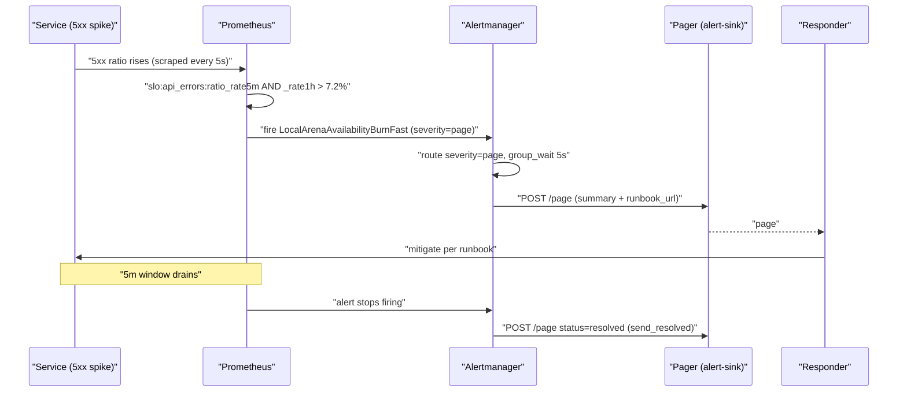
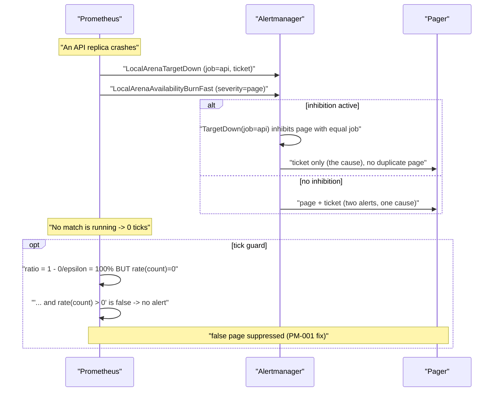

# ADR-0017 deep dive: SLOs, burn-rate alerting, backup and failover

## 1. TL;DR

- LocalArena defines **four 30-day SLOs** — API availability 99.5% non-5xx, API latency 99% < 300 ms, game ticks 99.9% < 50 ms, durable events 99% delivered — recorded as `slo:*` rules in Prometheus.
- Alerts use the **Google SRE multi-window multi-burn-rate** pattern: **page** when both the 1 h and 5 m burn rates exceed **14.4×** (2% of budget in 1 h), **ticket** when both the 6 h and 30 m rates exceed **6×** (5% in 6 h). The short window makes a page auto-resolve soon after a fix.
- Every alert carries a `runbook_url`; rules are **unit-tested with `promtool test rules`**, including the two regression tests "healthy traffic does not page" and "no traffic (no matches) does not page" — the latter guards the exact false page seen in [PM-001](../../postmortems/PM-001-pgbouncer-paused.md).
- Alertmanager **routes `page` and `ticket` separately** and **inhibits** SLO pages while a scrape target is down (one cause, one page).
- **Recovery was measured, not assumed:** `pg_dump -Fc` backs up 1.8 MB in **0.49 s while 300 writes ran** and restores to a fresh instance in **0.61 s** with verified integrity; async-replica promotion gives **RTO ≈ 0.7 s** and **RPO = replication lag** (0 writes lost when healthy, **139 of 278 / 2.78 s** after a 5 s partition). See [Experiment 006](../../experiments/006-week6-observability/README.md).

## 2. Context and problem

ADR-0016 gave LocalArena the signals. This ADR decides **what "good enough" means
numerically** and **when a human should be woken up** — plus whether the system
can actually be recovered when it isn't good enough.

The problems:

1. **No target.** Without an SLO, "is latency OK?" is a matter of opinion. The
   team needed explicit, measurable objectives tied to the signals.
2. **Alert quality.** Naive threshold alerts (e.g. "error rate > 1%") either page
   on every blip (noise) or react too slowly (miss short outages). The team
   wanted alerts that fire fast on real budget burn and self-resolve.
3. **False pages are expensive.** PM-001 showed a tick-budget alert paging when
   *no match was running* (zero ticks evaluated the SLI to 100% bad). A false
   page during a real incident costs attention when it's scarcest.
4. **Recovery was untested.** "We have backups" and "we have a replica" are
   claims, not evidence. The ADR commits to *drills* that measure RPO/RTO and
   verify a restore.

## 3. HLD

Recording rules turn raw RED/tick/event metrics into SLI ratios over several
windows. Alert rules compare short+long windows against burn-rate thresholds and
emit `severity: page|ticket` with a `runbook_url`. Alertmanager groups, routes
by severity, inhibits redundant pages, and webhooks the lab pager (`alert-sink`).
Recovery is handled out-of-band by scripted drills.





## 4. LLD

### 4.1 Components and responsibilities

| Component | Responsibility | Where |
|---|---|---|
| `slo-sli` rule group | Recording rules computing SLI ratios per window | `infra/observability/rules/slo.yml` |
| `slo-alerts` rule group | Multi-window burn-rate page/ticket alerts | `infra/observability/rules/slo.yml` |
| `causes` rule group | Cause alerts (target down, pool, lag, PgBouncer, consumer lag) | `infra/observability/rules/slo.yml` |
| `slo_test.yml` | `promtool` unit tests incl. two PM regressions | `infra/observability/rules-tests/slo_test.yml` |
| Alertmanager config | Routing by severity, grouping, inhibition | `infra/observability/alertmanager.yml` |
| `alert-sink` | Lab pager: `/page`, `/ticket`, `GET /alerts` | `backend/cmd/alertsink/main.go` |
| Runbooks | symptom → check → mitigate → verify → follow up | `runbooks/*.md` |
| `backup-restore.sh` | Online dump, restore to fresh instance, integrity verify | `experiments/006-week6-observability/` |
| `failover-rpo.sh` | Kill primary, promote replica, measure RPO/RTO | `experiments/006-week6-observability/` |
| `incident.sh` | Inject one hidden fault, seal the answer | `experiments/006-week6-observability/` |

### 4.2 SLOs, SLIs and the burn-rate math (exact numbers)

**SLO targets (30 d), from `slo.yml` header and the README:**

| SLO | Target | Error budget | SLI expression (source) |
|---|---|---|---|
| Availability | 99.5% non-5xx | 0.5% | `5xx_rate / all_rate` |
| Latency | 99% < 300 ms | 1% | `1 - count(le=0.3)/count` |
| Ticks | 99.9% < 50 ms | 0.1% | `1 - count(le=0.05)/count` |
| Durable events | 99% delivered | 1% | `dropped|failed / queued` |

**Recording rules** (availability shown; others analogous):

- `slo:api_errors:ratio_rate5m|30m|1h|6h` = `5xx rate / clamp_min(all rate, 1e-9)`.
- Numerator wrapped in `(... or vector(0))` so a missing 5xx series reads as **0, not no-data** (Experiment 006 finding #3).
- `clamp_min(..., 1e-9)` prevents divide-by-zero when traffic is zero.
- `slo:api_slow:ratio_rate5m|1h` = `1 - rate(bucket{le="0.3"}) / clamp_min(rate(count), 1e-9)`.
- `slo:ticks_slow:ratio_rate5m|1h` = `1 - rate(bucket{le="0.05"}) / clamp_min(rate(count), 1e-9)`.
- `slo:events_dropped:ratio_rate5m` = `dropped|failed / clamp_min(queued, 1e-9)`.
- `route:api_latency:p99_5m` = `histogram_quantile(0.99, sum by (le, route) (...))` (dashboard).
- `slo:error_budget_remaining:avail_30d` = `1 - (5xx_increase_30d / all_increase_30d) / 0.005`.

**Burn-rate thresholds** (an SLI value, not a count):

- Page (fast): `ratio_rate1h > 14.4 * budget` **AND** `ratio_rate5m > 14.4 * budget`.
- Ticket (slow): `ratio_rate6h > 6 * budget` **AND** `ratio_rate30m > 6 * budget`.
- Applied per SLO with its own budget: availability `14.4 * 0.005 = 0.072` (7.2%), latency `14.4 * 0.01 = 0.144` (14.4%), ticks `14.4 * 0.001 = 0.0144` (1.44%).
- **14.4×** means burning 2% of a 30-day budget in 1 h; **6×** means 5% in 6 h.
- The **AND of two windows** is the trick: the long window confirms sustained burn (no flapping), the short window makes the alert *clear* fast once fixed. (In PM-001 the fast page cleared 4 m 54 s after mitigation — one 5 m window.)

**The PM-001 guard (tick alert):**

```
slo:ticks_slow:ratio_rate5m > (14.4*0.001)
  and slo:ticks_slow:ratio_rate1h > (14.4*0.001)
  and sum(rate(localarena_tick_duration_seconds_count[5m])) > 0
```

The last conjunct is the fix: with zero ticks, `1 - 0/ε = 100%` and the alert
paged falsely during PM-001. The regression test "no ticks … must not page"
locks this in.

**Cause alerts** (tickets unless noted):

- `LocalArenaTargetDown`: `up == 0` for 30s.
- `LocalArenaEventSpoolGrowing`: `events_spool_bytes > 1e6` for 2m.
- `LocalArenaPostgresReplicaLag`: `pg_replication_lag_seconds > 30` for 1m.
- `LocalArenaReplicationSlotRetainingWAL`: slot WAL diff `> 1e9` (1 GB) for 5m.
- `LocalArenaPgBouncerClientsWaiting` **(page, PM-001)**: `client_waiting > 5 and server_active == 0` for 30s.
- `LocalArenaConsumerLagGrowing` **(page, PM-002)**: group lag `> 500` and `deriv(... [2m]) > 0` for 1m.
- `LocalArenaNoRewardsGranted` (ticket, PM-002): events delivered but 0 rewards in 15m.
- `LocalArenaDBPoolSaturated`: `acquired/max > 0.9` for 1m.

### 4.3 Alertmanager routing (exact)

- Default receiver `ticket`; `group_by: [alertname, slo]`; `group_wait: 10s`, `group_interval: 1m`, `repeat_interval: 4h`.
- Sub-route `severity="page"` → receiver `page`, `group_wait: 5s` (pages leave faster).
- Receivers `page`/`ticket` webhook into `http://alert-sink:9095/{page,ticket}` with `send_resolved: true`.
- **Inhibit rule:** `source alertname=LocalArenaTargetDown` suppresses any `severity=page` with the same `job` — a dead replica explains SLO burn, so don't page twice for one cause.

### 4.4 Recovery posture (exact measured values)

**Backup** (`backup-restore.sh`, `results/backup-restore.txt`): logical `pg_dump -Fc` (custom format, compressed, consistent online snapshot).

- Dump: **1.8 MB in 0.49 s** taken *while 300 writes ran* (MVCC snapshot isolation → consistent).
- Restore into a **fresh Postgres 18.6** container: **0.61 s**.
- Integrity on the restored copy: players 1020, purchases 1197, credits sum 999 929 690, inventory 1197, match_players 200 000, outbox 1656, migrations **version 12**, 5 partitions, **0 unvalidated constraints, 0 negative balances**. App smoke: the `migrate` binary reads schema version 12.
- RPO of nightly logical dumps: **up to 24 h**. Lower RPO needs WAL archiving / CNPG (planned).

**Failover** (`failover-rpo.sh`): `kill -9` the primary, `pg_promote()` the async replica.

| Run | Replica state | RPO (acked writes lost) | RTO (promote / first write) |
|---|---|---:|---|
| healthy | streaming, replay lag 0.672 ms | **0 of 143** (0 s) | 0.46 s / 0.71 s |
| partitioned 5 s | cut off for 5 s | **139 of 278 (2.78 s)** | 0.55 s / 0.70 s |

RPO is a property of replication state, not the tooling — hence the
`LocalArenaPostgresReplicaLag` alert. Zero-RPO credits would need
`synchronous_commit = remote_apply` with a quorum standby, trading write latency
and availability-when-standby-down.

## 5. Sequence diagrams

### 5.1 Happy path: a short outage pages, is fixed, and auto-resolves



### 5.2 Failure/edge path: a dead replica should not double-page; zero ticks must not false-page



## 6. Concepts explained

### SLI, SLO, error budget

- **What it is.** An **SLI** is a measured ratio of good events to valid events (e.g. non-5xx / all). An **SLO** is the target for that SLI over a window (99.5% / 30 d). The **error budget** is `1 - SLO` — the allowed amount of badness (0.5%).
- **Why LocalArena uses it.** It turns "is the API healthy?" into arithmetic and makes alerting a question of *budget burn*, not raw thresholds. The budget is also a release-risk signal (follow-up postmortem if > 5% consumed).
- **Measured.** Four SLOs in `slo.yml`; `slo:error_budget_remaining:avail_30d` tracks the availability budget. PM-001 noted the lab's short history makes 30 d budget numbers not yet meaningful.
- **Where else.** Cloud SLAs, payment-processor uptime commitments, e-commerce checkout availability, streaming QoE targets.

### Multi-window multi-burn-rate alerting

- **What it is.** Alert on the *rate of budget consumption* over two windows at once: a long window (sustained problem) ANDed with a short window (still happening). Different burn multipliers map to different severities.
- **Why LocalArena uses it.** A single threshold either flaps or lags. 14.4× over 1 h+5 m pages on a fast burn and clears within ~5 m of a fix; 6× over 6 h+30 m tickets on a slow leak.
- **Measured.** In PM-001 the fast page fired at 18:28:11 (~100 s after fault) and resolved at 18:35:11 (~5 m after `RESUME`). `promtool` test "10% errors for an hour pages; 0.1% does not" asserts the boundary.
- **Where else.** Google's SRE workbook pattern is used across SaaS, fintech, and large web properties for availability/latency SLOs.

### Burn rate (14.4× / 6×)

- **What it is.** How many times faster than "sustainable" you're spending budget. 1× burns the whole budget exactly over the window; 14.4× burns 2% of a 30 d budget in 1 h.
- **Why LocalArena uses it.** The multiplier encodes urgency: fast burn = page, slow burn = ticket. Thresholds are `multiplier * budget` applied to the SLI ratio.
- **Measured.** Availability page threshold `14.4*0.005=7.2%`; the PM-001 page summary read "7.658% 5xx over 1 h".
- **Where else.** Any error-budget-based alerting; the exact multipliers come from the SRE workbook's recommended table.

### Alert testing (`promtool test rules`)

- **What it is.** Unit tests that feed synthetic time series into the rules and assert which alerts fire.
- **Why LocalArena uses it.** Alerting logic is code; regressions (false pages) are bugs. Tests encode "healthy doesn't page", "no traffic doesn't page", "paused PgBouncer pages on the cause", "stopped processor pages on growing lag".
- **Measured.** `slo_test.yml` has 6 cases, run in CI. Two are direct PM regressions (PM-001 zero-ticks, PM-002 consumer lag).
- **Where else.** Mature SRE orgs test alert rules in CI exactly like application tests; the same idea applies to Datadog monitors and CloudWatch alarms via config tests.

### Paging vs tickets (severity routing)

- **What it is.** *Pages* interrupt a human now (user-facing, budget-threatening); *tickets* are async work (slow leaks, cause signals). They need different urgency and channels.
- **Why LocalArena uses it.** `severity=page` routes to `/page` with `group_wait: 5s`; everything else tickets with `group_wait: 10s`. Cause alerts are mostly tickets, except the two that mean "users are hurting and you won't see it otherwise" (PgBouncer stuck, consumer lag growing).
- **Measured.** PM-001 pager JSON shows `AvailabilityBurnFast`/`LatencyBurnFast` as `page`, `DBPoolSaturated`/`AvailabilityBurnSlow`/`TargetDown` as `ticket`.
- **Where else.** PagerDuty/Opsgenie severity tiers in every on-call org; P1 pages, P3 tickets.

### Alert grouping and inhibition

- **What it is.** *Grouping* collapses related alerts into one notification (`group_by`). *Inhibition* suppresses a downstream alert when a known cause alert is firing.
- **Why LocalArena uses it.** A dead API replica would fire both `TargetDown` and an SLO page for the same `job`; the inhibit rule suppresses the page so you get one notification for one cause.
- **Measured.** Inhibit rule in `alertmanager.yml` (`equal: [job]`). PM-001 noted stale `TargetDown` tickets for an intentionally-stopped `rewards` worker hid new ones — an open action item.
- **Where else.** "Dependency down" suppressing "service degraded" alerts is standard in any alerting pipeline to fight storms.

### Guarding `1 - good/total` against `total = 0`

- **What it is.** An SLI of the form `1 - good/total` evaluates to 100% bad when `total` is 0 (or a tiny epsilon from `clamp_min`), which is wrong.
- **Why LocalArena uses it.** Idle subsystems (no matches → no ticks) must not page. The guard `... and rate(count) > 0` suppresses the alert when there's nothing to measure.
- **Measured.** PM-001 false page; fixed and regression-tested ("no ticks … must not page").
- **Where else.** Any availability SLI at low or zero traffic (nightly-idle internal tools, regional failover where a region drains to zero, batch endpoints between runs).

### `or vector(0)` vs no-data

- **What it is.** `rate()` of an absent series returns *empty*, not 0. `or vector(0)` substitutes a 0 so ratios and alerts evaluate.
- **Why LocalArena uses it.** With zero errors the 5xx series doesn't exist; without the guard the error-ratio rule returned no-data, breaking the alert and budget math.
- **Measured.** Experiment 006 finding #3. Applied to all error/dropped numerators in `slo.yml`.
- **Where else.** Any Prometheus error-rate rule where the error series can legitimately be absent (most of them).

### Runbooks

- **What it is.** A fixed procedure for an alert: symptom → check → mitigate → verify → follow up. Linked from the alert so the responder isn't improvising.
- **Why LocalArena uses it.** Every alert's `runbook_url` points into `runbooks/`. PM-001's diagnosis path ("SQL spans missing → look at the pooler") was *added to the runbook* as an action item.
- **Measured.** 5 runbooks (`api-availability`, `api-latency`, `tick-budget`, `postgres`, `event-pipeline`) covering every alert in the README table.
- **Where else.** Every on-call rotation; auditors (SOC2, PCI) expect documented incident procedures.

### Incident response (detect/diagnose/mitigate)

- **What it is.** The lifecycle of an incident: detection (alert), diagnosis (find cause), mitigation (stop the bleeding), resolution, follow-up.
- **Why LocalArena uses it.** The game-day drill (`incident.sh`) injects a hidden fault and measures each phase, proving the signals actually support a human.
- **Measured.** PM-001: detect 1 m 40 s, diagnose 1 m 6 s, mitigate 3 m 46 s, fast alert cleared 4 m 54 s after fix; diagnosis correct.
- **Where else.** Universal — the same phases structure every production incident in every industry.

### Blameless postmortems

- **What it is.** A written retrospective focused on systems and signals, not individual blame, with timeline, impact, root cause, contributing factors, what went well, and action items.
- **Why LocalArena uses it.** PM-001 explicitly states "this describes systems and signals, not people" and turns findings into tracked action items (PgBouncer exporter, tick guard, runbook note).
- **Measured.** PM-001 and PM-002 exist; each action item has a type and status.
- **Where else.** Google/Etsy-style postmortem culture across tech; incident reviews in finance and healthcare (often regulator-facing).

### Backup types (logical vs physical; full vs incremental; WAL archiving)

- **What it is.** *Logical* (`pg_dump`) exports SQL/data, portable across versions; *physical* copies data files; *WAL archiving* continuously ships the write-ahead log for point-in-time recovery. Full vs incremental trades restore speed for backup size.
- **Why LocalArena uses logical now.** `pg_dump -Fc` is simple, consistent online, and restores to a fresh instance — good enough for the lab. WAL archiving / CNPG is planned for lower RPO.
- **Measured.** 1.8 MB dump in 0.49 s, restore 0.61 s, verified integrity. Nightly-dump RPO ≤ 24 h.
- **Where else.** Logical dumps for migrations/dev-refreshes; physical + WAL for production PITR in banking/SaaS; incremental for large data warehouses.

### Restore verification

- **What it is.** Actually restoring a backup into a fresh system and checking integrity — because an unverified backup is a hope, not a backup.
- **Why LocalArena uses it.** The drill restores to a new container and asserts row counts, credit sum, constraint validity (0 unvalidated), 0 negative balances, and schema version, then runs the app's `migrate` against it.
- **Measured.** All checks passed in `results/backup-restore.txt`; README gate "a fresh database is restored from backup" met.
- **Where else.** DR audits everywhere; the classic failure is discovering at recovery time that backups were corrupt or untested.

### RPO and RTO

- **What it is.** **RPO** (Recovery Point Objective) = how much data you can afford to lose (time of writes). **RTO** (Recovery Time Objective) = how long recovery may take.
- **Why LocalArena uses it.** The failover drill *measures* both and shows RPO is a function of replication lag, not the promotion tool — which is why replica lag is alerted.
- **Measured.** RTO ≈ 0.7 s (first write accepted); RPO 0 writes (healthy) vs 139/2.78 s (after a 5 s partition).
- **Where else.** Every DR plan states RPO/RTO per tier; payments demand near-zero RPO (synchronous replication), analytics tolerate hours.

### Failover and synchronous vs asynchronous replication

- **What it is.** *Failover* promotes a standby to primary. *Async* replication acknowledges the client before the standby has the write (fast, can lose recent writes). *Sync* waits for a standby (zero data loss, slower, stalls if standby is down).
- **Why LocalArena uses async (for the lab).** Fast writes, simple ops; accepts RPO = lag. The ADR explicitly notes credits in production would need `synchronous_commit=remote_apply` with a quorum standby.
- **Measured.** Async promotion lost 139 acked writes after a 5 s partition — a concrete demonstration of the async trade-off.
- **Where else.** Read replicas (async) for scaling reads; synchronous quorum (Raft/Paxos-backed stores, synchronous Postgres) for money-critical writes.

### Chaos engineering / game days

- **What it is.** Deliberately injecting failures (hidden from the responder) to test that detection, diagnosis, and recovery actually work.
- **Why LocalArena uses it.** `incident.sh` picks one of three faults at random and seals the answer; the responder must diagnose from telemetry alone, then the answer is unsealed to grade.
- **Measured.** The hidden fault (`pgbouncer-pause`) was diagnosed correctly; timings recorded in PM-001.
- **Where else.** Netflix Chaos Monkey, AWS FIS, GameDays in finance/e-commerce to validate DR and on-call readiness.

## 7. Code pointers

| Path (symbol / key) | What to look at |
|---|---|
| `infra/observability/rules/slo.yml` (`slo-sli`) | SLI recording rules, `clamp_min`, `or vector(0)`, `le=0.3`/`le=0.05` |
| `infra/observability/rules/slo.yml` (`slo-alerts`) | 14.4× / 6× multi-window burn-rate alerts, tick guard `rate(count) > 0` |
| `infra/observability/rules/slo.yml` (`causes`) | `TargetDown`, `PgBouncerClientsWaiting`, `ConsumerLagGrowing`, `NoRewardsGranted`, pool/lag/WAL |
| `infra/observability/rules-tests/slo_test.yml` | 6 promtool cases incl. PM-001/PM-002 regressions |
| `infra/observability/alertmanager.yml` (`route`, `inhibit_rules`) | Severity routing, group timings, TargetDown inhibition |
| `backend/cmd/alertsink/main.go` (`recv`, `note`) | Lab pager: `/page`, `/ticket`, `GET /alerts`, 1 MiB body cap, 500-item ring |
| `runbooks/api-availability.md` | 5xx burn procedure incl. "no SQL span → pooler" (PM-001) |
| `runbooks/api-latency.md` | Latency/pool procedure, Tempo query `duration > 300ms` |
| `runbooks/tick-budget.md` | Tick budget, start-lag vs work, pprof pointer |
| `runbooks/postgres.md` | Lag, WAL slots, backup/restore, failover commands |
| `runbooks/event-pipeline.md` | Spool/Kafka/consumer-lag/rewards, DLQ replay |
| `experiments/006-week6-observability/backup-restore.sh` | Online dump + restore + integrity drill |
| `experiments/006-week6-observability/failover-rpo.sh` | Kill-promote RPO/RTO measurement |
| `experiments/006-week6-observability/incident.sh` | Hidden-fault game-day harness |
| `experiments/006-week6-observability/results/*.txt`/`.json` | Raw measured evidence |
| `postmortems/PM-001-pgbouncer-paused.md` | Blameless postmortem + action items |

## 8. Trade-offs and alternatives

| Option | Pros | Cons | Why (not) chosen |
|---|---|---|---|
| Multi-window multi-burn-rate | Fast on real burn, low flapping, auto-resolves | More rules to maintain/test | **Chosen** — SRE-workbook pattern, promtool-tested |
| Single static threshold ("error rate > 1%") | Simple | Flaps on blips or lags on short outages; no budget notion | **Rejected** — poor signal/noise |
| Page on every cause alert | Never miss a cause | Alert storms, duplicate pages per incident | **Rejected** — causes are tickets; only user-impacting causes page, plus inhibition |
| Synchronous replication now | RPO = 0 | Higher write latency; writes stall if standby down | **Deferred** — async for the lab; sync reserved for credits in production |
| WAL archiving / PITR now | RPO seconds, not 24 h | More moving parts (archive store, restore tooling) | **Planned (week 7 CNPG)** — logical dumps suffice for the lab |
| No restore verification | Less work | Backups may be unrecoverable | **Rejected** — drill verifies integrity every run |
| Real PagerDuty/Slack | Production-grade | External dependency, not offline-testable | **Deferred** — `alert-sink` webhook stands in; swap the receiver URL |

## 9. Failure modes and how they were found

- **False page when a subsystem is idle** (zero ticks → 100% bad SLI) → found in [PM-001](../../postmortems/PM-001-pgbouncer-paused.md); fixed with `rate(count) > 0`; regression test "no ticks … must not page".
- **Missing cause signal** (no PgBouncer metrics; cause only found via interactive `SHOW POOLS`) → PM-001 action item; added `pgbouncer-exporter` + `LocalArenaPgBouncerClientsWaiting` (promtool-tested).
- **Error-ratio rules returned no-data at zero errors** → [Experiment 006](../../experiments/006-week6-observability/README.md) finding #3; fixed with `or vector(0)`.
- **Stale tickets hide new ones** (`TargetDown` for intentionally-stopped services) → PM-001 open action item (week 7 k8s service discovery).
- **Async RPO data loss** (139 acked writes lost after a 5 s partition) → measured directly by `failover-rpo.sh`; mitigation documented (sync quorum for credits).
- **Silent reward stoppage** (matches complete, nobody rewarded) → PM-002; added `LocalArenaConsumerLagGrowing` (page) and `LocalArenaNoRewardsGranted` (ticket), both promtool-tested.

## 10. Interview questions

**Q1 (beginner). Define SLI, SLO, and error budget.**
SLI = a measured ratio of good to valid events (e.g. non-5xx / all requests). SLO = the target for that SLI over a window (99.5% over 30 days). Error budget = `1 - SLO`, the allowed badness (0.5%), which you can "spend" on risk/releases.

**Q2 (beginner). What does a burn rate of 14.4× mean?**
You're consuming error budget 14.4× faster than the sustainable rate — specifically, burning 2% of a 30-day budget in 1 hour. It's the threshold LocalArena uses to page.

**Q3 (beginner). Why does every alert carry a `runbook_url`?**
So the responder gets a fixed procedure (symptom → check → mitigate → verify) instead of improvising at 3 a.m. It shortens diagnosis and encodes hard-won knowledge (e.g. PM-001's "no SQL span → check the pooler").

**Q4 (intermediate). Why ANDed short and long windows instead of one window?**
The long window (1 h) confirms the burn is sustained, avoiding flapping on transient blips; the short window (5 m) makes the alert *resolve quickly* once the fix lands, instead of staying lit for the full long window. You need both properties.

**Q5 (intermediate). Explain the `1 - good/total` zero-traffic bug and the fix.**
With `total = 0`, `good/total` is 0 (or undefined), so `1 - 0 = 100%` reads as totally bad. An idle subsystem then false-pages. LocalArena adds `and rate(count) > 0` so the alert only evaluates when there's traffic to measure. PM-001 hit exactly this with zero ticks.

**Q6 (intermediate). Why `or vector(0)` on the error numerators?**
`rate()` of a series that doesn't exist (no errors ever happened) returns empty, not 0, so the whole ratio becomes no-data and the alert/budget break. `or vector(0)` substitutes a literal 0 so the math works at zero errors.

**Q7 (intermediate). Why are SQL/latency buckets placed exactly at `.3` and `.05`?**
Those are the SLO thresholds (300 ms latency, 50 ms tick). Having a bucket boundary there lets the SLI be computed exactly as `1 - count(le=threshold)/count` without relying on `histogram_quantile` interpolation across buckets.

**Q8 (intermediate). What's the difference between RPO and RTO, and which did the failover drill show was tool-dependent?**
RPO = data loss tolerance (time of writes); RTO = recovery time. The drill showed RTO (~0.7 s) depends on the promotion tooling, but **RPO depends on replication lag at the moment of failure**, not the tool — 0 when healthy, 2.78 s after a 5 s partition.

**Q9 (senior). PM-001 had a false page during a real incident. Why is that specifically harmful, and how was it prevented?**
During an incident, attention is the scarcest resource; a false page (tick-budget firing with no matches) splits focus and erodes trust in alerts. Prevented by the zero-traffic guard plus a promtool regression test, so the same bug can't silently return.

**Q10 (senior). Why do most cause alerts ticket, but PgBouncer-stuck and consumer-lag-growing page?**
Causes are usually diagnosed from a symptom page; ticketing them avoids storms (one incident, one page via inhibition). But those two are *silent, user-impacting* failures with no other symptom alert — a stuck pooler fails requests with generic deadlines (PM-001), and a stopped processor silently stops rewards (PM-002) — so they warrant a page of their own.

**Q11 (senior). How does Alertmanager avoid double-paging when an API replica dies?**
An inhibit rule: `LocalArenaTargetDown` with a given `job` suppresses any `severity=page` alert with the `equal` `job`. The dead replica is the cause; the SLO page is the effect, so you get one notification (the ticket for the cause) instead of two.

**Q12 (senior). The lab accepts async replication and its RPO. What would you change for real money (credits)?**
Switch credit writes to `synchronous_commit = remote_apply` with a quorum of standbys, so a commit isn't acknowledged until durable on another node (RPO = 0). Trade-offs: higher write latency and writes stall if the quorum can't be met — so pair it with monitoring and a documented degradation policy.

**Q13 (senior, design). Design SLOs and alerting for this system at 100x traffic and 10 regions.**
Define per-region and global SLOs; compute SLIs with recording rules per region and aggregate globally. Keep multi-window burn-rate alerts but tune windows to the higher event rate (short windows get statistically stable faster). Add burn-rate alerts on *dependency* SLIs (DB, Kafka) feeding the user SLO. Route by region/team, use inhibition to collapse regional outages, and tail-sample traces (100% of errors). For recovery, move to physical backups + WAL archiving with per-region PITR and tested cross-region failover; monitor replication lag as an SLI because it is the RPO.

**Q14 (senior, design). You're told to cut on-call pages by half without missing real incidents. How?**
Audit which alerts actually drove action (a page that no one acted on is a ticket). Push cause alerts to tickets and rely on symptom-based SLO burn-rate pages. Add/extend inhibition and grouping to collapse storms. Verify changes with `promtool`/monitor tests so you don't silence real signals, and track "pages that led to no action" as a quality metric.

**Q15 (intermediate). What makes a postmortem "blameless" and why does it matter here?**
It analyses systems and signals, not individuals (PM-001 says so explicitly). It matters because fear of blame hides the real contributing factors; blameless reviews surface honest root causes and produce durable fixes (exporter, guard, runbook note) rather than scapegoats.
