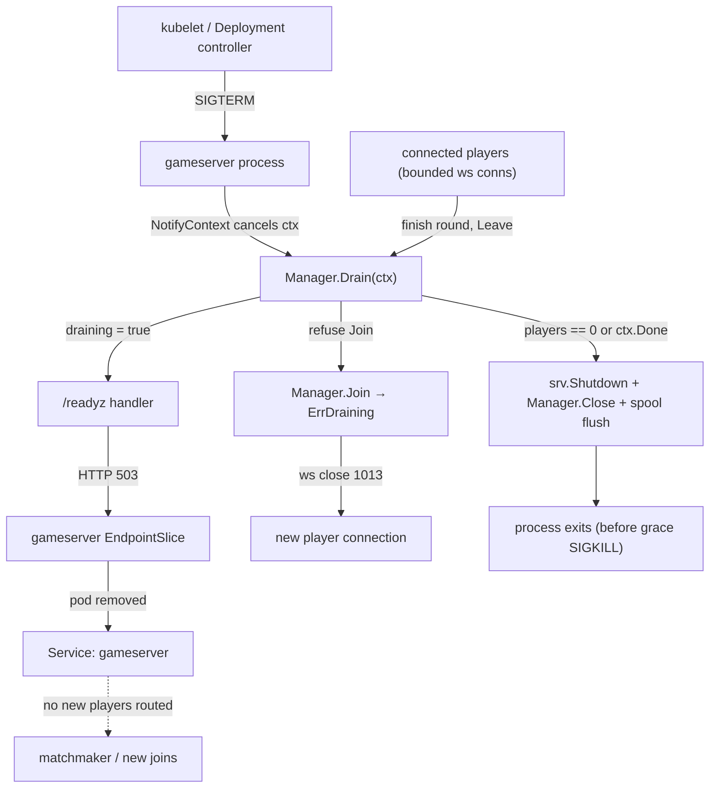
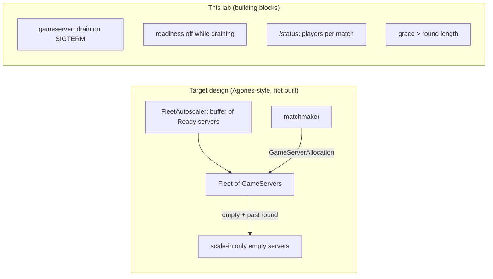
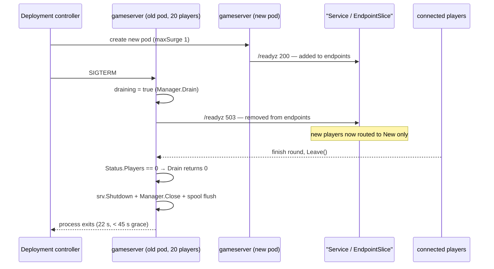
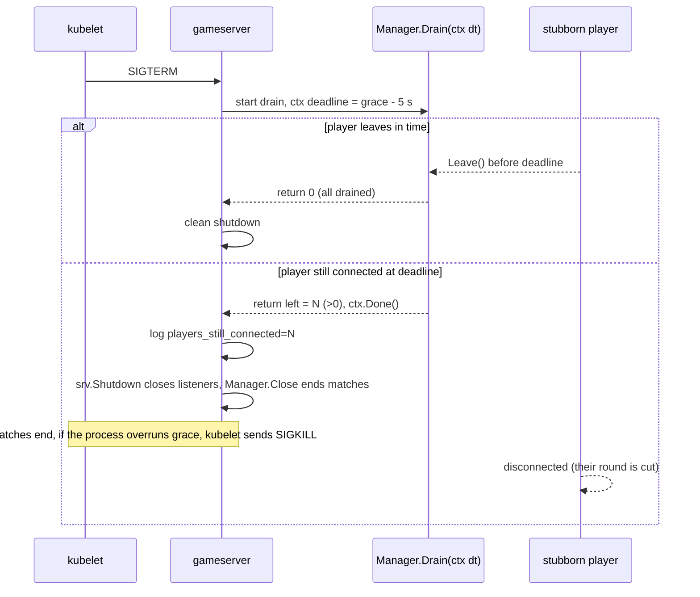
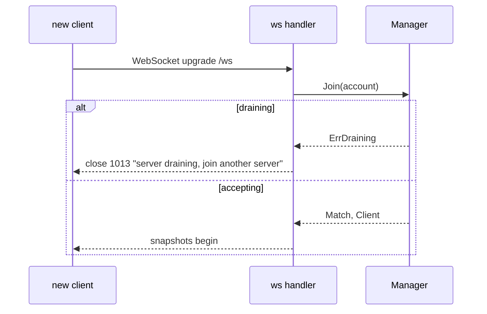

# ADR-0018 deep dive: Game server lifecycle — drain, allocation

> Source decision: [`../../adr/0018-gameserver-lifecycle.md`](../../adr/0018-gameserver-lifecycle.md)
> Evidence: [`../../experiments/007-week7-delivery/README.md`](../../experiments/007-week7-delivery/README.md)
> Code: [`../../backend/internal/match/manager.go`](../../backend/internal/match/manager.go), [`../../backend/cmd/gameserver/main.go`](../../backend/cmd/gameserver/main.go), [`../../infra/helm/localarena/templates/gameserver.yaml`](../../infra/helm/localarena/templates/gameserver.yaml)

## 1. TL;DR

- A game server is **stateful while a match runs**: the authoritative world state lives only in memory (ADR-0001, ADR-0003). You cannot kill it like a stateless pod without cutting live players, so on `SIGTERM` it **drains** instead of dying.
- Drain is a four-step protocol: fail `/readyz` (→ `503`), refuse new joins (WebSocket close `1013`), wait for connected players to leave via `Manager.Drain`, then close matches and flush the event spool.
- `terminationGracePeriodSeconds` is set **longer than one round** (dev `45 s` for `30 s` rounds, default `150 s` for `120 s` rounds); the in-process `-drain-timeout` is the grace period minus `5 s`.
- **No HPA for game servers.** Scaling them is an *allocation* problem (free player slots, scale-in only empty servers), not a CPU problem. The lab provides the Agones-style building blocks; a `FleetAutoscaler` is the target design.
- Verified in Experiment 007: deleting a gameserver pod with 20 bots mid-match dropped **0 of 20** players; the pod exited `22 s` after `SIGTERM`, well inside the `45 s` grace.

## 2. Context and problem

LocalArena's game server is authoritative (ADR-0001): it owns position, collisions, score and the match outcome, and runs each match as a single-goroutine actor with bounded queues (ADR-0003). The decisive property for this ADR is that **the only copy of an in-progress match lives in RAM**. There is no database row you can replay to resurrect a match that was 90 seconds into a 120-second round.

Kubernetes rolls out new versions by terminating old pods. The standard contract is:

1. The pod is removed from Service endpoints.
2. The container receives `SIGTERM`.
3. After `terminationGracePeriodSeconds`, if the process has not exited, it receives `SIGKILL`.

For a **stateless** API pod this is fine — in-flight requests finish in milliseconds and the load balancer re-routes new ones. For a **stateful** game server the default behaviour is catastrophic: `SIGTERM` → `SIGKILL` after 30 seconds (the Kubernetes default) would destroy every live match on that pod. Twenty players who were mid-round would simply be disconnected.

Two things are therefore needed:

- A **graceful shutdown** that keeps serving existing matches until they finish while refusing new ones, bounded by a grace period that is *longer than a round*.
- A **scaling model** that never scales down a server that holds live matches, and scales up on *player demand* rather than CPU. A generic HPA does neither.

The README scope explicitly marks live **match migration** as an optional stretch goal, so this ADR accepts one honest limitation: if the *node* (not the pod) is lost without a clean `SIGTERM`, those matches are gone. Drain protects planned terminations (deploys, scale-in, voluntary disruptions); it cannot protect against a yanked power cord.

## 3. HLD

On `SIGTERM`, the game server flips readiness to failing, which removes it from the `gameserver` Service's `EndpointSlice`. The matchmaker / Service stops sending new players to it. Existing WebSocket connections keep running on their hijacked TCP sockets (they are *not* part of `http.Server.Shutdown`'s tracked connections), so players finish their round. When the last player leaves, `Manager.Drain` returns and the process shuts the HTTP server, closes matches and flushes durable events.



The scaling side of the decision is deliberately *not* an autoscaler:



## 4. LLD

### Components and responsibilities

| Component | File | Responsibility |
|---|---|---|
| `Manager` | `backend/internal/match/manager.go` | Assigns players to matches, tracks slot accounting under one mutex, owns the `draining` flag, implements `Drain`/`Draining`. |
| `gameserver` main | `backend/cmd/gameserver/main.go` | Installs the `SIGTERM`/`SIGINT` handler, computes the drain timeout, orchestrates the shutdown sequence. |
| `server` readiness | `backend/internal/server/server.go` | `/readyz` returns `503` while `mgr.Draining()`; `/healthz` always returns `ok`. |
| `ws` handler | `backend/internal/server/ws.go` | Translates `ErrDraining` into a WebSocket close with code `1013` ("try again later"). |
| Deployment template | `infra/helm/localarena/templates/gameserver.yaml` | Sets `terminationGracePeriodSeconds`, the `-drain-timeout` arg, probes, rollout strategy. |

### Key data structures

`Manager` (trimmed to the lifecycle-relevant fields):

```go
type Manager struct {
    opts   Options
    ctx    context.Context
    cancel context.CancelFunc

    mu       sync.Mutex
    active   map[engine.PlayerID]bool // every connected player, for dedup
    matches  []*slot                  // live matches with free-slot accounting
    closed   bool                     // Close() called
    draining bool                     // Drain() started — readiness + join gate
    version  uint64                   // bumped on every membership change
    changed  chan struct{}            // closed+replaced on change (status streaming)
    wg       sync.WaitGroup           // match goroutines
}
```

`Status` / `MatchStatus` is the point-in-time view that both `/status` and `Drain` read:

```go
type Status struct {
    Version uint64        `json:"version"`
    Players int           `json:"players"`
    Matches []MatchStatus `json:"matches"`
}
type MatchStatus struct {
    ID      string `json:"id"`
    Players int    `json:"players"`
    Tick    uint64 `json:"tick"`
}
```

### Exact config values

From `infra/helm/localarena/values.yaml` and `values-dev.yaml`:

| Key | Prod default | Dev (kind) | Meaning |
|---|---|---|---|
| `gameserver.roundSeconds` | `120` | `30` | Length of one match round. |
| `gameserver.terminationGracePeriodSeconds` | `150` | `45` | Kubernetes hard deadline before `SIGKILL`. Must exceed `roundSeconds` + margin. |
| `-drain-timeout` (templated) | `145s` | `40s` | `sub terminationGracePeriodSeconds 5` → grace minus 5 s. |
| `gameserver.replicas` | `1` | `1` | One server in the lab; a fleet in production. |
| `gameserver.resources.requests` | `cpu 200m, memory 64Mi` | same | CPU stays low until the tick budget is nearly gone. |
| `gameserver.resources.limits.memory` | `256Mi` | same | Memory bound per server. |
| rollout strategy | `maxSurge 1, maxUnavailable 0` | same | New server becomes ready before the old one drains. |
| strategy type | `RollingUpdate` | same | (The ADR text mentions Recreate semantics per node; the template uses RollingUpdate surge-1/unavail-0, which never runs two versions of the *same* match because each pod owns its own matches.) |

From `backend/cmd/gameserver/main.go`:

- `-drain-timeout` flag; if `0`, defaults to `roundSeconds*time.Second + 10*time.Second`.
- `srv.Shutdown` timeout: `10 s`.
- `pub.Close` flush timeout: `5 s`.
- `modeFor` flag lookup: bounded to `50 ms` so a flagd stall only delays round start.

From `backend/internal/server/server.go`:

- Gameserver `readinessProbe`: `periodSeconds 2, failureThreshold 1` (template) → readiness goes false almost immediately on drain.
- Gameserver `livenessProbe`: `periodSeconds 10` on `/healthz`.

### Algorithm — graceful drain, step by step

From `main.go` and `manager.go`:

1. `signal.NotifyContext(ctx, os.Interrupt, syscall.SIGTERM)` wires `SIGTERM` to cancel `ctx`.
2. The HTTP listener runs in a goroutine; `main` blocks on `select { case <-errc; case <-ctx.Done() }`.
3. On `ctx.Done()` (SIGTERM), compute `dt` = `-drain-timeout`, or `roundSeconds + 10s` if unset.
4. Create `dctx` with timeout `dt` and call `left := mgr.Drain(dctx)`.
5. `Drain` sets `draining = true` under `mu`, calls `bumpLocked()` (so `/status/stream` and `/readyz` reflect the change), then loops every `200 ms`:
   - read `Status()`; if `Players == 0`, return `0` immediately;
   - otherwise wait for the next tick or `ctx.Done()`.
   - On `ctx.Done()` (grace nearly up) return the players still connected.
6. Meanwhile `/readyz` returns `503` (`mgr.Draining()` is true), so the kubelet marks the pod not-ready and it is pulled from the `EndpointSlice`.
7. New `Join` calls return `ErrDraining`; the ws handler sends close `1013` ("server draining, join another server").
8. After `Drain` returns, `srv.Shutdown(10s)` stops accepting new HTTP connections; `mgr.Close()` cancels all match contexts and `wg.Wait()`s for match goroutines; `pub.Close(5s)` flushes undelivered durable events (anything still in flight stays in the spool for the next start — ADR-0009).
9. Process exits before the `SIGKILL` deadline.

### Algorithm — slot accounting (why two joins never overfill a match)

`Join` holds `mg.mu` for the entire slot decision:

1. Reject if `closed` or `draining`.
2. Assign a guest ID (`nextID.Add(1)`) if `account == 0`; reject with `ErrAlreadyPlaying` if the ID is already in `active`.
3. Mark `active[id] = true`.
4. Linear-scan `matches` for the first slot with `n < Capacity`; if none, create a new match and start its goroutine.
5. `s.n++`, `bumpLocked()`, **then** unlock.
6. Send the client on the match's `join` channel; if the match already stopped (`<-s.m.done`), `release` the slot and return `ErrClosed`.

Because the capacity check and the increment are inside the same critical section, two concurrent joins can never both see the last free slot. `release` symmetrically decrements and stops a match when `n == 0` (empty-server scale-in, in miniature).

## 5. Sequence diagrams

### Happy path — rolling deploy drains the old server cleanly



### Failure / edge path — a player stays past the grace period



### Edge path — join attempt arrives mid-drain



## 6. Concepts explained

### Kubernetes Deployment, ReplicaSet, Service, EndpointSlice

- **What it is.** A `Deployment` declares the desired pod template and replica count; it creates a `ReplicaSet` per revision, which creates `Pod`s. A `Service` gives those pods one stable virtual IP/DNS name; the set of healthy backing pod IPs is published as `EndpointSlice` objects. Removing a pod from readiness removes its IP from the EndpointSlice, which is how "stop sending me traffic" actually happens.
- **Why LocalArena uses it.** `gameserver.yaml` declares a `Deployment` (`name: gameserver`), a `Service` (`name: gameserver`, port 8080 → http), and relies on the readiness→EndpointSlice path so that flipping `/readyz` to `503` takes the draining pod out of rotation without deleting it.
- **What was measured.** Experiment 007 gameserver-drain drill: "readiness false immediately (no new players routed)". The pod was out of the EndpointSlice while still serving its 20 players.
- **Where else it is used.** (1) A payments API behind a cloud load balancer uses readiness to drain a node before patching. (2) An e-commerce checkout service rolls versions with the same EndpointSlice mechanics. (3) A ride-hailing dispatch service uses readiness gates during config reloads. (4) A social-feed edge tier removes slow nodes from the Service on readiness failure.

### Pod Disruption Budget (PDB)

- **What it is.** A PDB caps how many pods of a set may be *voluntarily* disrupted at once (node drain, eviction). It does not protect against involuntary loss (node crash).
- **Why LocalArena uses it.** The API has `PodDisruptionBudget minAvailable: 1` (`api.yaml`). The game server relies on drain + grace instead, because a PDB cannot express "do not evict me until my current match finishes". A PDB would only cap *how many* servers drain simultaneously, not *when* one is safe to stop.
- **What was measured.** Not measured directly for the gameserver (no PDB on it). The API PDB is exercised indirectly in the rolling-update drill (0 failed requests).
- **Where else it is used.** (1) A banking ledger service keeps `minAvailable` quorum during cluster upgrades. (2) A Kafka-consumer fleet caps concurrent evictions so lag never spikes. (3) A stateful search cluster prevents the node drainer from evicting two shard replicas at once.

### Startup / readiness / liveness probes

- **What it is.** *Startup* gates the other probes until the app has booted (useful for slow starts). *Readiness* decides whether the pod receives traffic. *Liveness* decides whether to restart a wedged container.
- **Why LocalArena uses it.** The gameserver uses `readinessProbe` on `/readyz` (`periodSeconds 2, failureThreshold 1`) so draining removes it from endpoints within ~2 s, and `livenessProbe` on `/healthz` (`periodSeconds 10`). Crucially, `/healthz` stays `ok` while draining — liveness must *not* restart a pod that is deliberately finishing its matches. The API additionally has a `startupProbe` (`failureThreshold 30, periodSeconds 2` → up to 60 s to boot).
- **What was measured.** Experiment 007: gameserver readiness went false immediately on SIGTERM; the pod kept serving and exited at 22 s. No liveness restart occurred during drain.
- **Where else it is used.** (1) A JVM service with a slow warm-up uses a long startup probe so it is not killed mid-boot. (2) A database proxy uses readiness tied to upstream health. (3) An IoT ingest gateway uses liveness to recover from deadlocked worker pools.

### Graceful shutdown and SIGTERM

- **What it is.** A process that catches `SIGTERM` and finishes work in flight before exiting, rather than dying instantly.
- **Why LocalArena uses it.** `signal.NotifyContext` turns `SIGTERM` into a cancelled context; the server then runs the drain protocol. The alternative — exit on signal — would destroy live matches.
- **What was measured.** Experiment 007: the old pod "exited 22 s after SIGTERM (after its players left)". `drain-bots.json` shows `server_drops: 0`.
- **Where else it is used.** (1) A message consumer commits its current offset batch on SIGTERM before leaving the group. (2) An HTTP API finishes in-flight requests. (3) A video-transcoding worker finishes the current segment and re-queues the rest.

### terminationGracePeriodSeconds

- **What it is.** The time the kubelet waits between `SIGTERM` and `SIGKILL`. If the process is still alive at the deadline, it is force-killed.
- **Why LocalArena uses it.** It is set to `round length + margin` (`45 s` dev, `150 s` prod) so a full round can finish. The in-process `-drain-timeout` is grace minus `5 s`, leaving a safety buffer so the process self-terminates *before* the kubelet's `SIGKILL`.
- **What was measured.** Experiment 007: exit at `22 s` for a `30 s` dev round, comfortably within the `45 s` grace.
- **Where else it is used.** (1) A long-poll/SSE gateway sets a grace period longer than its max connection hold time. (2) A batch worker sets grace longer than its longest task. (3) A payment settlement job sets grace to cover a settlement window.

### Stateful vs stateless scaling

- **What it is.** Stateless pods are interchangeable; any replica can serve any request, so you can add/remove them freely (HPA on CPU/RPS). Stateful pods hold data that cannot move instantly, so removing one loses or must migrate that state.
- **Why LocalArena uses it.** The API is stateless → CPU HPA is correct. The game server is stateful *for the duration of a match* → scaling is an allocation decision. This is the core of ADR-0018's "no HPA for game servers".
- **What was measured.** API HPA scaled 2→5 on 600 req/s in ~30 s, 90,000 requests, 0 failed, p95 9.8 ms (Experiment 007). The gameserver was scaled by *drain*, not by an autoscaler.
- **Where else it is used.** (1) A WebSocket chat gateway holds connection state; it scales by connection count and drains on deploy. (2) A video-call SFU pins a call to a media server. (3) A stateful stream processor (Kafka Streams, ADR-0011) scales by partition assignment, not CPU.

### Game server allocation (Agones fleets)

- **What it is.** Agones models game servers as a `Fleet` of `GameServer` pods. A `FleetAutoscaler` keeps a buffer of `Ready` servers; matchmaking requests a `GameServerAllocation`, which flips one server to `Allocated` (and thus exempt from scale-down). Scale-in only ever removes `Ready` (empty) servers.
- **Why LocalArena uses it.** It is the *target* design, not built in the lab. The lab provides the primitives Agones needs: drain on SIGTERM, readiness off while draining, a `/status` endpoint reporting players per match, and `terminationGracePeriodSeconds` > round length.
- **What was measured.** Not measured — the fleet controller is not implemented. The building blocks are each exercised in Experiment 007.
- **Where else it is used.** (1) Session-sticky allocation generalizes to any "pin a workload to a node for its lifetime" problem: video rendering sessions, remote-desktop brokers, (2) notebook/IDE backends (JupyterHub spawns a pod per user), (3) CI runners allocated per job.

### HPA and metrics-server

- **What it is.** The `HorizontalPodAutoscaler` adjusts replica count toward a target metric (here CPU utilization). It reads pod CPU from `metrics-server`, which scrapes kubelets.
- **Why LocalArena uses it.** For the stateless API only: `hpa { enabled, min 2, max 6 (dev 5), cpuUtilization 70 (dev 60) }`. `metrics-server` is installed by OpenTofu (ADR-0020) with `--kubelet-insecure-tls` because kind kubelets use self-signed certs. The API Deployment omits `spec.replicas` when the HPA is enabled, and Argo CD ignores `/spec/replicas`, so the HPA and GitOps don't fight.
- **What was measured.** Experiment 007 `hpa.txt`: CPU 3%→537%, replicas 2→5 within ~30 s of load, back to 2 within 150 s of load ending; scale-up uses `stabilizationWindowSeconds 0, Pods +2 / 15 s`, scale-down `stabilizationWindowSeconds 60, Pods -1 / 30 s`.
- **Where else it is used.** (1) An e-commerce product API scales on CPU for a flash sale. (2) A queue worker scales on queue-depth custom metrics. (3) A latency-sensitive API scales on RPS via a custom-metrics adapter.

### Why *not* an HPA for the game server

- **What it is.** A design argument, not a feature. CPU-based HPA is wrong for game servers on two counts: scale-**down** would pick an arbitrary pod and cut live matches; scale-**up** should follow *free player slots*, not CPU (CPU stays low until the tick budget is nearly exhausted — Experiment 001).
- **Why LocalArena uses it.** To justify the allocation model and the absence of a gameserver HPA in the chart.
- **What was measured.** Experiment 001 established that gameserver CPU stays low until tick overload; Experiment 007 confirms drain-based termination keeps `server_drops: 0`.
- **Where else it is used.** Any workload where per-unit load is "sessions/slots" not CPU: (1) telephony media servers (channels), (2) collaborative-doc servers (documents), (3) MMO zone servers (players per zone).

### Rolling update (maxSurge / maxUnavailable)

- **What it is.** During a rollout, `maxSurge` is how many extra pods may exist above the desired count, `maxUnavailable` is how many may be below it.
- **Why LocalArena uses it.** Gameserver uses `maxSurge 1, maxUnavailable 0`: a new server becomes `Ready` *before* the old one is drained, so capacity never dips. (The API uses the same, see ADR-0019.)
- **What was measured.** Not isolated for the gameserver rollout in Experiment 007 (that drill deleted a single pod). The API rolling drill with the same settings recorded 1672 ok / 0 failed.
- **Where else it is used.** (1) A payments API rolls `maxUnavailable 0` to never drop below quorum. (2) A fixed-size worker pool rolls `maxSurge 1` to keep throughput. (3) A capacity-constrained cluster rolls `maxUnavailable 1, maxSurge 0` when it cannot afford extra pods.

### Bounded queues and latest-wins (why the connection is cheap to hold)

- **What it is.** Each match reads inputs and writes snapshots over bounded channels; a slow client gets the newest snapshot, never a growing backlog (ADR-0003).
- **Why LocalArena uses it.** It makes holding a draining player cheap and safe: the server will not accumulate unbounded memory while it waits for stragglers to finish their round.
- **What was measured.** `drain-bots.json`: `snapshots_replaced: 0, snapshots_skipped_lagging: 0, heap_inuse_peak_mib: 3.97, tick_p99_ms: 0.71` — the server was comfortable throughout the drain.
- **Where else it is used.** (1) Live dashboards push the latest value, dropping stale frames. (2) Market-data fan-out drops stale ticks to slow subscribers. (3) Telemetry pipelines sample under pressure (ADR-0009's best-effort class).

## 7. Code pointers

| Path (symbol / key) | What to look at |
|---|---|
| [`backend/internal/match/manager.go`](../../backend/internal/match/manager.go) `Manager.Drain` | The drain loop: set `draining`, `bumpLocked`, poll `Status` every 200 ms, return count still connected on `ctx.Done()`. |
| [`backend/internal/match/manager.go`](../../backend/internal/match/manager.go) `Manager.Draining` | Readiness source of truth. |
| [`backend/internal/match/manager.go`](../../backend/internal/match/manager.go) `Manager.Join` | Join gate: `ErrDraining` when draining; slot accounting under `mu`. |
| [`backend/internal/match/manager.go`](../../backend/internal/match/manager.go) `Manager.release` | Empty-match scale-in: cancel the match when `n == 0`. |
| [`backend/cmd/gameserver/main.go`](../../backend/cmd/gameserver/main.go) `main` | `signal.NotifyContext`, drain-timeout computation, shutdown sequence, spool flush. |
| [`backend/cmd/gameserver/main.go`](../../backend/cmd/gameserver/main.go) `-drain-timeout` flag | Defaults to `roundSeconds + 10s`. |
| [`backend/internal/server/server.go`](../../backend/internal/server/server.go) `/readyz` | Returns `503` while `mgr.Draining()`. |
| [`backend/internal/server/ws.go`](../../backend/internal/server/ws.go) `ErrDraining` handling | WebSocket close `1013` on a join during drain. |
| [`infra/helm/localarena/templates/gameserver.yaml`](../../infra/helm/localarena/templates/gameserver.yaml) | `terminationGracePeriodSeconds`, `-drain-timeout` = `sub ... 5`, probes, rollout strategy. |
| [`infra/helm/localarena/values.yaml`](../../infra/helm/localarena/values.yaml) `gameserver.*` | Round length and grace defaults (prod). |
| [`infra/helm/localarena/values-dev.yaml`](../../infra/helm/localarena/values-dev.yaml) `gameserver.*` | `roundSeconds 30`, grace `45`. |
| [`experiments/007-week7-delivery/results/gameserver-drain.txt`](../../experiments/007-week7-delivery/results/gameserver-drain.txt) | Drain drill output: readiness false, exit at 22 s. |
| [`experiments/007-week7-delivery/results/drain-bots.json`](../../experiments/007-week7-delivery/results/drain-bots.json) | `server_drops: 0`, tick and memory metrics during drain. |

## 8. Trade-offs and alternatives

| Option | Pros | Cons | Why (not) chosen |
|---|---|---|---|
| **Drain on SIGTERM, grace > round** (chosen) | Zero dropped players on planned termination; simple; uses native readiness. | A deploy waits up to a round length; node loss still cuts matches. | Chosen: matches scope (no migration) and keeps the server authoritative. |
| HPA on gameserver CPU | Reuses the standard autoscaler. | Scale-down cuts live matches; CPU is a bad signal for player load. | Rejected: wrong unit of work; would drop players. |
| Agones `Fleet` + `FleetAutoscaler` | Production-grade allocation, ready-buffer, allocation-aware scale-in. | Extra operator and complexity; out of lab scope. | Deferred: it is the stated *target*; the lab builds its primitives. |
| Live match migration | A deploy need not wait for rounds; node loss survivable. | Requires serializing and transferring authoritative state; hard to get right. | Out of scope (README optional stretch goal). |
| StatefulSet for gameservers | Stable network IDs, ordered rollout. | Still no match-aware scale-in; ordinal identity isn't what we need. | Not needed: matches are ephemeral, not per-pod persistent volumes. |

## 9. Failure modes and how they were found

- **Pod killed mid-match (planned):** found and validated in [`../../experiments/007-week7-delivery/README.md`](../../experiments/007-week7-delivery/README.md) "Gameserver drain" drill — 0 of 20 bots dropped, exit at 22 s.
- **Player refuses to leave before grace ends:** handled by the `ctx.Done()` branch in `Drain` (returns the still-connected count and logs `players_still_connected`); after that the process shuts down and those players are cut. This is the honest limit the ADR documents.
- **Node loss (involuntary):** not protected — the ADR records that matches on a lost node are lost (no migration). Related node-loss failover for the database is studied in [`../../experiments/003-week3-resilience/README.md`](../../experiments/003-week3-resilience/README.md) and the CNPG topology notes.
- **Liveness restarting a draining pod:** avoided by keeping `/healthz` healthy during drain; only `/readyz` fails.

## 10. Interview questions

1. **Why can't you treat a game server like a stateless web pod during a rollout?**
   Because the authoritative match state lives only in RAM. Killing the pod (SIGTERM→SIGKILL after the default 30 s) destroys every live match. A web pod's in-flight work finishes in milliseconds and is reroutable; a 120-second round is not.

2. **Walk me through what happens on SIGTERM in LocalArena's game server.**
   `NotifyContext` cancels the root context → `Manager.Drain` sets `draining=true` → `/readyz` returns 503 so the pod leaves the EndpointSlice → new joins get `ErrDraining` (WebSocket close 1013) → existing players finish and `Leave` → when `Status.Players==0` Drain returns → `srv.Shutdown`, `Manager.Close`, flush the event spool → exit.

3. **What is the relationship between `terminationGracePeriodSeconds` and the drain timeout, and why the 5-second gap?**
   Grace is the kubelet's SIGTERM→SIGKILL deadline. The in-process drain timeout is `grace - 5s` so the process finishes draining and exits cleanly *before* the kubelet force-kills it, leaving a 5 s buffer for `srv.Shutdown`/`Manager.Close`/spool flush.

4. **Why is `/healthz` kept healthy during drain but `/readyz` fails?**
   Readiness controls traffic (remove from endpoints). Liveness controls restarts. If `/healthz` failed during drain, the kubelet would restart the pod mid-drain and cut the matches it is trying to protect.

5. **Why no HPA on the game server? Be specific about scale-up and scale-down.**
   Scale-down: a CPU HPA picks an arbitrary pod to delete, which could be one holding live matches → dropped players. Scale-up: player load doesn't show up as CPU until the tick budget is nearly gone (Experiment 001), so CPU is a lagging, misleading signal. The right signal is free player slots; the right scale-in is "empty servers only".

6. **What would an Agones-based design add, concretely?**
   A `Fleet` of game servers, a `FleetAutoscaler` keeping a buffer of `Ready` servers, and `GameServerAllocation` so matchmaking flips a server to `Allocated` (exempt from scale-down). Scale-in only removes `Ready`/empty servers. LocalArena already exposes the primitives it needs (drain, readiness, `/status`, long grace).

7. **How does LocalArena guarantee two concurrent joins never overfill a 20-player match?**
   `Join` holds `Manager.mu` across both the capacity check (`n < Capacity`) and the increment (`s.n++`). Because it is one critical section, two joins cannot both observe the last free slot.

8. **A player stays connected right up to the grace deadline. What happens?**
   `Drain`'s `ctx.Done()` fires, it returns the still-connected count, the server logs `players_still_connected=N`, then shuts down — those players are cut. It is bounded and logged, not silent data loss.

9. **How does the draining pod actually stop receiving new players at the network level?**
   `/readyz` → 503 makes the kubelet mark the pod NotReady; its IP is removed from the Service's `EndpointSlice`; kube-proxy / the LB stops sending new connections. Existing hijacked WebSocket TCP connections are untouched.

10. **Why does `srv.Shutdown` not close the active matches, and what does?**
    Hijacked WebSocket connections are not tracked by `http.Server.Shutdown`. `Manager.Close` cancels every match context and waits on the goroutine `WaitGroup`, which closes the matches (and their WebSockets).

11. **(Design) You now run 50 game servers and 2,000 players. Design allocation.**
    Add a fleet controller: keep a ready buffer sized to peak join rate × spin-up time; matchmaking calls an allocation API that selects a `Ready` server with capacity and marks it `Allocated`; readiness continues to drain; scale-in only removes `Ready` servers idle past a round. Store per-server `players/capacity` in a fast store (Valkey) for the allocator; cap matches per server by memory/tick budget, not CPU.

12. **(Design / 100x scale) What breaks at 100x and how would you change it?**
    Single-region in-memory matches become a bottleneck: (a) shard by region (ADR-0021) and allocate region-locally to cut RTT; (b) introduce a proper fleet autoscaler with predictive buffer sizing; (c) add optional session migration or quick-rejoin so a node loss is recoverable; (d) move allocation state out of a single process into a replicated store; (e) protect scale-in with PDB-like "no two draining servers in the same region" rules; (f) back live matches with periodic state snapshots so an involuntary loss degrades to a rejoin, not a total loss.

13. **Why is the gameserver readiness probe so aggressive (`failureThreshold 1, period 2s`)?**
    To remove a draining server from endpoints as fast as possible, minimizing the window where a new player could still be routed to it. False positives are tolerable because a transient flap only briefly stops *new* joins.

14. **Does the chart risk the HPA and GitOps fighting over `replicas` on the gameserver?**
    No — the gameserver has no HPA, so its `spec.replicas` is set directly (1). The conflict only arises for the API, where Argo CD ignores `/spec/replicas` because the HPA owns it.

15. **What's the one failure this design explicitly does not handle, and why is that acceptable here?**
    Involuntary node loss (crash/power cut) with no clean SIGTERM — those matches are lost because there is no migration or snapshot. It is acceptable per the README scope (match migration is an optional stretch goal) and is documented rather than hidden.
