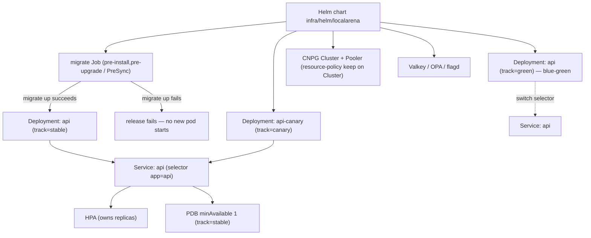
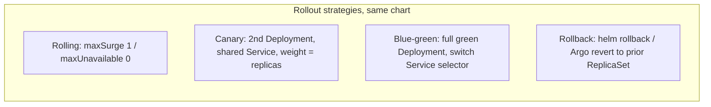
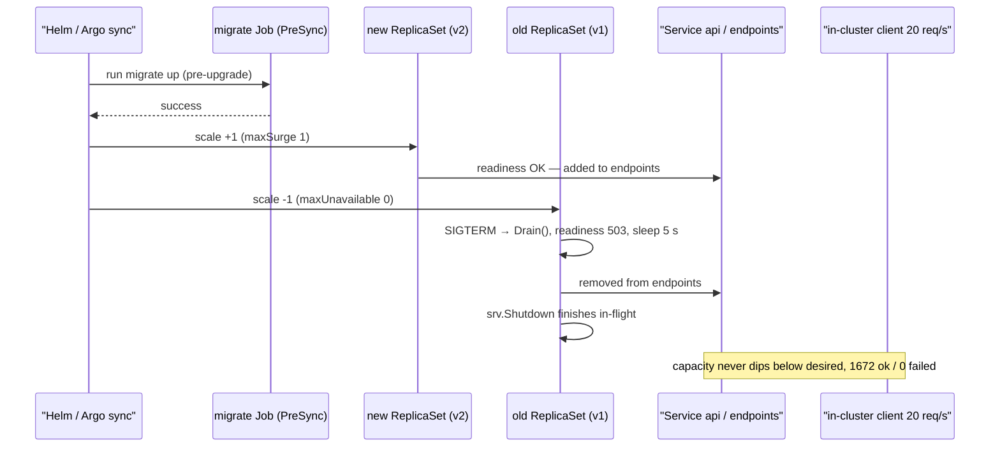
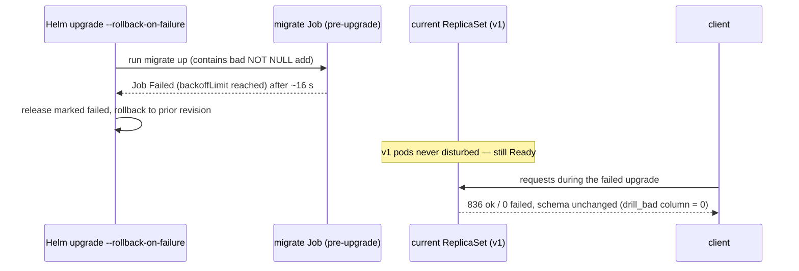
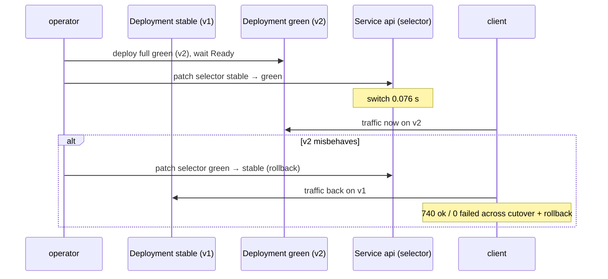

# ADR-0019 deep dive: Helm packaging and rollout strategies (rolling, canary, blue-green, migration hooks)

> Source decision: [`../../adr/0019-delivery-strategies.md`](../../adr/0019-delivery-strategies.md)
> Evidence: [`../../experiments/007-week7-delivery/README.md`](../../experiments/007-week7-delivery/README.md)
> Code: [`../../infra/helm/localarena`](../../infra/helm/localarena), [`../../backend/cmd/api/main.go`](../../backend/cmd/api/main.go)

## 1. TL;DR

- **One Helm chart** (`infra/helm/localarena`) packages the app (API, gameserver) and its dependencies (CloudNativePG `Cluster`/`Pooler`, Valkey, OPA, flagd). `values.yaml` is production-shaped; `values-dev.yaml` relaxes it for kind.
- **API rolling update:** `maxSurge 1, maxUnavailable 0`, startup/readiness/liveness probes, a `5 s` readiness-off drain, and a `PodDisruptionBudget minAvailable 1`. The HPA owns `replicas`, so Argo CD ignores `spec.replicas`.
- **Canary** = a second Deployment (`track=canary`) with its own image tag behind the *same* Service; share ≈ `canary replicas / total replicas`. **Blue-green** = a full second Deployment (`track=green`) and a Service-selector switch.
- **Migrations** run as a `pre-install,pre-upgrade` Helm hook Job (`argocd.argoproj.io/hook: PreSync`). A failing migration fails the release *before any new pod starts*; expand-only migrations (ADR-0005) keep old code working on the new schema.
- Experiment 007: **0 failed requests** in every rollout drill (rolling, canary, blue-green, failed-migration, rollback). Canary share measured **31%** at 1-of-3. Two documented hazards: a first install with automatic rollback can delete non-`keep` resources (the Pooler — finding F2); the CNPG `Cluster` survives because it carries `helm.sh/resource-policy: keep`.

## 2. Context and problem

By week 7 LocalArena has many moving parts — API, game server, PgBouncer-fronted Postgres, Valkey, OPA, flagd — each with its own manifests, probes, resource limits and security context. Three problems follow:

1. **Packaging.** Hand-written YAML per environment drifts. The lab needs one versioned, lint-able, templated artifact that renders both a production-shaped config and a kind-sized config from the same source.
2. **Zero-downtime delivery.** The API must deploy new versions, run a controlled canary, do a blue-green cutover, and roll back — all without a single failed request. The final success criteria (README §2.6) demand "continue serving API traffic after one stateless replica fails" and (README §2.9) "rolling updates, a canary, and rollback".
3. **Schema safety.** A bad migration must never reach running pods. If a migration fails, the old revision must keep serving on the *old* schema, which only works if migrations are expand-only (ADR-0005) and run *before* new pods start.

Helm answers (1) with templating + release revisions; Kubernetes rollout strategies answer (2); a `pre-upgrade` hook Job answers (3). The ADR also records two sharp edges discovered in Experiment 007: server-side-apply field ownership when two controllers touch one release (deferred to ADR-0020), and the destructive first-install-with-rollback behaviour (F2).

## 3. HLD

One chart renders all workloads. The API Service selects `app: api` (both `track=stable` and `track=canary`), so a canary Deployment behind the same Service receives a replica-weighted share of traffic. Blue-green flips the Service selector between `track=stable` and `track=green`. The migrate Job is a pre-upgrade hook that gates the whole release.

## 4. LLD

### Components and responsibilities

| Component | File | Responsibility |
|---|---|---|
| Chart metadata | `infra/helm/localarena/Chart.yaml` | `version 0.7.0`, `appVersion 0.7.0`, `kubeVersion >=1.33.0-0`. |
| Prod values | `infra/helm/localarena/values.yaml` | Production-shaped defaults. |
| Dev overrides | `infra/helm/localarena/values-dev.yaml` | kind sizing: smaller HPA max, short rounds. |
| API manifests | `templates/api.yaml` | Deployment(s), Service, PDB, HPA, canary Deployment. |
| API pod helper | `templates/_helpers.tpl` `la.apiPod` | Shared pod spec parameterised by `track` and `tag`. |
| Gameserver | `templates/gameserver.yaml` | See ADR-0018. |
| Migrate hook | `templates/migrate-job.yaml` | Pre-install/pre-upgrade/PreSync Job running `migrate up`. |
| Postgres | `templates/postgres.yaml` | CNPG `Cluster` (`resource-policy: keep`) + `Pooler`. |
| Dependencies | `templates/deps.yaml` | Valkey, OPA, flagd, optional Ingress. |
| Shared helpers | `templates/_helpers.tpl` | labels, security contexts, topology spread, db env. |
| API drain | `backend/cmd/api/main.go`, `backend/internal/api/api.go` `Drain`/`ready` | Readiness-off drain window. |

### API Deployment / Service / PDB / HPA (exact config)

From `templates/api.yaml` + `values.yaml`:

- Deployment `api`: `revisionHistoryLimit 5`, `strategy.type RollingUpdate`, `rollingUpdate { maxSurge 1, maxUnavailable 0 }`, selector `{ app: api, track: stable }`.
- `spec.replicas` is emitted **only when the HPA is disabled** (`{{- if not .Values.api.hpa.enabled }}`). With the HPA on, the HPA owns replica count.
- Service `api`: selector `{ app: api }` — intentionally matches both `track=stable` and `track=canary`.
- PodDisruptionBudget `api`: `minAvailable 1`, selector `{ app: api, track: stable }`.
- HPA `api` (autoscaling/v2): `minReplicas` / `maxReplicas` from values (`2`/`6` prod, `2`/`5` dev), metric CPU `averageUtilization` `70` (prod) / `60` (dev); `behavior.scaleUp { stabilizationWindowSeconds 0, Pods +2 / 15s }`, `scaleDown { stabilizationWindowSeconds 60, Pods -1 / 30s }`.

API pod (`la.apiPod` in `_helpers.tpl`):

- `terminationGracePeriodSeconds: 20`, port `http: 8081`.
- env: `DATABASE_URL` → `arena-db-pooler-rw:5432`, `REPLICA_URL` → `arena-db-ro:5432`, `DB_MAX_CONNS 10`, `DRAIN_SECONDS` from `api.drainSeconds` (`5`), `LEGACY_V1` from `api.legacyV1` (`true`→`1`), `APP_TRACK` = the track.
- Probes: `startupProbe { /healthz, periodSeconds 2, failureThreshold 30 }` (≈60 s budget to boot); `readinessProbe { /readyz, periodSeconds 3, failureThreshold 2 }`; `livenessProbe { /healthz, periodSeconds 10 }`.
- `resources { requests: cpu 100m / memory 64Mi, limits: memory 192Mi }`.

Canary (`api.canary`, default disabled): `enabled false, tag dev, replicas 1`. When enabled, `templates/api.yaml` renders a second Deployment `api-canary` with selector `{ app: api, track: canary }` and the canary tag.

### Migrate hook Job (exact config)

From `templates/migrate-job.yaml`:

- Name `migrate-{{ .Release.Revision }}` (unique per revision).
- Annotations: `helm.sh/hook: pre-install,pre-upgrade`, `helm.sh/hook-weight: "0"`, `helm.sh/hook-delete-policy: before-hook-creation,hook-succeeded`, `argocd.argoproj.io/hook: PreSync`.
- `backoffLimit: {{ .Values.migrate.backoffLimit }}` (`1`), `activeDeadlineSeconds: 300`, `restartPolicy: Never`.
- initContainer `wait-db` runs `/migrate version` against `DATABASE_URL` from secret `arena-db-app` key `uri` — waits for the CNPG cluster + app secret on a first install.
- container `migrate` runs `/migrate up`; if `migrate.failForDrill` is set, `MIGRATE_FAIL_FOR_DRILL=1` injects a failing statement (drill only).

### Postgres `resource-policy: keep` (exact config)

From `templates/postgres.yaml`:

- `Cluster arena-db` carries annotation `helm.sh/resource-policy: keep` — Helm never deletes it on uninstall. `instances 2`, `storage 1Gi`, `max_connections 100`, `deadlock_timeout 200ms`, `smartShutdownTimeout 10`.
- `Pooler arena-db-pooler-rw`: `instances 2`, `poolMode transaction`, `default_pool_size 10`, `max_client_conn 500`. **No `keep` annotation** — this is exactly what finding F2 deletes on a failed first install.

### Algorithm — rolling update, step by step

1. `helm upgrade` (or Argo sync) renders the chart; the migrate hook runs first.
2. The Deployment controller creates a new ReplicaSet and scales it up by `maxSurge` (1) while keeping the old one at full size (`maxUnavailable 0`).
3. The new pod boots; `startupProbe` gates it, then `readinessProbe` adds it to the `api` EndpointSlice.
4. Once the new pod is Ready, the controller scales the old ReplicaSet down by one.
5. The old pod receives `SIGTERM`; `api` main calls `apiSrv.Drain()` (readiness → 503) and sleeps `DRAIN_SECONDS` (5 s) so Envoy health checks (2 s × 2) and endpoints stop routing, then `srv.Shutdown` finishes in-flight requests.
6. Repeat until all pods are on the new ReplicaSet. Capacity never drops below the desired count.

### Algorithm — canary

1. Set `api.canary.enabled=true` with a new `tag` and `replicas` (e.g. 1).
2. A second Deployment `api-canary` (`track=canary`) starts behind the same Service.
3. Traffic splits by endpoint count: with 2 stable + 1 canary, ≈1/3 of requests hit the canary.
4. Watch canary metrics; to **promote**, set `image.api.tag` to the canary tag and `canary.enabled=false`.

### Algorithm — blue-green

1. Render a full green Deployment (`track=green`, new tag) next to blue (`track=stable`).
2. When green is Ready, switch the Service selector from `track=stable` to `track=green` (near-instant).
3. Watch; to **roll back**, switch the selector back to `track=stable`.

### Algorithm — migration gate

1. The migrate Job is a `pre-upgrade` hook, so Helm runs it and waits before touching Deployments.
2. If `migrate up` fails, the Job fails; the hook fails; the release is marked `failed`. With `--rollback-on-failure`/`--atomic` (or Argo CD), the previous revision's ReplicaSets keep serving.
3. Because migrations are expand-only (ADR-0005), the old code runs correctly on whatever schema exists between steps.

## 5. Sequence diagrams

### Happy path — rolling update with zero failed requests

### Failure path — a failing migration never reaches pods

### Edge path — blue-green cutover and instant rollback

## 6. Concepts explained

### Helm chart, templating and release revisions

- **What it is.** Helm renders Go-templated YAML into Kubernetes manifests and tracks each `install`/`upgrade` as a numbered *revision*, enabling `helm rollback`.
- **Why LocalArena uses it.** One chart renders production and kind configs (`values.yaml` vs `values-dev.yaml`), shares pod specs via `_helpers.tpl` (`la.apiPod`, `la.labels`, security contexts, topology spread), and gives free rollback via revisions.
- **What was measured.** `helm rollback` to the previous revision took **6 s**, 1108 ok / 0 failed (Experiment 007 `rollback.txt`); the failed-migration drill showed revision history `24:superseded 25:failed 26:deployed`.
- **Where else it is used.** (1) Packaging a microservice suite for staging/prod. (2) Shipping an operator + its CRs as one chart. (3) A SaaS vendor distributing a self-hostable app to customers.

### `maxSurge` / `maxUnavailable` (rolling update)

- **What it is.** Surge = extra pods allowed above desired; unavailable = pods allowed below desired during a rollout.
- **Why LocalArena uses it.** `maxSurge 1, maxUnavailable 0` keeps capacity at/above target throughout, so a stateless-pod rollout never drops a request.
- **What was measured.** Rolling drill: 12 s, **1672 ok / 0 failed** (Experiment 007 `rolling.txt`).
- **Where else it is used.** (1) Payment APIs roll `maxUnavailable 0` for strict capacity. (2) A capacity-pinned cluster uses `maxSurge 0, maxUnavailable 1`. (3) A latency-SLO web tier keeps surge to avoid cold-start dips.

### Readiness-gated rollout and graceful API drain

- **What it is.** A new pod joins the Service only when `/readyz` passes; an old pod leaves by failing `/readyz` first, then finishes in-flight work.
- **Why LocalArena uses it.** `api.yaml` readiness `periodSeconds 3, failureThreshold 2`; on SIGTERM `api` main calls `Drain()` then sleeps `DRAIN_SECONDS=5` so Envoy's 2 s×2 health checks and endpoints both stop before shutdown. `/readyz` fails *only* while draining — a shared dependency (Postgres/Valkey) being down does not fail readiness, because that would empty the whole Service (see `api.go` `ready`).
- **What was measured.** Zero failed requests across rolling, canary, blue-green and rollback drills.
- **Where else it is used.** (1) Any LB-fronted service draining before patch. (2) A gRPC service setting `NOT_SERVING` on its health endpoint before stop. (3) A queue consumer failing readiness while finishing its batch.

### Canary release

- **What it is.** Ship the new version to a *fraction* of traffic, observe, then promote or abort.
- **Why LocalArena uses it.** A second Deployment `api-canary` behind the same Service; the split equals the endpoint-count ratio. Coarse but zero-infrastructure (no mesh).
- **What was measured.** 1 canary + 2 stable → **31% canary** (228/744 by per-pod `requests_total`), ≈1/3; 744 ok / 0 failed; then promoted to v2 (Experiment 007 `canary.txt`, `canary-split.txt`). A measurement bug (grep matched histogram lines, `kubectl` ate stdin in a loop) initially read 0% — fixed to read the per-pod counter only (finding F5).
- **Where else it is used.** (1) Feature rollout to 1% of users on a web app. (2) A new ranking model served to a slice of search traffic. (3) A new pricing engine canaried on a region.

### Blue-green deployment

- **What it is.** Run two full environments (blue = current, green = new); switch all traffic at once; roll back by switching back.
- **Why LocalArena uses it.** A full green Deployment (`track=green`) and a Service-selector switch give near-instant cutover and rollback with no partial state.
- **What was measured.** Selector switch **0.076 s**; 740 ok / 0 failed across cutover + rollback (Experiment 007 `bluegreen.txt`).
- **Where else it is used.** (1) A database-schema-compatible app cutover. (2) A CDN origin swap. (3) A tax-season financial app that wants instant rollback.

### Rollback

- **What it is.** Returning to a known-good prior release.
- **Why LocalArena uses it.** `helm rollback` to a prior revision, or (with Argo) revert Git; both re-point to the prior ReplicaSet.
- **What was measured.** `helm rollback` 6 s, 1108 ok / 0 failed (Experiment 007 `rollback.txt`).
- **Where else it is used.** (1) Reverting a bad deploy in any CD pipeline. (2) Rolling back a feature flag (fast path). (3) Reverting an infra change.

### Migration hooks (pre-upgrade Job)

- **What it is.** A one-shot Job that runs *before* the workload is updated and gates the release on success.
- **Why LocalArena uses it.** `migrate-{{ .Release.Revision }}` as a `pre-install,pre-upgrade` Helm hook (`PreSync` for Argo). A failing migration fails the release before any new pod starts; the old revision keeps serving.
- **What was measured.** Failed-migration drill: pre-upgrade hook failed after **16 s**, release marked failed, previous revision kept, schema unchanged (`drill_bad` column = 0), **836 ok / 0 failed** (Experiment 007 `failed-migration.txt`).
- **Where else it is used.** (1) Flyway/Liquibase migration jobs in CD. (2) Cache warm-up jobs before a cutover. (3) Index-build jobs gating a search deploy.

### Expand/contract migrations (why the gate is safe)

- **What it is.** Schema changes are additive first (expand), code switches over, then old columns are removed later (contract) — never a breaking change in one step (ADR-0005).
- **Why LocalArena uses it.** It is what makes the pre-upgrade gate safe: between the hook and the new pods, old code must work on the new schema. Expand-only guarantees that.
- **What was measured.** The drill's *bad* migration was a `NOT NULL` column without a default — exactly the non-expand change expand/contract forbids — and it was caught by the hook.
- **Where else it is used.** (1) Online schema change tools (gh-ost, pt-osc). (2) Event-schema evolution (Apicurio BACKWARD_TRANSITIVE, ADR-0015). (3) Protobuf field-addition rules.

### `helm.sh/resource-policy: keep`

- **What it is.** An annotation that tells Helm *not* to delete a resource on uninstall/rollback.
- **Why LocalArena uses it.** The CNPG `Cluster` (the database) carries `keep` so an accidental uninstall never destroys data. The `Pooler` does **not**, which is why finding F2 shows a failed first-install-with-rollback deleting it.
- **What was measured.** F2: a `--rollback-on-failure` first install *uninstalled* the release; the `Cluster` survived (`keep`), the `Pooler` did not.
- **Where else it is used.** (1) Keeping PVCs/PVs across chart reinstalls. (2) Retaining a `LoadBalancer` Service's external IP. (3) Preserving a secret managed out-of-band.

### PodDisruptionBudget

- **What it is.** A cap on voluntary disruptions. See ADR-0018 for the full treatment.
- **Why LocalArena uses it.** API `PDB minAvailable 1 (track=stable)` ensures a node drain can't take all API pods at once.
- **What was measured.** Not isolated; the rolling drill (0 failed) exercises it indirectly.
- **Where else it is used.** (1) Quorum services. (2) Consumer fleets. (3) Stateful search clusters.

### HPA ignore-differences (two controllers, one field)

- **What it is.** When the HPA owns `spec.replicas`, GitOps must not revert it, or they fight forever.
- **Why LocalArena uses it.** The API Deployment omits `replicas` when the HPA is on; Argo CD `ignoreDifferences` on `/spec/replicas` (ADR-0020). This ADR sets up the condition; ADR-0020 wires the ignore.
- **What was measured.** HPA scaled 2→5 and back to 2 without GitOps interference (Experiment 007 `hpa.txt`).
- **Where else it is used.** (1) Any HPA-managed Deployment under GitOps. (2) VPA-managed resource requests under GitOps. (3) Externally-mutated annotations ignored by the reconciler.

## 7. Code pointers

| Path (symbol / key) | What to look at |
|---|---|
| [`infra/helm/localarena/Chart.yaml`](../../infra/helm/localarena/Chart.yaml) | `version 0.7.0`, `kubeVersion >=1.33.0-0`. |
| [`infra/helm/localarena/values.yaml`](../../infra/helm/localarena/values.yaml) `api.*` | `maxSurge 1`, `maxUnavailable 0`, `hpa`, `drainSeconds 5`, `canary`. |
| [`infra/helm/localarena/values-dev.yaml`](../../infra/helm/localarena/values-dev.yaml) | kind overrides (`hpa.max 5`, `cpuUtilization 60`). |
| [`infra/helm/localarena/templates/api.yaml`](../../infra/helm/localarena/templates/api.yaml) | Deployment, canary Deployment, Service (selects both tracks), PDB, HPA. |
| [`infra/helm/localarena/templates/_helpers.tpl`](../../infra/helm/localarena/templates/_helpers.tpl) `la.apiPod` | Shared pod spec, probes, `APP_TRACK`, `DRAIN_SECONDS`. |
| [`infra/helm/localarena/templates/migrate-job.yaml`](../../infra/helm/localarena/templates/migrate-job.yaml) | pre-install/pre-upgrade/PreSync hook, `backoffLimit`, `failForDrill`. |
| [`infra/helm/localarena/templates/postgres.yaml`](../../infra/helm/localarena/templates/postgres.yaml) | `helm.sh/resource-policy: keep` on the Cluster; Pooler without it. |
| [`backend/cmd/api/main.go`](../../backend/cmd/api/main.go) (drain block) | `apiSrv.Drain()` then `time.Sleep(drain)` then `srv.Shutdown`. |
| [`backend/internal/api/api.go`](../../backend/internal/api/api.go) `Drain`, `ready` | Readiness 503 while draining; shared-dependency rule. |
| [`experiments/007-week7-delivery/results/rolling.txt`](../../experiments/007-week7-delivery/results/rolling.txt) | 12 s, 1672 ok / 0 failed. |
| [`experiments/007-week7-delivery/results/canary.txt`](../../experiments/007-week7-delivery/results/canary.txt) | 31% canary split, promote. |
| [`experiments/007-week7-delivery/results/bluegreen.txt`](../../experiments/007-week7-delivery/results/bluegreen.txt) | 0.076 s switch, 740 ok / 0 failed. |
| [`experiments/007-week7-delivery/results/failed-migration.txt`](../../experiments/007-week7-delivery/results/failed-migration.txt) | hook failed 16 s, previous revision kept. |
| [`experiments/007-week7-delivery/results/rollback.txt`](../../experiments/007-week7-delivery/results/rollback.txt) | 6 s rollback, 1108 ok / 0 failed. |

## 8. Trade-offs and alternatives

| Option | Pros | Cons | Why (not) chosen |
|---|---|---|---|
| **One Helm chart + values files** (chosen) | Single source, revisions, rollback, lint/template in CI. | Go templating is error-prone (findings F3/F4). | Chosen: standard, testable in CI (`helm lint/template`). |
| Kustomize overlays | No templating language; patches are declarative. | No release revisions/rollback; weaker dependency packaging. | Not chosen: wanted revisions and dependency bundling. |
| Replica-weighted canary (chosen) | Zero extra infra; same Service. | Coarse share (31% at 1/3); no header-based routing. | Chosen for the lab; precise splits need a mesh/Gateway API (week 8). |
| Service-mesh traffic-weight canary | Precise percentages, header routing. | Adds Envoy/Istio/Linkerd complexity. | Deferred to week 8 (Envoy weights). |
| Blue-green by Service selector (chosen, manual) | Instant cutover/rollback, no partial state. | Needs 2× capacity; done by hand with `kubectl` here. | Chosen for the drill; a chart-native version would template both colours. |
| Migration in an init-container on the Deployment | Simpler. | Runs *after* new pods start; a bad migration can crash-loop the new version and there's no clean gate. | Rejected: hook gates the release before pods start. |
| First install with `--atomic`/rollback | Clean failed installs. | Uninstalls the release on failure → deletes non-`keep` resources (Pooler, F2). | Avoided for first installs; `keep` protects the DB. |

## 9. Failure modes and how they were found

- **Rolling/canary/blue-green/rollback with traffic:** all drills in [`../../experiments/007-week7-delivery/README.md`](../../experiments/007-week7-delivery/README.md) recorded **0 failed requests**.
- **Failed migration reaching pods:** prevented by the pre-upgrade hook; proven by the failed-migration drill (836 ok / 0 failed, schema unchanged).
- **F2 — first install with rollback deletes the Pooler:** found in Experiment 007; mitigation is `keep` on stateful resources and not running first installs with automatic rollback.
- **F3 — OPA ConfigMap directory loaded the policy thrice** (`..data` symlinks): load the file path, not the directory (applies to the chart's OPA deps).
- **F4 — rendering quirks** (unquoted `?` in a YAML flow map, `include | nindent` in flow mappings): helpers now emit block style.
- **F5 — canary share mis-measured** at 0%: grep matched histogram lines and `kubectl` consumed stdin in a loop; fixed to read `requests_total` per pod.

## 10. Interview questions

1. **Why `maxUnavailable 0, maxSurge 1` for the API?**
   To guarantee capacity never drops below the desired count during a rollout, so a stateless-pod rollout drops zero requests. Surge adds the new pod before removing an old one.

2. **How does LocalArena's API drain during a rolling update?**
   On SIGTERM it calls `Drain()` (readiness → 503), sleeps `DRAIN_SECONDS=5 s` so Envoy's 2 s×2 health checks and the EndpointSlice both stop routing, then `srv.Shutdown` finishes in-flight requests.

3. **Why does `/readyz` not fail when Postgres is down?**
   Because every replica depends on the same Postgres; failing readiness would empty the whole Service and even cache-served reads would stop. Readiness fails *only* while draining; dependency degradation is reported in the body for humans/alerts (Experiment 003 informed this).

4. **How is the canary traffic split determined, and why is it imprecise?**
   The Service selects both `track=stable` and `track=canary`, so the split equals the endpoint-count ratio. With 2 stable + 1 canary it's ≈1/3 (measured 31%). Precise percentages need traffic-level weights (a mesh or Gateway API).

5. **Walk through a blue-green cutover and rollback.**
   Deploy a full green Deployment, wait Ready, patch the Service selector `stable→green` (0.076 s measured). To roll back, patch the selector back to `stable`. No partial state; both directions near-instant.

6. **Why run migrations as a pre-upgrade hook instead of an init-container?**
   A hook runs and is validated *before* any new pod starts, so a failing migration fails the release and the old revision keeps serving. An init-container runs after the new pod is scheduled — a bad migration would crash-loop the new version with no clean gate.

7. **What makes the migration gate safe between the hook and the new pods?**
   Expand/contract migrations (ADR-0005): schema changes are additive first, so old code runs correctly on the new schema in the window between the hook and the rollout.

8. **What does `helm.sh/resource-policy: keep` protect, and what did its absence cost?**
   It stops Helm deleting a resource on uninstall/rollback. The CNPG `Cluster` has it (data safe); the `Pooler` doesn't — so a failed first install with automatic rollback uninstalled the release and deleted the Pooler (finding F2).

9. **Why does the API Deployment omit `spec.replicas`?**
   Because the HPA owns replica count. The template emits `replicas` only when the HPA is disabled, and Argo CD ignores `/spec/replicas` so GitOps and the HPA don't fight.

10. **How do you roll back, and how fast was it?**
    `helm rollback <prev>` (re-points to the prior ReplicaSet) or, under GitOps, revert the Git commit. Measured: 6 s, 1108 ok / 0 failed.

11. **A rollout caused failing requests in another system. What would you check in this chart first?**
    Probe timing (readiness `failureThreshold`/`periodSeconds`), the drain window vs the LB health-check interval, `maxUnavailable` > 0, and whether the Service selector actually matches the new pods. Here the 5 s drain is tuned to exceed Envoy's 2 s×2 checks.

12. **(Design) Give the canary a precise 5% split and automatic promotion.**
    Introduce traffic-level weighting: Envoy/Gateway API `HTTPRoute` weights (5/95) or a mesh, decoupling share from replica count. Add an automated analysis step (metrics-driven, e.g. Argo Rollouts or Flagger) that promotes if error-rate/latency SLOs hold over a window and aborts otherwise.

13. **(Design / 100x scale) Deliver this to many clusters/regions without hand-run kubectl.**
    Make blue-green chart-native (template both colours + a selector toggle value); drive canary with progressive-delivery controllers and SLO gates; promote images via an image-updater or CI values commit (ADR-0020 next step); fan out with ApplicationSets per region; keep migrations backward-compatible and run them once per database, not per cluster, with advisory-lock coordination.

14. **What do `helm lint` and `helm template` catch in CI, and what did they miss here?**
    They catch schema/syntax errors and render failures (CI runs both, including `--set api.canary.enabled=true`). They missed the semantic YAML-flow-map quirks (F4) that only surfaced at apply; those were fixed by emitting block style.

15. **Why is `revisionHistoryLimit: 5` set, and what's the trade-off?**
    It keeps the last 5 ReplicaSets so rollback has targets, while bounding clutter/etcd usage. Too low loses rollback history; too high leaves many stale ReplicaSets.
