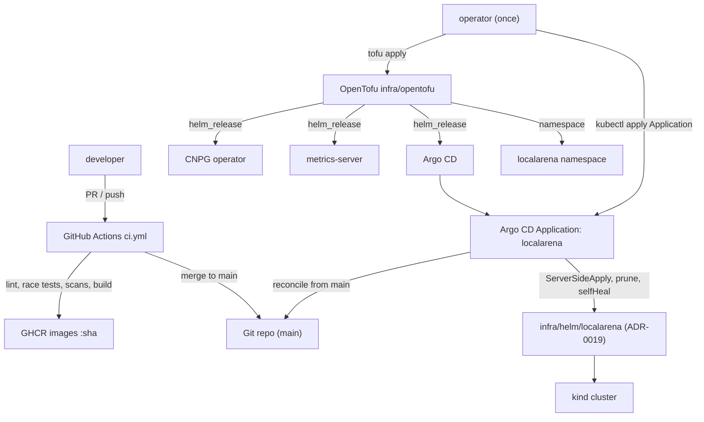
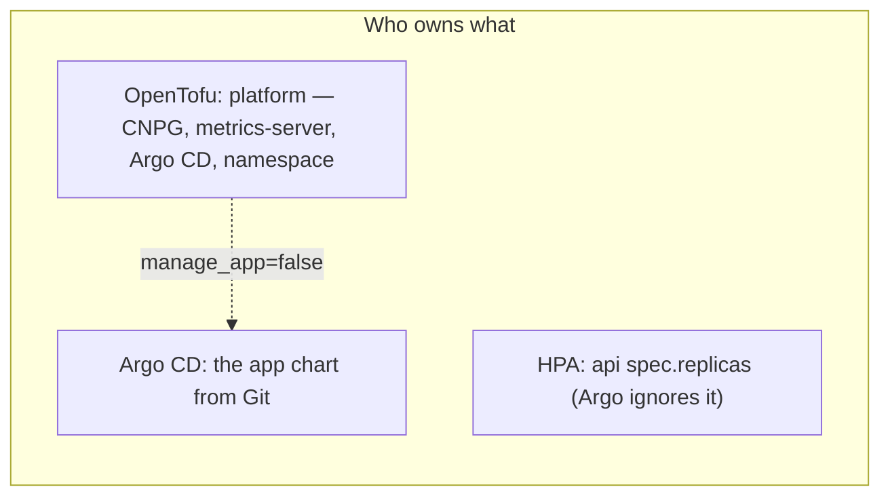
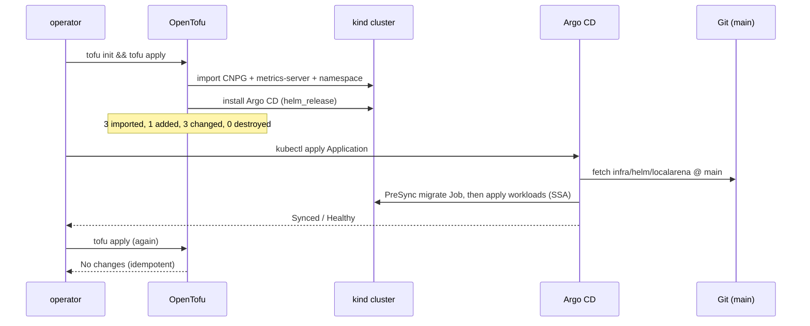
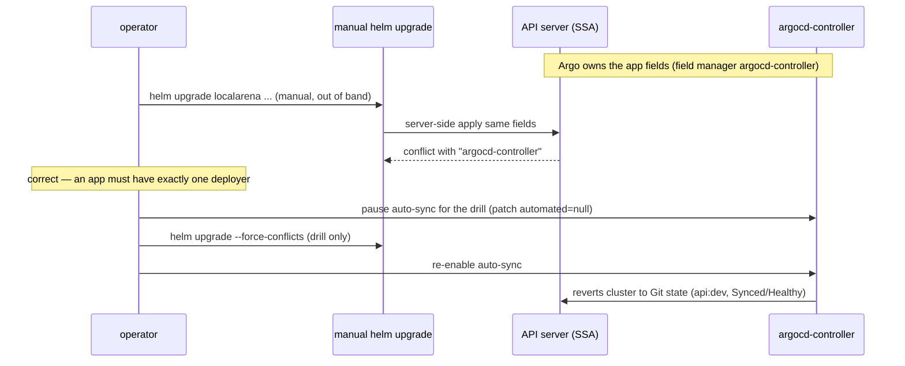
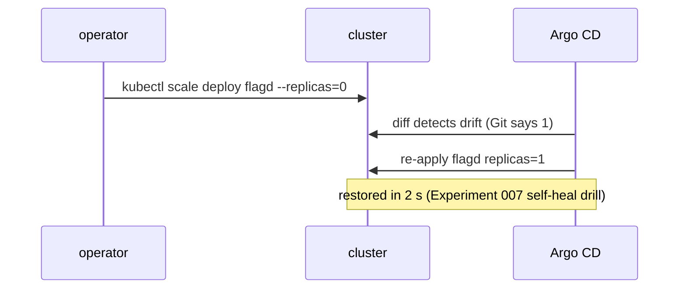

# ADR-0020 deep dive: OpenTofu for the platform, Argo CD for the app, GitHub Actions CI

> Source decision: [`../../adr/0020-iac-ci-gitops.md`](../../adr/0020-iac-ci-gitops.md)
> Evidence: [`../../experiments/007-week7-delivery/README.md`](../../experiments/007-week7-delivery/README.md)
> Code: [`../../infra/opentofu`](../../infra/opentofu), [`../../infra/argocd/localarena-app.yaml`](../../infra/argocd/localarena-app.yaml), [`../../.github/workflows/ci.yml`](../../.github/workflows/ci.yml)

## 1. TL;DR

- **Clear ownership split.** OpenTofu (`infra/opentofu`) owns *platform* pieces (app namespace, CloudNativePG operator, metrics-server, Argo CD) with pinned versions and `import` blocks to adopt existing releases. Argo CD owns the *application* (renders `infra/helm/localarena` from `main` with automated sync, prune, self-heal, retry). Exactly one controller deploys the app.
- **GitOps reconciliation + self-heal.** An Argo CD `Application` continuously reconciles the cluster to Git; manual drift is reverted. `ServerSideApply=true` means a manual `helm upgrade` against the Argo-managed release conflicts on field ownership (finding F1) — which is correct, and drills explicitly pause auto-sync.
- **CI** (`.github/workflows/ci.yml`): Go (gofmt/vet/golangci-lint, `-race` integration tests against Postgres/Valkey/OPA service containers, govulncheck, gosec), Kafka Streams Gradle tests, `opa test`, promtool rule tests, `helm lint/template`, `tofu fmt/validate`, Apicurio BACKWARD_TRANSITIVE schema check, Trivy config+secret scans, and Buildx image builds with the GitHub Actions layer cache, Trivy-scanned (HIGH/CRITICAL fail) and pushed to GHCR by commit SHA on `main`.
- **Reproducible bring-up:** `tofu apply` → `kubectl apply` the Application → Argo CD converges. Experiment 007 OpenTofu run: `3 imported, 1 added, 3 changed, 0 destroyed`; the second plan shows **No changes** (idempotent). GitOps self-heal restored a scaled-to-0 `flagd` in **2 s**.
- **Known gap:** image promotion is not automated yet — the cluster uses locally loaded `:dev` images; CI publishes SHA-tagged images to GHCR but nothing updates the running tag.

## 2. Context and problem

Week 7's goal (README §7) is a *reproducible* environment: CI/CD, Kubernetes, IaC via OpenTofu, Helm, build caching and dependency management, with the gate "environment is reproducible; API deploys without visible outage" (README §7 Gate). Three distinct responsibilities must be separated cleanly, or they fight:

1. **Who creates the cluster-level platform** (operators like CNPG, metrics-server, and Argo CD itself)? This is bootstrap infrastructure — it must exist *before* GitOps can run, so it cannot be managed by GitOps. IaC (OpenTofu) is the right tool, with state and drift detection.
2. **Who deploys the application** (the Helm chart from ADR-0019)? Exactly one controller must own it; two deployers tramping on the same objects corrupt field ownership. GitOps (Argo CD) is the right tool: Git is the source of truth, and self-heal reverts manual drift.
3. **How is every change validated before it merges?** CI must lint, race-test, security-scan, check schema compatibility, validate Helm/Tofu, and build reproducible images.

A subtlety the ADR calls out: Helm 4 uses **server-side apply**, so field ownership becomes a hard constraint. If OpenTofu *and* Argo CD both tried to manage the app, or if an operator ran `helm upgrade` by hand against an Argo-managed release, Kubernetes would reject the write with a field-ownership conflict (finding F1). The resolution is organizational: `manage_app=false` in Tofu by default, and all app changes go through Git.

## 3. HLD

Two control loops with a clean boundary: OpenTofu runs once (imperatively, by an operator) to establish the platform; Argo CD runs continuously to keep the app converged to Git. CI gates what reaches `main`.

## 4. LLD

### Components and responsibilities

| Component | File | Responsibility |
|---|---|---|
| Tofu platform | `infra/opentofu/main.tf` | namespace + `helm_release` for CNPG, metrics-server, Argo CD; optional app release. |
| Provider pins | `infra/opentofu/versions.tf` | `required_version >= 1.13.0`, `helm 3.3.0`, `kubernetes 3.3.0`, local state note. |
| Variables | `infra/opentofu/variables.tf` | `kubeconfig`, `kube_context`, `app_namespace`, `image_tag`, `manage_app=false`. |
| Import blocks | `infra/opentofu/imports.tf` | adopt existing namespace, CNPG, metrics-server. |
| Argo CD values | `infra/opentofu/argocd-values.yaml` | single replicas, no Dex/notifications, insecure HTTP in-cluster. |
| Outputs | `infra/opentofu/outputs.tf` | installed chart versions. |
| Argo Application | `infra/argocd/localarena-app.yaml` | GitOps source, syncPolicy, ignoreDifferences. |
| CI pipeline | `.github/workflows/ci.yml` | `go`, `streams`, `policy-and-config`, `images` jobs. |
| kind cluster | `infra/kubernetes/kind/cluster.yaml` | 1 control plane + 2 workers. |
| CNPG operator values | `infra/kubernetes/helm/cnpg-values.yaml` | 2 operator replicas, topology spread. |

### OpenTofu resources (exact config)

From `infra/opentofu/main.tf` + `versions.tf` + `variables.tf`:

- `kubernetes_namespace_v1.app`: name from `var.app_namespace` (`localarena`), label `app.kubernetes.io/part-of=localarena`.
- `helm_release.cnpg`: chart `cloudnative-pg` `0.29.1` from `https://cloudnative-pg.github.io/charts`, namespace `cnpg-system`, `create_namespace`, values from `cnpg-values.yaml`, `wait=true`.
- `helm_release.metrics_server`: chart `metrics-server` `3.14.0`, namespace `kube-system`, `set args[0]=--kubelet-insecure-tls` (kind self-signed kubelet certs).
- `helm_release.argocd`: chart `argo-cd` `10.10.5` from `https://argoproj.github.io/argo-helm`, namespace `argocd`, `create_namespace`, values from `argocd-values.yaml`, `wait=true`, `timeout=600`.
- `helm_release.localarena`: `count = var.manage_app ? 1 : 0` (so **0** by default), chart `../helm/localarena`, values `values-dev.yaml`, `set image.*.tag=var.image_tag`, `atomic=true`, `timeout=600`, `depends_on=[cnpg]`.
- Providers pinned: `hashicorp/helm 3.3.0`, `hashicorp/kubernetes 3.3.0`; `required_version >= 1.13.0`.
- State: **local**, gitignored (`.gitignore` has `terraform.tfstate`); holds no secrets (none pass through Tofu). A shared setup would need a remote backend + locking.

Import blocks (`imports.tf`): adopt `kubernetes_namespace_v1.app` (`localarena`), `helm_release.cnpg` (`cnpg-system/cnpg`), `helm_release.metrics_server` (`kube-system/metrics-server`). Import is a no-op once in state.

### Argo CD Application (exact config)

From `infra/argocd/localarena-app.yaml`:

- `source`: `repoURL https://github.com/SanidhyaMadheshia/localArena.git`, `targetRevision main`, `path infra/helm/localarena`, `helm.valueFiles [values-dev.yaml]`, `releaseName localarena`.
- `destination`: in-cluster (`https://kubernetes.default.svc`), namespace `localarena`.
- `syncPolicy.automated { prune: true, selfHeal: true }`.
- `syncOptions: [ServerSideApply=true, RespectIgnoreDifferences=true]`.
- `retry { limit 3, backoff { duration 10s, factor 2, maxDuration 2m } }`.
- `ignoreDifferences`: `apps/Deployment api /spec/replicas` (owned by the HPA).

### Argo CD install values (exact config)

From `infra/opentofu/argocd-values.yaml`: `server.insecure: true`, `dex.enabled: false`, `notifications.enabled: false`, `applicationSet.replicas: 1`, and tight resource requests/limits for controller/repoServer/server/redis (lab sizing).

### CI pipeline (exact structure)

From `.github/workflows/ci.yml`:

- Triggers: `push` to `main`, all `pull_request`. `permissions: contents: read`. Concurrency group `ci-${{ github.ref }}` with `cancel-in-progress`.
- **Job `go`** (ubuntu-24.04): service containers `postgres:18.6-alpine`, `valkey:9.0.6-alpine` (host port 6380), `opa:1.21.2` (8181). Steps: checkout, setup-go `1.27.2` with `go.sum` cache, load the OPA policy into the service container, `gofmt -l` + `go vet`, golangci-lint `v2.15.0`, `go test -race -count=1 -p 1 ./...`, `govulncheck@v1.9.0`, `gosec@v2.29.0` (`-exclude=G404`).
- **Job `streams`**: setup-java temurin 21 with gradle cache, `./gradlew test --no-daemon`.
- **Job `policy-and-config`**: `opa test`, promtool `check rules` + `test rules` on `infra/observability/rules/slo.yml`, `helm lint` + `helm template` (with `--set api.canary.enabled=true`), `tofu fmt -check` + `tofu init -backend=false` + `tofu validate`, Apicurio `3.3.3` BACKWARD_TRANSITIVE check of the PR's `events.proto` against `main`, Trivy fs scan (`misconfig,secret`, HIGH/CRITICAL, `exit-code 1`, `skip-dirs experiments`).
- **Job `images`** (`needs: [go, streams, policy-and-config]`, `permissions: packages: write`): matrix api/gameserver/streams; Buildx; login to GHCR on push; `build-push-action@v6` with `cache-from/to: type=gha, scope=<name>, mode=max`; push on `push`, `load` on PR; tag `ghcr.io/<owner>/localarena-<name>:${{ github.sha }}`; Trivy image scan (HIGH/CRITICAL, `exit-code 1`, `ignore-unfixed`).
- Tool versions pinned; validated with actionlint (per ADR, not run on GitHub yet).

### Algorithm — reproducible bring-up

1. Create the kind cluster (`infra/kubernetes/kind/cluster.yaml`, 1 control plane + 2 workers).
2. `cd infra/opentofu && tofu init && tofu apply` → adopts existing CNPG/metrics-server/namespace via `import`, installs Argo CD. Second apply is a no-op (`No changes`).
3. `kubectl apply -f infra/argocd/localarena-app.yaml` → Argo CD renders the chart from `main` and syncs (migrate Job PreSync hook first).
4. Argo CD reconciles continuously: prune removes resources no longer in Git, self-heal reverts manual drift.

### Algorithm — drift and self-heal

1. Argo's application controller diffs the live cluster against the rendered chart on a timer and on webhook.
2. If a resource drifted (someone ran `kubectl scale`), `selfHeal` re-applies the Git state.
3. `ignoreDifferences` excludes fields owned by other controllers (`/spec/replicas` → HPA), so those are not treated as drift.
4. `ServerSideApply` means Argo CD is a named field manager; a competing manual `helm upgrade` conflicts on the fields Argo owns (F1).

## 5. Sequence diagrams

### Happy path — bring up platform, then let GitOps converge

### Failure path — two controllers, one app (finding F1)

### Edge path — manual drift is self-healed

## 6. Concepts explained

### Infrastructure as Code (IaC)

- **What it is.** Declaring infrastructure in versioned code so it can be reviewed, applied repeatably, and diffed against reality.
- **Why LocalArena uses it.** OpenTofu declares the platform (operators, metrics-server, Argo CD, namespace) with pinned versions, so bring-up is `tofu apply`, not a runbook of manual `helm install`s.
- **What was measured.** Experiment 007: `3 imported, 1 added, 3 changed, 0 destroyed`; second plan `No changes`.
- **Where else it is used.** (1) Provisioning cloud VPCs/subnets/IAM. (2) Managing Kubernetes operators across clusters. (3) Declaring DNS zones and TLS certs.

### OpenTofu vs Terraform

- **What it is.** OpenTofu is an open-source, Terraform-compatible fork (HCL, providers, state). It exists because Terraform moved to the BSL license.
- **Why LocalArena uses it.** README §3 mandates open-source only (no proprietary license). OpenTofu gives the Terraform workflow (`init`/`plan`/`apply`, providers, `import`) without the license constraint.
- **What was measured.** OpenTofu `1.13.1`, providers `helm/kubernetes 3.3.0` (Experiment 007 system config). Not a behavioural measurement.
- **Where else it is used.** (1) Teams migrating off BSL Terraform. (2) CI that must stay fully OSS. (3) Vendors shipping OSS reference infra.

### State, import, drift

- **What it is.** *State* is Tofu's record of what it manages. *Import* adopts a pre-existing resource into state without recreating it. *Drift* is divergence between state and reality.
- **Why LocalArena uses it.** Weeks 2–7 created CNPG and metrics-server by hand; `imports.tf` adopts them so `apply` doesn't destroy-and-recreate. State is local+gitignored (no secrets flow through Tofu); a shared setup would need a remote backend + locking.
- **What was measured.** The import run showed `3 imported` and a subsequent `No changes`, proving adoption, not recreation.
- **Where else it is used.** (1) Bringing a hand-built prod resource under IaC. (2) Detecting out-of-band changes (drift) before they break a deploy. (3) Remote-state locking to prevent concurrent `apply`s.

### Provider/version pinning and `.terraform.lock.hcl`

- **What it is.** Pinning provider and tool versions so applies are reproducible; the lock file records exact provider hashes.
- **Why LocalArena uses it.** `versions.tf` pins providers to `3.3.0` and the core to `>= 1.13.0`; a lock file is committed. CI runs `tofu init -backend=false && tofu validate`.
- **What was measured.** Not a runtime metric; reproducibility is the property.
- **Where else it is used.** (1) Any multi-engineer IaC repo. (2) Supply-chain-sensitive infra. (3) Air-gapped mirrors of providers.

### GitOps reconciliation

- **What it is.** A controller continuously makes the cluster match a Git-declared desired state (pull-based CD), instead of a pipeline pushing `kubectl apply`.
- **Why LocalArena uses it.** The Argo CD `Application` renders the chart from `main` and syncs; Git is the single source of truth for the app. Exactly one controller deploys it.
- **What was measured.** Self-heal restored `flagd` in **2 s**; re-enabling auto-sync moved the cluster "straight back to the Git state (`api:dev`, Synced/Healthy)".
- **Where else it is used.** (1) Fleet-wide app rollout across many clusters. (2) Auditable prod changes (every change is a Git commit). (3) Disaster recovery (reconstruct a cluster from Git).

### Self-heal and prune

- **What it is.** *Self-heal* reverts manual drift to Git; *prune* deletes resources that were removed from Git.
- **Why LocalArena uses it.** `syncPolicy.automated { prune: true, selfHeal: true }` so the cluster can't silently drift and deleted manifests are cleaned up.
- **What was measured.** `kubectl scale deploy flagd --replicas=0` → Argo restored 1 replica in 2 s (Experiment 007 `argocd-selfheal.txt`).
- **Where else it is used.** (1) Preventing config drift in regulated environments. (2) Guaranteeing removed features actually leave the cluster. (3) Enforcing a golden config across tenants.

### Server-side apply and field ownership

- **What it is.** Kubernetes tracks, per object, which *field manager* owns each field. Two managers writing the same field without `--force-conflicts` get a conflict error.
- **Why LocalArena uses it.** Argo CD syncs with `ServerSideApply=true`, becoming the field manager for the app's fields. A manual `helm upgrade` then correctly conflicts (F1) — enforcing "one deployer". `ignoreDifferences` + `RespectIgnoreDifferences` lets the HPA own `/spec/replicas` without a fight.
- **What was measured.** F1: manual `helm upgrade` failed with `conflict with "argocd-controller"`; drills paused auto-sync and used `--force-conflicts`.
- **Where else it is used.** (1) Multiple controllers safely co-managing one object (e.g. HPA + GitOps). (2) Operators owning status fields while users own spec. (3) Preventing accidental clobbering in shared clusters.

### CI pipeline (stages and gates)

- **What it is.** Automated lint/test/scan/build on every push and PR, failing the merge if any gate fails.
- **Why LocalArena uses it.** `ci.yml` runs Go lint+race+integration tests against real service containers, Streams tests, OPA/alert-rule tests, Helm/Tofu validation, schema compatibility, and security scans before anything merges or ships.
- **What was measured.** Not run on GitHub yet; validated with actionlint only (a documented remaining risk).
- **Where else it is used.** (1) Any PR-gated monorepo. (2) Compliance pipelines (scan gates). (3) Library release pipelines.

### Service containers and `-race` integration tests

- **What it is.** GitHub Actions `services:` spin up ephemeral Postgres/Valkey/OPA so tests run against real dependencies; Go's `-race` detector catches data races.
- **Why LocalArena uses it.** The `go` job tests the real DB/cache/policy paths (`go test -race -count=1 -p 1 ./...`) rather than mocks, catching concurrency bugs (relevant to ADR-0003/0006).
- **What was measured.** CI not yet run on GitHub; locally the race detector is part of the week-1/2 experiments.
- **Where else it is used.** (1) DB-backed service tests in CI. (2) Contract tests against a real broker. (3) Policy tests against a real OPA.

### Caching builds (GitHub Actions layer cache)

- **What it is.** Reusing Docker layer cache across CI runs (`cache-from/to: type=gha`) to avoid rebuilding unchanged layers.
- **Why LocalArena uses it.** The `images` job caches per-image (`scope=<name>, mode=max`) so builds are fast and reproducible.
- **What was measured.** No timing captured (CI not run on GitHub).
- **Where else it is used.** (1) Monorepo image builds. (2) Multi-arch builds. (3) Large base-image pipelines.

### Supply-chain scanning (Trivy, govulncheck, gosec)

- **What it is.** Scanning source config/secrets, Go dependencies, Go code, and built images for vulnerabilities/misconfig, failing on HIGH/CRITICAL.
- **Why LocalArena uses it.** `govulncheck` (Go vulns), `gosec` (insecure code, `-exclude=G404`), Trivy fs (`misconfig,secret`) and Trivy image (HIGH/CRITICAL fail, `ignore-unfixed`) — defense-in-depth before publishing.
- **What was measured.** Not run on GitHub yet; configured to `exit-code 1` on findings.
- **Where else it is used.** (1) Container registries with admission scanning. (2) SBOM/vuln gating in regulated CD. (3) Secret-leak prevention in PRs.

### Schema compatibility gate (Apicurio BACKWARD_TRANSITIVE)

- **What it is.** Checking a PR's event schema against `main` for backward-transitive compatibility so consumers don't break (ADR-0015).
- **Why LocalArena uses it.** CI registers the base `events.proto` then checks the head against it, failing on a breaking change.
- **What was measured.** Not a runtime metric; it's a merge gate. Behavioural proof of breaking-change rejection is in week-5 work (ADR-0015).
- **Where else it is used.** (1) Kafka event-driven platforms. (2) gRPC/protobuf API evolution. (3) Public API versioning gates.

### Image promotion (the documented gap)

- **What it is.** Moving a built, scanned image into the running environment by updating the deployed tag.
- **Why LocalArena uses it (or not).** It is *not* automated: CI pushes SHA-tagged images to GHCR, but the cluster runs locally loaded `:dev` images. The next step is an image-updater or a CI values commit.
- **What was measured.** N/A — explicitly a remaining risk.
- **Where else it is used.** (1) Argo CD Image Updater. (2) Flux image automation. (3) CI commits a new tag to the GitOps repo.

## 7. Code pointers

| Path (symbol / key) | What to look at |
|---|---|
| [`infra/opentofu/main.tf`](../../infra/opentofu/main.tf) `helm_release.*` | CNPG/metrics-server/Argo CD releases; `localarena` guarded by `manage_app`. |
| [`infra/opentofu/versions.tf`](../../infra/opentofu/versions.tf) | Pinned versions; local-state rationale. |
| [`infra/opentofu/variables.tf`](../../infra/opentofu/variables.tf) `manage_app` | Default `false` — Argo CD owns the app. |
| [`infra/opentofu/imports.tf`](../../infra/opentofu/imports.tf) | Adopt existing namespace/CNPG/metrics-server. |
| [`infra/opentofu/argocd-values.yaml`](../../infra/opentofu/argocd-values.yaml) | Lab-sized Argo CD install values. |
| [`infra/argocd/localarena-app.yaml`](../../infra/argocd/localarena-app.yaml) | `automated {prune,selfHeal}`, `ServerSideApply`, `ignoreDifferences /spec/replicas`, retry. |
| [`.github/workflows/ci.yml`](../../.github/workflows/ci.yml) job `go` | service containers, race/integration tests, govulncheck, gosec. |
| [`.github/workflows/ci.yml`](../../.github/workflows/ci.yml) job `policy-and-config` | opa test, promtool, helm lint/template, tofu validate, Apicurio check, Trivy fs. |
| [`.github/workflows/ci.yml`](../../.github/workflows/ci.yml) job `images` | Buildx, GHA layer cache, GHCR push by SHA, Trivy image scan. |
| [`infra/kubernetes/kind/cluster.yaml`](../../infra/kubernetes/kind/cluster.yaml) | 1 control plane + 2 workers (real node-loss failover). |
| [`infra/kubernetes/helm/cnpg-values.yaml`](../../infra/kubernetes/helm/cnpg-values.yaml) | 2 operator replicas, topology spread (leader election). |
| [`experiments/007-week7-delivery/results/argocd-selfheal.txt`](../../experiments/007-week7-delivery/results/argocd-selfheal.txt) | flagd restored in 2 s. |
| [`experiments/007-week7-delivery/results/hpa.txt`](../../experiments/007-week7-delivery/results/hpa.txt) | metrics-server driving the HPA. |

## 8. Trade-offs and alternatives

| Option | Pros | Cons | Why (not) chosen |
|---|---|---|---|
| **OpenTofu for platform + Argo CD for app** (chosen) | Clear ownership; bootstrap vs continuous reconciliation separated; one deployer per layer. | Two tools to learn; a bootstrap chicken-and-egg (Argo installed by Tofu). | Chosen: matches the two different lifecycles. |
| Argo CD manages everything incl. operators | Single tool. | GitOps can't bootstrap itself; operators need to exist first. | Rejected: bootstrap must precede GitOps. |
| Tofu manages the app too (`manage_app=true`) | One tool end-to-end. | Two deployers → SSA field-ownership conflicts (F1); no continuous reconciliation. | Default off; only for a quick local install. |
| Terraform (BSL) | Mature ecosystem. | Non-OSS license. | Rejected: README mandates OSS. |
| Remote state + locking | Safe for teams. | Extra backend to run. | Deferred: local state is fine for a single-operator lab; noted as the next step for sharing. |
| Push-based CD (`kubectl apply` in CI) | Simple. | No drift detection/self-heal; CI needs cluster creds. | Rejected: GitOps gives self-heal + audit + pull model. |
| Automated image promotion | Fully hands-off deploys. | Needs an image-updater or values-commit flow. | Not built yet — documented gap. |

## 9. Failure modes and how they were found

- **F1 — two controllers, one app:** found in [`../../experiments/007-week7-delivery/README.md`](../../experiments/007-week7-delivery/README.md). A manual `helm upgrade` against the Argo-managed release conflicted on SSA field ownership. Correct behaviour; drills pause auto-sync and the normal path is Git-only.
- **Drift:** `kubectl scale deploy flagd --replicas=0` was self-healed in 2 s (self-heal drill).
- **Idempotency of IaC:** the second `tofu apply` showed `No changes`, proving import adopted rather than recreated.
- **F2 (shared with ADR-0019):** first install with automatic rollback deletes the non-`keep` Pooler — informs why Tofu's `localarena` release (`atomic=true`) is for quick local installs only, not production first-installs.
- **CI not yet run on GitHub:** a documented remaining risk — the workflow is validated by actionlint only, and GHCR publishing needs package permissions.

## 10. Interview questions

1. **Why split platform (OpenTofu) from app (Argo CD) instead of one tool?**
   They have different lifecycles. The platform (operators, metrics-server, Argo CD itself) must exist *before* GitOps can run, so it is bootstrapped imperatively with IaC. The app is then reconciled continuously from Git. One deployer owns each layer, avoiding field-ownership conflicts.

2. **What is `manage_app=false` protecting against?**
   It stops OpenTofu from also deploying the app. If both Tofu and Argo CD managed it, server-side apply would produce field-ownership conflicts (F1). Default off means Argo CD is the single app deployer.

3. **Explain finding F1 and why it's actually correct behaviour.**
   Helm 4 uses server-side apply, so Argo CD becomes the field manager (`argocd-controller`). A manual `helm upgrade` tries to own the same fields and the API server rejects it with a conflict. That's correct: an application must have exactly one deployer. Drills pause auto-sync and use `--force-conflicts`; normally changes go through Git.

4. **How do the HPA and Argo CD avoid fighting over replica count?**
   The API Deployment omits `spec.replicas` (HPA owns it), and the Argo Application sets `ignoreDifferences` on `apps/Deployment api /spec/replicas` with `RespectIgnoreDifferences=true`, so Argo doesn't treat HPA-driven scaling as drift.

5. **What does `import` give you, and why not just recreate?**
   Import adopts a pre-existing resource (CNPG, metrics-server) into Tofu state so `apply` manages it in place. Recreating would delete and rebuild the operator (and risk the database it manages). The run proved it: `3 imported`, then `No changes`.

6. **Why is local Tofu state acceptable here, and when would you change it?**
   No secrets pass through Tofu, and it's a single-operator lab, so local gitignored state is fine (backed up with the repo). A shared/multi-operator setup needs a remote backend with state locking to prevent concurrent `apply` corruption.

7. **Walk through a full reproducible bring-up.**
   Create the kind cluster → `tofu init && tofu apply` (imports CNPG/metrics-server/namespace, installs Argo CD) → `kubectl apply` the Application → Argo CD runs the PreSync migrate Job then syncs the chart from `main` → it reconciles continuously.

8. **What does GitOps self-heal actually do, and how fast was it here?**
   The Argo controller diffs live state against Git on a timer/webhook and re-applies drift. Scaling `flagd` to 0 was reverted to 1 replica in 2 s.

9. **List the CI gates and what each catches.**
   gofmt/vet/golangci-lint (style/bugs), `-race` integration tests (concurrency against real Postgres/Valkey/OPA), govulncheck (Go CVEs), gosec (insecure code), Gradle Streams tests, `opa test` (policy), promtool (alert rules), `helm lint/template` (chart), `tofu fmt/validate` (IaC), Apicurio BACKWARD_TRANSITIVE (schema compat), Trivy fs+image (misconfig/secrets/CVEs).

10. **Why build images with the GitHub Actions layer cache and tag by SHA?**
    Layer caching (`type=gha, mode=max, scope=<name>`) makes rebuilds fast and reproducible; tagging by commit SHA makes every image immutable and traceable to a commit, which is what an image-promotion flow would reference.

11. **What's the image-promotion gap and how would you close it?**
    CI pushes SHA-tagged images to GHCR but nothing updates the running tag (cluster uses `:dev`). Close it with Argo CD Image Updater or a CI step that commits the new tag to the GitOps values and lets Argo reconcile.

12. **Why does metrics-server need `--kubelet-insecure-tls` here, and would you keep it in prod?**
    kind's kubelets use self-signed certs, so metrics-server can't verify them. In production you'd provision proper kubelet serving certs and drop the flag — it's a lab accommodation, not a pattern.

13. **(Design) You now manage 20 clusters across 3 regions. How does this change?**
    Keep OpenTofu per-cluster for the platform (or a module applied per cluster) with a remote locked backend; use Argo CD ApplicationSets to template one Application per cluster/region from a single generator; promote images via automated tag commits; add environment overlays (values per region); centralize RBAC and projects in Argo CD; and add progressive delivery (SLO-gated canaries, ADR-0019).

14. **(Design / 100x scale) How do you keep CI fast and safe at 100x the code and contributors?**
    Shard and parallelize jobs (already split go/streams/policy/images), cache aggressively (Go module + Docker layer caches, Gradle cache), run only affected targets via change detection, keep service-container integration tests but gate the heaviest (full e2e) on merge-queue not every PR, enforce required scans as merge gates, and use a merge queue to serialize integration against `main`.

15. **What's the single biggest risk documented in this ADR, and how is it bounded?**
    Running two deployers against one app (F1) or a destructive first-install-with-rollback (F2). Both are bounded organizationally: `manage_app=false`, Git-only changes, `helm.sh/resource-policy: keep` on stateful resources, and no automatic rollback on first installs.
