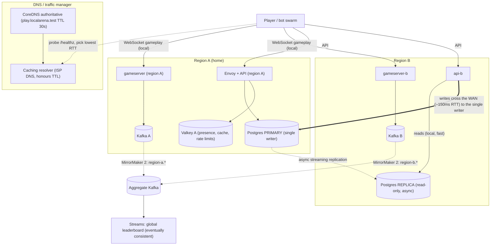
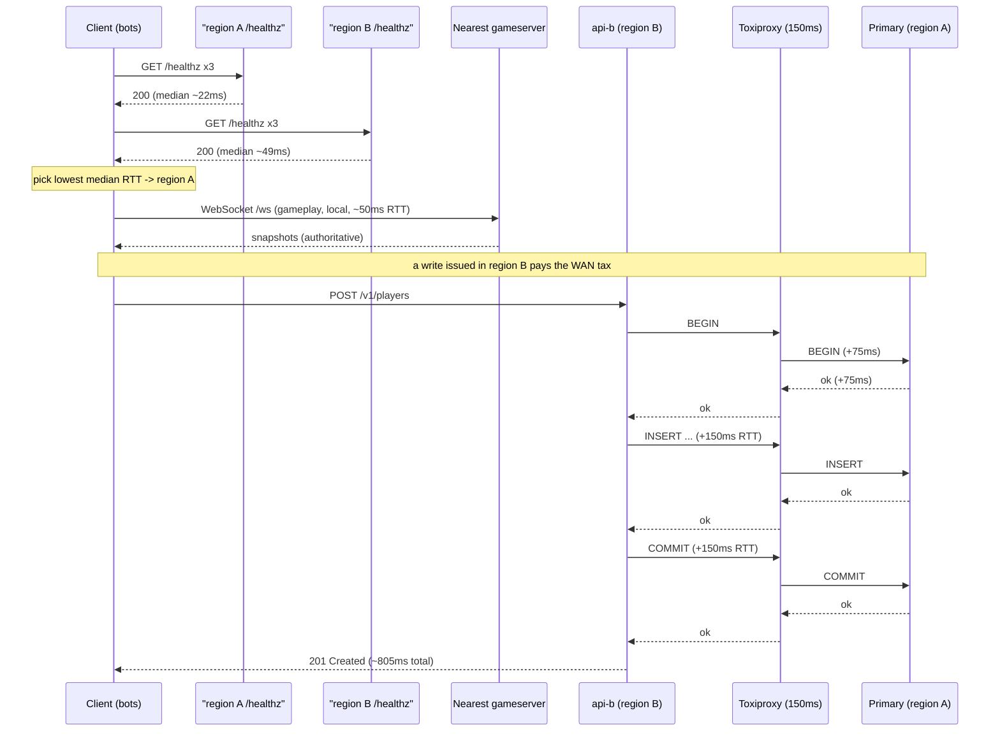
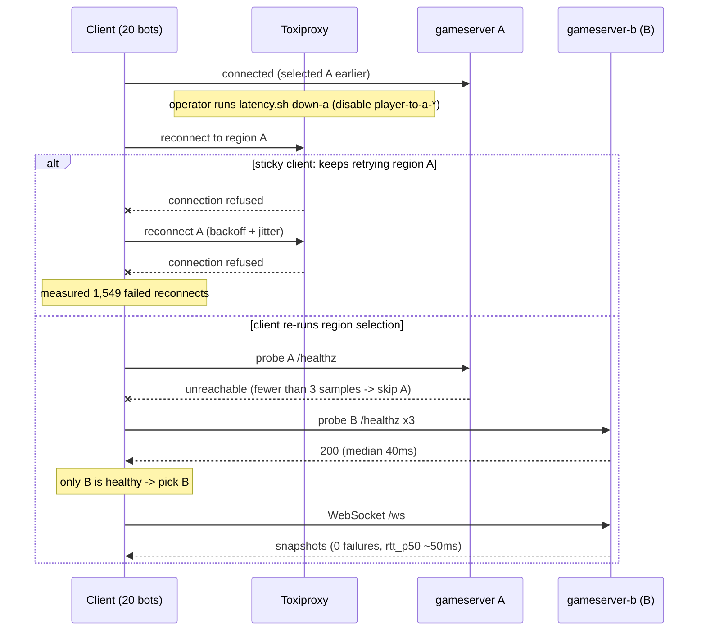
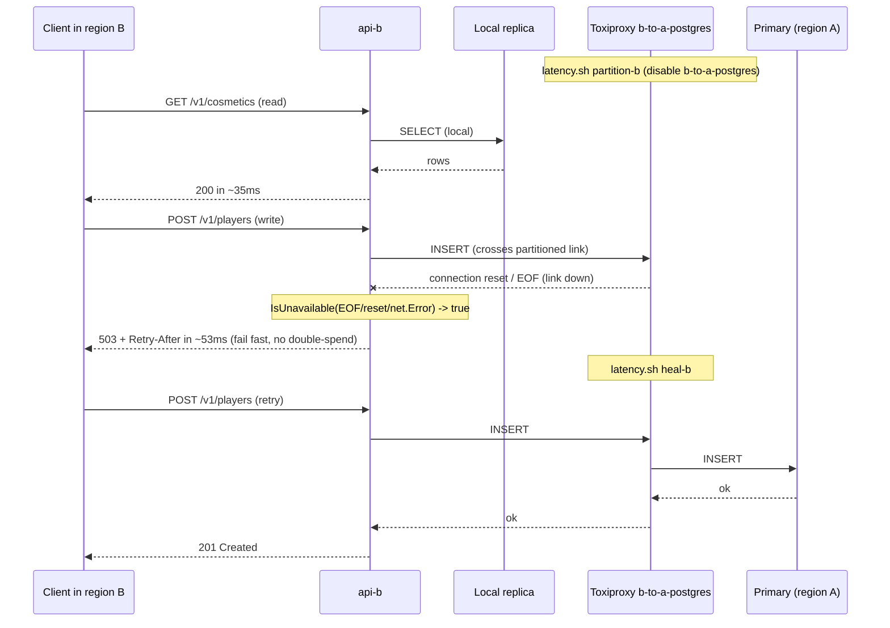

# ADR-0021 deep dive: Multi-region: region-local gameplay, single-writer economy, regional failover

> Source decision: [`../../adr/0021-multi-region.md`](../../adr/0021-multi-region.md)
> Evidence: [`../../experiments/008-week8-regions/README.md`](../../experiments/008-week8-regions/README.md), [`../../experiments/008-week8-regions/cost.md`](../../experiments/008-week8-regions/cost.md), [`../../postmortems/PM-002-final-game-day.md`](../../postmortems/PM-002-final-game-day.md), [`../../FINAL_REPORT.md`](../../FINAL_REPORT.md)

## 1. TL;DR

- **Gameplay is region-local and latency-critical; the economy has one home.** Match state lives in the region's gameserver process; accounts, credits and inventory have a single writer (region A's Postgres primary) and are read from local replicas elsewhere. This is a deliberate *CP for money, AP for gameplay and reads* split.
- **Region B pays the WAN tax on every write.** A `POST /v1/players` in B took a measured **805 ms** versus **35 ms** in A, because each SQL round trip in the transaction crosses the simulated 150 ms inter-region link to the single writer. Reads stay local and fast.
- **Failover has two speeds.** Client-side health-based region selection (`bots -servers`, probe `/healthz`, pick lowest median RTT) recovers in seconds: sticky clients saw **1,549 failed reconnects**, re-selecting clients saw **0**. DNS failover is coarse and TTL-bounded: a caching resolver kept serving the old region for **~34–39 s** at TTL 30 s.
- **A region partition degrades writes only.** When B lost its link to A, B reads returned 200 in 35 ms and gameplay was unaffected (0 connect failures), while B writes failed fast with **503 in 53 ms** inside the 3 s budget — no double-spend, no hang. `IsUnavailable` had to be widened to map dead pooled connections (EOF/reset) to 503 instead of 500.
- **Cross-cluster Kafka (MirrorMaker 2) is a design exercise, not deployed.** Source-region topic prefixes (`region-a.*`) prevent replication loops; globally unique event IDs keep mirror-delivered duplicates idempotent; a region↔aggregate partition only delays the *global* leaderboard, never local producers.

## 2. Context and problem

Players are spread across geographies. Two forces pull in opposite directions:

1. **Gameplay wants the nearest server.** Input→snapshot round-trip time is dominated by physical distance (speed of light in fibre). A 20 Hz authoritative loop (ADR-0001) already spends 50 ms between ticks; adding a trans-continental 150 ms RTT on top would make the game feel broken. So the simulation must run close to the player.
2. **Money wants one truth.** Credits, inventory and purchases are money-like: they must never be double-spent or diverge. Multi-master writes across regions introduce write-write conflicts that are genuinely hard to resolve correctly (you need CRDTs, last-writer-wins with vector clocks, or application-level merge). That is explicitly out of scope (README calls active-active an optional stretch goal).

LocalArena resolves the tension by classifying data and giving each class its own ownership and consistency policy. The whole thing is simulated on **one host** so that the behaviour — not the absolute latencies — can be measured. Experiment 008 builds "region A" and "region B" as separate service sets on the same Docker network, with [Toxiproxy](../../infra/compose/regions/toxiproxy.json) injecting a simulated WAN:

| Link | Simulated one-way | Simulated RTT |
|---|---|---|
| player → region A | 10 ms ± 3 | ~20 ms |
| player → region B | 20 ms ± 5 | ~40 ms |
| region B → region A database | 75 ms ± 5 | **150 ms** |

(From [`infra/compose/regions/latency.sh`](../../infra/compose/regions/latency.sh): `apply` adds `latency` toxics on both `downstream` and `upstream` streams of each proxy.)

The invariant we are protecting: **players near either region get bounded input latency, and credits never double-spend, even during a region partition.**

## 3. HLD

Region A is the *home region*: it owns the Postgres primary (the single writer for the economy) and runs the existing gameserver/API/Envoy stack. Region B is a second, independent set of services (`gameserver-b`, `api-b`) that read a local replica but send writes across the WAN to A's primary. Players reach both regions through Toxiproxy listeners (the "simulated WAN edge"), and discover the active region through DNS.

Key properties visible in the diagram:

- **Gameplay never crosses the WAN.** `GSA`/`GSB` serve the players connected to them, in-process, and emit events to a *local* Kafka. The WAN link exists only on B's write path to the primary.
- **One writer.** Only `PGP` accepts economy writes. `api-b` writes there over the WAN; it reads its local `REP`.
- **Replication is asynchronous.** `REP` lags the primary by the replication delay, so B's reads can be stale (eventual consistency).
- **Aggregation is offline.** The global leaderboard is computed from mirrored topics and lags by the mirror delay; per-region boards are fresh.

## 4. LLD

### 4.1 Components and responsibilities

| Component | Where | Responsibility |
|---|---|---|
| `toxiproxy` | shared host | The "simulated WAN." Listens on `21080/21081` (region A game/API) and `22080/22081` (region B game/API), plus `25432` (B→A primary via PgBouncer) and `25433` (B→A replica). Latency and partition toxics live here. |
| `coredns` | shared host | Authoritative DNS for `localarena.test`. `play.localarena.test` TXT record names the active region and port; failover = edit zone + bump SOA serial. TTL 30 s, `reload 2s`. |
| `resolver` | shared host | A caching resolver ("ISP DNS") that `forward`s to `coredns` and `cache 300`s. Models the client that keeps serving a stale answer until the *record* TTL expires. |
| `gameserver` / `gameserver-b` | A / B | Authoritative simulation for players connected to that region. `gameserver-b` runs with `-seed 1000`, `ALLOW_GUESTS=1`. |
| Envoy + `api` | A | Region A edge and API; writes/reads the local primary and replica. |
| `api-b` | B | Region B API. `DATABASE_URL` points at `toxiproxy:25432` (writes cross the WAN to A's PgBouncer); `REPLICA_URL` points at the local `postgres-replica`. `APP_REGION=b`, `LEGACY_V1=1`. |
| `postgres` (primary) | A | Single writer for accounts/credits/inventory/purchases/matches. |
| `postgres-replica` | A (shared in lab) | Async streaming replica that B reads from. In the lab both regions share this one replica (a stated limitation). |
| `bots` | client | Probes region `/healthz`, selects the lowest-RTT region, then plays. `pickRegion` is the client-side GSLB. |

### 4.2 Data ownership table (the core decision)

| Data | Owner / write location | Replication | Read location | Consistency |
|---|---|---|---|---|
| Live match state | region gameserver (in memory) | none | same process | strong, process-local, short-lived |
| Accounts / credits / inventory / purchases | **home-region primary (region A), single writer** | async streaming to replicas | local replica (+ LSN read-your-writes) | CP: writes fail during partition rather than diverge |
| Match results / history | primary (via API or outbox) | async replica | local replica, may be seconds stale | eventual |
| Profiles cache, presence, rate limits | region-local Valkey | none | local | disposable, per-region |
| Match events (Kafka) | region-local cluster (`game.match-events.v1`) | MirrorMaker 2 → aggregate as `region-a.game.match-events.v1` | analytics in aggregate region | at-least-once, per-partition order |
| Leaderboards | per-region Streams; global from mirrored topics | — | local board fresh; global board lags mirror | per-region strong-ish, global eventual |
| Economy events (outbox/CDC) | home region only (Debezium on primary) | mirrored outward | anywhere | follows the DB owner |

### 4.3 Config values (exact, from the repo)

From [`compose.yaml`](../../compose.yaml) regions profile (lines ~397–431):

- `toxiproxy`: image `ghcr.io/shopify/toxiproxy:2.13.0`; published ports `8474` (admin), `21080`, `21081`, `22080`, `22081`.
- `coredns` / `resolver`: image `coredns/coredns:1.14.7`. CoreDNS published on `127.0.0.1:1053:53/udp`.
- `gameserver-b`: `-tick-hz 20 -capacity 20 -round-seconds ${ROUND_SECONDS:-120} -seed 1000`, `ALLOW_GUESTS=1`, limits `cpus: "2"`, `memory: 256M`.
- `api-b`: `ADDR=":8081"`, `DATABASE_URL=...@toxiproxy:25432/localarena`, `REPLICA_URL=...@postgres-replica:5432/localarena`, `LEGACY_V1=1`, `APP_REGION=b`, limits `cpus: "1"`, `memory: 256M`.

From [`infra/compose/regions/latency.sh`](../../infra/compose/regions/latency.sh): player→A `latency:10 jitter:3`, player→B `latency:20 jitter:5`, b-to-a-postgres `latency:75 jitter:5` on both `downstream` and `upstream`.

From [`infra/compose/regions/toxiproxy.json`](../../infra/compose/regions/toxiproxy.json): six proxies — `player-to-a-game` (→`gameserver:8080`), `player-to-a-api` (→`envoy:10000`), `player-to-b-game` (→`gameserver-b:8080`), `player-to-b-api` (→`api-b:8081`), `b-to-a-postgres` (→`pgbouncer:5432`), `b-to-a-replica` (→`postgres-replica:5432`).

From [`infra/compose/regions/localarena.test.db`](../../infra/compose/regions/localarena.test.db): `$TTL 30`; SOA `( 103 60 30 600 30 )` (serial, refresh, retry, expire, minimum); `play 30 IN TXT "region=a port=21080"`.

From [`infra/compose/regions/Corefile`](../../infra/compose/regions/Corefile): `reload 2s`. From [`Corefile.resolver`](../../infra/compose/regions/Corefile.resolver): `forward . coredns:53`, `cache 300`.

### 4.4 Algorithms, step by step

**Client-side region selection** (`pickRegion`, [`backend/cmd/bots/main.go`](../../backend/cmd/bots/main.go)):

1. For each candidate region URL:
   1. GET `<url>/healthz` **3 times** with a **1 s** per-request timeout.
   2. If any probe fails (error), **skip** that region entirely (`break`; fewer than 3 samples → not a candidate).
   3. Sort the 3 samples; take the **median** (`samples[1]`), rounded to the millisecond.
2. Return the region with the lowest median RTT, and the full RTT map for logging.
3. If no region is healthy, print "no healthy region" and exit 1.
4. The selected region becomes `c.server`; all bots then connect there.

This is a tiny, client-side GSLB: ping beacons + lowest-latency pick, exactly what a real game client does. It is also the failover mechanism: on an outage, re-running selection drops the dead region (fewer than 3 successful probes) and moves to the survivor.

**Cross-region write path** (region B `POST /v1/players`):

1. `api-b` begins a transaction against `DATABASE_URL` = `toxiproxy:25432` → PgBouncer → region A primary.
2. Every statement (BEGIN, INSERT, any SELECT, COMMIT) is a separate network round trip across the 150 ms link.
3. ~5 sequential round trips × 150 ms ≈ **~750 ms** of pure WAN time, plus local work ≈ the measured **805 ms**.
4. Reads (`GET /v1/players/{id}`) go to the *local* replica, so they are fast (~28 ms in A). A **cache-miss** profile read in B costs ~198 ms because the cache fill reads the primary over the WAN (B has no local Valkey in the lab).

**Partition handling** (`IsUnavailable`, [`backend/internal/store/store.go`](../../backend/internal/store/store.go)):

1. A write hits a pooled connection whose underlying TCP link is severed by the partition.
2. The driver surfaces the failure as `io.EOF`, `ECONNRESET`, a `net.Error`, or `pgconn.SafeToRetry` — **not** always a connection-class (`08xxx`) SQLSTATE.
3. `IsUnavailable` returns `true` for all of these, so the handler answers **503 + `Retry-After`** (retryable) rather than **500**.
4. Result: the write fails fast (53 ms) and the caller can retry after failover — it is never a silent 5xx or a hang.

Before Experiment 008, the first B write during a partition returned **500** because a dead pooled connection mid-query does not yield an `08xxx` code; widening `IsUnavailable` fixed the classification.

## 5. Sequence diagrams

### 5.1 Happy path: client region selection + local gameplay + remote write

### 5.2 Failure path: region A goes dark, sticky vs re-selecting clients

### 5.3 Edge path: region B ↔ A partition (reads survive, writes fail fast)

## 6. Concepts explained

### 6.1 Multi-region architectures: active-passive, active-active, single-writer / home region

**What it is.** Three common shapes for running a system in more than one geographic location:
- *Active-passive*: one region serves everything; a standby region takes over on failure.
- *Active-active*: every region serves live traffic, including writes — requires conflict resolution for shared mutable data.
- *Single-writer / home region*: all writes for a piece of data go to one "home" region; other regions serve reads locally. A middle ground: locally fast reads and globally correct writes, without conflict resolution.

**Why LocalArena uses it.** Gameplay is *active-active-like* (each region runs its own simulation, no shared mutable state to conflict), while the economy is *single-writer* (region A primary). This keeps money correct without CRDTs and keeps input latency local.

**What was measured.** Single-writer behaviour is visible: local write in A = **35 ms**, remote write in B = **805 ms** (Exp 008 `cross-region-write.txt`). Active-active writes were explicitly not built.

**Where else it is used.**
- Banking core ledgers: one authoritative region for balances, read replicas elsewhere.
- E-commerce: inventory decrements on a home region to avoid overselling; product catalog read-replicated everywhere.
- SaaS multi-tenant apps: each tenant pinned to a "home" region for its primary data (data residency + single-writer).
- Payment processors: ledger writes serialized through one region; reporting read from replicas.

### 6.2 Data ownership and data sovereignty

**What it is.** Deciding, per data class, *who* may write it and *where* it physically lives. Sovereignty adds a legal dimension: some data must stay in a particular jurisdiction.

**Why LocalArena uses it.** The ADR's ownership table is the whole design: match state → gameserver, economy → home primary, cache/presence → region-local Valkey, events → region-local Kafka. Each class gets the cheapest consistency that is still correct.

**What was measured.** Not a latency number, but the *consequences* are measured throughout Exp 008 (stale reads for history, fast local reads, slow remote writes). Correctness held: credits never double-spent.

**Where else it is used.** GDPR/data-residency (EU user data stays in EU regions); healthcare (HIPAA data in compliant regions); fintech ledgers; a ride-hailing app keeping a city's trip data in-country.

### 6.3 Replication lag and eventual consistency across regions

**What it is.** Asynchronous replication copies writes to replicas *after* the primary commits, so replicas trail the primary by a variable delay. Reads from a replica may not see a just-committed write — the system is *eventually* consistent.

**Why LocalArena uses it.** Match history and leaderboards tolerate staleness, so B reads a lagging local replica rather than paying the WAN for every read. Profiles do not tolerate staleness, so they use the LSN read-your-writes trick from ADR-0004/0008.

**What was measured.** With replay paused (simulated lag), a match recorded through B was invisible in B's replica — **0 matches** returned — until replay resumed, then **1** (Exp 008 `stale-read.txt`). From Exp 006: RPO 0 when healthy, **2.8 s of writes** lost after a 5 s partition on async failover.

**Where else it is used.** Social feeds ("I posted but don't see it" on a read replica); e-commerce order status trailing the write DB; analytics dashboards reading a warehouse replica; DNS itself (eventually consistent by design).

### 6.4 Latency budgets and the speed of light

**What it is.** Light in fibre travels ~200,000 km/s, so distance sets a hard floor on RTT (~1 ms per 100 km one way, before equipment). A *latency budget* allocates that fixed floor plus processing time across the request path and refuses designs that can't fit.

**Why LocalArena uses it.** The 20 Hz loop already consumes 50 ms per tick; adding a 150 ms inter-region RTT to the *gameplay* path is unacceptable, which is exactly why simulation stays local and only economy writes cross the WAN.

**What was measured.** Local gameplay RTT p50/p99 = **49.9 / 56 ms** in A and **50.5 / 94 ms** in B (Exp 008 `rtt.txt`) — dominated by the simulated player link, not the WAN. The WAN cost shows only on the write path (805 ms).

**Where else it is used.** CDNs placing content near users; stock-trading colocation next to the exchange; video conferencing picking the nearest media server; multiplayer matchmaking by region.

### 6.5 Client-side region selection

**What it is.** The client, not the server, decides which region to use, usually by pinging candidate endpoints and choosing the lowest-latency healthy one.

**Why LocalArena uses it.** It is both the steady-state router (play on the nearest region) and the *fast* failover lever (re-probe on disconnect, drop the dead region). Server-side GSLB/DNS is too slow because of TTL caching.

**What was measured.** `pickRegion` chose A (22 ms vs 49 ms). On an A outage, re-selection moved all 20 bots to B with **0 failures**, versus **1,549** when they stuck to A (Exp 008 `failover.txt`).

**Where else it is used.** Game clients (ping beacons, "best region" UI); WebRTC ICE candidate selection; multi-CDN clients measuring and switching; mobile apps probing nearest API edge.

### 6.6 GSLB / anycast / DNS failover and TTL caching

**What it is.** Ways to send users to the right region at the network layer:
- *GSLB* (global server load balancing): a DNS-based traffic manager returns different answers based on health/geo.
- *Anycast*: the same IP is announced from many locations; BGP routes to the nearest.
- *DNS failover*: change the authoritative answer to repoint traffic; propagation is bounded by **TTL** — caching resolvers keep serving the old answer until the record's TTL expires.

**Why LocalArena uses it.** CoreDNS plays the traffic manager: `play.localarena.test` TXT names the active region; failover is "edit the zone + bump the serial." The ADR is explicit that this is a *coarse* lever and fast failover must come from the client.

**What was measured.** Authoritative answer changed **4–14 s** after the edit (CoreDNS `reload 2s` + bind-mount propagation); a caching resolver kept serving region A until its cached TTL ran out — total **~34–39 s** at TTL 30 (Exp 008 `dns-ttl.txt`). Clients that cache longer (JVM `networkaddress.cache.ttl`, browsers, OS) are slower still.

**Where else it is used.** Route 53 / Cloudflare health-check failover; anycast DNS (every resolver is "nearby"); global API gateways; CDN origin failover. The classic ops lesson — "lower your TTL *before* you need to fail over" — is exactly what this drill demonstrates.

### 6.7 Network partitions and CAP choices per data class

**What it is.** CAP: during a network partition you must choose **Consistency** (reject the operation) or **Availability** (serve it, risk divergence); you can't have both while partitioned. The insight here is that the choice can be made **per data class**, not once for the whole system.

**Why LocalArena uses it.** During a B↔A partition: gameplay and reads choose **AP** (keep serving the local replica, stay available); economy writes choose **CP** (fail fast with 503, never double-spend). One system, two CAP answers.

**What was measured.** Partition test (Exp 008 `partition.txt`): B read **200 in 35 ms**, B write **503 in 53 ms**, B gameplay **0 connect failures**, A unaffected; healed → 201.

**Where else it is used.** Payments (refuse the charge rather than double-charge when the ledger is unreachable — CP); shopping-cart browsing stays up during a backend blip (AP); session stores often AP; inventory reservation often CP.

### 6.8 Fail-fast vs hang; error classification (`IsUnavailable`)

**What it is.** When a dependency is down, returning a prompt, *retryable* error (503 + `Retry-After`) is far better than blocking until a timeout (a hang) or returning a non-retryable 500. This requires correctly *classifying* the error.

**Why LocalArena uses it.** A pooled connection dying mid-query during a partition surfaces as EOF / connection reset / `net.Error`, not as an `08xxx` SQLSTATE. `IsUnavailable` was widened to cover those so the API answers 503 instead of 500.

**What was measured.** First B write during the partition initially returned **500**; after the fix it returned **503 in 53 ms** (Exp 008 README "Finding while running the partition test"). FINAL_REPORT week 8 row: "500s during an inter-region partition → EOF/reset/net errors → 503."

**Where else it is used.** Any DB client behind a connection pool (pgx, HikariCP, etc.); gRPC `UNAVAILABLE` vs `INTERNAL`; HTTP clients distinguishing retryable 503 from fatal 500; message consumers deciding retry vs DLQ.

### 6.9 Single writer and the cost of remote writes

**What it is.** Routing all writes for a dataset to one node/region. Reads can be local and cheap; writes from far regions pay the full WAN RTT per round trip.

**Why LocalArena uses it.** It is the price of "no multi-master conflicts" for money data. The ADR lists mitigations: fewer round trips per write (one-statement CTEs, pipelining) or moving write ownership to the player's home region.

**What was measured.** B write **805 ms** ≈ ~5 sequential round trips × 150 ms, vs **35 ms** in A (Exp 008). Cache-miss profile read in B = **198 ms** because the fill reads the primary.

**Where else it is used.** Primary/replica SQL everywhere; a global app writing to a us-east primary from eu-west; Kafka partition leaders (writes go to the leader); any "home shard" design.

### 6.10 MirrorMaker 2 / cross-cluster Kafka replication

**What it is.** MirrorMaker 2 copies topics between Kafka clusters, prefixing mirrored topics with the **source cluster alias** (e.g. `region-a.game.match-events.v1`) and translating consumer-group offsets so consumers can fail over between clusters.

**Why LocalArena uses it (design only).** To build a *global* leaderboard from per-region clusters without coupling regional producers to the aggregate cluster. The source prefix prevents replication loops (A's data can't be re-mirrored back into A under A's name); globally unique event IDs keep mirror-delivered duplicates idempotent on the consumer side.

**What was measured.** **Not measured / not deployed** — the ADR and Exp 008 "Remaining risks" both state cross-region Kafka replication is a design, not a running component.

**Where else it is used.** Multi-DC Kafka (active/active or hub-and-spoke aggregation); disaster-recovery mirroring; migrating between clusters; compliance replication to an audit cluster.

### 6.11 Globally unique event IDs and idempotent consumers

**What it is.** Giving every event an ID unique across all regions (here, the run ID includes the server instance) so that a message delivered twice — e.g. once directly and once via the mirror — is deduplicated by the consumer and processed exactly once in effect.

**Why LocalArena uses it.** At-least-once delivery plus cross-cluster mirroring means duplicates are guaranteed; idempotent consumers keyed on event ID make them harmless, including the reward/economy projections.

**What was measured.** In-region idempotency is strongly measured elsewhere: **1.45 M duplicate events changed nothing** (Exp 004, cited in FINAL_REPORT criterion 5). Cross-region dedup is designed, not separately measured.

**Where else it is used.** Payment idempotency keys; e-commerce "process order once" across retries; IoT telemetry dedup after reconnect; any at-least-once message pipeline.

### 6.12 Cost modeling: per CCU, egress dominance, fixed vs variable cost

**What it is.** Estimating *resource units* per unit of load — per concurrent player (CCU) and per match — to find the dominant cost and the right scaling lever. A key split is **fixed cost** (platform runs regardless of load) vs **variable cost** (scales with players). *Egress* (outbound bandwidth) is frequently the dominant cost in real-time systems.

**Why LocalArena uses it.** To know what to optimize and where managed/scale-to-zero makes sense. The answer: bandwidth is the first target, and below a few hundred CCU the HA platform costs more than the game.

**What was measured (all from [`cost.md`](../../experiments/008-week8-regions/cost.md)).**
- Per CCU: **0.0025 gameserver cores**, **~30 KiB memory**, **~15 KB/s egress ≈ 39 GB/month**.
- Per 2-min 20-player match: **6 core-seconds**, **36 MB egress**, **~455 KB Kafka** (RF 3, 7-day retention), **~2 KB Postgres**.
- At 1,000 CCU 24/7: CPU ~2.5 cores but egress **~39 TB/month** → *bandwidth dominates*.
- Kafka at 1,000 CCU: ~36,000 matches/day → ~**16 GB/day**, ~**115 GB** at 7-day retention across 3 replicas.
- Fixed "minimum HA" footprint: 3 Kafka brokers, 2 Postgres + 2 poolers, 2 Streams, 2 API, OPA×2, Valkey, flagd, Keycloak, observability (~1.5 GB).

Optimizations (not individually measured here): delta snapshots (~3–10×), protobuf vs JSON (~2–3×), interest management. Retention is the Kafka cost lever (halving retention halves storage; compaction doesn't help event topics).

**Where else it is used.** Cloud cost reviews everywhere (egress is usually the surprise line item); video streaming (bandwidth-bound); CDN billing; deciding reserved vs on-demand vs serverless for spiky workloads.

### 6.13 Cold starts and scale-to-zero

**What it is.** A *cold start* is the delay before a freshly-started instance can serve traffic. *Scale-to-zero* shuts idle services off entirely to save money, accepting a cold start on the next request. Good for spiky, non-latency-critical work; bad for latency-critical paths.

**Why LocalArena uses it.** To justify *not* scaling game servers and stream processors to zero (cold starts are visible to players), while suggesting scale-to-zero for spiky work like replay archiving.

**What was measured (cost.md "Cold start").**
- Go API pod: ready in **~3 s** (startup probe).
- Gameserver: ready in **< 2 s**.
- Kafka Streams instance: **~10–45 s** to RUNNING (rebalance + state restore; Exp 004).
- CNPG Postgres replica: **minutes** (base backup).

Conclusion: game servers and stream processors stay *warm* (a buffer of ready servers); only stateless request handlers are good autoscaling/scale-to-zero candidates.

**Where else it is used.** AWS Lambda / Cloud Run cold starts; serverless databases (Aurora Serverless, Neon); scale-to-zero internal tools; batch/ETL jobs that spin up on demand.

### 6.14 CP for economy, AP for gameplay (summary of the per-class CAP decision)

**What it is.** Applying 6.7 as an explicit product rule: money is Consistent-under-partition; gameplay and reads are Available-under-partition.

**Why LocalArena uses it.** It matches player expectations: a laggy/stale leaderboard is tolerable; a double-spent credit is not. During a partition, B keeps the game fun (AP) and refuses purchases (CP).

**What was measured.** The partition test demonstrates exactly this split (see 6.7): writes 503, reads/gameplay fine.

**Where else it is used.** Any system with mixed criticality — browse vs buy, feed vs transfer, read dashboard vs submit form.

## 7. Code pointers

| Path (symbol / key) | What to look at |
|---|---|
| [`backend/cmd/bots/main.go`](../../backend/cmd/bots/main.go) (`pickRegion`) | Client-side GSLB: 3× `/healthz` probe, 1 s timeout, median pick, skip unhealthy regions. This is the fast failover mechanism. |
| [`backend/cmd/bots/main.go`](../../backend/cmd/bots/main.go) (`-servers` flag, `runBot` backoff) | How bots select a region and how reconnect backoff + jitter avoids reconnect storms. |
| [`backend/internal/store/store.go`](../../backend/internal/store/store.go) (`IsUnavailable`) | Error classification: `pgconn.ConnectError`, `io.EOF`/`ECONNRESET`/`EPIPE`/`net.Error`/`SafeToRetry`, `08xxx`, `57P01/02/03`, `25006` → 503 + Retry-After (the Exp 008 fix). |
| [`backend/cmd/gameserver/main.go`](../../backend/cmd/gameserver/main.go) (`-round-seconds`, `-seed`, `-allow-guests`) | Region B gameserver flags; `ROUND_SECONDS` default 120 (the PM-002 recovery side-effect). |
| [`compose.yaml`](../../compose.yaml) (regions profile, lines ~393–431) | `toxiproxy`, `coredns`, `resolver`, `gameserver-b`, `api-b` service definitions, ports and WAN routing (`DATABASE_URL`→`toxiproxy:25432`). |
| [`infra/compose/regions/toxiproxy.json`](../../infra/compose/regions/toxiproxy.json) | The six WAN proxies and their listen/upstream mapping. |
| [`infra/compose/regions/latency.sh`](../../infra/compose/regions/latency.sh) (`apply`, `partition-b`, `heal-b`, `down-a`, `up-a`) | Toxic definitions and the fault levers used in the experiment. |
| [`infra/compose/regions/Corefile`](../../infra/compose/regions/Corefile) / [`Corefile.resolver`](../../infra/compose/regions/Corefile.resolver) | Authoritative (`reload 2s`) vs caching resolver (`cache 300`) config. |
| [`infra/compose/regions/localarena.test.db`](../../infra/compose/regions/localarena.test.db) | The zone: `$TTL 30`, SOA serial, `play ... IN TXT "region=a port=21080"`. |
| [`experiments/008-week8-regions/regions.sh`](../../experiments/008-week8-regions/regions.sh) | `scen_rtt`, `scen_cross_region_write`, `scen_stale_read`, `scen_partition`, `scen_failover`, `scen_dns_ttl` — every scenario's exact commands. |
| [`experiments/008-week8-regions/cost.md`](../../experiments/008-week8-regions/cost.md) | Per-CCU and per-match cost model, egress dominance, fixed cost, cold starts. |

## 8. Trade-offs and alternatives

| Option | Pros | Cons | Why (not) chosen |
|---|---|---|---|
| **Single-writer / home region (chosen for economy)** | No write conflicts; money stays correct; reads local and cheap | Remote writes pay full WAN RTT (805 ms measured); losing the home region needs operator-driven replica promotion (RPO = lag) | Chosen: correctness of money outweighs write latency; writes are rare vs reads |
| Active-active writes (CRDTs / per-player home) | Low write latency everywhere; no single point of write | Needs conflict resolution; hard to reason about money invariants; high complexity | Not chosen: explicitly out of scope (README stretch goal) |
| Region-local gameplay (chosen) | Bounded input latency near each region; no shared mutable state to conflict | Match state not replicated; a killed gameserver loses its match | Chosen: latency-critical and short-lived; matches are disposable |
| Synchronous cross-region replication | Strong consistency on reads everywhere | Every write waits for the far replica; write latency = WAN RTT always; availability drops during partition | Not chosen: async keeps the primary fast; staleness is acceptable for history/leaderboards |
| DNS/GSLB-only failover | Simple; no client changes | TTL-bounded (~34–39 s measured); OS/JVM caches make it worse | Used only as a coarse lever; fast failover delegated to the client |
| Client-side health selection (chosen for fast failover) | Seconds-scale failover; 0 failures after re-select | Requires client logic; bots currently re-select only at start (PM-002 action 5 open) | Chosen as the primary failover mechanism |
| Shared replica + no region-local Valkey (lab shortcut) | Simplest to run on one host | B cache-miss reads cost 198 ms; stale-read results apply to both "regions" | Accepted as a lab limitation; real regions need their own replica + Valkey |

## 9. Failure modes and how they were found

| Failure mode | How found | Evidence |
|---|---|---|
| Remote writes are slow (805 ms) | `scen_cross_region_write` in Exp 008 | [`results/cross-region-write.txt`](../../experiments/008-week8-regions/results/cross-region-write.txt) |
| Stale reads from a lagging replica (history 0→1) | `scen_stale_read` (paused WAL replay) | [`results/stale-read.txt`](../../experiments/008-week8-regions/results/stale-read.txt) |
| Partition: first B write returned 500 instead of 503 | `scen_partition`; traced to dead pooled conn surfacing as EOF, not `08xxx` | Exp 008 README "Finding"; [`store.go` `IsUnavailable`](../../backend/internal/store/store.go); FINAL_REPORT week 8 row |
| 1,549 failed reconnects when clients stick to a dead region | `scen_failover` | [`results/failover.txt`](../../experiments/008-week8-regions/results/failover.txt) |
| DNS failover bounded by TTL (~34–39 s) | `scen_dns_ttl` | [`results/dns-ttl.txt`](../../experiments/008-week8-regions/results/dns-ttl.txt) |
| No automatic region failover in clients yet | Observed in Exp 008; carried as action | [`PM-002` action 5](../../postmortems/PM-002-final-game-day.md) |
| Egress is the dominant cost at scale | Cost model | [`cost.md`](../../experiments/008-week8-regions/cost.md) |

Related incident: [`PM-002-final-game-day.md`](../../postmortems/PM-002-final-game-day.md) ran the game day on top of this stack and noted that *no* fallback region existed in that run (27,707 reconnect attempts failed during the 76 s a gameserver was down), reinforcing PM-002 action 5.

## 10. Interview questions

**1. (Beginner) What does "single-writer / home region" mean and why use it?**
All writes for a dataset go to one region's primary; other regions read local replicas. It avoids write-write conflicts entirely (no CRDTs needed) and keeps reads local and fast. The cost is that writes from far regions pay the WAN RTT — in LocalArena, 805 ms from region B vs 35 ms in A.

**2. (Beginner) Why is gameplay region-local but the economy single-writer?**
Gameplay is latency-critical and has no shared mutable state to conflict, so each region simulates its own matches locally (RTT stayed ~50 ms). The economy is money-like and must never double-spend, so it has one authoritative writer. Different data, different policy.

**3. (Beginner) Why is DNS failover slow, and what number did you measure?**
Caching resolvers keep serving the old answer until the record TTL expires. With TTL 30 s, clients behind a caching resolver switched after ~34–39 s, even though the authoritative answer changed in 4–14 s. OS/JVM/browser caches add more.

**4. (Intermediate) Explain the CAP choice LocalArena makes during a region partition.**
Per data class. Gameplay and reads choose AP — region B keeps serving its local replica and games continue (0 connect failures). Economy writes choose CP — they fail fast with 503 in 53 ms rather than risk a double-spend. CAP is answered per data class, not once for the system.

**5. (Intermediate) Why did the first cross-region write return 500, and how was it fixed?**
A pooled Postgres connection dying mid-query during the partition surfaced as `io.EOF` / connection reset / a `net.Error`, not a connection-class `08xxx` SQLSTATE, so the original `IsUnavailable` didn't recognize it and the handler returned 500. The fix widened `IsUnavailable` to cover EOF/reset/`net.Error`/`SafeToRetry`, mapping it to 503 + `Retry-After` (retryable). Measured: 503 in 53 ms afterward.

**6. (Intermediate) Walk through client-side region selection.**
`pickRegion` probes each candidate's `/healthz` 3 times with a 1 s timeout, takes the median RTT, skips any region that fails a probe (fewer than 3 samples), and returns the lowest-median healthy region. It's both the steady-state router and the fast failover mechanism: on an outage, re-selecting dropped the dead region and moved all 20 bots to B with 0 failures (vs 1,549 when sticky).

**7. (Intermediate) Why is a remote write ~805 ms? Can you make it faster without changing ownership?**
Each SQL statement (BEGIN, INSERT, COMMIT, etc.) is a separate round trip over the 150 ms link — ~5 trips ≈ 750 ms plus local work. Without moving ownership: reduce round trips — one-statement CTEs, pipelining, or batching the transaction into a single server-side function — so the WAN is crossed once, not five times.

**8. (Intermediate) What is replication lag and where did it bite you?**
Async replicas trail the primary by a variable delay, so reads can miss a just-committed write. With WAL replay paused, a match recorded through B was invisible in B's replica (0 matches) until replay resumed (1). Measured RPO after a 5 s partition on failover: 2.8 s of writes (Exp 006).

**9. (Senior) How does MirrorMaker 2 avoid replication loops and duplicate processing across regions?**
It prefixes mirrored topics with the source cluster alias (`region-a.*`), so A's data appears in the aggregate under a name A will never re-consume and re-mirror — no loop. Duplicates that still arrive (at-least-once + mirror) are harmless because event IDs are globally unique (run ID includes the server instance) and consumers are idempotent. MM2 also translates consumer offsets for failover. Note: in LocalArena this is a design, not deployed.

**10. (Senior) Your cost model says egress dominates. Defend that and give the optimization order.**
At 1,000 CCU 24/7, gameserver CPU is ~2.5 cores but snapshot egress is ~39 TB/month (~15 KB/s/player). Bandwidth is the bill, not compute. Optimization order: delta snapshots (send only changes, ~3–10×), binary encoding like protobuf instead of JSON (~2–3×), then interest management (only nearby players). Kafka storage's lever is retention, not compaction (event topics don't compact).

**11. (Senior) When should a component scale to zero, and which of yours can't?**
Scale-to-zero suits spiky, non-latency-critical work where a cold start is acceptable. Game servers (<2 s but visible to players mid-match) and stream processors (10–45 s to restore state) must stay warm. Only stateless API handlers (~3 s cold start) are good autoscaling/scale-to-zero candidates; replay archiving is the scale-to-zero candidate.

**12. (Senior, design) Design region failover for LocalArena so players recover in seconds, not a TTL.**
Primary mechanism is client-side: on repeated connect failures, re-run `pickRegion` (probe all regions' `/healthz`, drop unhealthy, pick nearest survivor). Keep DNS as a coarse secondary with a low TTL and a traffic manager that health-checks regions, but never rely on it for seconds-scale failover because resolver/OS caches ignore you until the TTL expires. For the economy, failover is an *operator* decision (promote B's replica; RPO = replication lag) because it risks data loss. Add server-side session-handoff hints so reconnecting clients know which region is up.

**13. (Senior, design / 100x scale) At 100,000 CCU across real regions, what changes?**
(a) Give every region its own primary writing *its* players' data (per-player home region / sharding by home), so writes are local — the 805 ms problem disappears. (b) Move to per-region Kafka + MirrorMaker 2 aggregation for a global leaderboard; regional boards stay fresh. (c) Egress at this scale is enormous (~3,900 TB/month at current encoding) — delta snapshots, protobuf and interest management become mandatory, not optional. (d) Real anycast/GSLB with health checks for coarse routing; client beacons for fine routing. (e) Capacity-aware game-server allocation (ADR-0018) per region. (f) Keep the economy single-writer *per home region* with cross-region read replicas; cross-region purchases either route to the home region or are disallowed.

**14. (Senior) A region loses its home primary entirely. What's your runbook, and what's the data-loss risk?**
Promote the surviving region's async replica to primary. RPO = replication lag at the moment of failure (measured up to 2.8 s of writes after a 5 s partition). Because that can lose committed-looking writes, it's an *operator* decision, not automatic — you weigh data loss vs downtime, fence the old primary to avoid split-brain, repoint `DATABASE_URL`, and reconcile any in-flight purchases via idempotency keys so retries don't double-charge.

**15. (Intermediate) Why keep presence, cache and rate limits region-local with no replication?**
They are disposable acceleration, not a source of truth. Presence is inherently per-region (who's connected *here*), caches refill from the primary, and rate-limit counters are cheap to rebuild. Replicating them across the WAN would add cost and conflicts for data that's fine to lose. The lab shortcut (B has no local Valkey) showed the cost of *not* having a local one: 198 ms cache-miss reads.
