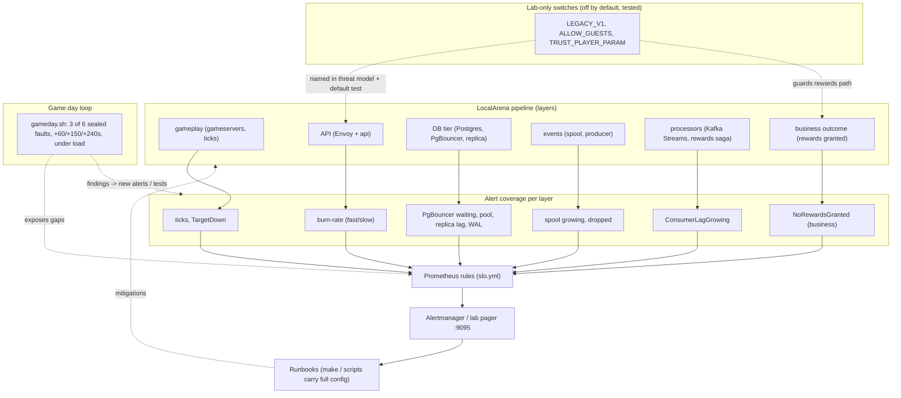
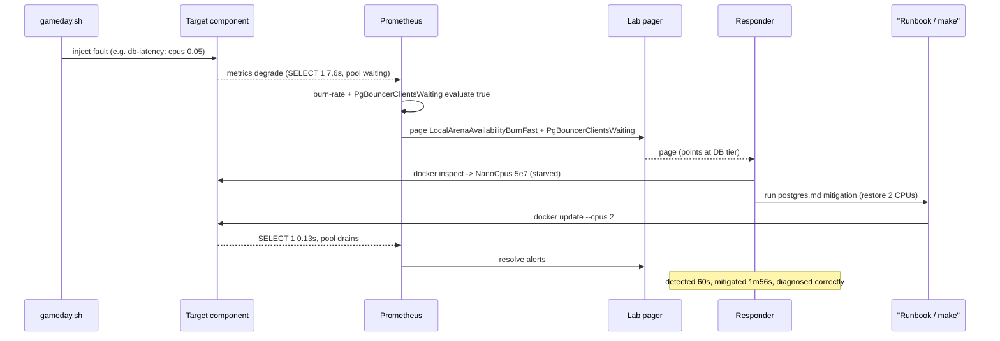
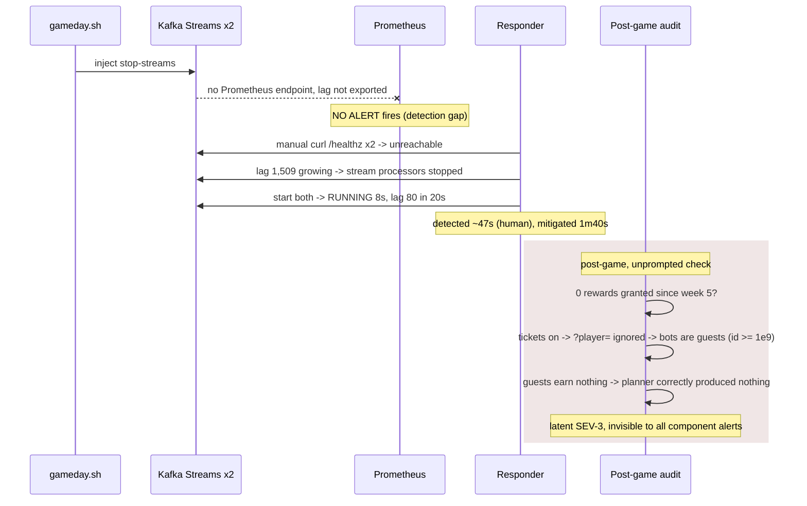
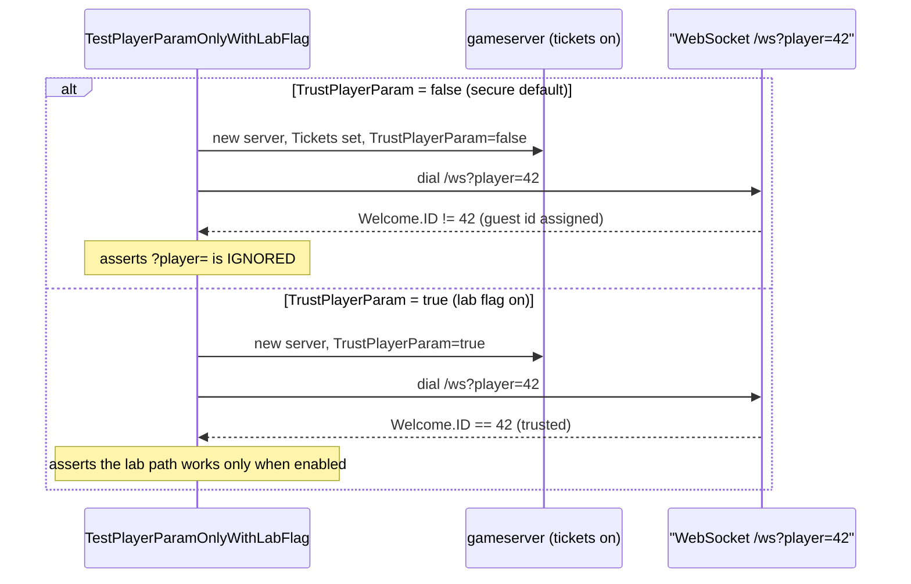

# ADR-0022 deep dive: Operational readiness: game days, alert coverage per layer, lab-only switches

> Source decision: [`../../adr/0022-game-day-operations.md`](../../adr/0022-game-day-operations.md)
> Evidence: [`../../postmortems/PM-002-final-game-day.md`](../../postmortems/PM-002-final-game-day.md), [`../../experiments/008-week8-regions/README.md`](../../experiments/008-week8-regions/README.md), [`../../experiments/008-week8-regions/gameday.sh`](../../experiments/008-week8-regions/gameday.sh), [`../../FINAL_REPORT.md`](../../FINAL_REPORT.md)

## 1. TL;DR

- **Every layer needs its own "is it working?" signal.** SLO/burn-rate alerts catch *user-facing* symptoms, but a stopped stream processor and a silent business regression (no rewards) slipped through the final game day. The fix is a **cause alert per pipeline layer** — gameplay, API, DB, events, processors, and a **business-outcome** alert — each with a runbook and a promtool test.
- **Business-outcome alerts assert the product works end to end.** `LocalArenaNoRewardsGranted` fires when gameplay events are flowing (>100 in 15 m) but zero rewards were granted — it catches "components are up but nobody gets paid," which component health alone cannot.
- **Game days are structured chaos.** `gameday.sh` draws **3 of 6** faults at random (sealed), injects them at **+60 / +150 / +240 s** under sustained load (100 bots + 80 req/s), and responders diagnose using telemetry only. All 3 were diagnosed correctly; **10,298 durable events queued = 10,298 delivered (0 lost).**
- **The dangerous bug was latent, not injected.** Since week 5, enabling game tickets disabled `?player=`, so account bots silently became guests and **no rewards had been granted for ~3 weeks**. It surfaced only because a human checked post-game. Fix: an explicit `TRUST_PLAYER_PARAM` lab flag (default off, unit-tested) plus the two new alerts; rewards flowed again (459 → 467).
- **Lab-only switches are explicit, off by default, and tested.** `LEGACY_V1`, `ALLOW_GUESTS`, `TRUST_PLAYER_PARAM` each weaken security; every one is named in the threat model and has a test asserting its default. **Mitigations come from runbooks/`make` targets** that carry full config — an ad-hoc `docker compose up` recreated a container with the wrong `ROUND_SECONDS` during the incident.

## 2. Context and problem

By week 8 LocalArena had SLOs and burn-rate alerts (ADR-0017) that reliably caught user-facing pain. The final game day (PM-002) stress-tested whether that was *enough*. It was not:

1. **A stopped stream processor produced no alert.** The Streams containers expose no Prometheus endpoint and consumer lag was not exported, so when both processors were killed, the leaderboard went stale with **no page** — a human found it by curling `/healthz`. Time to detect: ~47 s, but only because someone was looking.
2. **A three-week-old business regression was invisible.** A correct week-5 security change (game tickets disable `?player=`) silently turned account bots into guests, and guests earn nothing. So **no rewards were granted since week 5** and nothing alerted — because every *component* was healthy. "Up" ≠ "working."
3. **Recovery itself caused a regression.** `docker compose up -d gameserver` during the incident recreated the container *without* the `ROUND_SECONDS=30` env from the original start command, silently changing round length to 120 s. Ad-hoc recovery commands don't carry full configuration.

The invariant ADR-0022 protects: **for every stage in the pipeline, and for the end-to-end business outcome, there is a signal that pages before users (or auditors) notice — and every mitigation is reproducible.**

## 3. HLD

The operational model has three pillars: (a) a **cause alert per layer** feeding a lab pager, each wired to a runbook; (b) **game days** that inject sealed, overlapping faults under load; (c) **lab-only switches** that are explicit, off by default, and covered by tests. Findings from game days become new alerts or tests, closing the loop.



## 4. LLD

### 4.1 Components and responsibilities

| Component | Responsibility |
|---|---|
| [`infra/observability/rules/slo.yml`](../../infra/observability/rules/slo.yml) | The alert rules: burn-rate, `TargetDown`, `PgBouncerClientsWaiting`, `DBPoolSaturated`, `ConsumerLagGrowing`, `NoRewardsGranted`, etc. |
| [`infra/observability/rules-tests/slo_test.yml`](../../infra/observability/rules-tests/slo_test.yml) | promtool unit tests that feed synthetic series and assert each alert fires/stays silent correctly. |
| `kafka-exporter` | Exports `kafka_consumergroup_lag` so a *stopped processor* becomes visible (the PM-002 detection gap). |
| [`experiments/008-week8-regions/gameday.sh`](../../experiments/008-week8-regions/gameday.sh) | The game-day driver: load generation, sealed random fault plan, timed injection, `stop`. |
| [`runbooks/`](../../runbooks/) | Per-alert `symptom → check → mitigate → verify → follow up`; mitigations use `make`/scripts that carry full config. |
| Lab flags in [`compose.yaml`](../../compose.yaml) / [`backend/cmd/gameserver/main.go`](../../backend/cmd/gameserver/main.go) / [`backend/cmd/api/main.go`](../../backend/cmd/api/main.go) | `LEGACY_V1`, `ALLOW_GUESTS`, `TRUST_PLAYER_PARAM` with safe defaults and tests. |
| [`server_test.go` `TestPlayerParamOnlyWithLabFlag`](../../backend/internal/server/server_test.go) | Proves `?player=` is ignored unless the lab flag is set. |

### 4.2 Alert coverage per layer (the core table, from the ADR)

| Layer | Cause alert | Severity |
|---|---|---|
| gameplay | ticks (tick-budget burn), `LocalArenaTargetDown` | ticket/page |
| API | burn rates (`AvailabilityBurnFast/Slow`, `LatencyBurnFast`) | page |
| DB tier | `PgBouncerClientsWaiting`, `DBPoolSaturated`, replica lag, WAL retention | page/ticket |
| events | `EventSpoolGrowing`, `DurableEventsDropped` | ticket/page |
| processors | `LocalArenaConsumerLagGrowing` | page |
| business outcome | `LocalArenaNoRewardsGranted` | ticket |

Every alert has a `runbook_url` and a promtool test — the two mechanisms that keep extra alerts from becoming noise.

### 4.3 Data structures / exact alert expressions and config values

From [`infra/observability/rules/slo.yml`](../../infra/observability/rules/slo.yml):

- **`LocalArenaPgBouncerClientsWaiting`** (page, `for: 30s`):
  ```
  max(pgbouncer_pools_client_waiting_connections) > 5
    and max(pgbouncer_pools_server_active_connections) == 0
  ```
  Catches "paused pooler OR DB unreachable" — the cause signal that was missing in PM-001.
- **`LocalArenaConsumerLagGrowing`** (page, `for: 1m`):
  ```
  sum by (consumergroup) (kafka_consumergroup_lag{consumergroup=~"localarena-.*"}) > 500
    and sum by (consumergroup) (deriv(kafka_consumergroup_lag{consumergroup=~"localarena-.*"}[2m])) > 0
  ```
  Thresholds: lag **> 500** *and* a **positive 2-minute derivative** (growing, not just high-then-draining).
- **`LocalArenaNoRewardsGranted`** (ticket, `for: 5m`):
  ```
  sum(increase(localarena_events_total{class="durable",result="delivered"}[15m])) > 100
    and (sum(increase(localarena_rewards_outcomes_total{outcome="granted"}[15m])) or vector(0)) == 0
  ```
  Fires only when **>100 durable events** were delivered in 15 m *and* **zero** rewards granted — the `or vector(0)` guards against a missing series reading as "no data" instead of zero.
- **`LocalArenaDBPoolSaturated`** (ticket, `for: 1m`): `max(localarena_db_pool_acquired_conns / localarena_db_pool_max_conns) > 0.9`.

From [`slo_test.yml`](../../infra/observability/rules-tests/slo_test.yml): the consumer-lag test feeds `0+100x20` (lag growing by 100 every 30 s) and asserts at `eval_time: 9m` that the alert fires with summary "...lag 1800 and growing...". The PgBouncer test feeds `30` waiting / `0` active and asserts the page.

Lab flags (exact defaults) from [`compose.yaml`](../../compose.yaml):
- `ALLOW_GUESTS: ${ALLOW_GUESTS:-1}` — bots play as guests; set 0 to require game tickets.
- `TRUST_PLAYER_PARAM: ${TRUST_PLAYER_PARAM:-1}` — LAB: `-accounts` bots play as accounts without tickets; 0 for a secure stack.
- `LEGACY_V1: ${LEGACY_V1:-1}` — unauthenticated `/v1` kept for bots/k6; set 0 for a secure stack.

Note the Compose *defaults* are permissive (`1`) so experiments work, but the **code** defaults are secure: `gameserver` parses `trust-player-param` as `env("TRUST_PLAYER_PARAM","")=="1"` (false if unset), and the documented secure stack is `LEGACY_V1=0 ALLOW_GUESTS=0` (threat model). "Off by default" means the *code/flag* default is off, not the demo Compose value.

### 4.4 The game-day algorithm (`gameday.sh start`)

1. Start **100 bots** (`-accounts 2 -ramp 5s -duration 12m -churn 20s`) → account players → rewards saga.
2. Start **80 req/s** of mixed API traffic via k6 (`api-mixed.js`, `MIN_ID=2 MAX_ID=1001`).
3. Draw **3 of 6** faults with `shuf -n 3 --random-source=<(openssl rand 64)` from: `kill-broker`, `stop-streams`, `db-latency`, `bad-policy`, `kill-gameserver`, `rewards-down`.
4. Write the plan (`t+60s …`, `t+150s …`, `t+240s …`, start time) **base64-sealed** to `results/gameday-answer.sealed`.
5. A background subshell injects fault 1 at +60 s, fault 2 at +90 s later, fault 3 at +90 s after that (`+60 / +150 / +240 s`).
6. Responders use **alerts, metrics, traces, logs only**; the answer is unsealed at the end and detection/mitigation time is scored per fault.

Each fault maps to a specific failure mode and expected signal (from the `fault()` function):
- `kill-broker` → under-replicated partitions.
- `stop-streams` → leaderboard stale, lag grows (the detection gap).
- `db-latency` (`docker update --cpus 0.05`) → starved slow primary.
- `bad-policy` → every OPA decision undefined (fail closed).
- `kill-gameserver` → `restart: unless-stopped` does *not* restart after `docker kill`.
- `rewards-down` → rewards lag, credits not granted.

## 5. Sequence diagrams

### 5.1 Happy path: game-day fault detected by its layer's cause alert



### 5.2 Failure path: silent fault (stopped processor) with no alert, then the latent regression



### 5.3 Edge path: lab switch default enforced by test (what should have caught the regression earlier)



## 6. Concepts explained

### 6.1 Game days (structured chaos engineering)

**What it is.** A scheduled exercise that injects real faults into a production-like system under realistic load, while responders practice detection, diagnosis and recovery using only their normal tooling. "Sealed" plans and randomized faults keep it honest.

**Why LocalArena uses it.** To validate that alerts, dashboards and runbooks actually work *together* under pressure, and to find gaps (like the missing processor alert) before a real incident does.

**What was measured (PM-002 / Exp 008).** 3 of 6 faults, all 3 diagnosed correctly. Detection/mitigation times: gameserver killed 46 s / 1 m 16 s; DB starved 60 s / 1 m 56 s; streams stopped ~47 s (manual) / 1 m 40 s. Durable events: 10,298 queued = 10,298 delivered.

**Where else it is used.** Netflix Chaos Monkey / GameDays; AWS Fault Injection Simulator exercises; bank DR drills; "wheel of misfortune" on-call training.

### 6.2 Overlapping incidents

**What it is.** Two or more faults active at once, where symptoms blur together and a naive responder mis-attributes them (e.g. blaming the DB for a problem actually caused by a stopped processor).

**Why LocalArena uses it.** The game day injects fault 3 *while fault 2 is still active* (+150 vs +240 s overlap window) to force disciplined, per-layer attribution.

**What was measured.** PM-002: db-latency (fault 2) overlapped stop-streams (fault 3). The team separated them by checking each signal against its own layer: `TargetDown` → container state; 5xx → DB timing; `/healthz` → processors. All three were attributed correctly.

**Where else it is used.** Any real outage where a deploy + a dependency blip + an autoscaling event coincide; incident command explicitly tracks "are these one incident or three?"

### 6.3 Alert coverage per layer (cause alerts vs symptom alerts)

**What it is.** A *symptom* alert fires on user-visible pain (error rate, latency). A *cause* alert fires on the component that produces it (pool exhausted, consumer lag growing). Good coverage has a symptom alert for the SLO *and* a cause alert per layer so you can localize fast.

**Why LocalArena uses it.** SLO burn-rate alerts told the team *that* users hurt; the PgBouncer and consumer-lag cause alerts told them *where*. PM-002 showed a layer with no cause alert (processors) is effectively invisible until users or auditors notice.

**What was measured.** The PM-001 `PgBouncerClientsWaiting` alert "fired on the database fault and sped up diagnosis" (PM-002 "what went well"). Before `ConsumerLagGrowing`, the stopped processor had **no alert**.

**Where else it is used.** SRE practice generally: USE/RED metrics per service; database saturation alerts alongside API SLOs; queue-depth alerts in any message system.

### 6.4 Business-outcome alerts

**What it is.** An alert that asserts the *product* works end to end ("customers can complete checkout," "players who finish matches get credits"), not merely that components are up. It is the last line of defense against "everything is green but nothing works."

**Why LocalArena uses it.** The entire latent-rewards regression was invisible to component health; only a business-outcome assertion would catch "matches complete but nobody is rewarded." `LocalArenaNoRewardsGranted` encodes exactly that.

**What was measured.** The regression went unnoticed for ~3 weeks (since week 5) and was found by hand post-game. After the alert + fix, the ADR states regressions surface "within 15 minutes instead of three weeks." Rewards resumed: granted 459 → 467 (`rewards-fix.txt`).

**Where else it is used.** E-commerce "orders per minute dropped to zero"; payments "successful charges == 0 while traffic flows"; signups-per-hour; synthetic end-to-end canaries (login→checkout→confirm).

### 6.5 Latent regressions and the "up vs working" distinction

**What it is.** A bug introduced by a *correct-looking* change that silently breaks an outcome while every component stays healthy. It can hide for a long time because nothing is "down."

**Why LocalArena uses it as a lesson.** Week 5's security change (tickets disable `?player=`) was correct for security but silently turned account bots into guests, and guests earn nothing — so rewards stopped. No test or alert covered "matches complete but nobody is rewarded."

**What was measured.** No rewards granted since week 5 (≈3 weeks); Exp 004's numbers predate week 5 so they were unaffected (which is why the regression wasn't caught earlier). Fixed with the lab flag + alerts; granted 459 → 467.

**Where else it is used.** A feature flag flip that quietly disables a revenue path; a schema migration that drops a downstream write; a correct auth hardening that breaks a batch job's service account.

### 6.6 Lab-only switches (explicit, off by default, tested)

**What it is.** Configuration flags that deliberately weaken security or correctness for development convenience. The discipline: name them, default them to the *safe* value, document them in the threat model, and write a test asserting the safe default.

**Why LocalArena uses it.** `LEGACY_V1` (unauthenticated `/v1`), `ALLOW_GUESTS` (anonymous play with tickets on), `TRUST_PLAYER_PARAM` (accept `?player=` without a ticket) all weaken security. Making them explicit and tested prevents a convenience flag from silently becoming production behavior — and `TRUST_PLAYER_PARAM` is the controlled re-enablement of the exact path the regression disabled.

**What was measured.** `TestPlayerParamOnlyWithLabFlag` proves `?player=` is ignored when `TrustPlayerParam=false` and honored when `true`. The threat model names `LEGACY_V1=1` as reintroducing threat #1 for `/v1`, with the secure stack documented as `LEGACY_V1=0 ALLOW_GUESTS=0`.

**Where else it is used.** `DEBUG=true` / `DISABLE_AUTH` dev flags; test-mode payment keys; feature flags for risky rollouts (gated, defaulted off); "allow insecure TLS" developer toggles — all dangerous if they leak to production.

### 6.7 Runbooks and reproducible mitigations (`make` / scripts carry full config)

**What it is.** Step-by-step incident procedures (`symptom → check → mitigate → verify → follow up`) where the *mitigation commands come from version-controlled scripts/`make` targets* that carry the complete configuration, not from an operator's memory.

**Why LocalArena uses it.** During PM-002, `docker compose up -d gameserver` from memory dropped `ROUND_SECONDS=30`, silently changing round length — a mitigation that caused a second regression. Runbook/`make`-driven recovery carries the full environment.

**What was measured.** Not a latency number; the evidence is the PM-002 contributing factor #4 and ADR-0022's consequence that "ad-hoc commands recreated a container with different settings." Action item 4 ("runbook commands use `make`/scripts") is tracked **open**.

**Where else it is used.** Every mature on-call setup: runbooks linked from alerts; one-click/one-command recovery; infrastructure-as-code so recovery is a re-apply, not hand-typed flags.

### 6.8 `restart: unless-stopped` vs orchestrator restart (recovery semantics)

**What it is.** Docker's `restart: unless-stopped` restarts a container that *crashes*, but **not** one you deliberately `docker kill` — Docker treats a kill as an operator "stop." Kubernetes, by contrast, restarts the pod regardless.

**Why LocalArena notes it.** The `kill-gameserver` fault stayed down (exit 137, restart count 0) precisely because `unless-stopped` doesn't recover from a kill — which is both a realistic fault and a reason Kubernetes behaves differently.

**What was measured.** PM-002: gameserver exit 137, not OOM, restart count 0 → "killed process (`unless-stopped` does not restart after `docker kill`)"; mitigation was a manual start.

**Where else it is used.** Any Compose-vs-K8s migration gotcha; understanding why a self-healing cluster recovers but a bare Docker host doesn't; liveness-probe-driven restarts.

### 6.9 promtool-tested alerts (unit testing your alerting)

**What it is.** Feeding synthetic time series into `promtool test rules` to assert that each alert fires (and *doesn't* fire) exactly when intended, so alert logic is regression-tested like code.

**Why LocalArena uses it.** To keep a growing alert set honest and noise-free, and to lock in fixes — e.g. the week-6 false page (`1 - 0/ε` reading as 100% bad) got a promtool regression test, and the new PM-002 alerts shipped "done, promtool test."

**What was measured.** The consumer-lag test asserts firing at lag 1800 with a growing derivative; the PgBouncer test asserts the page at 30 waiting / 0 active. FINAL_REPORT week 6 row: "guard `total > 0`; promtool regression test."

**Where else it is used.** Any Prometheus/Thanos/Mimir shop; CI gates that run `promtool test rules`; alert-as-code review practices.

### 6.10 Durability under fault injection (zero event loss)

**What it is.** Proving that an asynchronous, at-least-once pipeline loses nothing even when a producer is killed — via a durable spool + idempotent producer that drains on recovery.

**Why LocalArena uses it.** The game day is also a correctness test of the event backbone (ADR-0009/0012): a gameserver kill must not drop durable events.

**What was measured.** PM-002 / Exp 008: **10,298 durable events queued = 10,298 delivered, 0 lost**; leaderboard caught up from Kafka (lag 1,509 → 80 in 20 s).

**Where else it is used.** Payment event pipelines; order/outbox patterns; any audit log that must not lose records during a crash.

## 7. Code pointers

| Path (symbol / key) | What to look at |
|---|---|
| [`experiments/008-week8-regions/gameday.sh`](../../experiments/008-week8-regions/gameday.sh) (`fault()`, sealed plan) | The 6 faults, random 3-of-6 selection (`shuf --random-source`), base64-sealed plan, +60/+150/+240 s injection. |
| [`infra/observability/rules/slo.yml`](../../infra/observability/rules/slo.yml) (`LocalArenaConsumerLagGrowing`, `LocalArenaNoRewardsGranted`, `LocalArenaPgBouncerClientsWaiting`) | Exact alert expressions and thresholds (lag>500 + growing; >100 events & 0 rewards; waiting>5 & 0 active). |
| [`infra/observability/rules-tests/slo_test.yml`](../../infra/observability/rules-tests/slo_test.yml) | promtool tests feeding synthetic series (`0+100x20`, `30x10`) and asserting firing. |
| [`backend/cmd/gameserver/main.go`](../../backend/cmd/gameserver/main.go) (`trustPID`, `guests`, `roundSecs`) | Secure code defaults: `TRUST_PLAYER_PARAM` false unless `=="1"`; `ALLOW_GUESTS`; `-round-seconds` default 120 (the PM-002 side-effect). |
| [`backend/cmd/api/main.go`](../../backend/cmd/api/main.go) (`LegacyV1`) | `LEGACY_V1` parsing; logged at startup. |
| [`backend/internal/server/server_test.go`](../../backend/internal/server/server_test.go) (`TestPlayerParamOnlyWithLabFlag`) | Asserts `?player=` ignored unless the lab flag is on (both branches). |
| [`compose.yaml`](../../compose.yaml) (`ALLOW_GUESTS`, `TRUST_PLAYER_PARAM`, `LEGACY_V1` defaults) | The permissive *demo* defaults (`:-1`) with inline comments pointing to the secure stack. |
| [`runbooks/README.md`](../../runbooks/README.md) + [`runbooks/event-pipeline.md`](../../runbooks/event-pipeline.md) | Alert→runbook mapping; the event-pipeline runbook's `ConsumerLagGrowing` and `NoRewardsGranted` steps (guest-id check). |
| [`postmortems/PM-002-final-game-day.md`](../../postmortems/PM-002-final-game-day.md) | Timeline, root causes, and action-item status table. |
| [`experiments/008-week8-regions/results/gameday-pager.txt`](../../experiments/008-week8-regions/results/gameday-pager.txt) | The actual alert firing/resolving timeline during the game day. |

## 8. Trade-offs and alternatives

| Option | Pros | Cons | Why (not) chosen |
|---|---|---|---|
| **Cause alert per layer + one business-outcome alert (chosen)** | Fast localization; catches "up but not working"; each alert tested | More alerts to maintain; risk of noise | Chosen: PM-002 proved symptom-only coverage misses silent layers; promtool tests + severities control noise |
| SLO/burn-rate alerts only | Few, high-signal, user-focused | Can't localize; silent-component and business regressions invisible | Insufficient: missed the stopped processor and the rewards regression |
| Alert on *every* metric threshold | Maximum coverage | Alert fatigue; pages lose meaning | Rejected: noise defeats the purpose; prefer per-layer cause + business outcome |
| **Randomized, sealed game-day faults (chosen)** | Honest test of detection/diagnosis; finds gaps | Needs sustained load + tooling; disruptive | Chosen: the only way to validate the whole on-call loop |
| Scripted, announced fault drills | Easy to schedule; low risk | Responders know the answer; doesn't test diagnosis | Weaker: used for onboarding, not the real exercise |
| **Lab flags explicit, off by default, tested (chosen)** | Convenience without silent insecurity; regression-proof | Extra flags, tests, threat-model entries | Chosen: directly prevents the class of bug PM-002 found |
| Build-time removal of insecure paths | No risk of a flag leaking | Can't reproduce old experiments; two builds to maintain | Not chosen for the lab; the secure *stack* (`LEGACY_V1=0 ALLOW_GUESTS=0`) is the production posture |
| Ad-hoc recovery commands | Fast to type | Drop config silently (the `ROUND_SECONDS` bug) | Rejected: mitigations must come from `make`/runbooks (action item 4) |

## 9. Failure modes and how they were found

| Failure mode | How found | Evidence |
|---|---|---|
| Stopped stream processors produce no alert | Final game day; found by a human curling `/healthz` | [`PM-002`](../../postmortems/PM-002-final-game-day.md) (root cause #2); fixed by `ConsumerLagGrowing` |
| No rewards granted for ~3 weeks (latent) | Post-game audit, unprompted | [`PM-002`](../../postmortems/PM-002-final-game-day.md) (root cause #3); [`rewards-fix.txt`](../../experiments/008-week8-regions/results/rewards-fix.txt) (459→467) |
| Recovery dropped `ROUND_SECONDS` (mitigation side-effect) | Noticed rounds changed to 120 s after `docker compose up` | [`PM-002`](../../postmortems/PM-002-final-game-day.md) (contributing factor #4) |
| `restart: unless-stopped` doesn't recover from a kill | `kill-gameserver` fault stayed down (exit 137, restart count 0) | [`PM-002`](../../postmortems/PM-002-final-game-day.md) (contributing factor #5); [`gameday.sh` `fault()`](../../experiments/008-week8-regions/gameday.sh) |
| DB starvation diagnosed via the PM-001 cause alert | `db-latency` fault during the game day | [`PM-002`](../../postmortems/PM-002-final-game-day.md); [`PM-001-pgbouncer-paused.md`](../../postmortems/PM-001-pgbouncer-paused.md); [`gameday-pager.txt`](../../experiments/008-week8-regions/results/gameday-pager.txt) |
| Earlier false page (`1 - 0/ε`) with no games running | Week 6 | [`FINAL_REPORT.md`](../../FINAL_REPORT.md) week 6 row (fixed + promtool test) |

Open follow-ups from PM-002: action 4 (runbook/`make` mitigations), action 5 (region-aware client reconnect; see [ADR-0021](ADR-0021-multi-region.md)), action 6 (CI end-to-end "a reward is granted after a match").

## 10. Interview questions

**1. (Beginner) What's the difference between a symptom alert and a cause alert?**
A symptom alert fires on user-visible pain (error rate, latency burn). A cause alert fires on the component producing it (pool exhausted, consumer lag growing). You want the symptom alert for the SLO *and* a cause alert per layer so you can localize quickly. PM-002 showed a layer with no cause alert (stream processors) is effectively invisible.

**2. (Beginner) What is a business-outcome alert and why did LocalArena need one?**
It asserts the product works end to end, not just that components are up. LocalArena needed `LocalArenaNoRewardsGranted` because every component was healthy while, silently, no player had been rewarded for ~3 weeks. Component health can't catch "up but not working."

**3. (Beginner) Describe a game day.**
Inject real faults into a production-like system under realistic load and have responders detect, diagnose, and recover using only normal tooling. `gameday.sh` draws 3 of 6 faults at random, seals the answer, injects them at +60/+150/+240 s under 100 bots + 80 req/s, and scores detection/mitigation time per fault.

**4. (Intermediate) The `LocalArenaNoRewardsGranted` expression uses `or vector(0)`. Why?**
If the `rewards_outcomes_total{outcome="granted"}` series is entirely absent (never incremented), `increase(...)` returns *no data*, which would make the `== 0` comparison never match and the alert never fire — the exact blind spot we're trying to close. `or vector(0)` substitutes 0 for a missing series so "no series at all" is correctly treated as "zero rewards."

**5. (Intermediate) Why does `LocalArenaConsumerLagGrowing` require both a threshold and a positive derivative?**
`lag > 500` alone would page during normal catch-up after a deploy or restart (high but shrinking). Adding `deriv(...[2m]) > 0` means "high *and* still growing," which indicates a stuck or dead processor rather than transient backlog — fewer false pages.

**6. (Intermediate) Explain the latent rewards regression end to end.**
Week 5 correctly made the gameserver ignore `?player=` when `GAME_TICKET_SECRET` is set. Compose sets that secret, so account bots started with `-accounts` silently joined as guests (ids ≥ 1e9). Guests earn no rewards, so the reward planner correctly produced nothing. No test or alert covered "matches complete but nobody is rewarded," so it hid for ~3 weeks until a post-game audit found it.

**7. (Intermediate) How do you add a dangerous convenience flag safely?**
Name it, default it to the *safe* value in code, document it in the threat model, and write a test asserting the safe default. `TRUST_PLAYER_PARAM` defaults to false in the gameserver (`env(...)=="1"`), and `TestPlayerParamOnlyWithLabFlag` proves `?player=` is ignored unless it's on. The permissive value lives only in the demo Compose file with a comment pointing at the secure stack.

**8. (Intermediate) Why did `docker kill` of the gameserver not auto-recover, and why would Kubernetes differ?**
`restart: unless-stopped` restarts crashes but treats `docker kill` as an operator stop, so it stayed down (exit 137, restart count 0). Kubernetes restarts the pod regardless (it reconciles desired state and uses liveness probes), so the same fault would self-heal there.

**9. (Senior) Overlapping faults blur symptoms. How did the team avoid mis-attribution?**
By checking each signal against its own layer rather than pattern-matching on the top-level symptom: `TargetDown` → inspect container state; 5xx + latency burn → DB timing (`SELECT 1`, PgBouncer waiting, `NanoCpus`); `/healthz` unreachable + growing lag → processors. That discipline correctly separated db-latency (fault 2) from the overlapping stop-streams (fault 3).

**10. (Senior) Why must mitigations come from `make`/runbooks and not memory?**
Because ad-hoc commands drop context. During PM-002, `docker compose up -d gameserver` recreated the container without `ROUND_SECONDS=30`, silently changing round length — a mitigation that introduced a new regression. A `make` target or script carries the full environment, so recovery is deterministic. (Tracked as PM-002 action 4, still open.)

**11. (Senior) How do you prevent a growing alert set from becoming noise?**
Every alert gets (a) a `for:` duration so transients don't page, (b) a severity split (page vs ticket) so only genuine user/business impact pages, (c) a `runbook_url` so a page is actionable, and (d) a promtool test asserting it fires and stays silent correctly. The week-6 false page was fixed and locked with a promtool regression test.

**12. (Senior, design) Design the minimum alert set to guarantee "up but not working" can't hide for LocalArena.**
One SLO burn-rate alert per user journey (login, matchmaking, tick budget), one cause alert per layer (ticks, API burn, DB pool/PgBouncer/replica lag, event spool, consumer lag), and at least one business-outcome alert per revenue/progression path (`NoRewardsGranted`, and e.g. `NoPurchasesCompleted`). Back each with a runbook and a promtool test. Add a synthetic end-to-end canary that plays a real match and asserts a credit lands — the direct check the latent regression lacked.

**13. (Senior, design / 100x scale) How does the game-day and alerting model change at 100x traffic and many regions?**
Alerts must be *per region* and aggregated, with multi-window multi-burn-rate SLOs to avoid flapping at scale; cause alerts need cardinality control (aggregate by service, not by pod). Game days become continuous, automated fault injection (FIS-style) with blast-radius limits and automatic abort on SLO breach, run per region and cross-region (partition drills). Business-outcome alerts move to statistical anomaly detection ("rewards/min dropped X% vs baseline") because a hard `== 0` is too coarse when some regions always have volume. Runbooks become fully automated remediations (operators/controllers) with humans supervising. Add deploy-correlation so a regression is tied to the change that caused it within minutes, not weeks.

**14. (Intermediate) What proved the event pipeline lost nothing during the game day?**
Under a gameserver kill, 10,298 durable events were queued and 10,298 delivered — zero loss — thanks to the durable spool + idempotent producer (ADR-0009/0012). The leaderboard also recovered from Kafka (lag 1,509 → 80 in 20 s), showing the processor rebuilt state from committed offsets/changelogs.

**15. (Senior) A correct security change caused a silent outcome regression. How do you institutionalize catching this class of bug?**
Three layers: (a) a business-outcome alert that asserts the outcome directly (`NoRewardsGranted`); (b) an end-to-end CI check that plays a match and verifies a reward is granted (PM-002 action 6); (c) deploy hygiene — every change that alters an auth/identity path gets a "what downstream outcome depends on this?" review item, and lab flags that re-enable the old path are explicit and tested. Together they turn a three-week blind spot into a 15-minute page.
