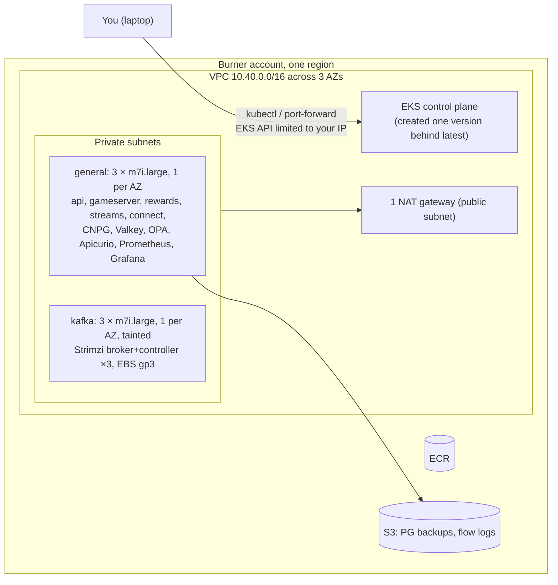

# LocalArena on AWS: one-week plan (burner account)

Repo: https://github.com/SanidhyaMadheshia/localArena

## 1. Constraints and approach

The AWS account lasts at most 7 days and then disappears with everything in
it: Tofu state, ECR images, S3 backups, logs and billing history.

That changes the plan in three ways:

1. **Do everything that isn't AWS-specific before the account starts, on `kind`.**
   Strimzi, Kafka TLS/SCRAM, the client code changes, and the new manifests all
   work on `kind`. Debugging them on AWS wastes paid days you can't get back.
2. **Use the 7 days only for what needs AWS:** EKS, VPC, AZs, EBS, Pod Identity,
   S3, cross-AZ traffic and cost, EKS upgrades, and optionally MSK.
3. **Treat the account as disposable.** Everything comes from git. Commit
   results every day, because nothing in the account survives.

Out of scope for the week: the public URL, game-server allocation and Agones,
Keycloak, multi-region, and RDS/ElastiCache. None of them needs AWS to learn,
or they need more time than a week allows. Section 6 lists them.

## 2. Target architecture for the week

Nothing is public. You reach every UI and service with `kubectl port-forward`.

## 3. Before the account starts (on your laptop, no AWS cost)

Take as long as you need. The week only goes well if every item here works on
`kind` first.

### 3.1 Kubernetes manifests, tested on `kind`

- **Fake zones on `kind`:** a `kind` cluster with 3 workers labeled
  `topology.kubernetes.io/zone=a|b|c`, so rack awareness behaves the same as on EKS.
- **Strimzi Kafka** (`infra/kafka/`):
  - `Kafka` + `KafkaNodePool` with 3 combined controller/broker nodes and
    `rack.topologyKey: topology.kubernetes.io/zone`.
  - `default.replication.factor: 3`, `min.insync.replicas: 2`, and
    `replica.selector.class: org.apache.kafka.common.replica.RackAwareReplicaSelector`.
  - Make the storage class, node affinity and tolerations values you can
    override, so the same files work on EKS.
- **Listener and users:** a TLS listener on 9093 with `scram-sha-512` and
  `authorization: simple`, plus one `KafkaUser` per service with ACLs.
  Streams also needs `TransactionalId` and `IdempotentWrite` for `EXACTLY_ONCE_V2`.
- **Topics:** `KafkaTopic` CRs converted from `scripts/kafka-topics.sh`, all 13 topics.
- **Event processing:** a Streams StatefulSet (state PVC, `num.standby.replicas=1`),
  a rewards Deployment, Strimzi `KafkaConnect` (`build:` with the Debezium plugin)
  with a `KafkaConnector` converted from `connect/outbox-connector.json`, and
  Apicurio Registry.
- **Postgres:** CNPG with `wal_level=logical` and HA replication slots. Point
  Debezium at the `-rw` service, not PgBouncer.
- **Secrets:** copy the Kafka user secrets and the cluster CA from `data` into
  `localarena`, with External Secrets Operator or a small script. The Strimzi
  User Operator only writes secrets into its own namespace.
- **Monitoring:** kube-prometheus-stack, with `infra/observability/rules/slo.yml`
  converted to a `PrometheusRule` plus Strimzi and CNPG monitors. You need this
  from day 2 to measure the drills.

### 3.2 Code changes, tested on `kind` and Compose

- **Go:** a new `backend/internal/kafkaconf` package. It reads
  `KAFKA_SECURITY_PROTOCOL`, `KAFKA_SASL_MECHANISM`, `KAFKA_USERNAME`,
  `KAFKA_PASSWORD` and `KAFKA_CA_FILE` and returns `[]kgo.Opt` (TLS plus
  SCRAM-SHA-512). Use it at every `kgo.NewClient` call
  (`grep -rn 'kgo.NewClient' backend/`). With no variables set, behavior stays
  as today, so Compose keeps working. Check the franz-go option names against
  the version in `go.mod`.
- **Java:** in `streams/.../Main.java`, map the same variables to
  `security.protocol`, `sasl.mechanism`, `sasl.jaas.config` and a PEM truststore.
- **Helm:** a `kafka.auth` block in the values with secret mounts, and
  `EVENT_SPOOL_DIR` on a volume for the gameserver.
- Run the existing Go, Streams and OPA tests, plus `experiments/004` on Compose,
  to confirm nothing regressed.

### 3.3 AWS code, written now and applied on day 1

- `infra/aws/10-network/`:
  - VPC with 3 public and 3 private subnets.
  - 1 NAT gateway and an S3 gateway endpoint.
  - Subnet tags for load balancers.
- `infra/aws/20-eks/`:
  - EKS **one minor version behind the newest**, so you can upgrade it on day 6.
  - Access entries, with the endpoint limited to your IP.
  - Add-ons: VPC CNI, CoreDNS, kube-proxy, Pod Identity Agent, EBS CSI driver.
  - `general` and `kafka` node groups, with IMDSv2 required and hop limit 1.
  - A `gp3` StorageClass (encrypted, `WaitForFirstConsumer`, expandable,
    `Retain`) set as the default.
- `infra/opentofu`: make `kube_context` a variable and drop
  `--kubelet-insecure-tls` on EKS.
- **Tofu state:** keep it local and gitignored. A state bucket isn't worth it
  for one week.
- `infra/helm/localarena/values-eks.yaml`: ECR image repositories, CNPG with 3
  instances, zone spread.
- **Scripts:**
  - `scripts/aws-up.sh`: network → EKS → platform → app, with one command.
  - `scripts/aws-teardown.sh`: delete `LoadBalancer` Services, then
    `tofu destroy`, then list leftover EBS volumes, load balancers and ENIs.
  - `scripts/drills/*.sh`: one script per drill, printing results into
    `experiments/0NN/results/`. Writing these now saves hours during the week.
- Run `tofu validate` on both stacks.

**Ready when:** `make k8s-up`, run against the 3-zone `kind` cluster, brings up
the whole stack with Kafka over TLS, and Debezium, Streams and rewards all
process events from bots.

**Secrets warning:** don't re-encrypt `config/secrets.dev.enc.yaml` with a KMS
key from the burner account. When the account is deleted, you can no longer
decrypt it. Keep age and create the Kubernetes Secrets from `sops -d`.

## 4. The week

Each day ends with `git commit` of the results and notes.

### Day 1: Account check, network and EKS

- **Check the account limits first.** Burner accounts often restrict regions,
  services, instance types or spending. Check:
  - allowed regions;
  - whether EKS, EC2 `m7i`, NAT gateways, VPC Flow Logs and (for day 6) MSK are allowed;
  - the EC2 on-demand vCPU quota (this plan needs 12 vCPU, plus 2 for day 4);
  - the spending cap.
- Set up an AWS Budget alert at your limit, and MFA if you can.
- `scripts/aws-up.sh` for network and EKS (about 20 minutes).
- **Drills** (`experiments/009-eks-foundation/`):
  1. One node per AZ: `kubectl get nodes -L topology.kubernetes.io/zone`.
  2. Create a PVC and pod, then cordon its node. The pod stays `Pending` unless
     another node is in the same AZ, because EBS volumes can't move between AZs.
  3. Terminate a node's EC2 instance and time the replacement.
  4. From another network, confirm `kubectl` can't reach the cluster API.

### Day 2: App and monitoring on EKS

- Create ECR repositories and push `api`, `gameserver`, `bots` and `streams`
  from your laptop with `docker buildx --platform linux/amd64`. Setting up CI
  with OIDC isn't worth it for a week.
- Install platform add-ons (CNPG, metrics-server, kube-prometheus-stack), then
  the chart with `values-eks.yaml`, without Kafka yet.
- Run bots as a Kubernetes Job inside the cluster, not through a port-forward
  from your laptop.
- **Drills** (`experiments/010-app-on-eks/`):
  1. Delete the CNPG primary and measure failover time across AZs. Compare
     with `experiments/002`.
  2. Rolling update and rollback (`drills-007`) on EKS, compared with `kind`.
  3. Tick-budget p99 at 200 bots, compared with your laptop (`experiments/001`).

### Day 3: Strimzi Kafka and the first failure drills

- Apply `infra/kafka/` with the `kafka` node group affinity and `gp3`. Switch
  gameserver, api and rewards to `localarena-kafka-bootstrap.data.svc:9093` over
  TLS with SCRAM.
- **Drills** (`experiments/011-kafka-on-eks/`), each with bots producing:
  1. **Delete a broker pod.** It returns with the same PVC and node ID. Measure
     produce errors, spool growth, ISR shrink and expand, and leader moves.
  2. **Terminate a broker's EC2 instance.** The pod can only start on a new node
     in the same AZ. Time it.
  3. **Isolate one AZ** with a network ACL that denies all traffic on that AZ's
     private subnet. The ISR drops to 2 and writes continue. Remove the rule.
  4. **Isolate a second AZ.** Producers get `NOT_ENOUGH_REPLICAS` and the
     gameserver spool absorbs events. Restore both, then check for lost or
     duplicated events with `eventcat`.

### Day 4: More Kafka drills and security

- **Drills** (continue `experiments/011`):
  5. **Fill the disk** on a small volume, then raise the PVC size in the
     `KafkaNodePool` and watch the gp3 volume grow online.
  6. **Rolling config change or upgrade** under load. Measure p99 produce latency.
  7. **Add a 4th broker** (temporary node) and run a `KafkaRebalance` with
     Cruise Control.
  8. **Measure cross-AZ traffic** with VPC Flow Logs to S3 before and after
     setting `client.rack` on consumers. This is the AWS cost lesson for Kafka.
- **Security** (`experiments/012-kafka-security/`):
  1. Wrong password: the client fails fast with a clear error.
  2. Remove one ACL: only that service breaks.
  3. Trigger Strimzi cluster CA renewal. Do your Go and Java clients survive or
     need a restart? Write down the answer.
  4. `openssl s_client` works on 9093 and 9092 is closed.

### Day 5: Streams, CDC, rewards and backups

- Apply Apicurio (run `scripts/register-schemas.sh` as a Job), Streams, Connect
  with Debezium, and the rewards worker. The Connect build pushes its image to
  ECR through Pod Identity.
- Point CNPG backups at an S3 bucket using a Pod Identity role limited to that bucket.
- **Drills** (`experiments/013-streams-cdc-on-eks/`):
  1. Fail over the Postgres primary to another AZ during purchases. Does
     Debezium resume with no lost or duplicated outbox events?
  2. Kill a Streams pod, then drain a Streams node. Compare recovery time with
     and without the standby replica.
  3. Restore Postgres from S3 into a new cluster and compare row counts.

### Day 6: EKS upgrade, then optionally MSK

- **Morning, EKS upgrade under load** (`experiments/014-eks-upgrade/`): upgrade
  the control plane, then add-ons, then each node group in turn. PodDisruptionBudgets
  should keep at most one broker and one CNPG instance down at a time. Record
  every disruption.
- **Afternoon, optional MSK comparison** (`experiments/015-msk/`):
  - Start creating a 3-broker MSK Provisioned cluster with SCRAM early. It
    takes 20–40 minutes.
  - Point a copy of the app at MSK. Your `kafkaconf` SCRAM code should work unchanged.
  - Run reboot-broker drills and compare: failover time, steps you no longer do,
    settings you can't change, and cost per hour.
  - Delete MSK the same day.

### Day 7: Collect results and tear down

- Export the numbers you need from Grafana and Prometheus into `experiments/`
  before teardown. Screenshots are fine.
- Record actual cost from Billing or Cost Explorer. Cost Explorer can lag by
  about 24 hours, so this is the last useful day to check.
- Write ADRs from what you measured:
  - `adr/0023-eks-network-and-access.md`
  - `adr/0024-kafka-on-strimzi.md`
  - `adr/0025-kafka-security.md`
  - `adr/0026-self-managed-vs-msk.md`
- Run `scripts/aws-teardown.sh` and confirm nothing is left: no EBS volumes,
  load balancers, NAT gateway or Elastic IPs. This matters even on a burner
  account if someone pays its bill.
- Final commit.

**If you fall behind:** drop day 6's MSK work first, then the day 4 Cruise
Control drill, then day 5's Streams drills. Keep days 1–4. They are the
AWS-specific lessons.

## 5. Cost for the week

These are rough on-demand prices for `us-east-1`. Check the AWS Pricing
Calculator for your region.

| Item | Per hour | 7 days, always on |
|---|---|---|
| EKS control plane | $0.10 | ≈ $17 |
| 6 × m7i.large | ≈ $0.60 | ≈ $100 |
| NAT gateway (plus $0.045 per GB) | ≈ $0.045 | ≈ $8 plus data |
| EBS gp3, about 150 GB | — | ≈ $3 |
| Flow Logs, S3, cross-AZ transfer | — | a few dollars |
| MSK, about 4 hours (day 6) | ≈ $0.6–0.7 | ≈ $3 |
| **Total** | | **≈ $130–150** |

To spend less, scale both node groups to 0 overnight. EBS volumes and the
control plane stay, so Kafka and Postgres data survive. This saves roughly $40.
It is also a drill in itself: does everything come back correctly in the morning?

## 6. Left out of the week (do later on `kind` or another account)

| Item | Why it can wait |
|---|---|
| Game-server allocation (registry in Valkey, `server_id` routing, KEDA vs Agones) | Not AWS-specific. `kind` is enough to learn it |
| Keycloak and OPA on Kubernetes | Not AWS-specific. Already covered in Compose |
| Default-deny NetworkPolicies | Same policy rules on `kind`. Only the enforcement engine differs |
| Loki and Tempo on S3 | Small AWS lesson. Prometheus and Grafana cover the drills |
| GitHub Actions to ECR through OIDC | Setup cost too high for a week-long account |
| Public URL (ALB, ACM, WAF, routing fix in `web/src/config.ts`) | Needs a domain and a security review. Not worth it on an account that expires |
| RDS, ElastiCache, second region | Not enough time |

## 7. Risks

- **Account limits** (regions, vCPU quota, service restrictions) could block
  day 1. Check them in the first hour, and pick smaller instances if you need to.
- **Unfinished prep work** turns paid days into debugging days. Don't start
  the account until section 3's "Ready when" check passes.
- **Lost data:** anything not committed by day 7 is gone. Commit every day.
- **Forgotten resources:** if the account is billed to you, check the teardown
  report before the account closes.
